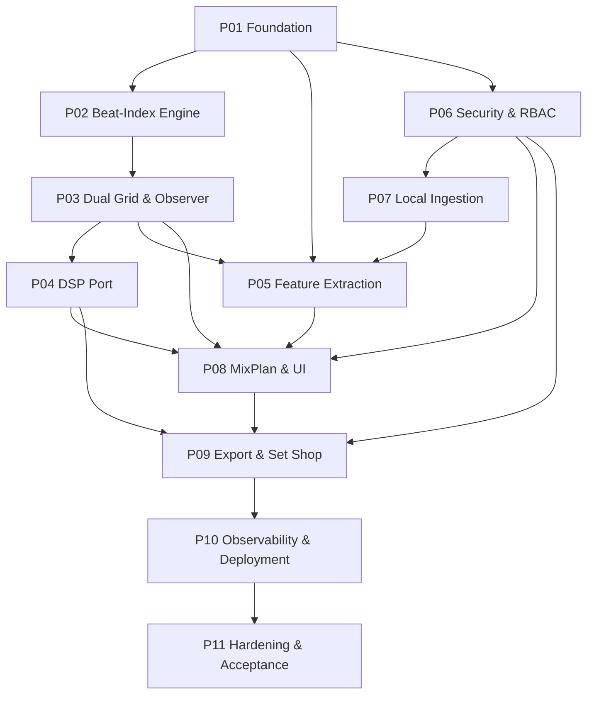
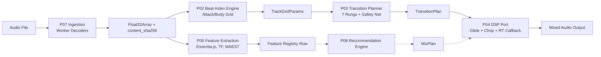

# System Map

## Phase Dependency Graph

The 11 phases form a directed acyclic graph. Arrows mean "must complete before."



**Why this order?** Security (P06) is placed *before* Ingestion (P07), MixPlan/UI (P08), and Export (P09) because those phases expose scope-gated endpoints. Building them against real tokens, scopes, tier grants, and RLS from day one avoids retrofitting.

## End-to-End Data Flow



## The Public Surface of `core`

`packages/core/src/index.ts` (37 lines) is the **single public export barrel** for the entire engine. It re-exports every module in dependency order:

```typescript
export * from './constants/timing';
export * from './constants/grid';
export * from './constants/scoring';
export * from './types/bpm';
export * from './types/camelot';
export * from './types/beat-index';
export * from './grid/t-of-i';
export * from './grid/period';
export * from './grid/anchor-sync';
export * from './timing/structure';
export * from './timing/quantum';
export * from './timing/clock';
export * from './timing/scheduler';
export * from './anchor/pearson';
export * from './anchor/classify';
export * from './anchor/realign';
export * from './anchor/fallback';
export * from './grid/model';
export * from './grid/prekick-short';
export * from './grid/prekick-map';
export * from './grid/attack';
export * from './grid/body';
export * from './grid/phase-offset';
export * from './grid/dual-grid';
export * from './grid/realign-trigger';
export * from './grid/realign-cosine';
export * from './observer/realign-log';
export * from './observer/drift';
export * from './observer/scale';
export * from './observer/degrade';
export * from './groove';
export * from './transition';
export * from './resilience/retry';
export * from './resilience/degraded';
export * from './telemetry/logger';
export * from './telemetry/propagation';
export * from './glide/target';
```

No consumer imports from deep paths. This barrel is the contract.

## Three Universal Invariants

1. **Beat-First** — All time is beat time. Wall-clock seconds exist only at the `t(i)` boundary and in the RT callback's `currentTime` parameter.
2. **Never-Throws (Safety Net Always Returns)** — `planTransition()` at `packages/core/src/transition/planner.ts:57` wraps its entire logic in `try/catch` and falls back to `planSafetyNetCrossfade()` (line 41) which **never throws** and **always returns a valid plan** for any input, including `NaN` BPM, negative `T0`, zero/negative duration.
3. **Zero-RAM in the Hot Path** — Functions marked `// @structural` (`timing/structure.ts`, `timing/quantum.ts`, `grid/realign-trigger.ts`, `observer/realign-log.ts`, `observer/scale.ts`, `observer/degrade.ts`) are pure O(1) arithmetic with **zero allocation**. The AudioWorklet in P04 pre-allocates all buffers at preparation time and performs no allocation in `process()`.

## How to Read the Rest of This Book

- **CH0 (Introduction)** — You are here. The pitch, the problem, the insight, the phase tour.
- **CH1 (System Map)** — This page. Dependency graph, data flow, public surface, invariants.
- **P01–P11 (Phase Chapters)** — Each phase has a narrative README (~200–500 words) followed by a complete task table extracted from the authoritative plan. Click any task ID to see its full detail: description, expected outcome, prerequisites, test specification, spec reference, review checkpoint, notes, and resolved `file:line` links to source symbols.
- **Search** — Type `/` to focus the search box. Search works across task descriptions, constant names, source symbols, and narrative text. Results show breadcrumbs (Phase → Task → Field).
- **Theme** — Top-right toggle switches dark/light. Preference persists in `localStorage`.
- **Code Links** — Any `file:line` reference (e.g., `packages/core/src/constants/grid.ts:99`) is a `vscode://` link. Click to open in VS Code.

## Castle & Moat Isolation Boundary (P05 Addendum)

The P05 Addendum introduces a hard isolation boundary between the core engine and analysis workers. No worker is ever imported or executed directly by @otomix/core. All communication crosses the Engine API Contract boundary.

``mermaid
graph LR
    C[Core<br/>@otomix/core] -->|Engine API Request<br/>pcm_buffer, sample_rate,<br>channels, length| E[Engine API Contract<br/>packages/contracts/src/engine-api.ts<br/>Ajv JSON schema validation]
    E -->|Validated Request| W[Isolated Worker<br/>Worker Thread<br/>packages/workers/src/engine-isolated.ts]
    W -->|Engine API Response<br/>{status, features}| E
    E -->|Validated Response| C
    C -->|contentSha256 + features| GC[Global Cache<br/>packages/core/src/repository/global-features.ts<br/>JSONB raw_analysis_data]
    GC -->|tenant-scoped write| TS[Tenant Feature Store<br/>per-tenant feature projection]
``r

**Flow summary**:
1. Core resolves the worker from WorkerRegistry (metadata only, no execution).
2. Core builds an EngineAnalysisRequest and validates it against the Engine API schema.
3. Isolated Worker receives the validated request, runs Essentia/TF/MAEST, and returns an EngineAnalysisResponse.
4. Core persists to the Global Cache first, then to the Tenant Feature Store.
5. The worker never touches core state; the core never touches worker internals. The contract is the moat.

Rule 26 applies at this boundary: sample_rate (Hz) and length (samples) are BOUNDARY_IO values. No beat-to-seconds conversion occurs inside the worker.

