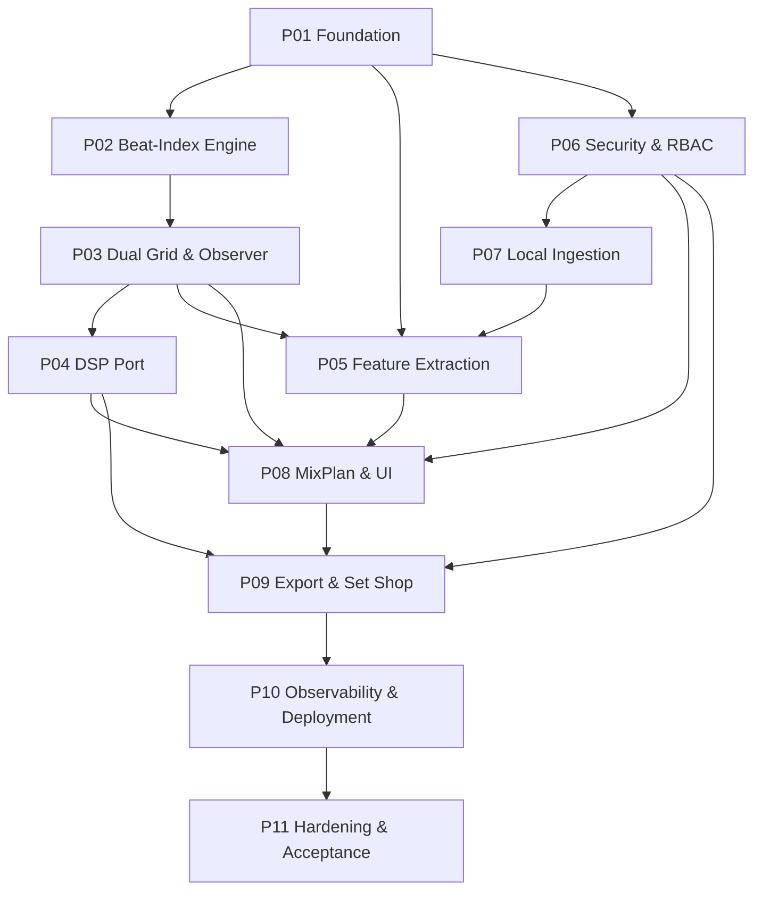
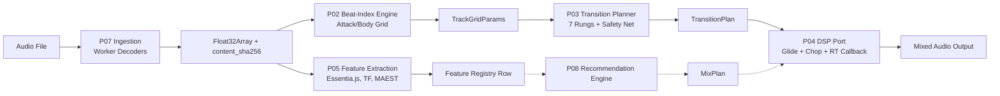

# نقشه سیستم

## نمودار وابستگی فاز

11 فاز یک نمودار غیر چرخه ای جهت دار را تشکیل می دهند. فلش ها به معنای «قبل از آن باید تکمیل شود».



**چرا این سفارش؟** امنیت (P06) *قبل* از ورود (P07)، MixPlan/UI (P08) و Export (P09) قرار می‌گیرد، زیرا این فازها نقاط پایانی دارای محدوده را نشان می‌دهند. ساختن آن‌ها در برابر توکن‌های واقعی، دامنه‌ها، کمک‌های مالی سطح و RLS از روز اول، از مقاوم‌سازی جلوگیری می‌کند.

## جریان داده سرتاسر



## سطح عمومی «هسته».

«packages/core/src/index.ts» (37 خط) **بشکه صادرات عمومی واحد** برای کل موتور است. هر ماژول را به ترتیب وابستگی دوباره صادر می کند:

```typescript
export * from './constants/timing';
export * from './constants/grid';
export * from './constants/scoring';
export * from './types/bpm';
export * from './types/camelot';
export * from './types/beat-index';
export * from './grid/t-of-i';
export * from './grid/period';
export * from './grid/anchor-sync';
export * from './timing/structure';
export * from './timing/quantum';
export * from './timing/clock';
export * from './timing/scheduler';
export * from './anchor/pearson';
export * from './anchor/classify';
export * from './anchor/realign';
export * from './anchor/fallback';
export * from './grid/model';
export * from './grid/prekick-short';
export * from './grid/prekick-map';
export * from './grid/attack';
export * from './grid/body';
export * from './grid/phase-offset';
export * from './grid/dual-grid';
export * from './grid/realign-trigger';
export * from './grid/realign-cosine';
export * from './observer/realign-log';
export * from './observer/drift';
export * from './observer/scale';
export * from './observer/degrade';
export * from './groove';
export * from './transition';
export * from './resilience/retry';
export * from './resilience/degraded';
export * from './telemetry/logger';
export * from './telemetry/propagation';
export * from './glide/target';
```

بدون واردات مصرف کننده از مسیرهای عمیق. این بشکه قرارداد است.

## سه متغیر جهانی

1. **بیت-اول** - همه زمان ها زمان ضرب است. ثانیه های ساعت دیواری فقط در مرز "t(i)" و در پارامتر "currentTime" پاسخ تماس RT وجود دارد.
2. ** هرگز پرتاب نمی‌شود (شبکه ایمنی همیشه برمی‌گردد)** — «planTransition()» در «packages/core/src/transition/planner.ts:57» کل منطق خود را در «try/catch» می‌پیچد و به «planSafetyNetCrossfade()» می‌رود **** (خط 41 معتبر است)** هر ورودی، از جمله «NaN» BPM، منفی «T0»، صفر/مدت منفی.
3. **Zero-RAM در Hot Path** — توابع با علامت "// @structural" ("timing/structure.ts"، "timing/quantum.ts"، "grid/realign-trigger.ts"، "observer/realign-log.ts"، "observer/scale.ts"، "observer/scale.ts" **1) با p.hmetic می باشد. تخصیص **. AudioWorklet در P04 همه بافرها را از قبل در زمان آماده سازی تخصیص می دهد و هیچ تخصیصی در «process()» انجام نمی دهد.

## چگونه بقیه این کتاب را بخوانیم

- **CH0 (مقدمه)** — شما اینجا هستید. زمین، مشکل، بینش، تور فاز.
- **CH1 (نقشه سیستم)** — این صفحه. نمودار وابستگی، جریان داده، سطح عمومی، متغیرها.
- **P01–P11 (فصل‌های فاز)** - هر مرحله دارای یک README روایت (~ 200-500 کلمه) است که به دنبال آن یک جدول وظایف کامل استخراج شده از طرح معتبر است. روی هر شناسه کار کلیک کنید تا جزئیات کامل آن را ببینید: توضیحات، نتیجه مورد انتظار، پیش نیازها، مشخصات تست، مرجع مشخصات، ایست بازرسی بررسی، یادداشت‌ها و پیوندهای حل‌شده «فایل: خط» به نمادهای منبع.
- **جستجو** — برای متمرکز کردن کادر جستجو، «/» را تایپ کنید. جستجو در شرح وظایف، نام‌های ثابت، نمادهای منبع و متن روایت کار می‌کند. نتایج پودر سوخاری را نشان می‌دهد (فاز → وظیفه → فیلد).
- **موضوع** - سوئیچ بالا سمت راست تیره/روشن را تغییر می دهد. اولویت در «Storage محلی» باقی می‌ماند.
- **پیوندهای کد** — هر مرجع «file:line» (به عنوان مثال، «packages/core/src/constants/grid.ts:99») یک پیوند «vscode://» است. برای باز کردن در VS Code کلیک کنید.