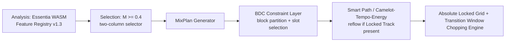

# Module 11: Breakdown Density Control (BDC)

**Document:** `OTOMIX_Architecture_Spec_Module11_BDC.md` **Parent document:** `OTOMIX_Architecture_Spec.md` (this module extends Section 4 – Feature Extraction & Analysis Pipeline, Section 4.9 – MixPlan & UI Architecture, Section 9 – API Contracts & Data Model, and Section 10 – Testing Plan) **Status:** Implementation-ready draft for owner review **Scope:** OTOMIX only (automated set-compilation engine). Does not touch the OTODJ live-performance surface or the real-time audio-callback path.

### Reading conventions (inherited from the parent document)

- Statements without a marker are normative requirements of this module.
- `[IMPL-DEFAULT]` marks a default value introduced here so the module is implementable; configurable, not a hard requirement.
- `[IMPL-DERIVED]` marks a schema or contract authored here from upstream constraints.
- `[IMPL-PROPOSED]` marks a design choice that needs owner confirmation (collected in the Open Decisions section at the end).
- "MUST / MUST NOT / SHOULD" are used in the RFC 2119 sense.

---

## 11.1 Problem Statement & Rationale

OTOMIX's set-compilation engine currently optimizes track order for harmonic compatibility, tempo compatibility and an energy-flow target (Section 4.9's `score = 0.60 × Camelot Proximity + 0.30 × Tempo Delta + 0.10 × Energy Progression`). None of these terms constrain **how often**, **how deeply**, or **how long** the compiled set dips into a breakdown/low-energy passage.

This is a real gap because breakdown placement has two opposing failure modes in club-style automated sets:

1. **Over-breaking.** A set that drops into full breakdowns too often, or for too long, reads as disjointed and kills dancefloor momentum — the dominant complaint in club-oriented listening contexts, where continuous groove is expected.
2. **Under-breaking.** A set that never dips in energy has no contrast between peak and trough, which removes the dramaturgical arc (tension/release) that makes a long set feel like a journey rather than a loop of same-energy tracks.

Both failure modes are currently possible outputs of the existing MixPlan recommendation algorithm, because it has no explicit term for breakdown cadence. The Breakdown Density Control (BDC) module closes this gap by turning "how much break, how often" into an explicit, user-tunable constraint that participates in track selection and ordering, using structural-segmentation features already obtainable from the Essentia-based analysis pipeline (Section 4).

## 11.2 Goals & Non-Goals

**Goals**

- G1. Let the set-compilation engine guarantee a **minimum and maximum breakdown cadence** across the compiled set ("a breakdown-grade dip at least every *N* tracks, at most every *M* tracks").
- G2. Let the engine bound the **depth** and **duration** of any breakdown segment that is allowed to anchor a transition.
- G3. Ship two ready-made presets ("Non-Stop / Driving" and "Dynamic / Festival Arc") plus free-form controls for advanced users.
- G4. Guarantee the result is **deterministic and explainable**: for any compiled set, the engine MUST be able to state why a given track was chosen to carry the breakdown slot for its block, consistent with the Set Explainability Panel pattern already used for Camelot/BPM/Mixability reasoning.
- G5. Reuse the existing Feature Registry / Abstract Analysis API Adapter infrastructure (Section 4.1) — **no new real-time audio-callback code path** and no change to the Beat-Index Engine or DSP Port Interface.

**Non-Goals**

- NG1. BDC does not generate or synthesize a breakdown inside a track (no audio transformation). It only *selects and sequences* existing tracks/segments.
- NG2. BDC does not replace the Vocal Map (Section 4.4) or the Mixability Scoring Engine (Section 4.5); it is an additional constraint layer evaluated alongside them during MixPlan generation.
- NG3. BDC does not run in the real-time audio thread. All segment detection and scoring happen in the existing offline/async Web Worker analysis layer (Section 4.1), consistent with the Real-Time Safety Contract (Section 3.12), which this module does not touch.

## 11.3 Expected Outcomes & Success Metrics

| Outcome | Metric | Target |
| --- | --- | --- |
| Predictable breakdown cadence | % of compiled sets whose realized breakdown spacing falls inside the user's configured `[min_gap, max_gap]` window | ≥ 98% `[IMPL-DEFAULT]` |
| No runaway breakdown depth/length | % of selected breakdown slots exceeding `duration_cap_s` or `max_depth` | 0% (hard constraint, not advisory) |
| Explainability coverage | % of breakdown-slot selections with a populated explain record (feature values + reason) | 100% |
| Engine latency | Added P99 latency to MixPlan (re)generation on a 50-track queue from constraint-layer evaluation | < 250 ms `[IMPL-DEFAULT]`, inside the existing MixPlan recompute budget (Section 4.9) |
| Graceful degradation | % of cases where an unsatisfiable constraint falls back to the nearest feasible cadence instead of failing the whole MixPlan | 100% (see §11.8.4 Failure Matrix) |

## 11.4 Conceptual Model

BDC exposes exactly three user-facing parameters plus one always-on safety rule, mirroring the simplicity of existing MixPlan controls:

| Parameter | Meaning | Range | `[IMPL-DEFAULT]` |
| --- | --- | --- | --- |
| `break_frequency` | Every how many tracks a breakdown-grade slot is **mandatory** | 3–10 tracks | 5 |
| `break_intensity` | How deep the mandatory breakdown is allowed/required to be | `low \| medium \| deep` | `medium` |
| `duration_cap_s` | Hard ceiling on the duration of the breakdown segment used for the transition | 10–90 s | 30 s |
| **Crowd Energy Guard** (always on) | A breakdown slot MUST NOT be placed immediately after a run of consecutive peak-energy tracks without at least one naturally-descending-energy track in between | boolean, not user-configurable `[IMPL-DEFAULT]`; exposed as an advanced override | enabled |

Two presets map to concrete parameter sets and MUST be offered in the UI (Section 11.10):

```
Non-Stop / Driving : break_frequency = 9, break_intensity = low,  duration_cap_s = 15
Dynamic / Festival Arc : break_frequency = 4, break_intensity = deep, duration_cap_s = 60
```

These values are `[IMPL-DEFAULT]` and MUST be confirmable/adjustable by the owner before GA.

## 11.5 Pipeline Integration

BDC inserts into the existing Section 4.8 data flow without adding a new top-level stage:



- BDC executes **after** the standard candidate pool is filtered by Mixability (`M ≥ 0.4`, Section 4.5) and **before** final grid construction (Section 3.1), so it never touches already-locked timing data.
- BDC is a **pure selection/ordering constraint**: it changes *which* track occupies a queue slot and *where the transition anchor points fall within that track*; it does not alter `t(i)`, `chopGrid`, or any Beat-Index Engine output.
- BDC MUST be re-evaluated whenever the Active Set Queue changes (manual reorder, Locked Track insertion, track removal), using the same Redux recompute trigger already defined in Section 4.9 for the Absolute Locked Grid timeline.

## 11.6 Essentia-Based Feature Extensions

No new analysis engine is introduced. BDC is built entirely from Essentia primitives already in scope for OTOMIX's Feature Registry pipeline (Section 4.1/4.2), plus one additional inexpensive fusion pass. Per-track, per-segment fields are computed once at analysis time and cached in the Feature Registry, not recomputed at MixPlan time.

| New Feature Registry field | Derived from (Essentia) | Computation |
| --- | --- | --- |
| `segments[]` | `SBic` (Bayesian structural boundaries) fused with `NoveltyCurve` and `Flux` peaks | Segment boundary candidates are produced by all three, then merged (boundaries within one beat of each other collapse to one) and **quantized to the nearest Attack Grid beat** (Section 3.1) so segment edges never land off-grid |
| `segments[].energy_rms` | `RMS` / `Energy` over the segment window | Mean + slope (first-difference) across the segment, for ramp detection |
| `segments[].bass_ratio` | `EnergyBandRatio` (sub-200 Hz band, reusing the `E_kick`/`C_bass` bands already computed for Mixability, Section 4.5) | Mean low-band energy ratio for the segment |
| `segments[].vocal_ratio` | TensorFlow `voice_instrumental` (already computed for the Vocal Map, Section 4.4) | Fraction of frames in the segment with `V_map = 1` |
| `segments[].is_breakdown` | Rule fusion of the four fields above | See §11.6.1 |
| `breakdown_score` (track-level) | `max(segments[].breakdown_score)` | Single comparable number per track for fast candidate filtering |
| `breakdown_duration_s` | Duration of the strongest breakdown segment | Used against `duration_cap_s` |
| `breakdown_depth` | 1 − (`bass_ratio` of the segment ÷ track median `bass_ratio`) | 0 = no perceptible dip, 1 = near-total bass removal |
| `breakdown_position_ratio` | Segment start time ÷ track duration | 0–1, used by the Crowd Energy Guard and by transition-anchor placement |

### 11.6.1 Breakdown classification rule `[IMPL-DEFAULT]`

A segment is labeled `is_breakdown = true` when, relative to the track's own median segment values:

```
bass_ratio_drop   >= 0.4   (low-band energy falls at least 40% below the track median)
AND energy_rms_slope is non-positive at segment entry (no mid-segment energy spike)
AND segment_duration_s >= 8   (filters out single-bar fills from genuine breakdowns)
```

`breakdown_depth` and `breakdown_intensity_class` (`low | medium | deep`) are then derived by thresholding `bass_ratio_drop` into terciles `[IMPL-DEFAULT]`. Presence of vocals (`vocal_ratio > 0.65`) does **not** disqualify a segment from being a breakdown — vocal breakdowns are common and valid — but is recorded so the Vocal Map (Section 4.4) and BDC never disagree about the same time window.

This rule set MUST ship as a configuration object (not hard-coded thresholds) so it can be tuned per-genre without a code change, consistent with the genre-median interpolation pattern already used in Section 4.6.

## 11.7 Feature Registry Schema Delta (v1.2 → v1.3) `[IMPL-DERIVED]`

```json
{
  "schema_version": { "type": "string", "pattern": "^1\\.3\\.\\d+$" },
  "breakdown": {
    "type": "object",
    "required": ["score", "duration_s", "depth", "position_ratio", "segments"],
    "properties": {
      "score":          { "type": "number", "minimum": 0, "maximum": 1 },
      "duration_s":     { "type": "number", "minimum": 0 },
      "depth":          { "type": "number", "minimum": 0, "maximum": 1 },
      "position_ratio": { "type": "number", "minimum": 0, "maximum": 1 },
      "segments": {
        "type": "array",
        "items": {
          "type": "object",
          "required": ["t_start", "t_end", "energy_rms", "bass_ratio", "vocal_ratio", "is_breakdown"],
          "properties": {
            "t_start":      { "type": "number" },
            "t_end":        { "type": "number" },
            "energy_rms":   { "type": "number" },
            "bass_ratio":   { "type": "number" },
            "vocal_ratio":  { "type": "number", "minimum": 0, "maximum": 1 },
            "is_breakdown": { "type": "boolean" }
          }
        }
      }
    }
  }
}
```

Per the existing cache-invalidation policy (Section 4.2/9.7), this is a **major version increment** of the Feature Registry (1.2 → 1.3): it MUST purge the Feature Registry cache and trigger re-analysis for all tracks on rollout, exactly as any other model/schema version bump does today. No new cache mechanism is required.

## 11.8 Constraint Layer Algorithm (BDC Constraint Solver)

The solver runs after candidate ordering is produced by the existing Camelot/Tempo/Energy scoring (Section 4.9) and before the grid is locked. It operates on the ordered Active Set Queue as a post-pass, with the ability to request a bounded local re-ordering from the Smart Harmonic/Energy path engine when a hard constraint cannot be met by reordering alone.

### 11.8.1 Block partitioning

```
blocks = partition(queue, size = break_frequency)
```

Each block is a contiguous run of break\_frequency tracks in the current queue order. The last block may be shorter than break\_frequency; a short trailing block is exempt from the mandatory-slot rule \[IMPL-DEFAULT\] (there is no next-peak for it to resolve into).

### 11.8.2 Mandatory slot selection (hard constraint)

For each block:

1. Filter the block's tracks to those with breakdown\_score >= threshold(break\_intensity) and breakdown\_duration\_s <= duration\_cap\_s.
2. Among the filtered set, prefer in order: (a) a track whose breakdown position\_ratio falls in the back half of the track (nearer the outro, a better transition anchor), (b) the track with the smallest harmonic/tempo penalty against its neighbors in the already-computed Section 4.9 score, (c) first occurrence in queue order (deterministic tie-break).
3. Mark the chosen track's strongest qualifying segment as the block's breakdown anchor; its t\_start/t\_end become an additional allowed transition-anchor hint for the MixPlan Generator (it does not override Vocal Map exclusion, Section 4.4; the two constraints are ANDed).
4. If no track in the block qualifies, escalate per Section 11.8.4 rather than silently skipping the block.

threshold(break\_intensity) \[IMPL-DEFAULT\]: low = 0.3, medium = 0.5, deep = 0.7, on the 0-1 breakdown\_score scale.

### 11.8.3 Crowd Energy Guard

Before a breakdown anchor is finalized for a block, the solver checks the local energy slope of the 1-2 tracks immediately preceding the anchor track, using the existing Multi-Dimensional Energy Profile scalar E (Section 4.3):

```
IF the preceding 2 tracks both have E in the top energy quintile AND
   neither shows a negative E slope relative to its own predecessor
THEN the anchor MUST move forward to the next track in the block
     (or the block boundary extends by 1 track, capped at break_frequency + 2)
     so the breakdown is preceded by at least one naturally descending-energy track.
```

This guard runs only forward (it never pulls the anchor earlier), so it cannot violate break\_frequency's upper bound by more than the stated +2 cap.

### 11.8.4 Failure Matrix (addition to Section 4.7)

| Failure | Detection | Deterministic response |
| --- | --- | --- |
| No track in a block meets breakdown\_score >= threshold | Step 11.8.2.1 empty set | Relax threshold one intensity tier down (deep to medium to low) for that block only; if low still empty, widen the block by merging with the next block once; if still empty, the block is flagged bdc\_unsatisfied in the explain record and left unconstrained -- the MixPlan is still generated, never blocked |
| Chosen anchor conflicts with a Vocal Map exclusion zone (Section 4.4) at the same transition point | Both constraints active on overlapping window | Vocal Map wins (hard rule, Section 4.4 priority); solver retries with the block's next-ranked candidate from 11.8.2 step 2 |
| Crowd Energy Guard would push the anchor past break\_frequency + 2 | Step 11.8.3 cap exceeded | Guard is skipped for that one block only, logged in the explain record as guard\_overridden: true |
| Queue shorter than break\_frequency | blocks has exactly one short block | BDC is a no-op for that set; recorded as bdc\_not\_applicable |
| duration\_cap\_s conflicts with the only available breakdown's natural length | breakdown\_duration\_s greater than duration\_cap\_s for all candidates | The anchor segment is truncated to duration\_cap\_s from its start, never from its end, so the transition entry point is preserved |

All fallback paths above are logged with enough structure (block index, rule triggered, before/after values) to populate the Set Explainability Panel (Goal G4) and to drive the bdc\_constraint\_satisfaction\_rate metric (Section 11.12).

## 11.9 API & Data Model Additions

### 11.9.1 REST endpoint \[IMPL-DERIVED\]

```
PATCH /api/v1/sets/{set_id}/break-profile
Required scope: local:process (same scope as /api/v1/sets, Section 9.10)
Idempotency-Key: required (state-mutating, per Section 9.10 convention)

Request body:
{
  "break_frequency": 5,
  "break_intensity": "medium",
  "duration_cap_s": 30,
  "crowd_energy_guard": true,
  "preset": "custom"
}

Response: 200 with the recomputed MixPlan summary (existing MixPlan response shape)
          plus "bdc_explain": [ { "block_index": 0, "anchor_track_id": "...", "rule_path": [...] }, ... ]

Errors:
  400 INVALID_ARGUMENT - parameter out of range (Section 11.4 ranges)
  409 CONFLICT - set is mid-export (export_jobs.status = 'running', Section 9.11)
```

This follows the error-modeling convention already used elsewhere in the spec (typed, client-actionable error codes rather than generic 500s) and reuses the existing export\_jobs status check rather than inventing a new lock.

### 11.9.2 Database schema \[IMPL-DERIVED\]

```sql
-- Extends the existing sets table (Section 9.11); break_profile is denormalized onto
-- the set row because it is 1:1 with a set and always read together with the queue.
ALTER TABLE sets ADD COLUMN break_profile jsonb NOT NULL DEFAULT
  '{"break_frequency":5,"break_intensity":"medium","duration_cap_s":30,"crowd_energy_guard":true,"preset":"custom"}'::jsonb;

ALTER TABLE sets ADD CONSTRAINT break_profile_shape CHECK (
  (break_profile ? 'break_frequency') AND (break_profile ? 'break_intensity') AND
  (break_profile ? 'duration_cap_s')  AND (break_profile ? 'crowd_energy_guard') AND
  ((break_profile->>'break_frequency')::int BETWEEN 3 AND 10) AND
  ((break_profile->>'duration_cap_s')::int BETWEEN 10 AND 90) AND
  (break_profile->>'break_intensity' IN ('low','medium','deep'))
);

-- Feature Registry: breakdown fields live inside the existing registry_json column
-- (Section 9.5); no new table. features.schema_version moves to '1.3.x'.
```

Consistent with the parent document's data-modeling posture (Section 9.5), shape and range constraints are enforced with database CHECK constraints, not left to the application layer, so an invalid break\_profile can never be persisted regardless of which service writes it.

### 11.9.3 Cache keys (addition to Section 9.13)

otomix:breakprofile:{set\_id} (mirrors otomix:features:{track\_id}:{schema\_version}); invalidated by the same LISTEN/NOTIFY mechanism (Section 9.7) on sets row updates. No new invalidation path is introduced.

### 11.9.4 Messaging

No new topic is required. A break\_profile change is folded into the existing MixPlan recompute flow adjacent to otomix.export; if a future async recompute queue is introduced for very large libraries, it should reuse otomix.ingest's dedup/sequence pattern (Section 9.9) rather than add a bespoke one.

## 11.10 UI / MixPlan Integration

- **Controls** live in the existing MixPlan configuration panel (Section 4.9), alongside the Camelot/Tempo/Energy weighting controls, not as a separate screen: a frequency stepper (3-10), an intensity segmented control (low/medium/deep), a duration cap slider (10-90 s), and the two presets (Non-Stop / Driving, Dynamic / Festival Arc) as one-click buttons that populate the three fields.
- **Design-system reuse:** the breakdown anchor overlay on the waveform canvas reuses the existing striped-overlay visual language already defined for Vocal Map exclusion zones (Section 4.4, 'striped red SVG overlays'), but as a distinct color token (amber, not red) so the two overlay types remain visually disambiguated without introducing a new overlay pattern. New token: `--otomix-overlay-breakdown` \[IMPL-PROPOSED\], to be added to the shared design-token set rather than hard-coded per-component.
- **Explainability:** each breakdown anchor marker is clickable and opens the same Set Explainability Panel card pattern used for Camelot/BPM/Mixability (prior proposal), showing: block index, chosen track, breakdown\_score, which fallback tier (if any) from Section 11.8.4 was used, and whether the Crowd Energy Guard fired.
- **Live recompute:** changing any BDC parameter triggers the same Redux recompute path already defined for Active Set Queue changes (Section 4.9), so the Absolute Locked Grid timeline and the breakdown overlays update together, never out of sync.

## 11.11 Observability Additions (Section 8)

| Metric (Datadog) | Type | Purpose |
| --- | --- | --- |
| `bdc_constraint_satisfaction_rate` | Gauge, % | Share of blocks resolved without any Section 11.8.4 fallback firing |
| `bdc_fallback_tier_count{tier}` | Counter | How often each fallback tier (threshold relax, block merge, unconstrained) fires |
| `bdc_guard_overridden_count` | Counter | How often the Crowd Energy Guard is overridden by its own cap |
| `bdc_solver_latency_ms` | Histogram | Added MixPlan recompute latency from the constraint layer (Section 11.3 target: P99 < 250 ms) |

**Alert threshold \[IMPL-DEFAULT\]:** `bdc_constraint_satisfaction_rate` below 95% over a rolling 1-hour window pages the on-call rotation at P2, consistent with the alerting conventions of Section 8.3.
