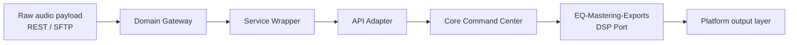
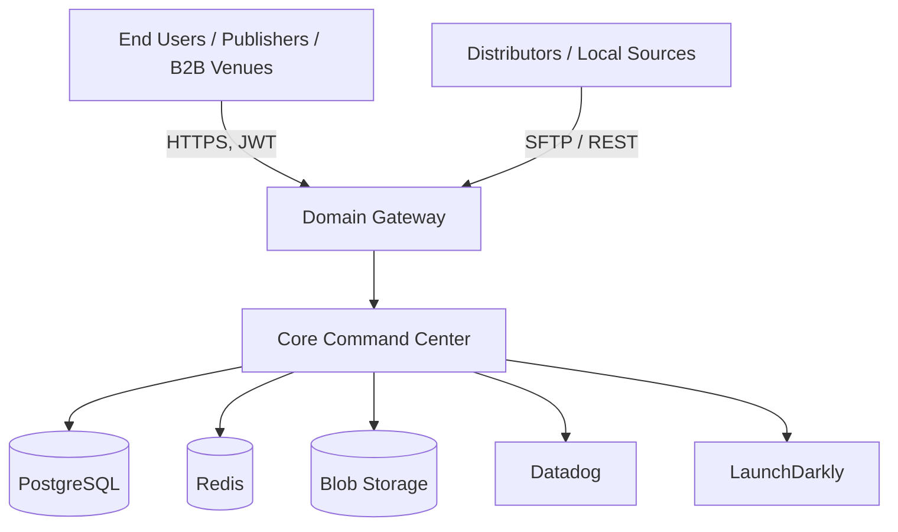
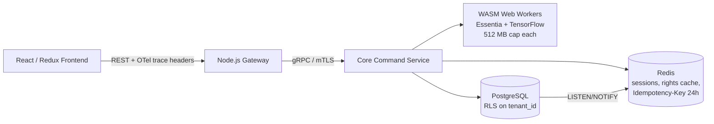
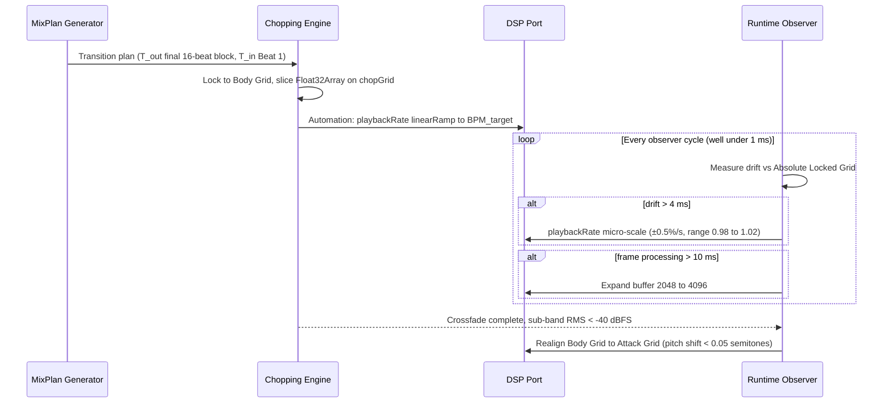
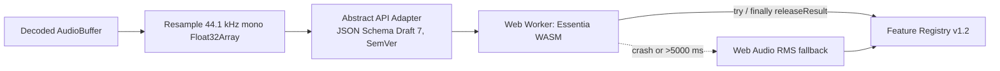
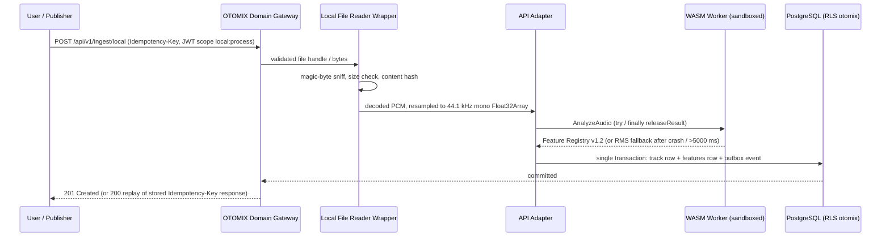
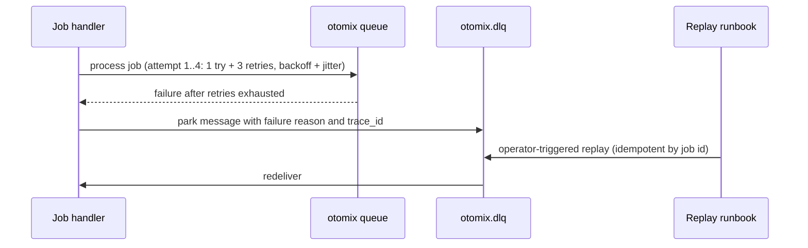
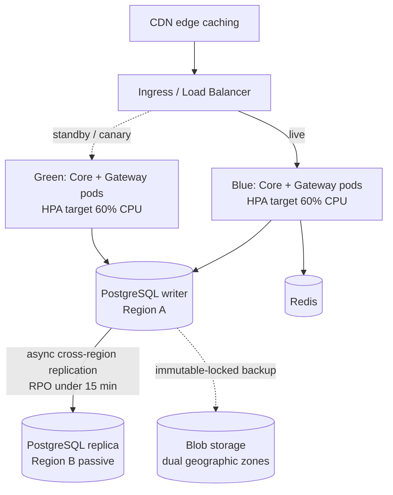

# OTOMIX Architecture Specification

**Document:** `OTOMIX_Architecture_Spec.md`
**Derived from:** "Software Architecture Specification: Unified Core Engine for OTOMIX & OTODJ Platforms" (Mother Document) including its Engineering Delivery Addendum
**Status:** Implementation-ready draft for owner review
**Companion document:** `OTODJ_Architecture_Spec.md` (shares the Core Command Center sections byte-for-byte: Sections 2.1–2.8, 3, 4, 7.1–7.10, 8.1–8.11, 9.1–9.9, 10, Appendix A)

### Reading conventions

- Statements without a marker are constraints taken from the Mother Document and its Addendum.
- `[IMPL-DEFAULT]` marks a default value introduced in this document so the specification is implementable; it is configurable and is not a Mother Document requirement.
- `[IMPL-DERIVED]` marks a schema or contract authored here from Mother Document constraints.
- `[IMPL-PROPOSED]` marks a design choice for a platform area the Mother Document describes only at headline level; it needs owner confirmation (listed in Appendix B).
- `[IMPL-REFERENCE]` marks arithmetic included only to make a constraint easy to verify.
- "MUST / MUST NOT / SHOULD" are used in the RFC 2119 sense.

---

## 1. Executive Summary & Platform Identity

### 1.1 Purpose

OTOMIX is the **local / informal-market** platform built on the single, headless **Core Command Center** that it shares, without modification, with OTODJ. It lets DJs, publishers and set sellers ingest their own audio files, analyze them (tempo, key, energy, vocal map, mixability), compile transition-perfect sets on the Absolute Locked Grid, master them through the EQ-Mastering-Exports port, and distribute results through publisher panels, custom landing pages, Set Shop sales and DJ-software metadata exports.

### 1.2 Platform Identity

| Axis | OTOMIX |
|---|---|
| Target market domain | **Local / Informal Market** |
| Audio source pipeline | **Local file uploads (MP3, WAV, FLAC via local directory access)** |
| Copyright compliance model | **Informal / local tool processing** |
| Commercial distribution model | **Publisher panels, custom landing pages, Set Shop audio file sales** |
| DJ software metadata export | **Unrestricted XML generation (Rekordbox, Traktor, VirtualDJ, Serato)** |
| Processing core engine | **100% shared unified Core Command Center** |
| Availability SLO | **99.9% uptime for OTOMIX endpoints** |
| Tenant identifier | `tenant_id = 'otomix'` |

### 1.3 Shared vs. OTOMIX-Specific Content

| Layer | Content | Status in this document |
|---|---|---|
| Shared (identical in OTODJ document) | Core Command Center, Beat-Index Engine, Absolute Locked Grid, Dual Grid, DSP Port Interface, Runtime Observer, feature extraction, scoped RBAC and security paradigms, observability, deployment, DR, base API contracts, base data model, test matrix | Sections 2.1–2.8, 3, 4, 7.1–7.10, 8.1–8.11, 9.1–9.9, 10, Appendix A |
| OTOMIX-specific | Local file ingestion, informal/local market handling, publisher panels, local XML exports, digital store (Set Shop) purchase handlers | Sections 2.9–2.12, 5, 6, 7.11–7.14, 8.12–8.14, 9.10–9.13, 10.9, Appendix B |

### 1.4 Explicit Non-Goals

- OTOMIX has **no DDEX ingestion**, **no DRM streaming**, **no DSR reporting**, and **no `master_cleared` / `publishing_cleared` enforcement**. Those columns and tables do not exist in the OTOMIX schema.
- OTOMIX MUST NOT read, reference, or join any OTODJ table, cache key, queue or storage prefix (Absolute Tenant Isolation).
- No computational fork of the Core Command Center.

### 1.5 Engineering Lenses Applied by Section

| Sections | Lens |
|---|---|
| 3, 4 (and parts of 2) | Real-time audio DSP: real-time safety, `Float32Array` memory boundaries, exact grid arithmetic |
| 2, 5, 9 | Backend design: gRPC/REST contracts, idempotency, DB atomicity, exponential backoff |
| 8 | Observability: OpenTelemetry, Datadog histograms, P99 alerts, structured JSON logs; deployment: Blue/Green, LaunchDarkly guarded rollouts |
| 7 | Security: STRIDE, zero-trust isolation, WASM sandboxing |

---

## 2. Unified Core Architecture & Service Layer Separation

### 2.1 Single Headless Core Command Center

The software architecture governing the OTOMIX and OTODJ platforms is established upon an absolute architectural decoupling of the central signal processing core from the service delivery and presentation layers. Rather than maintaining dual computational engines, the platform implements a **single, headless Core Command Center**. This central engine encapsulates:

- all audio feature analysis,
- rhythmic mathematical indexing (Beat-Index Engine),
- timing grid alignments (Absolute Locked Grid, Dual Grid),
- transition orchestration (MixPlan execution, Transition Window Chopping Engine),
- Digital Signal Processing (DSP) executions (via the DSP Port Interface).

The Core Command Center is **100% shared** between OTOMIX and OTODJ. No computational logic is forked per platform; all behavioral differences are expressed as configuration, scopes, and adapters at the layers described in Sections 2.4 and 2.7–2.9.

### 2.2 Tenant Isolation Mechanisms

To guarantee tenant isolation between OTOMIX and OTODJ, the Core Command Center employs three independent mechanisms. Isolation is defense-in-depth: failure of any one mechanism MUST NOT by itself permit cross-tenant access.

| Mechanism | Specification |
|---|---|
| Namespace-separated memory sandboxing | Each tenant executes in its own memory namespace. WASM linear memory is never shared between tenants. WASM heap is capped at **512 MB per worker**. |
| Dedicated worker thread pools | Each tenant owns a dedicated worker thread pool. A saturated pool in one tenant MUST NOT consume threads from the other (bulkhead). |
| Cryptographic data segregation | Tenant data (audio storage, feature cache, catalog rows) is encrypted with tenant-specific symmetric keys, rotated every **90 days** (see Section 7.5). PostgreSQL Row-Level Security (RLS) is additionally enforced on `tenant_id` (see Section 9.5). |

### 2.3 Inter-Component API Contracts

The API contracts between the Core Command Center, service wrappers, and domain gateways are strictly defined using **versioned gRPC protocols and Protobuf (v3) schemas**, ensuring backwards compatibility and strict type safety. The normative `CoreCommandService` contract is specified in Section 9.2. Breaking changes require a new package version (`otodsp.core.v2`); additive changes within a version MUST use new field numbers only and MUST NOT reuse or renumber existing fields.

### 2.4 End-to-End Data Flow Through the Service Layers

Operational differentiation between OTOMIX and OTODJ occurs **exclusively** at the service presentation layer, domain gateway, and access management boundaries, based on target market requirements and legal compliance frameworks.

Data flows sequentially and in one direction:

1. Raw audio payloads ingest via the **Domain Gateway** (REST / SFTP).
2. They map through the **Service Wrapper**.
3. They translate via the **API Adapter** (Abstract Analysis API Adapter, Section 4.1).
4. They finally execute within the **Core Command Center**.



### 2.5 Retry, Error-Handling and Degraded-Mode Policy

All service layers implement the same exponential-backoff retry and error-handling policy:

- **Maximum 3 retries** per failed call, after which the failure is surfaced as a typed error (Section 9.3 status mapping) or routed to the Dead-Letter Queue where a DLQ applies.
- Backoff is exponential with jitter. `[IMPL-DEFAULT]`: base delay 200 ms, multiplier 2.0, full jitter, per-attempt cap 5 000 ms. These values are configurable; the *maximum of 3 retries* is fixed.
- Retries apply **only to idempotent operations**. State-mutating requests are retried only when they carry an `Idempotency-Key` (Section 9.3).
- Every outbound call has an explicit timeout sized to the dependency's SLO. `[IMPL-DEFAULT]` Circuit breakers and per-dependency bulkheads isolate failing dependencies.

**Degraded mode fallback.** In cases of thread exhaustion or worker failure, the system initiates a degraded mode fallback: it executes **standard crossfading without localized micro-chopping**, ensuring uninterrupted audio playback. The degraded mode is entered automatically, emits the `system.thread.starvation` gauge and a structured log event, and exits when pool utilization recovers (runbook in Section 8.8).

### 2.6 Operational Axis (Platform Differentiation Matrix)

| Operational Axis | OTOMIX Platform | OTODJ Platform |
|---|---|---|
| Target Market Domain | Local / Informal Market | Official International DSP Market |
| Audio Source Pipeline | Local file uploads (MP3, WAV, FLAC via local directory access) | Local file uploads + Official DDEX-ERN catalog ingestion feeds |
| Copyright Compliance Model | Informal / Local tool processing | Licensed DSP platform holding Master and Publishing permissions |
| Commercial Distribution Model | Publisher panels, custom landing pages, Set Shop audio file sales | International B2C streaming & B2B Commercial Zone background licensing |
| DJ Software Metadata Export | Unrestricted XML generation (Rekordbox, Traktor, VirtualDJ, Serato) | Restricted XML exports scoped to authorized streaming protocols |
| Processing Core Engine | 100% Shared Unified Core Command Center | 100% Shared Unified Core Command Center |

Domain separation is enforced through lightweight service wrappers. OTOMIX connects to local file readers, custom publishing APIs, XML serialization modules, and digital store purchase handlers. OTODJ hooks into automated DDEX catalog ingestion pipelines, Digital Rights Management (DRM) streaming networks, and Digital Sales Reporting (DSR) logging infrastructures.

### 2.7 Architectural Blueprints (C4 / UML, required in-repository as Mermaid.js or PlantUML)

The following diagrams MUST exist in the repository and be reviewed with every change to a service boundary.

**Context diagram** (End Users, Distributors, Core Command Center, external gateways):



**Container diagram** (React/Redux frontend, Node.js Gateway, WebAssembly Workers, PostgreSQL, Redis):



The ingestion sequence diagram is in Section 5, the transition-execution sequence diagram (Body Grid to Attack Grid realignment) is in Section 3.14, the DLQ replay sequence diagram is in Section 5 (OTODJ) / Section 5.8 (OTOMIX), and the deployment diagram is in Section 8.5.

### 2.8 Service Boundary Principles

- **Framework at the edges.** Business rules live in plain, testable use-cases; HTTP, SFTP, and ORM concerns live in thin adapters.
- **Expected failures vs. bugs.** Validation, not-found, conflict, rate-limit and rights-denial outcomes are typed results mapped to protocol status at the edge. No bare catch-all handlers.
- **Validate at the boundary.** Inputs are parsed into domain types (e.g., a `BPM` bounded to [60.0, 200.0], a `CamelotKey`) once, at the gateway; the Core works only with valid data.
- **Outbox for write-then-publish.** Any event emitted after a state change (e.g., a DSP parameter update) is written to an outbox table in the same transaction as the state change, then published by a relay. This is the foundation of effectively-once delivery (Section 9.9).

### 2.9 OTOMIX Domain Gateway

The OTOMIX Domain Gateway is the only entry point for OTOMIX traffic. It is a Node.js service exposing versioned REST endpoints (Section 9.10) and performing, in order: TLS termination, JWT validation (Section 7.4) including deny-list check, `tenant_id` extraction from the token and assertion `tenant_id == 'otomix'`, scope check against the endpoint's declared scope, rate limiting (leaky bucket), `Idempotency-Key` handling for state-mutating requests, request validation into domain types, and OpenTelemetry context creation.

- Accepts local-file ingestion requests and publisher-panel API calls.
- Does **not** expose any `/ddex`, `/rights`, `/dsr` or streaming-license route. Requests for those paths return HTTP 404 (not 403) so the route's existence is not disclosed.
- The gateway sets the PostgreSQL session variable `app.tenant_id = 'otomix'` for every transaction (Section 9.5).

### 2.10 OTOMIX Service Wrappers

Lightweight wrappers adapt platform concerns to the Core's gRPC contract. Each wrapper is stateless and contains no audio logic.

| Wrapper | Connects to | Responsibility |
|---|---|---|
| **Local File Reader Wrapper** | Local directory access (browser directory handle / desktop agent) and upload endpoint | Enumerate, sniff, decode, resample and hand audio to the API Adapter (Section 5) |
| **Publishing API Wrapper** | Publisher panel and custom landing-page services | Publisher-scoped set publication, landing-page content, asset bundles (Section 5.6) |
| **XML Serialization Wrapper** | Rekordbox, Traktor, VirtualDJ, Serato export modules | Serialize Feature Registry grid, BPM and key data into DJ-software metadata (Section 5.5) |
| **Digital Store Purchase Handler** | Set Shop storefront and payment provider | Purchase webhooks, entitlements, download bundle generation (MP3, WAV, FLAC) (Section 5.7) |

Every wrapper applies the retry policy of Section 2.5 (maximum 3 retries, exponential backoff with jitter, idempotent operations only) and returns typed results mapped per Section 9.3.

### 2.11 OTOMIX Tenant Binding

| Concern | OTOMIX binding |
|---|---|
| Worker pool | Dedicated OTOMIX pool (no sharing with OTODJ) |
| WASM namespace | `otomix` memory namespace, 512 MB cap per worker |
| Encryption key | OTOMIX tenant DEK, 90-day rotation |
| Storage prefix | `s3://<bucket>/otomix/` (object-store prefix; IAM policy denies cross-prefix access) `[IMPL-DEFAULT]` |
| Redis key prefix | `otomix:` `[IMPL-DEFAULT]` |
| Message topics | `otomix.*` `[IMPL-DEFAULT]` |

### 2.12 OTOMIX Degraded Mode

On thread exhaustion or worker failure the OTOMIX tenant degrades to **standard crossfading without localized micro-chopping** (Section 2.5). Because OTOMIX users may be on constrained local hardware, the browser-side fallback additionally widens `chopGrid` toward 1/8 (Section 3.8) before degrading fully. Set Shop bundle generation is a server-side batch path and is unaffected by degraded playback mode.

---

## 3. Beat-Index Engine & DSP

> Engineering lens for this section: real-time audio DSP. Every rule below is subject to the real-time-safety contract in Section 3.12 and the latency budget in Section 3.13.

### 3.1 Absolute Locked Grid Engine

Traditional beat-matching software relying on real-time kick transient detection experiences timing failure during audio breakdowns, ambient sections, or drumless passages. The Beat-Index Engine eliminates transient dependency by constructing an **Absolute Locked Grid**: a continuous, unyielding mathematical timeline that translates time in seconds into discrete beat indices regardless of audio signal amplitude.

**Seed tempo.** The grid uses a base seed tempo `BPM_seed`, derived during feature extraction via **K-means clustering of the local tempo histogram**, mathematically validated against the track's highest structural energy peak. Micro-adjustments to the grid period are constrained within a strict boundary of **[0.95, 1.05] of the seed period**, based on validated kick anchor points.

**Mapping equation.** The complete mapping transforming any target beat index `i` into an absolute audio timestamp `t(i)` in seconds is:

```
t(i) = T_0 + (i - 1) × (60 / BPM_seed) + Δ_i
```

| Symbol | Meaning | Constraint |
|---|---|---|
| `i` | Target beat index (Beat 1 = verified reference downbeat anchor) | Integer; negative indices defined in Section 3.10 |
| `T_0` | Verified time offset (seconds) of the reference downbeat anchor | Validated per Section 3.4 |
| `BPM_seed` | Seed tempo from K-means over the local tempo histogram | Feature Registry bound: Float [60.0, 200.0] |
| `Δ_i` | Continuous drift correction factor | Structurally constrained to a drift threshold of **±0.05 seconds** |

Because `t(i)` operates as an uninterrupted linear function across the entire audio buffer, breakdown passages lacking low-frequency transients remain locked to the timing grid, preventing out-of-bounds errors or transition cancellations.

**Cumulative-error control.** To prevent cumulative timing errors in long-duration tracks, the engine forces a **hard anchor synchronization every 16 bars**.

**Variable BPM.** For variable BPM tracks, the grid operates **piecewise**, updating `BPM_seed` sequentially at predefined structural boundaries.

**Grid lock failure recovery.** In the rare event of a total grid lock failure, the system engages an immediate recovery state, **falling back to the track's global average BPM and disabling localized micro-adjustments**.

Worked numeric reference `[IMPL-REFERENCE]`: at `BPM_seed = 120`, the beat period is `60/120 = 0.5 s`; with `T_0 = 0.250 s` and `Δ_i = 0`, `t(1) = 0.250 s`, `t(17) = 0.250 + 16 × 0.5 = 8.250 s`, and a 16-bar block (64 beats) spans `32.0 s`.

### 3.2 Dual Grid Architecture (Attack Grid & Body Grid)

In contemporary electronic genres (such as Deep House, Trap, and Minimal Techno), kick drums frequently feature sub-bass energy bodies extending beyond the initial transient attack. Aligning audio tracks strictly by high-frequency onset transients leads to phase cancellation and acoustic flamming in the low end. Conversely, aligning strictly by sub-bass energy peaks introduces rhythmic misalignment in secondary high-frequency instruments such as hi-hats and snares.

To resolve this conflict, the Beat-Index Engine generates and maintains **two parallel temporal grids for every track**:

| Grid | Mapped to | Extraction method | Governs |
|---|---|---|---|
| **Attack Grid** | High-frequency onset transients `T_(attack_onset)` | Spectral flux peak detection: **2048-sample Hamming window, 50% overlap**, isolating frequencies **above 200 Hz** | General quantization and secondary instrument timing |
| **Body Grid** | Energy peak of the sub-bass envelope `T_(body_peak)` from the kick body | **80 Hz Butterworth low-pass filter** and **RMS amplitude detection** | Initial transition crossfading (low-end acoustic alignment) |

The exact phase offset `Δ_ϕ` between these grids is:

```
Δ_ϕ = T_(body_peak) − T_(attack_onset)
```

**Transition behavior.**

1. During a transition window, initial track synchronization **locks to the Body Grid** to prevent low-end acoustic interference.
2. Once the crossfade completes and the outgoing track's low-frequency energy is fully attenuated, numerically defined as **Sub-band RMS dropping below −40 dBFS**, a progressive realignment mechanism shifts timing back to the Attack Grid.
3. This realignment maps along a **cosine interpolation curve spanning exactly 4 bars**, moving at a rate of **~1 ms per beat**.
4. In non-electronic genres or acoustic tracks devoid of a strong kick body, the architecture **defaults entirely to the Attack Grid**.

The Runtime Observer's post-transition realignment (Section 3.6, 16-bar logarithmic shift, <0.05 semitones) is specified separately in the Mother Document; the relationship between the two curves is recorded in Appendix A, item A1.

Timing facts `[IMPL-REFERENCE]` at 44.1 kHz: a 2048-sample window = 46.44 ms; 50% overlap hop (1024 samples) = 23.22 ms.

### 3.3 Timing Hierarchy & Sub-Beat Resolution

Internal scheduling, chopping, and quantization within the core engine operate **strictly on beat-based units**; absolute time metrics (seconds or milliseconds) are isolated to lower-level Web Audio rendering contexts.

**Quantum.** The system enforces a strict hierarchical timing resolution based on a **32nd-note triplet quantum**, defined mathematically as exactly:

```
quantum_seconds = (60 / BPM) / 24
```

(See Appendix A, item A6 regarding the note-value naming of this quantum; the formula is normative.)

**Structural units.** Higher-level structural units, including **4-beat bars** and **8-bar, 16-bar, and 32-bar blocks**, are evaluated dynamically on-the-fly using modulo arithmetic (`Index % MaxBeats`) rather than persistent memory allocations. Computing temporal parameters dynamically ensures a mathematically proven **zero-RAM footprint for timing storage**, incurring a CPU cost of **<2% overhead per active thread**. The reference arithmetic is in Section 3.15.

**Scheduling.** To mitigate standard Web Audio jitter, the scheduler employs a **50 ms lookahead buffer**, locking timing accuracy to **±2 ms**.

**Non-integer tempos / drift.** Quantization for non-integer tempos or fluctuating tempo drift operates dynamically on **floating-point beat indices**, constantly rounding to the nearest triplet quantum parameter.

### 3.4 Primary Kick Definition & Anchor Validation

To prevent intro syncopations, light percussion, or ambient sound effects from corrupting global grid placement, the engine performs an **Anchor Validation** routine prior to grid lock. The initial detected kick candidate at track start is evaluated against primary kicks located at bar intervals corresponding to multiples of 4 (specifically **Bars 5, 8, and 16**).

- **Algorithm:** fuzzy cross-correlation based on the **Pearson correlation coefficient** of the **100 ms low-frequency energy envelope**.
- **Off-beat classification:** if the initial kick candidate exhibits structural divergence exceeding a dynamically calibrated threshold, defined as **correlation coefficient < 0.85 or shape variance > 15%**, relative to the downbeat kicks at bars 5, 8, and 16, it is classified as an **off-beat syncopation**.
- **Realignment:** for off-beat syncopations, the anchor timestamp `T_0` is automatically realigned **forward** to the primary validated downbeat identified in subsequent 4-bar blocks.
- **Fallback anchor:** if the track inherently lacks kicks at bars 5, 8, or 16 (or is entirely kick-less), the system anchors to the **first significant transient exceeding −12 dBFS**.

### 3.5 Quantization & Groove Metadata Registry

During analytical feature extraction, the engine measures micro-timing variances across **16th-note subdivisions** to identify the track's rhythmic groove. The detected pattern is registered in the Feature Registry under one of three structural modes:

| Mode | Definition |
|---|---|
| **Straight** | Isochronous 16th-note distribution with strict **<2% micro-timing variance** |
| **Triplet** | Micro-timing peaks clustered with **<5% variance** from precise **33.3% and 66.6%** subdivisions within eighth-note boundaries |
| **Swing** | Systematic temporal displacement of off-beat 16th notes ranging between **0.05 and 0.33 of the beat interval** (effectively a **55% to 66% swing ratio**) |

The quantization engine uses this metadata to dynamically adjust chopping window boundaries by the precise swing displacement `Δ_groove`, preventing secondary percussion elements from experiencing phase cancellation during transition mixing.

**Irregular grooves.** For tracks exhibiting irregular micro-timing or complex hybrid grooves, the engine defaults to a **Straight** layout but **expands the micro-crossfade window by +10 ms** to safely mask any resulting phase incongruities.

### 3.6 Runtime Observer & Dynamic Realignment

The Runtime Observer operates as an **asynchronous background thread** during live playback and Mix Preview. It performs two real-time operations, and its loop cycle is engineered to complete in **well under 1 ms**.

**(a) Intrinsic Drift Compensation**

- Calculates phase deltas between real-time context execution and the Absolute Locked Grid.
- If temporal drift exceeds the strict **4 ms** threshold, it applies instantaneous micro-scaling to the Web Audio `playbackRate`.
- The micro-scaling is strictly bounded to a rate of **±0.5% per second**, restricted within a **[0.98, 1.02]** range.
- **High-load degradation:** in high-load CPU scenarios or thread starvation (where frame processing exceeds **10 ms**), the Observer degrades gracefully by **expanding the audio buffer size from 2048 to 4096 samples**.

**(b) Post-Transition Realignment**

- Following transition completion (where synchronization was locked to the Body Grid), the Runtime Observer executes a precise **logarithmic shift over a 16-bar window**, realigning timing back to the Attack Grid.
- The induced pitch shift during this curve is mathematically guaranteed to remain **<0.05 semitones**, ensuring the realignment remains completely inaudible.

(See Appendix A, items A1 and A4 for the cross-references between this section, Section 3.2, and the acceptance criterion in Section 10.)

### 3.7 Gradual BPM Shift (Tempo Glide)

Instantaneous tempo adjustments between consecutive tracks introduce phase distortion and pitch jump artifacts. The Beat-Index Engine executes smooth tempo shifts via automated parameter ramps applied to the Web Audio `playbackRate` attribute using **`linearRampToValueAtTime`**, passing strict start/end targets to the driver.

- During a transition, the engine automates the playback rates of both the outgoing (`BPM_out`) and incoming (`BPM_in`) tracks toward a calculated target tempo `BPM_target`, which defaults to the arithmetic mean:

```
BPM_target = (BPM_out + BPM_in) / 2
```

- The duration of the linear ramp **precisely matches the duration of the transition window**.
- The acceptable range for the tempo glide is restricted to a **maximum of ±8%** (`playbackRate` bounds).
- Alterations beyond this threshold affect key and pitch by more than **±1 semitone**; when this occurs, pitch integrity is maintained via a **secondary WebAssembly pitch-shifting node** (see Appendix A, item A3).
- **Half-time / double-time:** for extreme structural differences, the engine automatically mathematically **halves or doubles** the incoming `BPM_in` mapping prior to initiating the tempo glide.

### 3.8 Transition Window Chopping Engine

To eliminate transient softening and CPU overhead caused by Waveform Similarity Overlap-Add (WSOLA) time-stretching algorithms, **WSOLA is completely removed from the primary execution engine**. Rhythmic alignment during transitions is achieved via **localized audio buffer chopping**.

- Audio array processing is isolated strictly to raw **`Float32Array`** buffers within a strict **16-bar transition window** bound to the grid's structural markers (see Appendix A, item A2 on bar/beat window terminology).
- Audio **outside** this window plays back directly without processing overhead.
- Sliced audio blocks within the transition window are quantized onto the mathematical grid.
- Boundary clicks are suppressed using a **parametric zero-click crossfade** `F_fade`, defined by `crossfadeMs` and applied precisely at the `chopGrid` sub-beat slice boundaries:

```
F_fade = 0.5 × (1 + cos(π · t / crossfadeMs)),   t ∈ [0, crossfadeMs]
```

- To prevent audible smearing, `crossfadeMs` is computationally restricted to:

```
crossfadeMs ≤ (60 / BPM × (chopGrid_fraction) / 4)
```

(unit handling in Appendix A, item A7).

- Both `crossfadeMs` and the slicing grid resolution `chopGrid` are exposed as **dynamic parameters** within the system administration dashboard (Section 7.2). `chopGrid` ∈ {1/8, 1/16, 1/32}.
- **Load shedding:** under low-latency or high-load edge conditions, the engine dynamically **widens `chopGrid` boundaries from 1/32 to 1/8** to preserve CPU cycles.
- **WSOLA legacy fallback:** while fundamentally deprecated, a discrete WSOLA legacy fallback is retained and triggered **exclusively** if the engine detects audio files with extreme reverb tails or complex transient anomalies that mathematically fail the chopping phase coherence tests.

### 3.9 Universal Transition Guarantee

The engine **permanently removes** conditional cancellation functions (such as `hasSixteenKickBeats` checks or out-of-bounds structural exception handlers). The architecture guarantees **100% deterministic transition execution across all audio files**. This standard is validated against a matrix of **10,000 headless track simulations** (Section 10).

**Structural anchors:**

| Role | Anchor |
|---|---|
| Incoming Track (`T_in`) | Transition locks to **Beat 1 of the initial 16-beat block (Bars 1 to 4)** |
| Outgoing Track (`T_out`) | Transition locks to the **final 16-beat block prior to track termination** |

**Guarantee ladder (evaluated in order, never cancelling):**

1. If an incoming track lacks kick drum transients within its initial 16 beats, the Absolute Locked Grid forces alignment mathematically across the 16-beat timeline, ensuring structural set continuity.
2. For purely ambient or completely kick-less tracks, the system maps a **static, mathematically derived 120 BPM grid** to enable standardized handling.
3. Should severe corruption cause the grid logic to fail, an **ultimate exception safety net** executes a **clean 4-bar volume crossfade independently of grid locks**.
4. Tracks shorter than the mandatory 16-beat boundary automatically execute a **silent structural loop** to satisfy the transition width requirement.

### 3.10 Pre-Kick Offset & Negative Beat Mapping

Tracks containing intro sound effects, sweeps, or ambient atmospheres prior to the initial kick downbeat are mapped via a **dual-offset strategy**:

| Condition | Rule |
|---|---|
| **Pre-kick gap < 1 bar (in beats)** | The initial kick downbeat is assigned **Beat 1**. Audio frames before this kick are assigned negative beat indices (**Beat −1, Beat −2, Beat −3**). |
| **Pre-kick gap ≥ 1 bar (in beats)** | The anchor point `T_0` is **shifted backward by exact 4-beat bar multiples** (e.g., **Beat −5, Beat −9**). The initial kick downbeat aligns with a primary downbeat (such as **Beat 5 or Beat 9**), preserving global bar counting conventions. |

- For highly complex, long introductions with variable tempos, the engine formulates a **localized pre-kick tempo map** to maintain rigid counting logic backwards from `T_0`.
- The **Dual Grid architecture (Body/Attack) remains computationally dormant during negative indices**, initializing exclusively once the timeline reaches Beat 1.
- Index zero is not assigned (consistent with the Mother Document's examples). `[IMPL-DEFAULT]` The extension of `t(i)` to negative indices uses `n = i` for `i ≤ −1` and `n = i − 1` for `i ≥ 1`, so `t(i) = T_0 + n × (60/BPM_seed) + Δ_i`. This convention is recorded in Appendix A, item A8 for owner confirmation.

### 3.11 DSP Port Interface (EQ-Mastering-Exports)

Audio manipulation routines, including **three-band EQ, filtering, multi-band compression, dynamic limiting, and export encoding**, are decoupled from core orchestration through the **EQ-Mastering-Exports port interface**.

- The core engine delivers **raw `AudioBuffer`s** and tightly structured **Web Audio `AudioParam` automation schemas** (defining target values, times, and curve types) to the port interface.
- This decoupling guarantees that underlying DSP drivers can be seamlessly versioned or updated without breaking users' stored mastering profiles.
- The port strictly enforces a **maximum fixed operational latency of <10 ms** utilizing a **1024-sample buffer at 44.1 kHz** (interpretation in Section 3.13 and Appendix A, item A5).
- **AudioParam automation:** tempo glides use `linearRampToValueAtTime`, passing strict start/end targets to the driver.
- **Bypass & mocking:** mock DSP drivers and bypass modules are incorporated into the deployment pipeline to permit **headless testing of signal flow logic without active audio rendering pipelines**.

**Signal-chain design `[IMPL-DEFAULT]`** (stage order is a design decision with audible consequences):

| # | Stage | Primitive | Rationale for position |
|---|---|---|---|
| 1 | Input gain / inter-track normalization (from `loudness_ebu128`) | Gain stage | Establish headroom before any processor |
| 2 | Three-band EQ and filtering | Cascaded IIR biquads (minimum-phase, ~0 algorithmic latency) | Spectral shaping before dynamics so compressors react to the shaped signal |
| 3 | Multi-band compression | Band-split biquads + detector/gain-computer per band | Dynamics control before the final peak stage |
| 4 | Dynamic limiter | Look-ahead peak limiter; **nonlinear stage, so oversampled 4x** with band-limiting up/down filters | Last processor; catches final peaks |
| 5 | Export encoding | Encoder (MP3 / WAV / FLAC, platform-dependent) | Terminal stage, outside the real-time callback |

Internal format is 32-bit float with flush-to-zero. Filter coefficients are re-derived on any sample-rate change; no coefficient is hard-coded to 44.1 kHz.

### 3.12 Real-Time Safety Contract (applies to every audio-callback and worklet code path)

1. **No locks, no heap allocation, no syscalls or file/log I/O, and no unbounded work** inside the audio callback (`AudioWorkletProcessor.process`). Everything is pre-allocated at preparation time: grid-state structs, `Float32Array` slice buffers, smoothing state, ring buffers.
2. **Denormals:** flush-to-zero / denormals-are-zero behavior is required on the audio thread (in WASM, enforced by a small DC offset or explicit near-zero flush in feedback paths).
3. **Parameter passing is lock-free:** UI/message thread to audio thread via `SharedArrayBuffer`-backed single-producer/single-consumer (SPSC) ring buffers or atomics; never a mutex the audio thread can block on.
4. **Per-sample smoothing** (one-pole ramp) is applied to every audio-path parameter that would otherwise zipper (EQ gains, limiter threshold). `crossfadeMs` and `chopGrid` changes take effect **only at the next slice boundary**, never mid-slice.
5. **Observable cost:** the Observer's loop cycle is measured and exported as a histogram (Section 8.1); a cycle longer than 1 ms is a defect, not a tuning item.
6. **Verification:** a null test against a scalar reference build, RT-safety audit (zero allocations and zero locks observed on the audio thread), and measurement of THD+N on the limiter and impulse/frequency response on the EQ are required before any DSP change ships (Section 10).

### 3.13 Latency & Buffer Budget

| Item | Value | Source / note |
|---|---|---|
| DSP port latency | **<10 ms** fixed maximum | 1024-sample buffer at 44.1 kHz |
| Buffer period at 1024 samples / 44.1 kHz | 23.22 ms | `[IMPL-REFERENCE]` 1024 / 44100 |
| Observer buffer degradation | 2048 to 4096 samples (46.44 ms to 92.88 ms periods) | Triggered when frame processing exceeds **10 ms** |
| Scheduler lookahead | **50 ms**, accuracy **±2 ms** | Section 3.3 |
| Drift threshold (Observer) | **4 ms** | Section 3.6 |
| Grid drift bound `Δ_i` | **±0.05 s** | Section 3.1 |
| Triplet quantum at 120 BPM | 20.83 ms | `(60/120)/24` |
| Observer loop cycle | **well under 1 ms** | Section 3.6 |
| WASM feature extraction | **<2500 ms** | Section 4 / alert in Section 8.3 |
| Thread blockage alert | **>10 ms** | Section 8.3 |

**Interpretation of the DSP port bound.** Because one 1024-sample buffer at 44.1 kHz is 23.22 ms long, the "<10 ms" bound is implemented and tested as the **per-block processing time of the port (compute latency) plus any algorithmic latency reported to the host**, not as the buffer period. Any algorithmic latency (look-ahead limiter, oversampling filters) MUST be summed, reported to the host, and kept inside this budget. See Appendix A, item A5.

### 3.14 Transition Execution Sequence (Body Grid to Attack Grid realignment)



### 3.15 Zero-RAM Structural Arithmetic (normative reference)

Structural positions are pure functions of the beat index; nothing is stored per bar or per block.

```
// All functions are O(1) time and O(1) space. No array is allocated.
// floorMod handles negative indices (Section 3.10): ((x % m) + m) % m
function floorMod(x, m)        { return ((x % m) + m) % m; }
function beatInBar(i)          { return floorMod(i - 1, 4) + 1; }            // 1..4
function barIndex(i)           { return Math.floor((i - 1) / 4); }
function blockPosition(i, nBars) { return floorMod(i - 1, 4 * nBars); }      // nBars in {4, 8, 16, 32}
function isBlockBoundary(i, nBars) { return blockPosition(i, nBars) === 0; }
function quantumIndex(beatFloat) { return Math.round(beatFloat * 24); }      // nearest triplet quantum
```

"Zero-RAM footprint" is defined as **O(1) memory space complexity for timeline generation** (Section 3.16).

### 3.16 Definitions & Governance Clarifications (Engine)

- **"Zero-RAM footprint":** technically defined as an **O(1) memory space complexity for timeline generation**. Structural bar units are not stored in memory arrays but calculated deterministically during execution via modulo operations.
- **"100% Deterministic":** defined as **zero unhandled exception fallbacks, zero transition cancellations, and rigid lock maintenance** during the 10,000-track automated integration suite.
- **`playbackRate` bounds:** tempo glides are strictly capped at a **±8% threshold**. Pitch shifts mathematically exceeding **±1 semitone** beyond this threshold trigger the secondary WebAssembly pitch-shifting node.

---

## 4. Feature Extraction & Analysis Pipeline

### 4.1 Abstract Analysis API Adapter

The core system avoids direct compile-time bindings to specific analytical engines (such as Essentia.js WebAssembly modules). Analytical requests pass through an **Abstract API Adapter** layer that:

- standardizes input parameters (**AudioBuffer resampled to 44.1 kHz mono arrays**), and
- transforms engine-specific JSON outputs into the standardized **Feature Registry** schema.

**Contract rules**

- All input/output bindings use **JSON Schema (Draft 7)**.
- **Semantic Versioning (SemVer)** is enforced to guarantee backward compatibility as underlying models evolve.
- **Heap-leak prevention:** worker threads encapsulate analytical calls in **`try`/`finally`** blocks that invoke explicit WASM allocation cleanups (**`releaseResult`**) following every feature extraction pass. Leak prevention is verified programmatically via **`performance.memory` snapshots** captured before and after module execution. Enforced cleanup prevents linear heap growth.
- **Crash/timeout fallback:** in the event of a WebAssembly worker crash or a module timeout **exceeding 5000 ms**, a lightweight fallback intercepts the audio buffer and routes it through standard **Web Audio API RMS analyzer nodes** to generate a basic viable feature set without stalling the queue.
- **Extraction budget:** WASM feature extraction completes in **<2500 ms** (alert threshold, Section 8.3). The extraction pipeline is benchmarked at **<1.5x real-time**, validated against an **average 4-minute 320 kbps MP3 on a standardized AWS M5.large worker node**.



### 4.2 Extracted Feature Registry Schema

The Feature Registry is bound to a strict **v1.2 versioned schema**. Normalization and data bounds are strictly typed (e.g., **BPM: Float [60.0, 200.0]**, **Key: String, Camelot format**).

- **Missing features** are systematically interpolated using the **global dataset median/average for the track's dominant (designated) genre** (Section 4.6).
- Extracted metadata remains **persistently cached**, but observes a strict **cache invalidation policy**: any **major version increment** of the extraction models immediately purges the cache and triggers re-analysis.

| Feature Category | Extracted Essentia Attribute | System Architectural Application |
|---|---|---|
| Rhythm & Timing | `bpm`, `bpm_histogram` | Base tempo seeding; static vs dynamic BPM determination |
| | `beats_position` | Primary transient grid construction and validation |
| | `onset_rate` | Rhythmic density tracking; track energy contribution |
| | `danceability` | Groove evaluation; multi-dimensional energy profiling |
| | `beats_loudness`, `band_ratio` | Kick hardness and spectral color classification |
| Tonal & Harmonic | `key_temperley`, `key_krumhansl`, `key_edma` | Tri-profile consensus harmonic key mapping |
| | `chords_*` | Advanced harmonic progression compatibility analysis |
| | `tuning_frequency` | Detection and compensation of microtonal pitch variances |
| | `hpcp` | 32-dimensional harmonic class fingerprinting |
| Spectral Low-Level | `spectral_centroid` | Timbre brightness evaluation |
| | `spectral_spread`, `skewness`, `kurtosis` | Spectral shape and energy distribution profiling |
| | `spectral_energyband_*` | 4-band spectral balance mapping |
| | `mfcc` | Timbral vector clustering and genre classification |
| Loudness & Dynamics | `loudness_ebu128` | Standardized inter-track gain normalization |
| | `dynamic_complexity` | Evaluation of modern compression and punch metrics |
| High-Level Models | TensorFlow `voice_instrumental` | Vocal Map generation for vocal-gated transitions |
| | TensorFlow `genre_discogs400` | Automated catalog classification |
| | Discogs-EffNet / MAEST embeddings | High-dimensional vector similarity matching |

The Feature Registry JSON Schema (Draft 7) that binds these fields, including nested Multi-Dimensional Energy Profile and Vocal Map structures, is specified in Section 9.6.

### 4.3 Multi-Dimensional Energy Profile Engine

Track energy is computed as a **normalized multi-dimensional vector** rather than relying solely on low-frequency RMS energy. The composite scalar score `E` uses strict component weights:

```
E = 0.4 × (Rhythm) + 0.3 × (Dynamics) + 0.2 × (Loudness) + 0.1 × (Spectral)
```

- Each component is mapped to a strict **[0, 1]** interval via **Min-Max dataset normalization**.
- The scalar `E` maps across dataset percentiles to a discrete **1-to-5 star rating** (e.g., **E > 80th percentile = 5 stars**). `[IMPL-DEFAULT]` Remaining bands: 4 stars for 60th to 80th, 3 stars for 40th to 60th, 2 stars for 20th to 40th, 1 star below the 20th percentile.
- **Compression penalty:** heavily compressed tracks displaying **near-zero dynamic range** receive a proportional numerical penalty applied to the **Dynamics** component.
- **Silence:** totally silent structural blocks yield an **absolute rating of 0**.

### 4.4 Vocal Map & Vocal-Gated Transitioning

To prevent acoustic collisions caused by overlapping vocal passages, the analysis pipeline routes audio buffers through the **TensorFlow `voice_instrumental`** model in a **dedicated Web Worker**.

- **Output schema:** an array of timestamped float probabilities.
- **Binarization:** the system translates this into a binary Vocal Map where `V_map[t] = 1` specifically when the vocal probability threshold evaluates strictly at **> 0.65**.
- **Smoothing:** false positives and negatives are scrubbed via a **1-second median smoothing filter**.
- **Transition planning:** the MixPlan Generator inspects the Vocal Map. If a standard **16-beat** transition window coincides with `V_map = 1`, the transition offset is dynamically shifted to the **nearest instrumental section**, defined as the closest contiguous 16-beat block where `Σ V_map = 0`.
- **Failure fallback:** if the TensorFlow engine completely fails to load or crashes, the system falls back to an assumed **`V_map = 0`** (all instrumental) to guarantee mixing continuity.
- **UI exclusion zones:** vocal zones (`V_map > 0.65`) render as **striped red SVG overlays** on the waveform canvas (Section 4.9).

### 4.5 Mixability Scoring Engine

Before tracks are admitted into set compilation queues, they undergo automated mixability validation. The Mixability Score `M` is:

```
M = 0.4 (E_kick) + 0.3 (C_bass) + 0.2 (S_tempo) + 0.1 (V_tune)
```

| Term | Definition |
|---|---|
| `E_kick` | Sub-200 Hz transient-to-noise ratio (kick clarity) |
| `C_bass` | RMS low-end energy concentration below 100 Hz |
| `S_tempo` | Variance in the beat histogram (tempo stability) |
| `V_tune` | Microtonal tuning relative to A = 440 Hz |

- Tracks scoring **below the unmixable threshold (`M < 0.4`)** are flagged **unmixable** and excluded from automated compilation queues. Tracks with `M ≥ 0.4` become available in the two-column selector.
- Tracks harboring fundamentally unknown tempos or key signatures (such as white-noise sweeps) automatically score **`M = 0`** and are re-classified as **Non-Rhythmic Wildcards**.

### 4.6 Analysis Engine Details

- **Interpolation:** missing features are mathematically interpolated using the **global dataset median for the track's designated genre**.
- **WASM memory cleanup:** enforced `try`/`finally` blocks utilizing the `releaseResult` method post-extraction prevent linear heap growth.
- **Benchmark context:** the **<1.5x real-time** benchmark is validated against an average 4-minute 320 kbps MP3 on a standardized **AWS M5.large** worker node.
- **Degraded analysis:** worker crash or timeout >5000 ms triggers the Web Audio RMS fallback (Section 4.1); TensorFlow failure triggers `V_map = 0` (Section 4.4).

### 4.7 Fallback & Failure Matrix (Analysis Layer)

| Failure | Detection | Deterministic response |
|---|---|---|
| WASM worker crash | Worker `error` / `messageerror` event | RMS analyzer fallback; basic feature set; queue not stalled |
| WASM extraction timeout | **>5000 ms** | Same as above |
| TensorFlow model load/crash | Load rejection / worker exit | Assume `V_map = 0` |
| Missing feature value | Schema `required` miss | Genre-median interpolation |
| Grid lock failure | Section 3.1 recovery state | Global average BPM; micro-adjustments disabled |
| Total grid corruption | Section 3.9 step 3 | Clean 4-bar volume crossfade |
| Thread exhaustion | Pool saturation / frame >10 ms | Degraded mode (Section 2.5) and buffer 2048 to 4096 |

### 4.8 System Data Flow & End-to-End Processing

The complete lifecycle of audio processing follows a strict data pipeline built for high scalability and absolute observability. Centralized logging, distributed tracing (APM), and transition-failure alerts are routed globally into Datadog dashboards.

1. **Ingestion.** Source audio enters the ingestion layer (platform-specific, Section 5).
2. **Analysis.** Decoded audio buffers pass through the Abstract API Adapter to worker threads executing Essentia WebAssembly analysis routines at **<1.5x real-time**. The pipeline computes base seed BPM, Attack/Body grids, multi-dimensional energy vectors, Camelot key assignments, TensorFlow vocal maps, and Mixability Scores, committing these attributes to the shared Feature Registry.
3. **Selection.** Tracks meeting the mixability threshold (**M ≥ 0.4**) become available within the two-column track selector. Once the user defines the sequence and validates the Starter Track, the MixPlan Generator builds the Absolute Locked Grid, applies pre-kick offset rules, validates downbeat anchors, flags vocal exclusion zones, and locks transition boundaries strictly to **16-beat windows**.
4. **Execution.** Raw `Float32Array` buffers pass **unmodified outside transition zones** to preserve performance. Inside transition windows, the Transition Window Chopping Engine slices buffer data, applies parametric micro-crossfades (`F_fade ≤ crossfadeMs`), quantizes slices to sub-beat resolution (`chopGrid`), and executes Web Audio `playbackRate` automated tempo glides. Real-time phase monitoring and post-transition body-to-attack realignments are managed asynchronously by the Runtime Observer.
5. **Mastering.** Processed audio streams pass through the EQ-Mastering-Exports port (equalization, multi-band compression, dynamic limiting).
6. **Output.** Platform-specific output (Section 5 and Section 6).
7. **Orchestration.** The entire Core Command Center is orchestrated with Kubernetes HPA auto-scaling to a stable **60% CPU** target, supported by LaunchDarkly feature flags, Blue/Green deployment, and multi-region PostgreSQL DR with a maximum **15-minute RPO**.

### 4.9 MixPlan & UI Architecture

**Two-column track selection (dual-column Redux state model)**

- **Left column (Available Library):** assets loaded from the platform's source (Section 5), with computed attributes (BPM, Key, Energy Stars, Mixability Score). Loading states use **UI skeletons** during WASM extraction.
- **Right column (Active Set Queue):** the ordered sequence of the compiled set. Add/reorder via drag-and-drop **immediately triggers the Redux engine to recalculate the entire Absolute Locked Grid timeline in real time**. Empty states explicitly guide user interaction.
- **Redux state:** normalized state (`byId`, `allIds`) for the library, plus an ordered `queueIndex` for the compiled set.

**Starter Track mechanics**

- The track in **Slot 1** of the Right Column is the **Starter Track**, establishing the tempo and key baseline.
- If the Starter Track has a **harmonic distance of 0** (identical key) combined with a **tempo delta of <1%** relative to adjacent tracks, the UI displays a **Starter Track warning** urging structurally distinct material.

**MixPlan recommendation algorithm**

```
score = 0.60 × (Camelot Proximity) + 0.30 × (Tempo Delta) + 0.10 × (Energy Progression)
```

- **Tie-breaking:** the 60/30/10 weighting tie-breaks **first on Camelot proximity**, then **strictly limits tempo deltas to <1%**.
- **Overlays:** identified vocal exclusion zones and computed pre-kick offsets are rendered as **striped overlay warning segments** on the canvas waveforms; vocal zones (`V_map > 0.65`) render as **striped red SVG overlays**.

---

## 5. Data Ingestion Pipeline (OTOMIX: Local Files)

### 5.1 Pipeline Overview



Source formats: **MP3, WAV, FLAC** via local directory access. Output of the stage is a committed Feature Registry row; tracks with `M ≥ 0.4` appear in the Left Column library (Section 4.9).

### 5.2 Local File Ingestion

- **Directory access:** the Local File Reader Wrapper reads files through a user-granted directory handle (browser) or a desktop agent path; the wrapper never traverses outside the granted root and resolves symlinks before the root check.
- **Format detection** is by **magic bytes and container parse**, never by file extension (`ID3`/MPEG frame sync for MP3, `RIFF....WAVE` for WAV, `fLaC` for FLAC). A mismatch between extension and content is logged and processed by content type only.
- **Size and duration limits** `[IMPL-DEFAULT]`: 500 MB per file and 4 hours of audio per file; exceeded limits return `INVALID_ARGUMENT` (HTTP 400).
- **Decoding and normalization:** decode to PCM, down-mix to mono, resample to **44.1 kHz** `Float32Array` (the API Adapter's input contract, Section 4.1).
- **Metadata:** embedded tags (title, artist, BPM tag, key tag) are untrusted display hints only; they never override analysis output.

### 5.3 Hostile-File Handling (WASM Injection Defense)

Local audio files are an attack vector (STRIDE Tampering, Section 7.6). Controls specific to this pipeline:

1. Decoding and analysis run only inside the **unprivileged, memory-bound Web Worker** (Section 7.7); the main thread and gateway never parse untrusted containers beyond header sniffing.
2. **512 MB** heap cap per worker; a worker exceeding the cap or the **5000 ms** timeout is terminated and the RMS analyzer fallback runs (Section 4.7).
3. Malformed or truncated containers are rejected with `INVALID_ARGUMENT`; they are never retried (a retry of a deterministic parse failure is a duplicate failure).
4. `[IMPL-DEFAULT]` Container-parser fuzzing (truncated frames, oversized chunk sizes, recursive tag structures) runs in CI against the decoder.

### 5.4 Idempotency & De-duplication

- Client uploads carry an `Idempotency-Key` (UUIDv4, Redis, 24 hours; Section 9.3).
- Independently of the request key, tracks are de-duplicated per tenant by **SHA-256 of the decoded canonical PCM** `[IMPL-DEFAULT]`: re-ingesting the same audio returns the existing `track_id` and, if `schema_version` is current, the cached Feature Registry row.
- A major version increment of the extraction models purges cached features and re-analyzes (Section 4.2).

### 5.5 DJ-Software Metadata Export (Unrestricted XML)

OTOMIX generates **unrestricted XML** metadata for **Rekordbox, Traktor, VirtualDJ and Serato**, gated by subscription tier (XML generation is a premium feature, Section 7.3).

| Target | Data exported from the Feature Registry |
|---|---|
| Rekordbox | BPM, beat-grid anchor (`T_0`), key, cue positions derived from 16-beat / 16-bar structural boundaries |
| Traktor | BPM, grid anchor, key, cue markers |
| VirtualDJ | BPM, beat phase, key, point-of-interest markers |
| Serato | BPM, grid anchor, key, cue markers |

- Positions are computed from the Absolute Locked Grid with `t(i)` (Section 3.1) and the **Attack Grid** as the exported grid, since DJ software aligns to transients.
- `[IMPL-PROPOSED]` Each exporter is a separate module behind the XML Serialization Wrapper with its own schema validation and golden-file tests; field-level mappings MUST be verified against each vendor's current format before implementation (see Appendix B, item B3, notably that Serato does not natively use XML for its library data).
- Exports are generated in a worker/batch path, are idempotent per `(tenant_id, set_id, target, schema_version)`, and are streamed to the user as a signed, expiring download.

### 5.6 Publisher Panels & Custom Landing Pages

- **Publisher panel API** (custom publishing APIs): publishers create and manage published sets, landing pages and asset bundles under a publisher namespace inside the OTOMIX tenant.
- **Landing pages** are rendered from structured content, not arbitrary HTML, and served under a strict CSP (`script-src` and `worker-src` allow-lists per Section 7.7) to prevent a publisher page from becoming an XSS vector against other OTOMIX users.
- `[IMPL-PROPOSED]` Publisher authorization uses a `publisher:manage` scope bound to the End User role plus a tier grant (Appendix B, item B2); the Mother Document defines the four roles of Section 7.1 only.

### 5.7 Set Shop & Digital Store Purchase Handlers

- **Set Shop** sells compiled set audio as **MP3, WAV and FLAC download bundles**; lossless (WAV/FLAC) exports are tier-gated (Section 7.3).
- **Purchase handler flow:** the payment provider calls a signed webhook; the handler verifies the signature, deduplicates by provider event id and `Idempotency-Key`, writes the `purchases` and `entitlements` rows and an outbox event in **one transaction**, then enqueues bundle generation.
- `[IMPL-DEFAULT]` Payment card data never touches OTOMIX systems (hosted checkout only); download links are signed, single-purchase-scoped and expire.
- Bundle generation reads the mastered render from the EQ-Mastering-Exports port (encoding stage) and is idempotent per `(purchase_id, format)`.

### 5.8 Failure Handling & Replay

- Per-call retries follow Section 2.5 (maximum 3, exponential backoff with jitter, idempotent operations only).
- Analysis failures degrade deterministically (Section 4.7); they are **not** queued for blind retry.
- **Failed asynchronous jobs** (bundle generation, XML export, webhook processing) go to an OTOMIX **Dead-Letter Queue** `otomix.dlq` after the 3-retry maximum; replay is a runbook action (Section 8.8) and is idempotent by job id.



---

## 6. Rights, Compliance & Reporting Engine (OTOMIX: Local Copyright)

### 6.1 Compliance Model

OTOMIX operates under an **informal / local tool-processing** copyright model: it is a processing tool operating on files the user supplies from local directories. It is **not** a licensed DSP and does **not** hold Master or Publishing permissions. Consequently:

- OTOMIX performs **no DDEX rights evaluation**, no `territory_mask` evaluation, and no `master_cleared` / `publishing_cleared` gating. These attributes do not exist in the OTOMIX schema.
- The OTODJ copyright engine is **physically decoupled and incapable of referencing OTOMIX local tables**, and the converse holds: OTOMIX has no code path, credential, network route or RLS visibility into OTODJ rights data.

### 6.2 Responsibility Allocation `[IMPL-PROPOSED]`

Because OTOMIX itself does not clear rights, compliance controls focus on making the allocation of responsibility explicit and auditable:

| Control | Specification |
|---|---|
| Source declaration | At first ingestion and again at each Set Shop publication and export, the user acknowledges a terms-based declaration that they hold the rights or permissions required for the use. Stored in `source_declarations` with `tenant_id`, `user_id`, `scope` (`ingest` / `publish` / `export`), `terms_version`, `declared_at` (UTC). |
| Publisher accountability | Publishers are the accountable party for content they list in the Set Shop and on landing pages. |
| Notice-and-takedown | A takedown request against a Set Shop listing or landing page removes public availability. Manual takedown and any manual override require the **two-tier administrative approval workflow**; execution is logged in the 7-year admin audit trail. |
| Commercial restriction | Set Shop listing requires an active tier grant (Section 7.3) and a current `publish` declaration. |

### 6.3 Reporting

OTOMIX has **no DSR (Digital Sales Reporting) obligation**. Commercial reporting is local:

- A **sales ledger** (`purchases`, `entitlements`) records Set Shop transactions, aggregated by UTC calendar month for publisher panels.
- Publisher panel analytics (plays, downloads, sales) use country-level geo only (ISO 3166-1 Alpha-2), with IP addresses stripped at the edge (Section 8.4).

### 6.4 Privacy (GDPR / CCPA)

- All telemetry masks PII at the edge; geo-location is limited to **ISO 3166-1 Alpha-2**.
- User-supplied audio and derived features are encrypted with the OTOMIX tenant key and are deletable on user request, with immutable-lock backup copies expiring per the 30-day lock (Section 8.9). `[IMPL-DEFAULT]` Deletion requests are processed against live stores immediately and against backups on lock expiry.

### 6.5 Audit

- Admin actions (takedowns, overrides, runtime parameter changes, role changes) are retained **7 years** in `admin_audit` (Section 9.5).
- Role escalations and emergency scope grants fire a Slack webhook (Section 7.1).

---

## 7. Security, Scoped RBAC & Access Management

> Engineering lens for this section: security review (STRIDE, zero-trust isolation, WASM sandboxing). Security is treated as a per-change reflex: every new endpoint, scope, or tenant boundary is reviewed against Sections 7.1, 7.6 and 7.7 before merge.

### 7.1 Scoped Role-Based Access Control (Scoped RBAC)

Security enforcement relies on a Scoped RBAC model, structuring privileges into functional namespaces under a strict **principle of least privilege**. Every API action requires an **explicit token scope mapping**; there are **no wildcard allowances** at the endpoint level (an endpoint declares the exact scope or scopes it accepts; see Appendix A, item A9 on how namespace grants such as `dsp:*` relate to this rule). Automated **BDD authorization testing** verifies token capabilities across endpoints.

| Role Identifier | Functional Namespace Scopes | Permitted System Actions |
|---|---|---|
| **Audio DSP Admin** | `dsp:*`, `audio:tuning`, `mastering:*` | Full administrative control over DSP runtime parameters (`crossfadeMs`, `chopGrid`), EQ curves, dynamic range limiting, and mastering profiles |
| **Content & Licensing Admin** | `catalog:*`, `ddex:*`, `rights:*` | Management of DDEX ERN feeds, ISRC catalog validation, manual rights overrides, and automated takedown executions |
| **System Admin** | `sys:*`, `users:*`, `billing:*` | Global user management, subscription plan tiering, system health monitoring, and infrastructure maintenance |
| **End User** | `user:read`, `local:process`, `stream:consume` | Local audio feature extraction, set queue compilation, playback, and domain-scoped consumption based on assigned Tier levels |

- **Escalation alerting:** any role escalation or emergency scope grant fires an **immediate webhook payload to administrative Slack channels**.
- **Revocation:** role revocations **instantly wipe the active JWT session globally** (Section 7.4).
- **Per-tenant binding:** which scopes may be issued in each tenant is defined in Section 7.11 (platform-specific) and enforced at token issuance, at the gateway interceptor, and by RLS.

### 7.2 Dynamic Audio Parameter Administration

Holders of the **Audio DSP Admin** role can modify active DSP parameters at runtime **without application re-compilation or deployment**:

- **`crossfadeMs`:** controls the parametric zero-click crossfade duration (`F_fade`) applied during audio slice quantization (bounded per Section 3.8).
- **`chopGrid`:** defines the temporal quantization boundary (**1/8, 1/16, or 1/32 note**) used by the Transition Window Chopping Engine.

**Propagation.** Updated settings propagate across active rendering threads via **distributed message queues protected by signature validation**, guaranteeing effectively-once delivery and event ordering (Section 9.9). Endpoint: `PATCH /api/v1/dsp/parameters`, requiring `dsp:*` or `audio:tuning` (Section 9.4).

- **Validation at the boundary:** `chopGrid` is an enum {1/8, 1/16, 1/32}; `crossfadeMs` is rejected if it exceeds the Section 3.8 upper bound for the active `BPM` and `chopGrid`.
- **Audit:** every change writes an admin audit record retained for **7 years** (Section 8.4) and is emitted as a structured event.
- **Application point:** parameters apply at the **next slice boundary** (Section 3.12, rule 4).

### 7.3 Tiered Subscription & Time-Bound Access Engine

Access to premium system features, such as **lossless audio exports, advanced mastering modules, XML generation, and commercial background streaming**, is managed via distinct user subscription tiers (e.g., **Tier 1** for basic local processing, **Tier 2** for streaming consumption).

The authorization layer supports **time-bound temporary feature grants**, evaluated as:

```
if Timestamp_current > Timestamp_expiration (strictly synchronized UTC):
    revoke access overrides; return user to base-tier capabilities
```

- All clocks are UTC; services use NTP-synchronized time. `[IMPL-DEFAULT]` A grant is evaluated on every authorization decision (not cached beyond the 15-minute access-token lifetime), so expiry takes effect no later than the next token refresh.

### 7.4 JWT Lifecycle

| Token | Lifetime | Rules |
|---|---|---|
| **Access token** | **15 minutes** | Carries `sub`, `tenant_id`, `scopes[]`, `tier`, `jti`, `exp` |
| **Refresh token** | **7 days** | **Rotation enabled**: each use issues a new refresh token and invalidates the previous one; reuse of an invalidated token revokes the whole token family |

- **Revocation:** revocations write the `jti` (and family id) to a **global Redis deny-list**; the gateway interceptor checks the deny-list on every request. Role revocation wipes the active session globally.
- `[IMPL-DEFAULT]` Deny-list entries expire at the token's natural `exp`. Signing keys are held in Vault (Section 7.5) and rotated on a schedule with an overlapping `kid` window.

### 7.5 Secret & Key Management

- **Secrets:** Kubernetes Secrets **backed by HashiCorp Vault**.
- **Symmetric encryption keys for audio storage rotate every 90 days.** Keys are per-tenant (Section 2.2).
- `[IMPL-DEFAULT]` Rotation re-wraps data-encryption keys (envelope encryption); bulk re-encryption of blobs is not required for a routine rotation.

### 7.6 STRIDE Threat Model

The threat model concentrates on the highest-risk vectors: **Tampering (malicious WASM payload injection via local audio files; unauthorized DDEX XML/XSD mutation designed to bypass rights validation)** and **Information Disclosure (cross-tenant data leakage between OTODJ and OTOMIX namespaces)**. All six STRIDE categories are covered:

| STRIDE | Threat | Primary mitigations |
|---|---|---|
| **S**poofing | Forged JWT; spoofed partner identity | 15-minute access tokens, rotation, Redis deny-list; mTLS on service-to-service and partner REST; partner DPID verification where DDEX applies (OTODJ, Section 5) |
| **T**ampering | WASM injection via crafted audio; XSD/XML mutation; DSP parameter tampering | Unprivileged, memory-bound Web Workers; strict CSP `script-src` / `worker-src`; AWS WAF rules blocking malicious XSD injection patterns; signature validation on parameter-update messages; immutable blob locks (30 days) |
| **R**epudiation | Denied admin action or rights override | Structured JSON audit logs, **7-year retention**; two-tier approval for rights overrides and takedowns; escalation webhooks |
| **I**nformation Disclosure | Cross-tenant leakage; PII in logs | Namespace sandboxing, per-tenant keys, PostgreSQL RLS on `tenant_id`; PII masked at the edge; geo-location truncated to ISO 3166-1 Alpha-2 |
| **D**enial of Service | Thread exhaustion; request floods | Leaky-bucket rate limiting (HTTP 429, `RESOURCE_EXHAUSTED`); dedicated per-tenant pools; degraded-mode fallback; HPA at 60% CPU |
| **E**levation of Privilege | Scope escalation; token replay across tenants | Explicit scope-to-endpoint mapping via interceptor middleware; nightly IAM fuzzing; bi-annual penetration tests targeting RBAC escalation; tenant-bound claims |

### 7.7 WASM Sandboxing & Browser Hardening

- WASM execution environments are strictly isolated within **unprivileged, memory-bound Web Workers**; **WASM heap cap 512 MB per worker**; memory snapshots detect leaks.
- **Content-Security-Policy** headers enforce strict **`script-src`** and **`worker-src`** origins. `[IMPL-DEFAULT]` Complementary headers: `object-src 'none'`, `base-uri 'none'`, `frame-ancestors 'none'`.
- Workers receive **audio bytes only**: no DOM, no credentials, no cookies, no network capability beyond what the message channel exposes. Decoded buffers are transferred, not shared across tenants.
- A worker that exceeds its memory cap or the 5000 ms extraction timeout is terminated and replaced; its failure triggers the analysis fallback (Section 4.7), never a retry loop beyond the 3-retry maximum.

### 7.8 Supply Chain & Perimeter

- **Automated dependency scanning (Snyk)** on every build.
- **AWS WAF** configured to block malicious XSD injection patterns.
- `[IMPL-DEFAULT]` Container images are digest-pinned, run non-root with a read-only root filesystem and dropped Linux capabilities; Kubernetes NetworkPolicies are **default-deny** with explicit allow rules per service pair.

### 7.9 Penetration Testing & Vulnerability Gate

- **Bi-annual third-party penetration testing** is mandatory, specifically targeting **RBAC privilege escalation (Section 7.1)** and **API contract vulnerabilities**.
- Any detected vulnerability rated **CVSS 7.0 or higher halts all deployment pipelines automatically**.
- **Absolute tenant isolation** must be verified by penetration test: an OTOMIX authentication token or namespace parameter cannot query, execute, or leak any catalog data, rights metadata, or DSP profiles belonging to the OTODJ DDEX database (Section 10).

### 7.10 Zero-Trust Posture

- No implicit trust by network location: every service-to-service call is authenticated (mTLS) and authorized (scope check) independently.
- Tenant identity is derived from the verified token, never from a request parameter; the `tenant_id` session variable used by RLS is set by the gateway from the token claim (Section 9.5).
- Rate limits, quotas, and worker pools are per tenant.

### 7.11 OTOMIX Scope Binding

Tokens with `tenant_id = 'otomix'` can only be issued these scopes; issuance of any other scope for this tenant is rejected at the token service and again by the gateway interceptor.

| Role | Scopes issuable in OTOMIX | Notes |
|---|---|---|
| Audio DSP Admin | `dsp:*`, `audio:tuning`, `mastering:*` | Controls `crossfadeMs`, `chopGrid` for the OTOMIX tenant |
| Content & Licensing Admin | `catalog:*` | **`ddex:*` and `rights:*` are NOT issuable in OTOMIX**; this role administers local catalog and takedowns only |
| System Admin | `sys:*`, `users:*`, `billing:*` | Tier management for OTOMIX users |
| End User | `user:read`, `local:process` | `stream:consume` is **not** issuable in OTOMIX; `[IMPL-PROPOSED]` plus `publisher:manage` and `store:purchase` for publisher and buyer flows (Appendix B, item B2) |

### 7.12 OTOMIX-Specific Threats (STRIDE additions)

| STRIDE | Threat | Mitigation |
|---|---|---|
| Tampering | Crafted MP3/WAV/FLAC targeting decoder or WASM | Section 5.3: sandboxed worker, memory cap, fuzzed parsers |
| Tampering | Forged purchase webhook granting entitlements | Signature verification, provider-event-id dedup, transactional entitlement write |
| Spoofing | Replay of a signed download link by another user | Links scoped to purchase and user, short expiry, single-use counters `[IMPL-DEFAULT]` |
| Information Disclosure | Publisher landing page used for XSS against other users | Structured content rendering; strict CSP (`script-src`, `worker-src`) |
| Information Disclosure | OTOMIX token used against OTODJ catalog | Token `tenant_id` claim, RLS, separate pools/keys, route non-exposure (Section 2.9); penetration test per Section 10.5 |
| Elevation of Privilege | End User self-granting `publisher:manage` | Scope grants only via System Admin or purchase workflow; escalation webhook |
| Denial of Service | Bulk local-file upload floods | Leaky-bucket 429, per-user size/duration limits, per-tenant worker pool |

### 7.13 Tier Mapping

- **Tier 1** (basic local processing): `local:process`, analysis, set compilation, playback, MP3 export.
- **Premium capabilities** gated by tier or time-bound grant (Section 7.3): lossless (WAV/FLAC) exports, advanced mastering modules, XML generation for DJ software, Set Shop listing.

### 7.14 Isolation Assertions

- No OTOMIX service account holds credentials, IAM permissions or network routes to OTODJ stores.
- RLS policies and per-tenant keys prevent a defect in one layer from exposing OTODJ data.
- Penetration scope in Section 10.5 explicitly includes OTOMIX-token attempts against OTODJ routes, caches, queues and object prefixes.

---

## 8. System Observability, Deployment & Disaster Recovery

> Engineering lenses for this section: observability (Datadog, OpenTelemetry), deployment (Kubernetes Blue/Green, LaunchDarkly guarded rollouts), and backend resilience (DLQ, backoff, DR).

### 8.1 Metrics (Datadog)

Metric naming is standardized via Datadog. Core metrics:

| Metric | Type | Meaning | Alert |
|---|---|---|---|
| `core.wasm.extraction_duration` | Histogram | WASM feature extraction wall time | **Critical if >2500 ms** (P99 and max) |
| `core.dsp.latency` | Histogram | DSP port per-block processing latency | Alert if P99 exceeds the **<10 ms** budget |
| `system.thread.starvation` | Gauge | Worker-pool starvation / frame-processing blockage | **Critical if thread blockage >10 ms** |
| `core.observer.cycle_duration` | Histogram `[IMPL-DEFAULT]` | Runtime Observer loop cycle | Alert if P99 >1 ms |
| `core.transition.failure_rate` | Rate `[IMPL-DEFAULT]` | Transition execution failures | Rollback trigger >0.1% (Section 8.7) |
| `core.degraded_mode.active` | Gauge `[IMPL-DEFAULT]` | Tenants currently in degraded mode | Page on sustained activation |
| `gateway.http.5xx_ratio` | Ratio `[IMPL-DEFAULT]` | 5xx share of total traffic | Rollback trigger >1% within 5 minutes of a deploy |
| `gateway.ratelimit.rejected` | Counter `[IMPL-DEFAULT]` | HTTP 429 rejections | Trend alert |

- **P99 latency alerts** are defined on every histogram above, per tenant (`tenant_id` tag) and per region.
- Tags: `tenant_id`, `env`, `region`, `service`, `version` (blue/green color). High-cardinality identifiers (track id, user id) are **never** metric tags.

### 8.2 Distributed Tracing (OpenTelemetry)

- **OpenTelemetry span propagation** from UI interaction (React) down to worker execution: browser span, Node.js gateway span, gRPC span, Core Command span, WASM worker span.
- W3C `traceparent` is propagated on REST and gRPC metadata and via `postMessage` envelopes into Web Workers.
- Distributed tracing monitors the exact latency of the audio extraction pipeline and transition calculation.
- `[IMPL-DEFAULT]` Sampling: 100% of errors and of spans exceeding alert thresholds (tail-based), probabilistic sampling for the remainder.

### 8.3 Alert Thresholds

- **Critical:** WASM extraction exceeds **2500 ms**.
- **Critical:** thread blockage (including the Transition Window Chopping Engine) exceeds **10 ms**.
- **Critical:** automated rollback triggers (Section 8.7).
- **Critical:** any vulnerability rated CVSS ≥7.0 (pipeline halt, Section 7.9).
- Platform-specific alerts: Section 8.12.

### 8.4 Logging & Privacy

- **Structured JSON logs** for all domain gateway transactions, ingestion results, and rights/authorization failures. `[IMPL-DEFAULT]` Required fields: `ts` (UTC ISO 8601), `level`, `service`, `tenant_id`, `trace_id`, `span_id`, `event`, `outcome`, `country` (ISO 3166-1 Alpha-2 only), `duration_ms`.
- **Audit logs** for administrative actions (e.g., manual rights overrides, runtime parameter changes) are retained for **7 years** to satisfy international copyright compliance. Standard application logs use **90-day hot-storage retention**.
- **PII masking:** all telemetry and logging pipelines automatically mask Personally Identifiable Information **at the edge**. Geo-location is stripped of exact IP addresses and **truncated/aggregated strictly at the ISO 3166-1 Alpha-2 country level**, for compliance with GDPR and CCPA.

### 8.5 Deployment Model (Kubernetes Blue/Green)

The unified platform uses a **Blue/Green deployment model orchestrated via Kubernetes**, guaranteeing **zero-downtime updates** for the headless Core Command Center.



- **Horizontal Pod Autoscaling** scales at **60% CPU utilization** to target stable 60% CPU loads.
- Cutover is a traffic switch after green passes health, contract (Pact), and smoke checks; blue is retained until the rollback window closes.
- Active-passive multi-region topology (Section 8.9).

### 8.6 Feature Flags (LaunchDarkly lifecycle)

**Policy.** Experimental DSP routing or updated TensorFlow models are introduced **behind LaunchDarkly feature flags**, allowing granular rollout to specific user subsets or isolated namespaces (tenants) before global availability.

| Lifecycle step | Rule `[IMPL-DEFAULT]` |
|---|---|
| Naming & scope | `<domain>.<capability>.<change>`, e.g. `core.dsp.chop-grid-1-32-default`; every flag has an owner and a removal date at creation |
| Context | Evaluation context includes `tenant_id`, `tier`, `region`, `service_version`, never PII |
| Fallback | In-code fallback value is the **safe, currently-shipping behavior** (e.g., standard crossfade without new routing) |
| Kill switch | Every DSP-routing and model-version flag doubles as a kill switch; turning it off must restore prior behavior without redeploy |
| Targeting | Start with an internal segment, then a single tenant, then percentage rollout |
| Guarded rollout stages | **1% (1 h window), 10% (24 h), 50% (24 h), 100% (24 h)** |
| Monitored metrics | `core.transition.failure_rate` (rollback), `core.wasm.extraction_duration` P99 (notify; rollback if >2500 ms sustained), `gateway.http.5xx_ratio` (rollback), `core.dsp.latency` P99 (notify) |
| Experiments | Used for model-version comparisons (e.g., a new `voice_instrumental` model) with `core.wasm.extraction_duration` and mixability-score distribution as metrics |
| Retirement | Once at 100% and stable, remove the flag and dead code path; flags older than their removal date trigger a stale-flag report |

Flag evaluation happens **outside** the real-time audio callback (Section 3.12): flag state is snapshotted into pre-allocated config structures and handed to the audio thread through the lock-free parameter channel.

### 8.7 Automated Rollback

If the observability layer detects **either** of the following, the CI/CD pipeline executes an **instantaneous, automated rollback** to the previous stable release state:

- a spike in **5xx HTTP errors exceeding 1% of total traffic within 5 minutes of a deployment**, or
- an **audio thread failure rate exceeding 0.1%**.

### 8.8 Runbooks

Step-by-step procedures are maintained for: **regional failover**, **resolving thread-starvation degraded modes**, and **DLQ replays**. Each runbook lists trigger metric, verification query, action steps, rollback, and escalation owner. `[IMPL-DEFAULT]` Runbooks are exercised during the DR drills in Section 8.10.

### 8.9 Disaster Recovery, Backup & Data Retention

High availability is achieved through a **multi-region, active-passive** cloud architecture.

- **Database DR:** catalog metadata, RBAC schemas, and the Feature Registry are stored in **clustered PostgreSQL** with **asynchronous cross-region replication**.
- **RPO / RTO:** **RPO < 15 minutes** and **RTO < 1 hour** in the event of a total regional catastrophic failure.
- **Blob storage backup:** original audio master files and ingested payloads are replicated across **dual geographic zones** with **immutable storage locks preventing deletion or ransomware modification for 30 days post-ingestion**.
- **Retention:** audit logs 7 years; application logs 90-day hot storage; DSR audit logs partitioned by month and retained 7 years (Section 9.7).

### 8.10 Chaos Engineering & DR Drills

- **Scheduled quarterly** pod-termination and network-partition injection targeting the **PostgreSQL writer node**.
- **DR drills are audited bi-annually.**
- `[IMPL-DEFAULT]` Each experiment states a steady-state hypothesis (e.g., "transition failure rate stays <0.1% and degraded mode engages within one observer cycle"), a blast-radius limit, and an abort condition.

### 8.11 Quantitative Non-Functional Requirements

| NFR | Target |
|---|---|
| WASM feature extraction latency | **<2500 ms** |
| EQ-Mastering-Exports DSP port | **<10 ms** per Section 3.13, **1024-sample buffer** |
| Extraction throughput | **500 concurrent extraction requests per region** |
| Autoscaling | HPA at **60% CPU** |
| WASM heap | **512 MB per worker** cap, memory snapshots enforced |
| Analysis speed benchmark | **<1.5x real-time** (4-minute 320 kbps MP3, AWS M5.large) |
| Timing accuracy | **±2 ms** with **50 ms** lookahead |
| RPO / RTO | **<15 minutes / <1 hour** |
| Rollback triggers | **5xx >1% within 5 minutes**; **audio thread failure >0.1%** |
| Availability SLO | Platform-specific (Section 8.12) |

### 8.12 OTOMIX Service-Level Objective & Platform Alerts

**SLO: 99.9% uptime for OTOMIX endpoints** (about 43.8 minutes of allowed downtime per 30-day month, `[IMPL-REFERENCE]`). The **RTO < 1 hour** DR objective (Section 8.9) applies to a total regional failure; the SLO is measured over regional-failure-free operation and DR events are reported separately.

| Metric | Type | Alert |
|---|---|---|
| `otomix.ingest.duration` | Histogram | P99 alert; correlates with `core.wasm.extraction_duration` (>2500 ms critical) |
| `otomix.ingest.rejected_files` | Counter | Spike alert (hostile-file indicator) |
| `otomix.export.xml_duration` | Histogram | P99 alert per target (Rekordbox, Traktor, VirtualDJ, Serato) |
| `otomix.store.webhook_failures` | Counter | Alert on any signature-verification failure burst |
| `otomix.dlq.depth` | Gauge | Alert on non-zero sustained depth |
| `otomix.store.bundle_generation_duration` | Histogram | P99 alert |

### 8.13 OTOMIX Feature Flags

Flags follow Section 8.6. Initial flag inventory `[IMPL-DEFAULT]`: `otomix.export.<target>-xml-v2` (one per DJ-software exporter, so a faulty exporter can be disabled alone), `core.dsp.chop-grid-*`, `core.analysis.voice-instrumental-model-*`. Tenant-scoped targeting allows a change to reach OTOMIX before OTODJ, or the reverse.

### 8.14 OTOMIX Operations Notes

- Regional failover, thread-starvation degraded mode and DLQ replay runbooks (Section 8.8) include OTOMIX-specific steps for `otomix.dlq` and Set Shop webhook redelivery.
- Blob storage holds original user audio under the OTOMIX prefix with the 30-day immutable lock (Section 8.9).

---

## 9. API Contracts & Data Model

> Engineering lens for this section: backend design (strict gRPC/REST contracts, idempotency, database atomicity, resilience). Schemas below marked `[IMPL-DERIVED]` are authored here from the constraints in the Mother Document; message and field *names* required by the source (`AnalyzeAudioRequest`, `AnalyzeAudioResponse`, `TransitionPlanRequest`, `ExecutionFallback`) are preserved.

### 9.1 Protocol Standards

- **gRPC / Protobuf v3** between Gateway, Service Wrappers, API Adapter and `CoreCommandService`; mTLS on every channel.
- **REST** at the Domain Gateway with strictly versioned paths (`/api/v1/...`).
- **SFTP** ingestion uses **isolated chroot jails per distributor/source**.
- **Cursor-based pagination** (`next_cursor`) on all list endpoints.
- **Backpressure:** HTTP **429 Too Many Requests** via a **leaky bucket** algorithm.

### 9.2 `CoreCommandService` Protobuf Contract `[IMPL-DERIVED]`

```protobuf
syntax = "proto3";
package otodsp.core.v1;

import "google/protobuf/timestamp.proto";

service CoreCommandService {
  rpc AnalyzeAudio       (AnalyzeAudioRequest)   returns (AnalyzeAudioResponse);
  rpc PlanTransition     (TransitionPlanRequest) returns (TransitionPlanResponse);
  rpc UpdateDspParameters(DspParameterUpdate)    returns (DspParameterAck);
}

enum Tenant { TENANT_UNSPECIFIED = 0; TENANT_OTOMIX = 1; TENANT_OTODJ = 2; }

message AnalyzeAudioRequest {
  string tenant_id        = 1;   // must equal the verified token claim
  string track_id         = 2;   // UUID
  bytes  pcm_float32_mono = 3;   // Float32 samples, 44.1 kHz mono (adapter-normalized)
  uint32 sample_rate_hz   = 4;   // MUST be 44100
  string schema_version   = 5;   // Feature Registry version, e.g. "1.2.0"
  string idempotency_key  = 6;   // UUIDv4
  uint32 timeout_ms       = 7;   // MUST be <= 5000 before fallback engages
}

message AnalyzeAudioResponse {
  string track_id                 = 1;
  string schema_version           = 2;
  bytes  feature_registry_json    = 3;  // validated against JSON Schema Draft 7 (Section 9.6)
  bool   used_rms_fallback        = 4;  // true after crash or >5000 ms
  bool   vocal_map_assumed_zero   = 5;  // true if TensorFlow failed
  uint32 extraction_ms            = 6;  // alert if > 2500
}

message TransitionPlanRequest {
  string tenant_id            = 1;
  string outgoing_track_id    = 2;
  string incoming_track_id    = 3;
  double bpm_out              = 4;  // [60.0, 200.0]
  double bpm_in               = 5;  // [60.0, 200.0]; halved/doubled by engine when required
  double bpm_target           = 6;  // default (bpm_out + bpm_in) / 2
  uint32 window_beats         = 7;  // 16-beat anchor window per Section 3.9
  double crossfade_ms         = 8;  // bounded per Section 3.8
  ChopGrid chop_grid          = 9;
  string idempotency_key      = 10; // UUIDv4
}

enum ChopGrid { CHOP_GRID_UNSPECIFIED = 0; CHOP_GRID_1_8 = 1; CHOP_GRID_1_16 = 2; CHOP_GRID_1_32 = 3; }

message TransitionPlanResponse {
  repeated GridAnchor anchors  = 1;   // beat-index based, not seconds
  ExecutionFallback   fallback = 2;   // populated only if a fallback rung was used
}

message GridAnchor { int32 beat_index = 1; double t0_seconds = 2; double drift_seconds = 3; }

message ExecutionFallback {
  enum Rung {
    RUNG_NONE = 0;
    RUNG_GLOBAL_AVG_BPM = 1;      // grid lock failure recovery (Section 3.1)
    RUNG_STATIC_120_GRID = 2;     // kick-less / ambient (Section 3.9 step 2)
    RUNG_FOUR_BAR_CROSSFADE = 3;  // ultimate safety net (Section 3.9 step 3)
    RUNG_SILENT_LOOP = 4;         // track shorter than 16 beats (Section 3.9 step 4)
    RUNG_STANDARD_CROSSFADE = 5;  // degraded mode: no micro-chopping (Section 2.5)
    RUNG_WSOLA_LEGACY = 6;        // reverb-tail / transient-anomaly exception (Section 3.8)
  }
  Rung   rung   = 1;
  string reason = 2;
}

message DspParameterUpdate {
  string tenant_id     = 1;
  double crossfade_ms  = 2;
  ChopGrid chop_grid   = 3;
  string message_id    = 4;   // UUID, receiver-side dedup key (Section 9.9)
  bytes  signature     = 5;   // signature over canonical message bytes
  uint64 sequence      = 6;   // monotonic per tenant, enforces ordering
}
message DspParameterAck { string message_id = 1; bool applied = 2; }
```

Compatibility rules: field numbers are never reused or renumbered; new fields are additive; enums keep their `*_UNSPECIFIED = 0` value; a breaking change creates `otodsp.core.v2`.

### 9.3 Error Handling, Idempotency & Status Mapping

- **Retries:** exponential backoff with a **maximum of 3 retries** (Section 2.5).
- **Idempotency:** all **state-mutating requests (REST and gRPC)** must include an **`Idempotency-Key` header (UUIDv4)**, **cached in Redis for 24 hours**. A repeat with the same key and the same request fingerprint returns the stored response; the same key with a *different* fingerprint returns a conflict (`ABORTED` / HTTP 409). `[IMPL-DEFAULT]` The key is stored with `SET NX` and an in-progress marker to serialize concurrent duplicates.
- **Status mapping:**

| gRPC status | HTTP | Use |
|---|---|---|
| `INVALID_ARGUMENT` | 400 | Schema/bounds violation (e.g., BPM outside [60.0, 200.0]) |
| `UNAUTHENTICATED` | 401 | Missing/expired/revoked token; DPID mismatch (OTODJ) |
| `PERMISSION_DENIED` | 403 | Scope missing; rights denied; territory mask denial |
| `NOT_FOUND` | 404 | Unknown resource |
| `ABORTED` / `ALREADY_EXISTS` | 409 | Idempotency conflict; duplicate feed |
| `RESOURCE_EXHAUSTED` | 429 | Rate limit (leaky bucket) |
| `DEADLINE_EXCEEDED` | 504 | Timeout |
| `UNAVAILABLE` | 503 | Dependency down; retryable |
| `INTERNAL` | 500 | Defect |

### 9.4 REST / SFTP Endpoints & RBAC Mapping

Interactions use strictly versioned endpoints. Scope enforcement is verified via **interceptor middleware**.

| Endpoint | Method | Required scope(s) | Notes |
|---|---|---|---|
| `/api/v1/catalog/features` | GET | `user:read` | Cursor-paginated (`next_cursor`) |
| `/api/v1/dsp/parameters` | PATCH | `dsp:*` **or** `audio:tuning` | Idempotency-Key required; Section 7.2 |
| `/api/v1/analysis` | POST | `local:process` | Idempotency-Key required; invokes `AnalyzeAudio` |
| `/api/v1/mixplan` | POST | `local:process` | Invokes `PlanTransition` |
| Platform endpoints | | | Sections 9.10 (OTOMIX) and 9.10 (OTODJ), in the respective document |

**Pagination:** `?limit=` (max `[IMPL-DEFAULT]` 200) and opaque `next_cursor`; stable ordering by `(created_at, id)`. **Backpressure:** leaky bucket returns HTTP 429 with `Retry-After`.

### 9.5 Database Schema (PostgreSQL) & Tenant Isolation

The ERD comprises four **bounded contexts**: **Catalog**, **Rights**, **Features**, and **Users**. Strict constraints and compound indices are enforced at the database, not trusted to the application layer.

```sql
-- Features context (shared shape; rows are tenant-scoped)
CREATE TABLE features (
  feature_id      uuid PRIMARY KEY,
  tenant_id       text NOT NULL CHECK (tenant_id IN ('otomix','otodj')),
  track_id        uuid NOT NULL,
  schema_version  text NOT NULL,
  bpm             numeric(6,3) NOT NULL CHECK (bpm >= 60.0 AND bpm <= 200.0),
  camelot_key     text NOT NULL CHECK (camelot_key ~ '^(1[0-2]|[1-9])[AB]$'),
  energy_scalar   numeric(5,4) NOT NULL CHECK (energy_scalar BETWEEN 0 AND 1),
  energy_stars    smallint     NOT NULL CHECK (energy_stars BETWEEN 0 AND 5),
  mixability      numeric(5,4) NOT NULL CHECK (mixability BETWEEN 0 AND 1),
  groove_mode     text NOT NULL CHECK (groove_mode IN ('straight','triplet','swing')),
  registry_json   jsonb NOT NULL,
  analyzed_at     timestamptz NOT NULL DEFAULT now(),
  UNIQUE (tenant_id, track_id, schema_version)
);
CREATE INDEX features_mix_idx ON features (tenant_id, mixability, bpm);

-- Users context
CREATE TABLE users (
  user_id     uuid PRIMARY KEY,
  tenant_id   text NOT NULL CHECK (tenant_id IN ('otomix','otodj')),
  role        text NOT NULL CHECK (role IN ('audio_dsp_admin','content_licensing_admin','system_admin','end_user')),
  tier        smallint NOT NULL CHECK (tier IN (1,2)),
  created_at  timestamptz NOT NULL DEFAULT now()
);

CREATE TABLE tier_grants (
  grant_id     uuid PRIMARY KEY,
  tenant_id    text NOT NULL,
  user_id      uuid NOT NULL REFERENCES users(user_id),
  feature      text NOT NULL,
  expires_at   timestamptz NOT NULL      -- evaluated in UTC (Section 7.3)
);

-- Admin audit (7-year retention, partitioned by month)
CREATE TABLE admin_audit (
  audit_id    uuid NOT NULL,
  tenant_id   text NOT NULL,
  actor_id    uuid NOT NULL,
  action      text NOT NULL,
  detail      jsonb NOT NULL,
  at_utc      timestamptz NOT NULL,
  PRIMARY KEY (audit_id, at_utc)
) PARTITION BY RANGE (at_utc);

-- Outbox (Section 2.8)
CREATE TABLE outbox (
  message_id  uuid PRIMARY KEY,
  tenant_id   text NOT NULL,
  topic       text NOT NULL,
  payload     jsonb NOT NULL,
  created_at  timestamptz NOT NULL DEFAULT now(),
  published_at timestamptz
);
```

**Tenant isolation (RLS).** OTOMIX and OTODJ data are cryptographically segregated (Section 2.2). PostgreSQL **Row-Level Security** is applied using a **`tenant_id` session variable**, ensuring queries cannot cross domain boundaries:

```sql
ALTER TABLE features ENABLE ROW LEVEL SECURITY;
ALTER TABLE features FORCE ROW LEVEL SECURITY;
CREATE POLICY tenant_isolation ON features
  USING      (tenant_id = current_setting('app.tenant_id', true))
  WITH CHECK (tenant_id = current_setting('app.tenant_id', true));
-- The same policy pattern is applied to every table carrying tenant_id.
-- The gateway issues `SELECT set_config('app.tenant_id', $1, true)` per transaction,
-- using the tenant claim from the verified JWT, never a request parameter.
-- Application roles do NOT have BYPASSRLS and do not own the tables.
```

### 9.6 Feature Registry JSON Schema v1.2 (Draft 7) `[IMPL-DERIVED]`

```json
{
  "$schema": "http://json-schema.org/draft-07/schema#",
  "$id": "https://schemas.internal/feature-registry/1.2.json",
  "type": "object",
  "required": ["schema_version","track_id","bpm","key","grid","energy","mixability","vocal_map"],
  "properties": {
    "schema_version": { "type": "string", "pattern": "^1\\.2\\.\\d+$" },
    "track_id": { "type": "string", "format": "uuid" },
    "bpm": { "type": "number", "minimum": 60.0, "maximum": 200.0 },
    "key": { "type": "string", "pattern": "^(1[0-2]|[1-9])[AB]$" },
    "grid": {
      "type": "object",
      "required": ["bpm_seed","t0_seconds","groove_mode"],
      "properties": {
        "bpm_seed": { "type": "number", "minimum": 60.0, "maximum": 200.0 },
        "t0_seconds": { "type": "number" },
        "delta_phi_seconds": { "type": "number" },
        "groove_mode": { "enum": ["straight","triplet","swing"] },
        "groove_delta": { "type": "number", "minimum": 0.05, "maximum": 0.33 },
        "pre_kick_beats": { "type": "integer" }
      }
    },
    "energy": {
      "type": "object",
      "required": ["rhythm","dynamics","loudness","spectral","scalar","stars"],
      "properties": {
        "rhythm":   { "type": "number", "minimum": 0, "maximum": 1 },
        "dynamics": { "type": "number", "minimum": 0, "maximum": 1 },
        "loudness": { "type": "number", "minimum": 0, "maximum": 1 },
        "spectral": { "type": "number", "minimum": 0, "maximum": 1 },
        "scalar":   { "type": "number", "minimum": 0, "maximum": 1 },
        "stars":    { "type": "integer", "minimum": 0, "maximum": 5 }
      }
    },
    "mixability": {
      "type": "object",
      "required": ["score","e_kick","c_bass","s_tempo","v_tune","class"],
      "properties": {
        "score":   { "type": "number", "minimum": 0, "maximum": 1 },
        "e_kick":  { "type": "number" }, "c_bass": { "type": "number" },
        "s_tempo": { "type": "number" }, "v_tune": { "type": "number" },
        "class":   { "enum": ["mixable","unmixable","non_rhythmic_wildcard"] }
      }
    },
    "vocal_map": {
      "type": "object",
      "required": ["threshold","smoothing_ms","frames"],
      "properties": {
        "threshold":    { "const": 0.65 },
        "smoothing_ms": { "const": 1000 },
        "frames": {
          "type": "array",
          "items": {
            "type": "object",
            "required": ["t","p","v"],
            "properties": {
              "t": { "type": "number" },
              "p": { "type": "number", "minimum": 0, "maximum": 1 },
              "v": { "enum": [0, 1] }
            }
          }
        }
      }
    },
    "interpolated_fields": { "type": "array", "items": { "type": "string" } },
    "used_rms_fallback": { "type": "boolean" }
  }
}
```

### 9.7 Cache & Retention Strategy

- **Redis** holds session states and ephemeral rights caching, and the 24-hour idempotency records.
- **Event-driven invalidation** via PostgreSQL **`LISTEN/NOTIFY`**: a committed change to a cached row emits a notification; subscribers evict the matching key. `[IMPL-DEFAULT]` A TTL acts as a backstop so a missed notification cannot cause indefinite staleness, and stampedes on eviction are prevented with single-flight reloads.
- **DSR audit logs** are **partitioned by month** and **retained for 7 years**; admin audit logs likewise 7 years; application logs 90-day hot storage.
- **Feature Registry cache:** purged and re-analyzed on any **major version increment** of the extraction models (Section 4.2).

### 9.8 Contract Testing

The Abstract Feature API Adapter, the Core gRPC interface, and any ingestion parser enforce schema stability via strict **Pact-based consumer-driven contract tests**, run in CI before every deployment.

### 9.9 Delivery Semantics: "Effectively-Once"

Exact-once delivery of DSP updates is **practically achieved via at-least-once message brokers combined with rigorous idempotent receiver logic (UUID-based message deduplication)**. Receivers record `message_id` in a dedup store (Redis, TTL `[IMPL-DEFAULT]` ≥ 24 h) inside the same unit of work as the effect; messages carry a per-tenant monotonic `sequence` to enforce ordering, and signatures are validated before dedup. Publishers use the outbox (Section 2.8).

### 9.10 OTOMIX REST Endpoints

All endpoints are under `/api/v1`. State-mutating methods require `Idempotency-Key`. All list endpoints use `next_cursor`.

| Endpoint | Method | Required scope(s) | Purpose |
|---|---|---|---|
| `/api/v1/ingest/local` | POST | `local:process` | Local file ingestion (Section 5) |
| `/api/v1/catalog/features` | GET | `user:read` | Feature Registry rows for the caller's library |
| `/api/v1/sets` | POST / GET | `local:process` | Compile and list sets |
| `/api/v1/exports/xml` | POST | `local:process` + active tier or grant | Generate DJ-software XML (`target` in rekordbox, traktor, virtualdj, serato) |
| `/api/v1/publisher/sets` | POST / GET / PATCH | `publisher:manage` `[IMPL-PROPOSED]` | Publisher panel set publication |
| `/api/v1/publisher/landing-pages` | POST / PATCH | `publisher:manage` `[IMPL-PROPOSED]` | Landing page content |
| `/api/v1/store/purchases` | POST | `store:purchase` `[IMPL-PROPOSED]` | Begin purchase |
| `/api/v1/store/webhooks/payment` | POST | Provider signature (no JWT) | Purchase confirmation |
| `/api/v1/store/downloads/{id}` | GET | `store:purchase` + entitlement | Signed download |
| `/api/v1/dsp/parameters` | PATCH | `dsp:*` or `audio:tuning` | Section 7.2 |
| `/api/v1/takedowns` | POST | `catalog:*` | Two-tier approval workflow (Section 6.2) |

Routes under `/api/v1/ingest/ddex`, `/api/v1/rights/*`, `/api/v1/dsr/*` and stream-license routes are **not mounted** in OTOMIX (Section 2.9).

### 9.11 OTOMIX Tables (all carry `tenant_id`, all under RLS)

```sql
CREATE TABLE tracks (
  track_id     uuid PRIMARY KEY,
  tenant_id    text NOT NULL CHECK (tenant_id = 'otomix'),
  owner_id     uuid NOT NULL REFERENCES users(user_id),
  content_sha256 bytea NOT NULL,
  format       text NOT NULL CHECK (format IN ('mp3','wav','flac')),
  duration_ms  integer NOT NULL CHECK (duration_ms > 0),
  storage_key  text NOT NULL,
  created_at   timestamptz NOT NULL DEFAULT now(),
  UNIQUE (tenant_id, owner_id, content_sha256)
);

CREATE TABLE source_declarations (
  declaration_id uuid PRIMARY KEY,
  tenant_id      text NOT NULL CHECK (tenant_id = 'otomix'),
  user_id        uuid NOT NULL REFERENCES users(user_id),
  scope          text NOT NULL CHECK (scope IN ('ingest','publish','export')),
  terms_version  text NOT NULL,
  declared_at    timestamptz NOT NULL
);

CREATE TABLE sets (
  set_id     uuid PRIMARY KEY,
  tenant_id  text NOT NULL CHECK (tenant_id = 'otomix'),
  owner_id   uuid NOT NULL REFERENCES users(user_id),
  queue      jsonb NOT NULL,          -- ordered queueIndex of track_ids
  created_at timestamptz NOT NULL DEFAULT now()
);

CREATE TABLE export_jobs (
  job_id     uuid PRIMARY KEY,
  tenant_id  text NOT NULL CHECK (tenant_id = 'otomix'),
  set_id     uuid NOT NULL REFERENCES sets(set_id),
  target     text NOT NULL CHECK (target IN ('rekordbox','traktor','virtualdj','serato')),
  schema_version text NOT NULL,
  status     text NOT NULL CHECK (status IN ('queued','running','done','failed')),
  UNIQUE (tenant_id, set_id, target, schema_version)
);

CREATE TABLE purchases (
  purchase_id        uuid PRIMARY KEY,
  tenant_id          text NOT NULL CHECK (tenant_id = 'otomix'),
  buyer_id           uuid NOT NULL REFERENCES users(user_id),
  set_id             uuid NOT NULL REFERENCES sets(set_id),
  provider_event_id  text NOT NULL,
  format             text NOT NULL CHECK (format IN ('mp3','wav','flac')),
  amount_minor       bigint NOT NULL CHECK (amount_minor >= 0),
  currency           char(3) NOT NULL,
  completed_at       timestamptz,
  UNIQUE (tenant_id, provider_event_id)
);

CREATE TABLE entitlements (
  entitlement_id uuid PRIMARY KEY,
  tenant_id      text NOT NULL CHECK (tenant_id = 'otomix'),
  purchase_id    uuid NOT NULL REFERENCES purchases(purchase_id),
  buyer_id       uuid NOT NULL REFERENCES users(user_id),
  expires_at     timestamptz              -- NULL = perpetual
);
-- Each table: ENABLE + FORCE ROW LEVEL SECURITY with the Section 9.5 tenant_isolation policy.
-- Compound indices: (tenant_id, owner_id), (tenant_id, buyer_id), (tenant_id, set_id).
```

### 9.12 OTOMIX Messaging

Topics: `otomix.ingest`, `otomix.export`, `otomix.store`, `otomix.dsp.params`, `otomix.dlq`. All consumers deduplicate on `message_id` (Section 9.9); DSP parameter messages are signed and carry a per-tenant `sequence`.

### 9.13 OTOMIX Cache Keys

`otomix:idem:{key}` (24 h), `otomix:session:{sid}`, `otomix:features:{track_id}:{schema_version}`; invalidation by `LISTEN/NOTIFY` on `features`, `entitlements` and `tier_grants` changes (Section 9.7).

---

## 10. Testing Plan & Acceptance Criteria

To substantiate engine claims and enforce production stability, all systems observe the following pipelines before deployment.

### 10.1 Universal Determinism & Edge-Case Matrix

The assertion of "100% deterministic transitions" is validated by a **daily automated integration suite** over **10,000 diverse headless audio pairings**, using mock DSP drivers (no active audio rendering). The matrix explicitly includes:

- extreme tempo deltas,
- **5/4** signatures (see Appendix A, item A10),
- dense triplet/swing permutations,
- **long 120-second ambient intro pads**,
- tracks wholly devoid of kick transients,
- silent tracks and tracks shorter than 16 beats.

**Pass criteria:** **0%** out-of-bounds array access errors, **0%** transition cancellations, **100%** grid lock maintenance, zero unhandled-exception fallbacks. Null-state stability and grid adherence are confirmed without a single out-of-bounds trigger.

### 10.2 Zero-RAM Proof

**V8 heap snapshots** must explicitly demonstrate **exactly 0 bytes of persistent array allocation** for 4-, 8- and 16-bar structural block storage, proving resolution via on-the-fly modulo arithmetic (Section 3.15). `[IMPL-DEFAULT]` Method: snapshot before and after generating timelines for tracks of 1 minute and 120 minutes; the retained-size delta attributable to timing storage must be 0 bytes and must not scale with track length (O(1)). The per-thread CPU overhead of timing computation must stay **<2%**.

### 10.3 Audio DSP Quality: Null Testing

- **Automated phase-inversion null testing** at transition intersections verifies **0% phase cancellation and transient softening**, and detects flamming resulting from timing deviations.
- **Pitch-shift prevention:** the Post-Transition Realignment and Runtime Drift Compensation are empirically verified via phase-cancellation null tests against the original source; realignment drift must never exceed a pitch displacement of **±0.05 semitones** (see Appendix A, item A4).
- `[IMPL-DEFAULT]` Bit-safety: any optimized (e.g., SIMD) build must null against the scalar reference with residual ≤ −120 dBFS, or the difference must be explained and signed off.
- `[IMPL-DEFAULT]` DSP port measurements: **THD+N** on the dynamic limiter (oversampled stage), **impulse and frequency response** on EQ and band-split filters, and a **real-time-safety audit** (zero heap allocations and zero lock acquisitions observed on the audio thread).

### 10.4 Contract, Load & Security Assertions

- **Contractual adherence:** Pact tests on the Abstract Feature API Adapter, the Core gRPC interface, and platform ingestion boundaries (Section 9.8).
- **Real-time scalability:** `chopGrid` arrays and Runtime Observer modules run **continuous high-concurrency memory load tests** simulating heavy multi-deck thread usage, demonstrating that buffer under-runs are eliminated. Load target: **500 concurrent extraction requests per region** at **<2500 ms** per extraction with HPA at **60% CPU**.
- **WASM memory:** heap capped at **512 MB per worker**; `performance.memory` snapshots before/after every extraction prove no linear growth (`releaseResult` in `finally`).
- **Benchmark:** **<1.5x real-time** on a 4-minute 320 kbps MP3 on an AWS M5.large node.
- **RBAC & compliance:** **nightly IAM fuzzing** continuously tests role escalations and platform rights/territory enforcement; **BDD authorization tests** verify token capabilities per endpoint.
- **Privacy:** geo-location anonymization (country-level, ISO 3166-1 Alpha-2) tested under strict multi-tenant data isolation (GDPR/CCPA).

### 10.5 Absolute Tenant Isolation

BDD testing and practical **penetration testing** must verify that an OTOMIX authentication token or namespace parameter **cannot query, execute, or leak** any catalog data, rights metadata, or DSP profiles belonging to the OTODJ DDEX database, and the reverse. Tests include forged `tenant_id` parameters, token replay across tenants, direct SQL under the application role (RLS must return zero rows), and cache-key collision probes.

### 10.6 Coverage Requirements

- **90% branch coverage** required for the Core Engine.
- **100% branch coverage** for Rights and Access modules.

### 10.7 Architectural Acceptance Criteria (Definition of Done)

1. **100% Deterministic Transition Guarantee:** proven by successfully processing a randomized matrix of 10,000 distinct track pairings (including silent tracks, ambient pads, and extreme BPM deltas) with precisely 0% out-of-bounds array access errors, 0% transition cancellations, and 100% grid lock maintenance.
2. **Zero-RAM Footprint for Timing Storage:** proven via heap snapshot analysis; the structural calculation of 4-bar, 8-bar and 16-bar blocks allocates exactly 0 bytes of persistent memory array space, resolving entirely via modulo operations on the fly.
3. **Audible Pitch-Shift Prevention:** Post-Transition Realignment and Runtime Drift Compensation empirically verified via phase-cancellation null tests against the original source file; displacement never exceeds ±0.05 semitones.
4. **Absolute Tenant Isolation:** penetration tests verify the isolation described in Section 10.5.

### 10.8 Test Automation Schedule

| Suite | Cadence |
|---|---|
| 10,000-pairing determinism matrix | Daily |
| IAM fuzzing, territory/rights enforcement | Nightly |
| Pact contract tests | Every CI run |
| Dependency scan (Snyk) | Every build |
| Chaos (pod termination, partition of PostgreSQL writer) | Quarterly |
| Third-party penetration test | Bi-annual |
| DR drill audit | Bi-annual |

### 10.9 OTOMIX-Specific Tests & Acceptance

| Area | Test | Pass criterion |
|---|---|---|
| Local ingestion | Corpus of MP3, WAV and FLAC including truncated, oversized-chunk, extension-mismatched and recursive-tag files | No worker escape, no heap above 512 MB, malformed files rejected with `INVALID_ARGUMENT`, no retry of deterministic parse failures |
| Fallback | Forced worker crash and forced >5000 ms extraction | RMS fallback produces a valid Feature Registry; queue not stalled |
| De-duplication | Re-ingest identical PCM under different file names and formats | Single `track_id`; one Feature Registry row per `(tenant_id, track_id, schema_version)` |
| DJ-software XML | Golden-file tests per target (Rekordbox, Traktor, VirtualDJ, Serato); grid positions recomputed from `t(i)` | Exported beat positions within ±2 ms of the Attack Grid at 44.1 kHz; files import in the target application (manual certification per release) |
| Set Shop | Webhook replay, duplicate delivery, forged signature, out-of-order events | Exactly one entitlement per `provider_event_id`; forged signatures rejected; no duplicate bundles |
| Download links | Cross-user replay, expiry, tampering | Rejected with 403 / expired as specified |
| Publisher pages | XSS payload corpus in landing-page content | Payloads neutralized; CSP blocks execution |
| Isolation | OTOMIX tokens against `/ddex`, `/rights`, `/dsr`, stream routes, OTODJ cache prefixes and object prefixes | 404 on unmounted routes; zero rows via RLS; access denied on stores |
| Scope binding | Request issuance of `ddex:*`, `rights:*`, `stream:consume` under `tenant_id = 'otomix'` | Token service rejects |
| Availability | Synthetic probes on OTOMIX endpoints | 99.9% monthly |

Rights/Access modules (scope binding, entitlement evaluation, takedown workflow) carry the **100% branch coverage** requirement of Section 10.6.

---

## Appendix A. Source-Document Discrepancies & Interpretation Register

These items are present in the Mother Document. They are **carried through as written** wherever they appear above; the "Treatment in this specification" column states how engineering proceeds until the owner decides. None has been silently resolved.

| ID | Where in the Mother Document | Observation | Treatment in this specification |
|---|---|---|---|
| A1 | Sections 2.2 vs 2.6 | Body-to-Attack realignment is a **4-bar cosine curve at ~1 ms/beat** in 2.2 but a **16-bar logarithmic shift** in 2.6 | Both documented. `[IMPL-DEFAULT]` 2.2 curve governs the in-transition alignment; the Observer's 16-bar logarithmic shift governs post-transition realignment. Owner to confirm they are one mechanism or two |
| A2 | 2.8 vs 2.9, 3.4, 7 | Transition window is **16-bar** (64 beats) in 2.8 but **16-beat** (4 bars) elsewhere | Both terms preserved verbatim. `[IMPL-DEFAULT]` Anchor and vocal-gating logic use 16-beat blocks; Float32Array processing scope uses the 16-bar window. Owner to confirm |
| A3 | 2.7, 13 | ±8% `playbackRate` corresponds to about **1.36 semitones** (±1 semitone is about ±5.95%) | Text preserved. `[IMPL-DEFAULT]` Pitch node engages by the semitone criterion (>±1 st), which can occur before the 8% cap. Owner to confirm intended trigger |
| A4 | 2.6, Acceptance 3 | Observer may scale `playbackRate` within **[0.98, 1.02]** (about ±0.34 st), yet acceptance requires drift/realignment pitch displacement **≤ ±0.05 st** (about ±0.29%) | Both preserved. Drift compensation is tested against ±0.05 st for the realignment path; the Observer's [0.98, 1.02] range is tested separately. Owner to confirm whether drift compensation must also satisfy ±0.05 st |
| A5 | 3.6 | **<10 ms** latency with a **1024-sample buffer at 44.1 kHz**, but one such buffer is **23.22 ms** | Implemented and tested as per-block processing latency plus reported algorithmic latency (Section 3.13) |
| A6 | 2.3 | `(60/BPM)/24` seconds is 1/24 of a beat, i.e., a 64th-note triplet (24 PPQN), not a 32nd-note triplet (1/12 beat) | The **formula** is normative; the name is retained as written |
| A7 | 2.8 | The `crossfadeMs` bound `60/BPM × chopGrid_fraction / 4` yields **seconds**, but the parameter is in **ms** | `[IMPL-DEFAULT]` Multiply by 1000 when comparing. Example (`[IMPL-REFERENCE]`): 120 BPM, `chopGrid_fraction` = 1/16: `0.5 × 0.0625 / 4 × 1000 = 7.8125 ms`; the owner should confirm that the fraction is a fraction of one beat |
| A8 | 2.10 | Negative-index mapping skips zero; the extension of `t(i)` and the "shift T_0 back by 4-beat multiples (Beat −5, −9)" example are underspecified | Convention in Section 3.10 `[IMPL-DEFAULT]` |
| A9 | 5.1 | "No wildcard allowances" coexists with scopes such as `dsp:*` | Interpreted as: roles may be granted namespace scopes; **endpoints** must name explicit required scopes; no global `*` |
| A10 | 8.1 | **5/4** test signatures vs fixed **4-beat bars** and `Index % MaxBeats` modulo | Bars are always 4 beats of the grid, independent of time signature; 5/4 material is a stress case that must still lock deterministically |
| A11 | 5.2 vs 13 | "Exact-once delivery" vs "Effectively-Once Delivery" | The Mother Document's Section 13 definition governs (this document's Section 9.9) |

Platform-specific discrepancies and open decisions are recorded in Appendix B of each document.

---

## Appendix B. OTOMIX Open Decisions & Platform-Specific Discrepancies

| ID | Item | Why it matters | Current treatment |
|---|---|---|---|
| B1 | The Mother Document gives OTOMIX's compliance model only as "informal / local tool processing" | Section 6 is therefore largely `[IMPL-PROPOSED]` (declarations, notice-and-takedown, accountability) | Implemented as lightweight, auditable controls; owner/legal to confirm adequacy for the target market |
| B2 | Roles in Section 7.1 do not include a publisher or buyer role, though publisher panels and Set Shop are in scope | A publisher role is required to authorize panel APIs and purchases | `[IMPL-PROPOSED]` `publisher:manage` and `store:purchase` scopes under End User; confirm or replace with a dedicated role |
| B3 | "Unrestricted XML generation" for Serato | Serato library metadata is not natively an XML format | Exporter treated as an XML interchange/adapter target; verify the vendor-supported mechanism before implementation |
| B4 | Content & Licensing Admin is defined with `ddex:*` and `rights:*` scopes in the unified role table | These scopes must not exist for OTOMIX under tenant isolation | Not issuable for `tenant_id = 'otomix'` (Section 7.11); confirm |
| B5 | OTOMIX payment provider and settlement currencies are not specified | Affects webhook schema and the `purchases` table | Provider-neutral design; `currency` and `amount_minor` generic |
