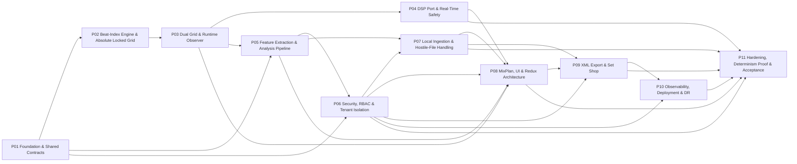
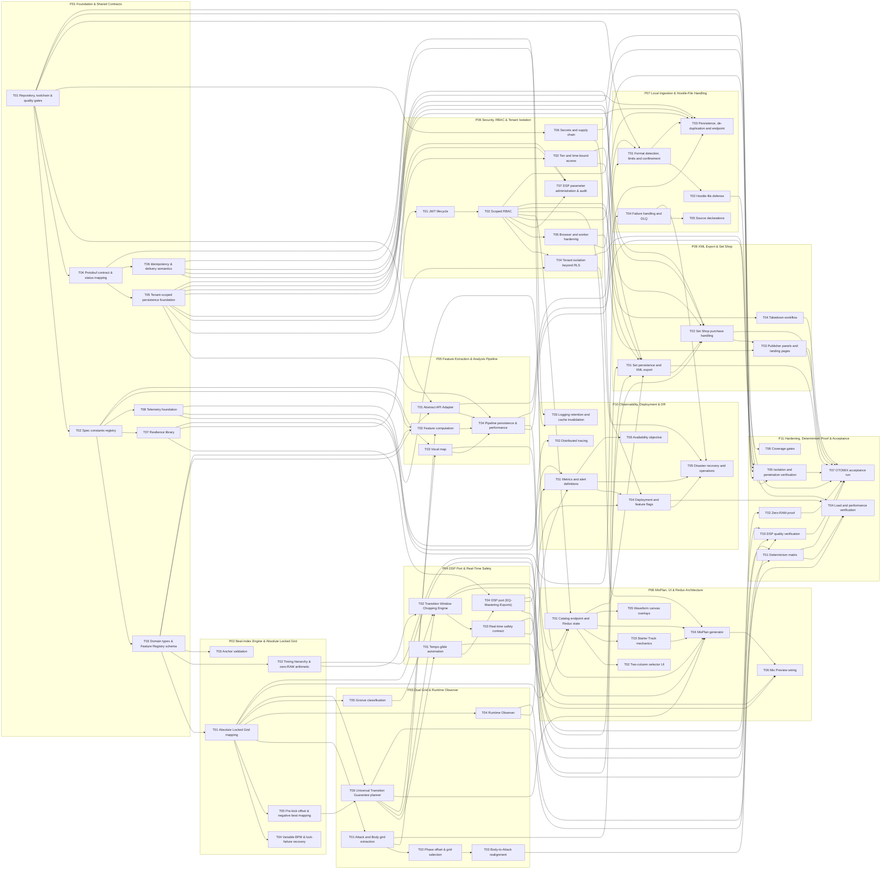

# OTOMIX Micro-Task Plan

**Document:** `OTOMIX_MicroTask_Plan.md`  
**Baseline:** `OTOMIX_Architecture_Spec.md` (OTOMIX-specific) and the Mother Document `Software_Arch_Spec__Main_.md` including its Engineering Delivery Addendum  
**Citation convention:** `OTOMIX §x.y` cites `OTOMIX_Architecture_Spec.md`; `Mother §x.y` cites the Mother Document; `Add. §n` cites the Mother Document's Engineering Delivery Addendum.  
**Status values:** `TODO`, or `[BLOCKED: OWNER DECISION OQ-nn]` where the specification has a gap (see Open Questions). No task is marked DONE in this file.  
**Spec-derived vs. added content:** a task's constraint comes from the cited section. Test tolerances written as 'default' in a test assertion are test parameters chosen here and are recorded in the task's Review Checkpoint; they are not specification requirements.

## Table of Contents

1. [Phase Overview Table](#1-phase-overview-table)
2. [Dependency Graph](#2-dependency-graph)
3. [Phase-by-Phase Breakdown](#3-phase-by-phase-breakdown)
   - [P01 Foundation & Shared Contracts](#p01)
   - [P02 Beat-Index Engine & Absolute Locked Grid](#p02)
   - [P03 Dual Grid & Runtime Observer](#p03)
   - [P04 DSP Port & Real-Time Safety](#p04)
   - [P05 Feature Extraction & Analysis Pipeline](#p05)
   - [P06 Security, RBAC & Tenant Isolation](#p06)
   - [P07 Local Ingestion & Hostile-File Handling](#p07)
   - [P08 MixPlan, UI & Redux Architecture](#p08)
   - [P09 XML Export & Set Shop](#p09)
   - [P10 Observability, Deployment & DR](#p10)
   - [P11 Hardening, Determinism Proof & Acceptance](#p11)
4. [Test Matrix](#4-test-matrix)
5. [Traceability Matrix](#5-traceability-matrix)
6. [Review Log](#6-review-log)
7. [Open Questions](#7-open-questions)

## 1. Phase Overview Table

Phase order differs from the suggested list in one respect, with justification: **Security, RBAC & Tenant Isolation is placed as P06**, ahead of Local Ingestion (P07), MixPlan/UI (P08) and XML Export & Set Shop (P09). Those phases expose scope-gated endpoints (OTOMIX §9.4, §7.1, §7.3) and must be built and tested against real tokens, scopes, tier grants and RLS; keeping Security ninth would force earlier tasks to depend on later ones. All other phase names and the 11-phase count follow the suggested set. The Transition Window Chopping Engine and tempo glide are placed in P04 (they render audio through the DSP port); the Universal Transition Guarantee planner is in P03 (it consumes grids and emits plans).

| Phase | Name | Objective | Upstream | Downstream | Est. micro-tasks |
|---|---|---|---|---|---|
| P01 | Foundation & Shared Contracts | Establish the monorepo, quality gates, the frozen constants registry, domain types, the Protobuf and Feature Registry contracts, the tenant-scoped database foundation with RLS, idempotency and delivery primitives, the retry/degraded-mode library, and the telemetry wrapper. | — | P02, P05, P06 | 23 |
| P02 | Beat-Index Engine & Absolute Locked Grid | Implement the transient-independent Absolute Locked Grid: the t(i) mapping with drift and period bounds, hard anchor synchronization, piecewise variable-BPM grids, grid-lock failure recovery, anchor validation, negative-index pre-kick mapping, and the zero-RAM structural arithmetic with its proof harness. | P01 | P03 | 18 |
| P03 | Dual Grid & Runtime Observer | Build the Attack Grid and Body Grid extractors, the Δϕ phase offset, the Body-to-Attack realignment curves, the asynchronous Runtime Observer, the groove classifier, and the Universal Transition Guarantee planner that turns grids into a never-cancelling transition plan. | P02 | P04, P05, P08 | 24 |
| P04 | DSP Port & Real-Time Safety | Execute the plans from Phase 03: tempo-glide automation, the Transition Window Chopping Engine with zero-click crossfades, the real-time-safe audio callback infrastructure (lock-free parameters, smoothing, denormals, audit tooling), and the EQ-Mastering-Exports DSP port with mock drivers, EQ, multi-band compression, a 4x-oversampled limiter, export encoding and the degraded-mode crossfade. | P03 | P08, P11 | 29 |
| P05 | Feature Extraction & Analysis Pipeline | Implement the Abstract API Adapter (44.1 kHz mono normalization, JSON Schema/SemVer contracts, WASM memory discipline, crash/timeout fallback), compute and validate the Feature Registry v1.2 contents (seed BPM, energy, mixability, vocal map, interpolation, cache invalidation), and persist results transactionally under tenant isolation within the 2500 ms and <1.5x real-time budgets. | P01, P03 | P06, P07, P08 | 22 |
| P06 | Security, RBAC & Tenant Isolation | Deliver the JWT lifecycle with rotation and a Redis deny-list, scoped RBAC with explicit per-endpoint scopes and the OTOMIX issuable-scope allow-list, time-bound tier grants, tenant isolation beyond RLS (route non-exposure, per-tenant pools, keys and namespaces), browser/worker hardening, secrets and supply-chain controls, and the DSP parameter administration path with audit. | P01, P05 | P07, P08, P09, P10, P11 | 26 |
| P07 | Local Ingestion & Hostile-File Handling | Implement the OTOMIX local-file ingestion path: content-based format detection, size/duration limits, directory confinement, sandboxed decoding and normalization, rejection and fuzz-testing of hostile containers, content-hash de-duplication, the scope-gated idempotent ingest endpoint with a single-transaction commit, rate limiting, and dead-letter handling with idempotent replay. | P05, P06 | P08, P09, P11 | 16 |
| P08 | MixPlan, UI & Redux Architecture | Build the catalog endpoint and the React/Redux client: normalized library and ordered queue state, the two-column selector with skeleton and empty states, the Starter Track warning, the MixPlan generator (weighted recommendation, tie-breaks, vocal-gated offsets, PlanTransition calls), waveform canvas overlays for vocal zones and pre-kick offsets, and Mix Preview wired to the Runtime Observer through the DSP port. | P03, P04, P05, P06, P07 | P09, P11 | 18 |
| P09 | XML Export & Set Shop | Persist compiled sets, generate tier-gated DJ-software XML metadata for Rekordbox, Traktor, VirtualDJ and Serato from the Attack Grid, implement the Set Shop purchase handler (provider-neutral port, signed webhooks, transactional entitlements, idempotent bundle generation, signed expiring downloads, lossless gating), publisher landing pages with safe rendering, and the two-tier takedown workflow. | P06, P07, P08 | P10, P11 | 20 |
| P10 | Observability, Deployment & DR | Make the platform operable: emit and alert on the specified metrics, propagate traces from UI to worker, enforce log retention and event-driven cache invalidation, deploy with Kubernetes Blue/Green and HPA, wire LaunchDarkly guarded rollouts with kill switches, automate rollback on the stated triggers, and prove disaster recovery (RPO < 15 minutes, RTO < 1 hour), runbooks, chaos experiments and the 99.9% SLO. | P06, P09 | P11 | 20 |
| P11 | Hardening, Determinism Proof & Acceptance | Prove the four architectural acceptance criteria and the quantitative NFRs: the 10,000-pairing determinism matrix, the zero-RAM heap proof and CPU overhead, null/pitch/bit-safety audio quality tests, load and memory soak tests, tenant-isolation and penetration verification, coverage gates, and the OTOMIX §10.9 acceptance run that produces the evidence bundle for sign-off. | P04, P06, P07, P08, P09, P10 | — | 22 |
| | **Total** | | | | **238** |

## 2. Dependency Graph

### 2.1 Phase level

### 2.2 Main-task level

Edges are derived from the micro-task `Prerequisites` fields (an edge `A --> B` exists when a micro-task in B lists a prerequisite in A).

## 3. Phase-by-Phase Breakdown

### P01 Foundation & Shared Contracts

**Objective.** Establish the monorepo, quality gates, the frozen constants registry, domain types, the Protobuf and Feature Registry contracts, the tenant-scoped database foundation with RLS, idempotency and delivery primitives, the retry/degraded-mode library, and the telemetry wrapper. Every later phase consumes these artifacts; nothing here contains audio logic.

**Entry criteria**

- OTOMIX_Architecture_Spec.md approved as the baseline.
- Owner has acknowledged the Open Questions list (blocked tasks stay blocked; unblocked work proceeds).

**Exit criteria**

- `pnpm -r build` and `pnpm -r test` are green in CI.
- Protobuf `otodsp.core.v1` and Feature Registry schema v1.2 are frozen and lint-clean.
- Migrations apply forward/back on a clean PostgreSQL; RLS denies cross-tenant reads.
- Idempotency, dedup, retry and logging primitives are published as internal packages.

**Upstream phases:** none  
**Downstream phases:** P02, P05, P06  
**Micro-tasks:** 23

#### P01-T01 Repository, toolchain & quality gates

*Spec basis:* OTOMIX §9.1; §10.6; §7.9

##### P01-T01-S01 Workspace and build

###### P01-T01-S01-M01 — [x]

| Field | Value |
|---|---|
| ID | `P01-T01-S01-M01` |
| Description | Initialize a pnpm monorepo with packages `core`, `access`, `adapter`, `gateway`, `workers`, `ui`, `db`, `proto`, `contracts`, strict TypeScript, ESLint and Prettier. |
| Expected Outcome | `pnpm -r build` exits 0; every package tsconfig has `strict: true`. |
| Prerequisites | None |
| Independent Test(s) | **unit** · Vitest · `tools/test/workspace.spec.ts` Input: workspace manifest. Expected: the 9 packages resolve and each tsconfig has strict=true. Pass: 0 failed assertions. |
| Spec Reference | OTOMIX §9.1 · Mother Add. §1–§2 |
| Review Checkpoint | Re-read `pnpm-workspace.yaml` and each `package.json`; run `pnpm -r exec madge --circular` and confirm no cycles. |

##### P01-T01-S02 Quality gates

###### P01-T01-S02-M01 — [x]

| Field | Value |
|---|---|
| ID | `P01-T01-S02-M01` |
| Description | Configure Vitest coverage thresholds of 90% branches for `packages/core` and 100% branches for `packages/access`. |
| Expected Outcome | `vitest.config.ts` fails the run when a threshold is not met. |
| Prerequisites | `P01-T01-S01-M01` |
| Independent Test(s) | **unit** · Vitest · `tools/test/coverage-config.spec.ts` Input: parsed config. Expected: thresholds core.branches=90 and access.branches=100. Pass: strict equality. |
| Spec Reference | OTOMIX §10.6 · Mother §8.2 |
| Review Checkpoint | Diff `vitest.config.ts`; confirm thresholds are per-package, not global. |

###### P01-T01-S02-M02 — [x]

| Field | Value |
|---|---|
| ID | `P01-T01-S02-M02` |
| Description | Implement `scripts/cvss-gate.ts` that exits non-zero when any scanner finding has CVSS ≥ 7.0 and wire it as a blocking CI step. |
| Expected Outcome | Script plus a CI job that halts the deploy job on non-zero exit. |
| Prerequisites | `P01-T01-S01-M01` |
| Independent Test(s) | **unit** · Vitest · `scripts/test/cvss-gate.spec.ts` Input: fixtures with max CVSS 6.9 and 7.0. Expected: exit codes 0 and 1 respectively. Pass: both match. |
| Spec Reference | OTOMIX §7.9 · Mother §8.3; Add. §6 |
| Review Checkpoint | Read the CI workflow and confirm the deploy job `needs:` the gate job. |

#### P01-T02 Spec constants registry

*Spec basis:* OTOMIX §3.1–3.9; §4.1–4.5; §7.4; §8.7

##### P01-T02-S01 Frozen constants

###### P01-T02-S01-M01 — [x]

| Field | Value |
|---|---|
| ID | `P01-T02-S01-M01` |
| Description | Create `packages/core/src/constants/timing.ts` exporting frozen constants: LOOKAHEAD_MS=50, SCHED_ACCURACY_MS=2, DRIFT_THRESHOLD_MS=4, STARVATION_FRAME_MS=10, BUFFER_NORMAL=2048, BUFFER_DEGRADED=4096, PORT_BUFFER_SAMPLES=1024, PORT_LATENCY_MS=10, ANALYSIS_TIMEOUT_MS=5000, EXTRACTION_ALERT_MS=2500, OBSERVER_CYCLE_MS=1. |
| Expected Outcome | File with `Object.freeze`d constants, each with a spec-section comment. |
| Prerequisites | `P01-T01-S01-M01` |
| Independent Test(s) | **unit** · Vitest · `packages/core/test/constants.timing.spec.ts` Input: import constants. Expected: values equal the list in the description and `Object.isFrozen` is true. Pass: 11 equalities. |
| Spec Reference | OTOMIX §3.3; §3.6; §3.11; §4.1; §8.3 · Mother §2.3; §2.6; §3.6, Add. §12; §3.1; §9.1; Add. §7 |
| Review Checkpoint | Compare each constant against OTOMIX §3.13 table line by line. |

###### P01-T02-S01-M02 — [x]

| Field | Value |
|---|---|
| ID | `P01-T02-S01-M02` |
| Description | Create `packages/core/src/constants/grid.ts` exporting: PERIOD_MIN=0.95, PERIOD_MAX=1.05, DRIFT_MAX_S=0.05, ANCHOR_SYNC_BARS=16, BODY_REALIGN_DBFS=-40, FALLBACK_TRANSIENT_DBFS=-12, CORR_MIN=0.85, SHAPE_VAR_MAX=0.15, STRAIGHT_VAR=0.02, TRIPLET_VAR=0.05, SWING_MIN=0.05, SWING_MAX=0.33, IRREGULAR_XFADE_EXTRA_MS=10, STATIC_GRID_BPM=120, SAFETY_XFADE_BARS=4, QUANTUM_DIVISOR=24, GLIDE_MAX=0.08, PITCH_NODE_SEMITONES=1, REALIGN_MAX_SEMITONES=0.05, RATE_MIN=0.98, RATE_MAX=1.02, RATE_SLEW_PER_S=0.005. |
| Expected Outcome | Frozen constants file with spec comments. |
| Prerequisites | `P01-T02-S01-M01` |
| Independent Test(s) | **unit** · Vitest · `packages/core/test/constants.grid.spec.ts` Input: import constants. Expected: 22 values equal the description. Pass: all equal. |
| Spec Reference | OTOMIX §3.1; §3.2; §3.4; §3.5; §3.6; §3.7; §3.9 · Mother §2.1; §2.2; §2.4; §2.5; §2.6; §2.7; §2.9 |
| Review Checkpoint | Cross-check each value against Mother Document §2.1–§2.9 text. |

###### P01-T02-S01-M03 — [x]

| Field | Value |
|---|---|
| ID | `P01-T02-S01-M03` |
| Description | Create `packages/core/src/constants/scoring.ts` and `packages/access/src/constants.ts` exporting: ENERGY_WEIGHTS=[0.4,0.3,0.2,0.1], MIX_WEIGHTS=[0.4,0.3,0.2,0.1], UNMIXABLE_BELOW=0.4, VOCAL_THRESHOLD=0.65, VOCAL_MEDIAN_S=1, RECO_WEIGHTS=[0.6,0.3,0.1], TEMPO_DELTA_LIMIT=0.01, WASM_HEAP_MB=512, ACCESS_TTL_MIN=15, REFRESH_TTL_DAYS=7, KEY_ROTATION_DAYS=90, IDEMPOTENCY_TTL_H=24, MAX_RETRIES=3, RPO_MIN=15, RTO_MIN=60, SLO=0.999. |
| Expected Outcome | Two frozen constant files with spec comments. |
| Prerequisites | `P01-T02-S01-M02` |
| Independent Test(s) | **unit** · Vitest · `packages/core/test/constants.scoring.spec.ts` Input: import constants. Expected: 15 values equal the description. Pass: all equal. |
| Spec Reference | OTOMIX §4.3; §4.4; §4.5; §4.9; §7.4; §7.5; §8.9; §9.3 · Mother §3.3; §3.4; §3.5; §6; Add. §11; §8.3; Add. §6; §9.3; Add. §8; Add. §1–§2 |
| Review Checkpoint | Verify against OTOMIX §4.3–§4.9 and §7.4; ensure no duplicate definitions elsewhere (`grep -rn '0.65'`). |

#### P01-T03 Domain types & Feature Registry schema

*Spec basis:* OTOMIX §4.2; §9.6; §3.10

##### P01-T03-S01 Validated domain types

###### P01-T03-S01-M01 — [x]

| Field | Value |
|---|---|
| ID | `P01-T03-S01-M01` |
| Description | Implement `BPM.parse(n)` returning a branded type, rejecting values outside [60.0, 200.0] with INVALID_ARGUMENT. |
| Expected Outcome | `packages/core/src/types/bpm.ts`. |
| Prerequisites | `P01-T02-S01-M02` |
| Independent Test(s) | **unit** · Vitest · `packages/core/test/types.bpm.spec.ts` Input: 59.999, 60.0, 200.0, 200.001, NaN. Expected: reject, accept, accept, reject, reject. Pass: matches. |
| Spec Reference | OTOMIX §4.2; §9.5 · Mother §3.2; Add. §1–§2 |
| Review Checkpoint | Confirm error type is the typed INVALID_ARGUMENT result, not a thrown generic Error. |

###### P01-T03-S01-M02 — [x]

| Field | Value |
|---|---|
| ID | `P01-T03-S01-M02` |
| Description | Implement `CamelotKey.parse(s)` accepting `^(1[0-2]\|[1-9])[AB]$` only. |
| Expected Outcome | `packages/core/src/types/camelot.ts`. |
| Prerequisites | `P01-T03-S01-M01` |
| Independent Test(s) | **unit** · Vitest · `packages/core/test/types.camelot.spec.ts` Input: '1A','12B','13A','0B','5C','a5'. Expected: accept, accept, reject x4. Pass: matches. |
| Spec Reference | OTOMIX §4.2; §9.6 · Mother §3.2; Add. §1–§2 |
| Review Checkpoint | Compare regex to the one in `features.camelot_key` CHECK (§9.5). |

###### P01-T03-S01-M03 — [x]

| Field | Value |
|---|---|
| ID | `P01-T03-S01-M03` |
| Description | Implement `BeatIndex.parse(i)` accepting any non-zero safe integer and rejecting 0 and non-integers. |
| Expected Outcome | `packages/core/src/types/beat-index.ts`. |
| Prerequisites | `P01-T03-S01-M02` |
| Independent Test(s) | **unit** · Vitest · `packages/core/test/types.beat-index.spec.ts` Input: -5,-1,0,1,1.5. Expected: accept,accept,reject,accept,reject. Pass: matches. |
| Spec Reference | OTOMIX §3.10 · Mother §2.10 |
| Review Checkpoint | Confirm index zero rejection matches §3.10 'Index zero is not assigned'. |

##### P01-T03-S02 Feature Registry v1.2 schema

###### P01-T03-S02-M01 — [x]

| Field | Value |
|---|---|
| ID | `P01-T03-S02-M01` |
| Description | Add the Draft 7 JSON Schema from §9.6 as `packages/contracts/schemas/feature-registry-1.2.json` with an AJV validator wrapper. |
| Expected Outcome | Schema file and `validateRegistry()` returning typed results. |
| Prerequisites | `P01-T03-S01-M02` |
| Independent Test(s) | **unit** · Vitest · `packages/contracts/test/registry-schema.spec.ts` Input: valid fixture, fixture with bpm 59.9, fixture with `vocal_map.threshold` 0.6. Expected: valid, invalid, invalid. Pass: matches. |
| Spec Reference | OTOMIX §9.6; §4.2 · Mother Add. §1–§2; §3.2 |
| Review Checkpoint | Diff the file against OTOMIX §9.6; confirm `required` arrays are unchanged. |

###### P01-T03-S02-M02 — [x]

| Field | Value |
|---|---|
| ID | `P01-T03-S02-M02` |
| Description | Implement a SemVer gate for `schema_version`: accept `1.2.x`, flag a major bump as `PURGE_AND_REANALYZE`, reject other minors. |
| Expected Outcome | `packages/contracts/src/semver-gate.ts`. |
| Prerequisites | `P01-T03-S02-M01` |
| Independent Test(s) | **unit** · Vitest · `packages/contracts/test/semver-gate.spec.ts` Input: '1.2.7','1.3.0','2.0.0'. Expected: ACCEPT, REJECT, PURGE_AND_REANALYZE. Pass: matches. |
| Spec Reference | OTOMIX §4.1; §4.2 · Mother §3.1; §3.2 |
| Review Checkpoint | Re-read §4.2 cache invalidation sentence ('major version increment'). |

#### P01-T04 Protobuf contract & status mapping

*Spec basis:* OTOMIX §9.2; §9.3; §2.3

##### P01-T04-S01 Core gRPC contract

###### P01-T04-S01-M01 — TODO

| Field | Value |
|---|---|
| ID | `P01-T04-S01-M01` |
| Description | Write `proto/core/v1/core.proto` exactly as §9.2 (messages `AnalyzeAudioRequest`, `AnalyzeAudioResponse`, `TransitionPlanRequest`, `ExecutionFallback` and the supporting types) and generate TypeScript stubs. |
| Expected Outcome | Proto file plus generated stubs checked in or generated by `pnpm -F proto gen`. |
| Prerequisites | `P01-T01-S01-M01` |
| Independent Test(s) | **contract** · buf · `proto/core/v1/core.proto` Input: file. Expected: `buf lint` exit 0 and `buf breaking --against baseline` reports no breaks; descriptor field numbers for `AnalyzeAudioRequest.idempotency_key`=6 and `DspParameterUpdate.sequence`=6. Pass: all true. |
| Spec Reference | OTOMIX §9.2; §2.3 · Mother Add. §1–§2; §1; Add. §3 |
| Review Checkpoint | Diff field names and numbers against OTOMIX §9.2; confirm no reused numbers. |

##### P01-T04-S02 Status mapping

###### P01-T04-S02-M01 — TODO

| Field | Value |
|---|---|
| ID | `P01-T04-S02-M01` |
| Description | Implement the gRPC-to-HTTP status map from §9.3 as `mapStatus(code)` including the nine listed codes. |
| Expected Outcome | `packages/gateway/src/status-map.ts`. |
| Prerequisites | `P01-T04-S01-M01` |
| Independent Test(s) | **unit** · Vitest · `packages/gateway/test/status-map.spec.ts` Input: each of INVALID_ARGUMENT, UNAUTHENTICATED, PERMISSION_DENIED, NOT_FOUND, ABORTED, RESOURCE_EXHAUSTED, DEADLINE_EXCEEDED, UNAVAILABLE, INTERNAL. Expected: 400,401,403,404,409,429,504,503,500. Pass: 9/9. |
| Spec Reference | OTOMIX §9.3 · Mother Add. §1–§2 |
| Review Checkpoint | Re-read the §9.3 table; confirm ALREADY_EXISTS also maps to 409. |

#### P01-T05 Tenant-scoped persistence foundation

*Spec basis:* OTOMIX §9.5; §2.8

##### P01-T05-S01 Migrations and RLS

###### P01-T05-S01-M01 — TODO

| Field | Value |
|---|---|
| ID | `P01-T05-S01-M01` |
| Description | Write migration `001_core.sql` creating `features`, `users`, `tier_grants`, `admin_audit` (range-partitioned by month) and `outbox` exactly per §9.5 CHECK constraints and indices. |
| Expected Outcome | Reversible migration applied by `pnpm -F db migrate`. |
| Prerequisites | `P01-T04-S01-M01` |
| Independent Test(s) | **integration** · Vitest + Testcontainers PostgreSQL · `packages/db/test/migrate.spec.ts` Input: migrate up/down; insert bpm 59.9, camelot '13A', tenant 'x'. Expected: up/down succeed; 3 inserts fail on CHECK. Pass: 3 constraint violations. |
| Spec Reference | OTOMIX §9.5 · Mother Add. §1–§2 |
| Review Checkpoint | Run `\d+ features` and compare constraints with §9.5. |

###### P01-T05-S01-M02 — TODO

| Field | Value |
|---|---|
| ID | `P01-T05-S01-M02` |
| Description | Add RLS (`ENABLE` + `FORCE`) and the `tenant_isolation` policy to every tenant-carrying table and create an application role without BYPASSRLS that does not own the tables. |
| Expected Outcome | Migration `002_rls.sql`. |
| Prerequisites | `P01-T05-S01-M01` |
| Independent Test(s) | **integration** · Vitest + Testcontainers PostgreSQL · `packages/db/test/rls.spec.ts` Input: rows for 'otomix' and 'otodj'; sessions with app.tenant_id='otomix','otodj', unset. Expected: sees own rows only; unset sees 0. Pass: counts 1/1/0. |
| Spec Reference | OTOMIX §9.5; §2.2 · Mother Add. §1–§2; §1; Add. §3 |
| Review Checkpoint | Query `pg_roles` for rolbypassrls=false and `pg_class.relforcerowsecurity` for every table. |

###### P01-T05-S01-M03 — TODO

| Field | Value |
|---|---|
| ID | `P01-T05-S01-M03` |
| Description | Implement `withTenant(tx, tenantId)` using `set_config('app.tenant_id', $1, true)` (transaction-local) and make the gateway repository layer require it. |
| Expected Outcome | `packages/db/src/with-tenant.ts`. |
| Prerequisites | `P01-T05-S01-M02` |
| Independent Test(s) | **integration** · Vitest + Testcontainers PostgreSQL · `packages/db/test/with-tenant.spec.ts` Input: commit a transaction and start a new one on the same connection. Expected: `current_setting('app.tenant_id', true)` is empty in the new transaction. Pass: empty string/null. |
| Spec Reference | OTOMIX §9.5; §7.10 · Mother Add. §1–§2; §8.3; Add. §6 |
| Review Checkpoint | Grep for repository calls that bypass `withTenant`; expect 0. |

#### P01-T06 Idempotency & delivery semantics

*Spec basis:* OTOMIX §9.3; §9.9

##### P01-T06-S01 Idempotency-Key

###### P01-T06-S01-M01 — TODO

| Field | Value |
|---|---|
| ID | `P01-T06-S01-M01` |
| Description | Implement middleware validating `Idempotency-Key` as UUIDv4 on POST/PUT/PATCH/DELETE; missing or malformed returns INVALID_ARGUMENT/400. |
| Expected Outcome | `packages/gateway/src/idempotency/validate.ts`. |
| Prerequisites | `P01-T04-S01-M01` |
| Independent Test(s) | **unit** · Vitest · `packages/gateway/test/idem-validate.spec.ts` Input: missing header, UUIDv1, UUIDv4. Expected: 400,400,pass-through. Pass: matches. |
| Spec Reference | OTOMIX §9.3 · Mother Add. §1–§2 |
| Review Checkpoint | Confirm GET/HEAD are exempt. |

###### P01-T06-S01-M02 — TODO

| Field | Value |
|---|---|
| ID | `P01-T06-S01-M02` |
| Description | Implement the Redis store: `SET NX` with an in-progress marker, 24 h TTL, request fingerprint; same key and fingerprint replays the stored response, different fingerprint returns ABORTED/409. |
| Expected Outcome | `packages/gateway/src/idempotency/store.ts`. |
| Prerequisites | `P01-T06-S01-M01` |
| Independent Test(s) | **integration** · Vitest + Testcontainers Redis · `packages/gateway/test/idem-store.spec.ts` Input: two requests with the same key; one with a different body. Expected: handler runs once; replay equals the first response; third returns 409; TTL=86400±5 s. Pass: all four. |
| Spec Reference | OTOMIX §9.3 · Mother Add. §1–§2 |
| Review Checkpoint | Inspect the Redis key with `TTL` and `GET`; confirm the `otomix:idem:` prefix. |

##### P01-T06-S02 Receiver dedup

###### P01-T06-S02-M01 — TODO

| Field | Value |
|---|---|
| ID | `P01-T06-S02-M01` |
| Description | Implement a receiver dedup store keyed by `message_id` (TTL ≥ 24 h) with per-tenant monotonic `sequence` ordering and signature validation performed before the dedup write. |
| Expected Outcome | `packages/db/src/receiver-dedup.ts`. |
| Prerequisites | `P01-T04-S02-M01` |
| Independent Test(s) | **unit** · Vitest · `packages/db/test/receiver-dedup.spec.ts` Input: duplicate message_id; sequence 5 before 4; tampered signature. Expected: second dropped; out-of-order rejected or held; tampered rejected with no dedup record written. Pass: 3 outcomes. |
| Spec Reference | OTOMIX §9.9; §7.2 · Mother Add. §1–§2; §5.2 |
| Review Checkpoint | Confirm signature check precedes the dedup `SET` in code order. |

#### P01-T07 Resilience library

*Spec basis:* OTOMIX §2.5; §2.12

##### P01-T07-S01 Retry and timeouts

###### P01-T07-S01-M01 — TODO

| Field | Value |
|---|---|
| ID | `P01-T07-S01-M01` |
| Description | Implement `retry(fn, {idempotent})` with at most 3 retries, base 200 ms, multiplier 2, full jitter, 5 000 ms cap, and a hard refusal to retry non-idempotent calls. |
| Expected Outcome | `packages/core/src/resilience/retry.ts`. |
| Prerequisites | `P01-T02-S01-M03` |
| Independent Test(s) | **unit** · Vitest (fake timers) · `packages/core/test/retry.spec.ts` Input: always-failing fn with a seeded RNG, idempotent true and false. Expected: 4 total attempts when idempotent, delays ≤ min(5000, 200·2^n); 1 attempt when false. Pass: matches. |
| Spec Reference | OTOMIX §2.5; §9.3 · Mother §1; Add. §3; Add. §1–§2 |
| Review Checkpoint | Verify the RNG is injected so the test is deterministic. |

##### P01-T07-S02 Degraded-mode controller

###### P01-T07-S02-M01 — TODO

| Field | Value |
|---|---|
| ID | `P01-T07-S02-M01` |
| Description | Implement `DegradedModeController` entering on pool exhaustion or worker failure and exiting on recovery, exposing `core.degraded_mode.active`. |
| Expected Outcome | `packages/core/src/resilience/degraded.ts`. |
| Prerequisites | `P01-T07-S01-M01` |
| Independent Test(s) | **unit** · Vitest · `packages/core/test/degraded.spec.ts` Input: events POOL_EXHAUSTED, WORKER_FAILED, RECOVERED. Expected: state enters on the first two, exits on RECOVERED, gauge 1→0. Pass: transitions match. |
| Spec Reference | OTOMIX §2.5; §2.12 · Mother §1; Add. §3 |
| Review Checkpoint | Check there is no code path that exits degraded mode without a RECOVERED event. |

#### P01-T08 Telemetry foundation

*Spec basis:* OTOMIX §8.2; §8.4

##### P01-T08-S01 Logging and trace propagation

###### P01-T08-S01-M01 — TODO

| Field | Value |
|---|---|
| ID | `P01-T08-S01-M01` |
| Description | Implement the JSON logger with required fields (ts, level, service, tenant_id, trace_id, span_id, event, outcome, country, duration_ms), edge PII masking and country truncation to ISO 3166-1 Alpha-2. |
| Expected Outcome | `packages/core/src/telemetry/logger.ts`. |
| Prerequisites | `P01-T02-S01-M03` |
| Independent Test(s) | **unit** · Vitest · `packages/core/test/logger.spec.ts` Input: record with ip '203.0.113.7', email, country 'Germany', lat/long. Expected: ip/email masked or absent, country rejected unless 2-letter, lat/long dropped. Pass: none of the raw values appear in output JSON. |
| Spec Reference | OTOMIX §8.4 · Mother §9.1; Add. §7 |
| Review Checkpoint | Run the logger against a fixture and `grep` the output for the raw IP; expect 0 hits. |

###### P01-T08-S01-M02 — TODO

| Field | Value |
|---|---|
| ID | `P01-T08-S01-M02` |
| Description | Implement W3C `traceparent` propagation across REST headers, gRPC metadata and a `postMessage` envelope into Web Workers. |
| Expected Outcome | `packages/core/src/telemetry/propagation.ts`. |
| Prerequisites | `P01-T08-S01-M01` |
| Independent Test(s) | **unit** · Vitest · `packages/core/test/propagation.spec.ts` Input: inject then extract through a simulated postMessage hop. Expected: same trace_id, new span_id with the original as parent. Pass: ids match. |
| Spec Reference | OTOMIX §8.2 · Mother §9.1; Add. §7 |
| Review Checkpoint | Confirm the envelope carries `traceparent` as a string field, not a global. |

#### P01 Phase Integration Test Suite

- **P01-IT** — covers: Contracts: Protobuf descriptors, Feature Registry schema, constants registry, domain types, `withTenant`, Idempotency-Key middleware, receiver dedup, retry library, logger. Failure path: a request with an invalid BPM and a replayed Idempotency-Key with a different fingerprint.  
  Command: `pnpm vitest run --project p01-integration`  
  Pass criterion: All suites green; the invalid-BPM request returns INVALID_ARGUMENT/HTTP 400 and the fingerprint-mismatch replay returns ABORTED/HTTP 409; 0 skipped tests.

#### P01 Cross-Phase Integration Tests

| Test ID | Boundary | Stubbed (only the boundary) | Test file | Assertion and pass criterion |
|---|---|---|---|---|
| `X-P01-P02` | P01→P02 | Stub only the `BPM` and `BeatIndex` domain types as produced by P01 (no grid engine). | `packages/contracts/test/x-p01-p02.spec.ts` | Grid engine entry point `tOfI` accepts `BPM`/`BeatIndex` instances from P01 and rejects a raw number 59.9 and `BeatIndex(0)` with INVALID_ARGUMENT. Pass: both rejections, one acceptance. |
| `X-P01-P05` | P01→P05 | Stub the extractor; feed a P01-validated registry fixture to the adapter output contract. | `packages/contracts/test/x-p01-p05.spec.ts` | Adapter output serializer accepts a v1.2 fixture and rejects one with `schema_version: '1.3.0'`. Pass: 1 accept, 1 reject. |
| `X-P01-P06` | P01→P06 | Stub token verification; use P01 `withTenant` and RLS migration. | `packages/contracts/test/x-p01-p06.spec.ts` | Interceptor skeleton sets `app.tenant_id` from a claim via `withTenant`; a query under tenant 'otodj' returns 0 rows from the 'otomix' fixture. Pass: row count 0. |

### P02 Beat-Index Engine & Absolute Locked Grid

**Objective.** Implement the transient-independent Absolute Locked Grid: the t(i) mapping with drift and period bounds, hard anchor synchronization, piecewise variable-BPM grids, grid-lock failure recovery, anchor validation, negative-index pre-kick mapping, and the zero-RAM structural arithmetic with its proof harness. This phase is pure, deterministic, beat-unit logic with no audio I/O.

**Entry criteria**

- P01 exit criteria met (constants, types and contracts frozen).
- Seeded RNG and fake-clock utilities from P01 available.

**Exit criteria**

- `tOfI` and structural helpers pass all unit tests including negative indices.
- Anchor validation classifies the boundary cases exactly at 0.85 and 15%.
- Heap-proof harness runs and reports 0 bytes retained delta for timeline generation (formal proof is executed in P11).
- Grid recovery state is reachable and tested.

**Upstream phases:** P01  
**Downstream phases:** P03  
**Micro-tasks:** 18

#### P02-T01 Absolute Locked Grid mapping

*Spec basis:* OTOMIX §3.1

##### P02-T01-S01 t(i) function

###### P02-T01-S01-M01 — TODO

| Field | Value |
|---|---|
| ID | `P02-T01-S01-M01` |
| Description | Implement `tOfI(i, T0, bpmSeed, delta)` as `T0 + n·(60/bpmSeed) + delta` with n=i−1 for i≥1 and n=i for i≤−1. |
| Expected Outcome | `packages/core/src/grid/t-of-i.ts`. |
| Prerequisites | `P01-T03-S01-M01`, `P01-T03-S01-M03` |
| Independent Test(s) | **unit** · Vitest · `packages/core/test/grid.t-of-i.spec.ts` Input: bpmSeed=120, T0=0.25, delta=0, i=1,2,17. Expected: 0.25, 0.75, 8.25 s. Pass: \|actual−expected\|<1e-9. |
| Spec Reference | OTOMIX §3.1; §3.10 · Mother §2.1; §2.10 |
| Review Checkpoint | Re-read the §3.1 worked reference and §3.10 negative-index convention; confirm no code path reads or writes an array. |
| Notes | Acceptance criterion tag: AC1 (implements); Related open question (non-blocking): OQ-07 |

###### P02-T01-S01-M02 — TODO

| Field | Value |
|---|---|
| ID | `P02-T01-S01-M02` |
| Description | Clamp `delta` to ±0.05 s inside `tOfI` and increment counter `core.grid.delta_clamped` when clamping occurs. |
| Expected Outcome | Clamp branch plus counter. |
| Prerequisites | `P02-T01-S01-M01` |
| Independent Test(s) | **unit** · Vitest · `packages/core/test/grid.delta-clamp.spec.ts` Input: delta=0.06, −0.06, 0.05. Expected: 0.05, −0.05, 0.05 and counter increments 2. Pass: matches. |
| Spec Reference | OTOMIX §3.1 · Mother §2.1 |
| Review Checkpoint | Confirm the bound is read from `DRIFT_MAX_S`, not a literal. |

##### P02-T01-S02 Period and anchor discipline

###### P02-T01-S02-M01 — TODO

| Field | Value |
|---|---|
| ID | `P02-T01-S02-M01` |
| Description | Implement `boundPeriod(measured, seedPeriod)` constraining the result to [0.95, 1.05]×seedPeriod. |
| Expected Outcome | `packages/core/src/grid/period.ts`. |
| Prerequisites | `P02-T01-S01-M01` |
| Independent Test(s) | **unit** · Vitest · `packages/core/test/grid.period.spec.ts` Input: seedPeriod=0.5, measured=0.52, 0.4, 0.6. Expected: 0.52, 0.475, 0.525. Pass: matches within 1e-9. |
| Spec Reference | OTOMIX §3.1 · Mother §2.1 |
| Review Checkpoint | Check both bounds use the constants, with inclusive edges. |

###### P02-T01-S02-M02 — TODO

| Field | Value |
|---|---|
| ID | `P02-T01-S02-M02` |
| Description | Implement hard anchor synchronization every 16 bars (every 64 beats) that resets Δ to the measured anchor error. |
| Expected Outcome | `packages/core/src/grid/anchor-sync.ts`. |
| Prerequisites | `P02-T01-S02-M01` |
| Independent Test(s) | **unit** · Vitest · `packages/core/test/grid.anchor-sync.spec.ts` Input: 256 beats with linear drift 0.0005 s/beat. Expected: \|Δ\| at beats 64, 128, 192 resets to the measured error; \|Δ\|≤0.05 throughout. Pass: both. |
| Spec Reference | OTOMIX §3.1 · Mother §2.1 |
| Review Checkpoint | Confirm the sync interval derives from `ANCHOR_SYNC_BARS`×4. |

#### P02-T02 Timing hierarchy & zero-RAM arithmetic

*Spec basis:* OTOMIX §3.3; §3.15

##### P02-T02-S01 Structural helpers

###### P02-T02-S01-M01 — TODO

| Field | Value |
|---|---|
| ID | `P02-T02-S01-M01` |
| Description | Implement `floorMod`, `beatInBar`, `barIndex`, `blockPosition`, `isBlockBoundary` exactly as §3.15. |
| Expected Outcome | `packages/core/src/timing/structure.ts`. |
| Prerequisites | `P01-T03-S01-M03` |
| Independent Test(s) | **unit** · Vitest · `packages/core/test/timing.structure.spec.ts` Input: i in {-5,-1,1,4,5,17,64,65} with nBars 4/8/16/32. Expected: beatInBar(−1)=3, beatInBar(5)=1, blockPosition(65,16)=0, isBlockBoundary(65,16)=true. Pass: full table matches. |
| Spec Reference | OTOMIX §3.3; §3.15 · Mother §2.3; Add. §4 |
| Review Checkpoint | Re-read §3.15 and confirm every function is O(1) with no allocation. |
| Notes | Acceptance criterion tag: AC2 (implements) |

###### P02-T02-S01-M02 — TODO

| Field | Value |
|---|---|
| ID | `P02-T02-S01-M02` |
| Description | Implement `quantumSeconds(bpm)=(60/bpm)/24` and `quantumIndex(beatFloat)=round(beatFloat·24)`, operating on floating-point beat indices. |
| Expected Outcome | `packages/core/src/timing/quantum.ts`. |
| Prerequisites | `P02-T02-S01-M01` |
| Independent Test(s) | **unit** · Vitest · `packages/core/test/timing.quantum.spec.ts` Input: bpm=120; beatFloat=1.0208, 1.0417. Expected: 0.0208333 s; index 24, 25. Pass: matches within 1e-6. |
| Spec Reference | OTOMIX §3.3 · Mother §2.3 |
| Review Checkpoint | Confirm the divisor 24 is read from `QUANTUM_DIVISOR`. |
| Notes | Related open question (non-blocking): OQ-16 |

###### P02-T02-S01-M03 — TODO

| Field | Value |
|---|---|
| ID | `P02-T02-S01-M03` |
| Description | Implement `LookaheadScheduler` with a 50 ms lookahead and an injected clock, scheduling events on beat-based units. |
| Expected Outcome | `packages/core/src/timing/scheduler.ts`. |
| Prerequisites | `P02-T02-S01-M02` |
| Independent Test(s) | **unit** · Vitest (fake clock) · `packages/core/test/timing.scheduler.spec.ts` Input: 1 000 events with injected ±1.9 ms clock jitter. Expected: scheduled times within ±2 ms of target. Pass: max error ≤2 ms; a 2.1 ms jitter fixture reports a violation. |
| Spec Reference | OTOMIX §3.3 · Mother §2.3 |
| Review Checkpoint | Check the scheduler never reads wall-clock time directly. |

##### P02-T02-S02 Zero-RAM tooling

###### P02-T02-S02-M01 — TODO

| Field | Value |
|---|---|
| ID | `P02-T02-S02-M01` |
| Description | Create an ESLint rule `no-alloc-in-structural` that fails on array/object/typed-array allocation inside files tagged `@structural`. |
| Expected Outcome | Rule in `tools/eslint-rules/` and the tag applied to `structure.ts` and `quantum.ts`. |
| Prerequisites | `P02-T02-S01-M02` |
| Independent Test(s) | **unit** · ESLint RuleTester · `tools/eslint-rules/test/no-alloc.spec.ts` Input: snippets with `[]`, `new Array`, `new Float32Array`, and a pure arithmetic function. Expected: 3 errors, 0 errors. Pass: matches. |
| Spec Reference | OTOMIX §3.3; §3.15; §10.2 · Mother §2.3; Add. §4; §8.2 |
| Review Checkpoint | Run `eslint packages/core/src/timing` and confirm 0 violations. |
| Notes | Acceptance criterion tag: AC2 (implements) |

###### P02-T02-S02-M02 — TODO

| Field | Value |
|---|---|
| ID | `P02-T02-S02-M02` |
| Description | Write `scripts/heap-proof.ts` that generates timelines for 1-minute and 120-minute tracks and reports the retained-size delta using V8 heap statistics and a heap snapshot. |
| Expected Outcome | Script emitting `heap-proof.json`. |
| Prerequisites | `P02-T02-S02-M01` |
| Independent Test(s) | **integration** · Node + v8 heap snapshot (Vitest) · `scripts/test/heap-proof.spec.ts` Input: run the script against the structural helpers. Expected: `retainedDeltaBytes`=0 and identical for both durations. Pass: 0 and equal. |
| Spec Reference | OTOMIX §10.2; §3.15 · Mother §8.2; Add. §4 |
| Review Checkpoint | Open `heap-proof.json` and confirm both durations are present. |
| Notes | Acceptance criterion tag: AC2 (implements) |

#### P02-T03 Anchor validation

*Spec basis:* OTOMIX §3.4

##### P02-T03-S01 Primary kick validation

###### P02-T03-S01-M01 — TODO

| Field | Value |
|---|---|
| ID | `P02-T03-S01-M01` |
| Description | Implement Pearson correlation over 100 ms low-frequency energy envelopes, returning 0 for zero-variance inputs with a flag. |
| Expected Outcome | `packages/core/src/anchor/pearson.ts`. |
| Prerequisites | `P01-T03-S01-M03` |
| Independent Test(s) | **unit** · Vitest · `packages/core/test/anchor.pearson.spec.ts` Input: [1,2,3,4] vs [2,4,6,8], vs [4,3,2,1], vs [5,5,5,5]. Expected: 1.0, −1.0, 0 with flag. Pass: within 1e-9. |
| Spec Reference | OTOMIX §3.4 · Mother §2.4 |
| Review Checkpoint | Check the envelope window constant is 100 ms. |

###### P02-T03-S01-M02 — TODO

| Field | Value |
|---|---|
| ID | `P02-T03-S01-M02` |
| Description | Implement `classifyKick(candidate, refs)` returning OFF_BEAT when correlation < 0.85 or shape variance > 15% against the kicks at bars 5, 8 and 16. |
| Expected Outcome | `packages/core/src/anchor/classify.ts`. |
| Prerequisites | `P02-T03-S01-M01` |
| Independent Test(s) | **unit** · Vitest · `packages/core/test/anchor.classify.spec.ts` Input: r=0.85, 0.8499; variance 0.15, 0.1501. Expected: ON_BEAT, OFF_BEAT, ON_BEAT, OFF_BEAT. Pass: matches. |
| Spec Reference | OTOMIX §3.4 · Mother §2.4 |
| Review Checkpoint | Confirm comparisons are strict (`<`, `>`) per spec. |

###### P02-T03-S01-M03 — TODO

| Field | Value |
|---|---|
| ID | `P02-T03-S01-M03` |
| Description | Implement forward realignment of `T0` to the first validated primary downbeat in subsequent 4-bar blocks for OFF_BEAT candidates. |
| Expected Outcome | `packages/core/src/anchor/realign.ts`. |
| Prerequisites | `P02-T03-S01-M02` |
| Independent Test(s) | **unit** · Vitest · `packages/core/test/anchor.realign.spec.ts` Input: candidate at 0.10 s, validated downbeats at 8.10, 14.10, 30.10 s. Expected: T0 > 0.10 and equals the earliest validated downbeat. Pass: equality. |
| Spec Reference | OTOMIX §3.4 · Mother §2.4 |
| Review Checkpoint | Check realignment never moves T0 backward. |

###### P02-T03-S01-M04 — TODO

| Field | Value |
|---|---|
| ID | `P02-T03-S01-M04` |
| Description | Implement the fallback anchor: when no kick is found at bars 5, 8 or 16 (or the track is kick-less), anchor at the first transient exceeding −12 dBFS. |
| Expected Outcome | `packages/core/src/anchor/fallback.ts`. |
| Prerequisites | `P02-T03-S01-M03` |
| Independent Test(s) | **unit** · Vitest · `packages/core/test/anchor.fallback.spec.ts` Input: signal with transients at −20, −13, −11.9 dBFS. Expected: anchor at the −11.9 dBFS transient. Pass: timestamp equality. |
| Spec Reference | OTOMIX §3.4 · Mother §2.4 |
| Review Checkpoint | Confirm threshold constant equals −12. |

#### P02-T04 Variable BPM & lock-failure recovery

*Spec basis:* OTOMIX §3.1

##### P02-T04-S01 Grid model states

###### P02-T04-S01-M01 — TODO

| Field | Value |
|---|---|
| ID | `P02-T04-S01-M01` |
| Description | Implement a piecewise `GridModel` with BPM_seed updates at predefined structural boundaries and continuity at each boundary. |
| Expected Outcome | `packages/core/src/grid/model.ts`. |
| Prerequisites | `P02-T01-S02-M02` |
| Independent Test(s) | **unit** · Vitest · `packages/core/test/grid.piecewise.spec.ts` Input: segments 120 BPM for 32 beats then 124 BPM. Expected: t(33) from segment two equals t(32)+60/120 within 1e-9; strictly increasing across the boundary. Pass: both. |
| Spec Reference | OTOMIX §3.1 · Mother §2.1 |
| Review Checkpoint | Confirm segment boundaries fall on structural block boundaries. |

###### P02-T04-S01-M02 — TODO

| Field | Value |
|---|---|
| ID | `P02-T04-S01-M02` |
| Description | Implement the lock-failure recovery state: fall back to the track's global average BPM and disable micro-adjustments (Δ≡0). |
| Expected Outcome | `GridModel.enterRecovery()`. |
| Prerequisites | `P02-T04-S01-M01` |
| Independent Test(s) | **unit** · Vitest · `packages/core/test/grid.recovery.spec.ts` Input: forced lock failure on a drifting fixture. Expected: state=RECOVERY, bpm=global average, delta=0 for all i. Pass: all true. |
| Spec Reference | OTOMIX §3.1 · Mother §2.1 |
| Review Checkpoint | Check there is no exit from RECOVERY inside a single transition. |

#### P02-T05 Pre-kick offset & negative beat mapping

*Spec basis:* OTOMIX §3.10

##### P02-T05-S01 Dual-offset strategy

###### P02-T05-S01-M01 — TODO

| Field | Value |
|---|---|
| ID | `P02-T05-S01-M01` |
| Description | Implement pre-kick gap < 1 bar: assign the kick downbeat Beat 1 and earlier frames Beat −1, −2, −3. |
| Expected Outcome | `packages/core/src/grid/prekick-short.ts`. |
| Prerequisites | `P02-T01-S01-M01` |
| Independent Test(s) | **unit** · Vitest · `packages/core/test/grid.prekick-short.spec.ts` Input: BPM 120, kick at 1.2 s, gap 1.2 s (<1 bar of 2.0 s). Expected: frame at 0.7 s → Beat −1, 0.2 s → Beat −2... within the gap. Pass: indices match the skip-zero convention. |
| Spec Reference | OTOMIX §3.10 · Mother §2.10 |
| Review Checkpoint | Confirm Beat 0 is never produced. |
| Notes | Related open question (non-blocking): OQ-07 |

###### P02-T05-S01-M02 — [BLOCKED: OWNER DECISION OQ-07]

| Field | Value |
|---|---|
| ID | `P02-T05-S01-M02` |
| Description | Implement pre-kick gap ≥ 1 bar: shift `T0` backward in exact 4-beat multiples so the kick aligns with a primary downbeat (Beat 5 or Beat 9). |
| Expected Outcome | Blocked until the numbering convention is confirmed. |
| Prerequisites | `P02-T05-S01-M01` |
| Independent Test(s) | **[BLOCKED]** Decision needed: exact index numbering for the shifted anchor (examples 'Beat −5, −9' vs kick at 'Beat 5 or 9') given skip-zero indexing; provide a worked example. |
| Spec Reference | OTOMIX §3.10 · Mother §2.10 |
| Review Checkpoint | After the decision, re-read §3.10 and Appendix A item A8. |
| Notes | Blocked by: OQ-07 |

###### P02-T05-S01-M03 — TODO

| Field | Value |
|---|---|
| ID | `P02-T05-S01-M03` |
| Description | Implement the localized pre-kick tempo map for long variable-tempo introductions, counting backwards from `T0`. |
| Expected Outcome | `packages/core/src/grid/prekick-map.ts`. |
| Prerequisites | `P02-T05-S01-M01` |
| Independent Test(s) | **unit** · Vitest · `packages/core/test/grid.prekick-map.spec.ts` Input: intro with 100 BPM for 8 beats then 110 BPM for 8 beats before T0. Expected: negative-index timestamps strictly decreasing and piecewise-consistent. Pass: monotonic and boundary-continuous. |
| Spec Reference | OTOMIX §3.10 · Mother §2.10 |
| Review Checkpoint | Confirm the map is computed, not stored per bar (zero-RAM rule). |

#### P02 Phase Integration Test Suite

- **P02-IT** — covers: Public contracts: `tOfI`, period/drift bounds, 16-bar anchor sync, structural helpers, `LookaheadScheduler`, `validateAnchor`, `GridModel` (piecewise + recovery), pre-kick mapping. Failure path: a track whose grid lock fails must enter RECOVERY with global average BPM and Δ≡0.  
  Command: `pnpm vitest run --project p02-integration`  
  Pass criterion: All suites green; for a 64-bar synthetic track `t(i)` is strictly increasing for i=1..256; the forced lock failure fixture ends in state RECOVERY; 0 skipped.

#### P02 Cross-Phase Integration Tests

| Test ID | Boundary | Stubbed (only the boundary) | Test file | Assertion and pass criterion |
|---|---|---|---|---|
| `X-P02-P03` | P02→P03 | Stub only the Attack/Body grid extractors; feed P02 `GridAnchor` objects to the dual-grid combiner. | `packages/contracts/test/x-p02-p03.spec.ts` | Dual-grid combiner accepts `GridAnchor {beat_index, t0_seconds, drift_seconds}` produced by `tOfI` for i in {-3,-1,1,17} and rejects beat_index 0. Pass: 4 accepted, 1 rejected. |

### P03 Dual Grid & Runtime Observer

**Objective.** Build the Attack Grid and Body Grid extractors, the Δϕ phase offset, the Body-to-Attack realignment curves, the asynchronous Runtime Observer, the groove classifier, and the Universal Transition Guarantee planner that turns grids into a never-cancelling transition plan. This phase produces plans and observer decisions; audio rendering of those plans is Phase 04.

**Entry criteria**

- P02 exit criteria met.
- Synthetic audio fixture generator (click trains, sub-bass kick bodies, ambient pads, silence) available in `packages/testkit`.

**Exit criteria**

- Attack and Body grids are extracted from fixtures within stated tolerances.
- Planner returns a plan for every fuzzed input (zero exceptions).
- Observer enforces the 4 ms, ±0.5%/s, [0.98, 1.02], 10 ms and <1 ms constraints in tests.
- Blocked decisions (OQ-01, OQ-02, OQ-04, OQ-17) are recorded and their tasks remain flagged.

**Upstream phases:** P02  
**Downstream phases:** P04, P05, P08  
**Micro-tasks:** 24

#### P03-T01 Attack and Body grid extraction

*Spec basis:* OTOMIX §3.2

##### P03-T01-S01 Attack Grid

###### P03-T01-S01-M01 — TODO

| Field | Value |
|---|---|
| ID | `P03-T01-S01-M01` |
| Description | Implement `extractAttackGrid(pcm)` using spectral-flux peak detection with a 2048-sample Hamming window, 50% overlap, restricted to frequencies above 200 Hz. |
| Expected Outcome | `packages/core/src/grid/attack.ts`. |
| Prerequisites | `P02-T01-S01-M01` |
| Independent Test(s) | **unit** · Vitest · `packages/core/test/grid.attack.spec.ts` Input: 8-bar click train at 120 BPM (44.1 kHz) and a 60 Hz sine-burst train. Expected: click onsets detected within ±1 024 samples; 0 onsets for the sub-200 Hz train. Pass: both. |
| Spec Reference | OTOMIX §3.2 · Mother §2.2 |
| Review Checkpoint | Re-read §3.2 table row 'Attack Grid'; confirm window=2048, hop=1024, cutoff=200 Hz. |

##### P03-T01-S02 Body Grid

###### P03-T01-S02-M01 — TODO

| Field | Value |
|---|---|
| ID | `P03-T01-S02-M01` |
| Description | Implement `extractBodyGrid(pcm)` using an 80 Hz Butterworth low-pass filter followed by RMS amplitude detection to locate the sub-bass envelope peak. |
| Expected Outcome | `packages/core/src/grid/body.ts`. |
| Prerequisites | `P03-T01-S01-M01` |
| Independent Test(s) | **unit** · Vitest · `packages/core/test/grid.body.spec.ts` Input: synthetic kick with attack at t and body peak at t+12 ms. Expected: detected `T_body_peak` within ±5 ms of t+12 ms. Pass: tolerance met. |
| Spec Reference | OTOMIX §3.2 · Mother §2.2 |
| Review Checkpoint | Verify filter order is documented and the cutoff constant equals 80 Hz. |

#### P03-T02 Phase offset & grid selection

*Spec basis:* OTOMIX §3.2; §3.10

##### P03-T02-S01 Δϕ and selection rules

###### P03-T02-S01-M01 — TODO

| Field | Value |
|---|---|
| ID | `P03-T02-S01-M01` |
| Description | Implement `phaseOffset(T_body_peak, T_attack_onset)` returning `Δϕ = T_body_peak − T_attack_onset`. |
| Expected Outcome | `packages/core/src/grid/phase-offset.ts`. |
| Prerequisites | `P03-T01-S01-M01`, `P03-T01-S02-M01` |
| Independent Test(s) | **unit** · Vitest · `packages/core/test/grid.phase-offset.spec.ts` Input: (0.512, 0.500), (0.500, 0.512). Expected: 0.012, −0.012. Pass: within 1e-9. |
| Spec Reference | OTOMIX §3.2 · Mother §2.2 |
| Review Checkpoint | Confirm sign convention matches the formula in §3.2. |

###### P03-T02-S01-M02 — [BLOCKED: OWNER DECISION OQ-17]

| Field | Value |
|---|---|
| ID | `P03-T02-S01-M02` |
| Description | Default to the Attack Grid only for tracks devoid of a strong kick body. |
| Expected Outcome | Blocked until 'strong kick body' is quantified. |
| Prerequisites | `P03-T02-S01-M01` |
| Independent Test(s) | **[BLOCKED]** Decision needed: a numeric criterion for 'devoid of a strong kick body' (for example a minimum sub-80 Hz to full-band RMS ratio) and whether it is genre-driven. |
| Spec Reference | OTOMIX §3.2 · Mother §2.2 |
| Review Checkpoint | After the decision, re-read §3.2 last bullet. |
| Notes | Blocked by: OQ-17 |

###### P03-T02-S01-M03 — TODO

| Field | Value |
|---|---|
| ID | `P03-T02-S01-M03` |
| Description | Keep the Dual Grid dormant for negative beat indices and initialize it only at Beat 1. |
| Expected Outcome | `DualGrid.activeAt(i)`. |
| Prerequisites | `P03-T02-S01-M01` |
| Independent Test(s) | **unit** · Vitest · `packages/core/test/grid.dormant.spec.ts` Input: i=−3,−1,1,2. Expected: inactive, inactive, active, active. Pass: matches. |
| Spec Reference | OTOMIX §3.10; §3.2 · Mother §2.10; §2.2 |
| Review Checkpoint | Confirm no Body/Attack computation executes for i<1 (spy count 0). |

#### P03-T03 Body-to-Attack realignment

*Spec basis:* OTOMIX §3.2; §3.6

##### P03-T03-S01 Trigger and curves

###### P03-T03-S01-M01 — TODO

| Field | Value |
|---|---|
| ID | `P03-T03-S01-M01` |
| Description | Detect the realignment trigger: outgoing sub-band RMS below −40 dBFS after crossfade completion. |
| Expected Outcome | `packages/core/src/grid/realign-trigger.ts`. |
| Prerequisites | `P03-T02-S01-M01` |
| Independent Test(s) | **unit** · Vitest · `packages/core/test/grid.realign-trigger.spec.ts` Input: RMS series −35, −39.9, −40.1 dBFS. Expected: trigger fires on −40.1 only. Pass: single fire. |
| Spec Reference | OTOMIX §3.2 · Mother §2.2 |
| Review Checkpoint | Confirm the comparison is strict (below −40). |

###### P03-T03-S01-M02 — TODO

| Field | Value |
|---|---|
| ID | `P03-T03-S01-M02` |
| Description | Implement the 4-bar cosine interpolation realignment at about 1 ms per beat. |
| Expected Outcome | `packages/core/src/grid/realign-cosine.ts`. |
| Prerequisites | `P03-T03-S01-M01` |
| Independent Test(s) | **unit** · Vitest · `packages/core/test/grid.realign-cosine.spec.ts` Input: Δϕ=16 ms over 4 bars (16 beats). Expected: curve starts 0, ends Δϕ, monotonic, mean slope ≈1 ms/beat (±0.1). Pass: all three. |
| Spec Reference | OTOMIX §3.2 · Mother §2.2 |
| Review Checkpoint | Re-read §3.2 item 3; confirm duration is exactly 4 bars. |
| Notes | Related open question (non-blocking): OQ-01 |

###### P03-T03-S01-M03 — [BLOCKED: OWNER DECISION OQ-01]

| Field | Value |
|---|---|
| ID | `P03-T03-S01-M03` |
| Description | Decide whether the §3.2 4-bar cosine curve and the §3.6 16-bar logarithmic shift are one mechanism or two sequential stages. |
| Expected Outcome | Owner decision recorded. |
| Prerequisites | `P03-T03-S01-M02` |
| Independent Test(s) | **[BLOCKED]** Decision needed: relationship between the 4-bar cosine realignment (§3.2) and the Runtime Observer's 16-bar logarithmic shift (§3.6); are they sequential, alternative, or the same. |
| Spec Reference | OTOMIX §3.2; §3.6 · Mother §2.2; §2.6 |
| Review Checkpoint | Re-read both sections and Appendix A item A1. |
| Notes | Blocked by: OQ-01 |

###### P03-T03-S01-M04 — TODO

| Field | Value |
|---|---|
| ID | `P03-T03-S01-M04` |
| Description | Implement the Observer's post-transition 16-bar logarithmic realignment with induced pitch shift below 0.05 semitones. |
| Expected Outcome | `packages/core/src/observer/realign-log.ts`. |
| Prerequisites | `P03-T03-S01-M02` |
| Independent Test(s) | **unit** · Vitest · `packages/core/test/observer.realign-log.spec.ts` Input: Δϕ=40 ms over 16 bars at 120 BPM. Expected: max instantaneous rate deviation r gives 12·log2(1+r)<0.05 semitones and the curve ends at Δϕ. Pass: both. |
| Spec Reference | OTOMIX §3.6 · Mother §2.6 |
| Review Checkpoint | Compute the maximum slope from the generated samples, not from the formula. |
| Notes | Acceptance criterion tag: AC3 (implements); Related open question (non-blocking): OQ-01 |

#### P03-T04 Runtime Observer

*Spec basis:* OTOMIX §3.6

##### P03-T04-S01 Drift compensation and degradation

###### P03-T04-S01-M01 — TODO

| Field | Value |
|---|---|
| ID | `P03-T04-S01-M01` |
| Description | Implement the drift calculation: phase delta between the rendering clock position and the Absolute Locked Grid. |
| Expected Outcome | `packages/core/src/observer/drift.ts`. |
| Prerequisites | `P02-T01-S01-M01` |
| Independent Test(s) | **unit** · Vitest · `packages/core/test/observer.drift.spec.ts` Input: grid time 10.000 s vs context 10.0035 s. Expected: drift=+3.5 ms. Pass: within 1e-6. |
| Spec Reference | OTOMIX §3.6 · Mother §2.6 |
| Review Checkpoint | Confirm units are converted at the boundary only. |

###### P03-T04-S01-M02 — TODO

| Field | Value |
|---|---|
| ID | `P03-T04-S01-M02` |
| Description | Apply `playbackRate` micro-scaling when drift exceeds 4 ms, bounded to ±0.5% per second and clamped to [0.98, 1.02]. |
| Expected Outcome | `packages/core/src/observer/scale.ts`. |
| Prerequisites | `P03-T04-S01-M01` |
| Independent Test(s) | **unit** · Vitest · `packages/core/test/observer.scale.spec.ts` Input: drift 3.9 ms, 4.1 ms, 50 ms sustained over 10 s. Expected: no change; scaling begins; slew ≤0.005/s and rate within [0.98,1.02]. Pass: all three. |
| Spec Reference | OTOMIX §3.6 · Mother §2.6 |
| Review Checkpoint | Check the clamp and slew use separate constants. |
| Notes | Acceptance criterion tag: AC3 (implements); Related open question (non-blocking): OQ-04 |

###### P03-T04-S01-M03 — TODO

| Field | Value |
|---|---|
| ID | `P03-T04-S01-M03` |
| Description | Expand the audio buffer from 2048 to 4096 samples when frame processing exceeds 10 ms. |
| Expected Outcome | `packages/core/src/observer/degrade.ts`. |
| Prerequisites | `P03-T04-S01-M02` |
| Independent Test(s) | **unit** · Vitest · `packages/core/test/observer.degrade.spec.ts` Input: frame times 9.9 ms and 10.1 ms. Expected: buffer stays 2048; becomes 4096. Pass: matches. |
| Spec Reference | OTOMIX §3.6 · Mother §2.6 |
| Review Checkpoint | Confirm degradation emits `system.thread.starvation`. |

###### P03-T04-S01-M04 — TODO

| Field | Value |
|---|---|
| ID | `P03-T04-S01-M04` |
| Description | Benchmark the Observer loop cycle and fail if the P99 exceeds 1 ms. |
| Expected Outcome | `bench/observer-cycle.bench.ts` and a CI threshold. |
| Prerequisites | `P03-T04-S01-M02` |
| Independent Test(s) | **benchmark** · Vitest bench · `bench/observer-cycle.bench.ts` Input: 100 000 cycles with 4 decks of state. Expected: P99 < 1 ms. Pass: threshold met on the CI reference runner. |
| Spec Reference | OTOMIX §3.6 · Mother §2.6 |
| Review Checkpoint | Record the runner type in the bench output. |

##### P03-T04-S02 Pitch-bound conflict

###### P03-T04-S02-M01 — [BLOCKED: OWNER DECISION OQ-04]

| Field | Value |
|---|---|
| ID | `P03-T04-S02-M01` |
| Description | Decide whether Runtime Drift Compensation must also satisfy the ±0.05 semitone bound given its [0.98, 1.02] range. |
| Expected Outcome | Owner decision recorded. |
| Prerequisites | `P03-T04-S01-M04` |
| Independent Test(s) | **[BLOCKED]** Decision needed: whether the ±0.05 semitone acceptance (§10.7 item 3) applies to drift compensation or only to post-transition realignment; the [0.98, 1.02] range spans about ±0.34 semitones. |
| Spec Reference | OTOMIX §3.6; §10.7 · Mother §2.6; §10 |
| Review Checkpoint | Re-read Appendix A item A4. |
| Notes | Acceptance criterion tag: AC3 (implements); Blocked by: OQ-04 |

#### P03-T05 Groove classification

*Spec basis:* OTOMIX §3.5

##### P03-T05-S01 Registry modes

###### P03-T05-S01-M01 — TODO

| Field | Value |
|---|---|
| ID | `P03-T05-S01-M01` |
| Description | Classify micro-timing across 16th-note subdivisions as Straight (<2% variance), Triplet (<5% from 33.3%/66.6%) or Swing (off-beat 16ths displaced 0.05–0.33 beat). |
| Expected Outcome | `packages/core/src/groove/classify.ts`. |
| Prerequisites | `P02-T01-S01-M01` |
| Independent Test(s) | **unit** · Vitest · `packages/core/test/groove.classify.spec.ts` Input: three fixtures plus boundary values 1.99%/2.01% and 0.049/0.05 displacement. Expected: Straight, Triplet, Swing and correct boundary results. Pass: all. |
| Spec Reference | OTOMIX §3.5 · Mother §2.5 |
| Review Checkpoint | Re-read the §3.5 table and confirm modes are mutually exclusive. |

###### P03-T05-S01-M02 — TODO

| Field | Value |
|---|---|
| ID | `P03-T05-S01-M02` |
| Description | Compute `Δ_groove` and shift chopping window boundaries by that swing displacement. |
| Expected Outcome | `packages/core/src/groove/delta.ts`. |
| Prerequisites | `P03-T05-S01-M01` |
| Independent Test(s) | **unit** · Vitest · `packages/core/test/groove.delta.spec.ts` Input: swing displacement 0.15 beat at 120 BPM. Expected: boundary shift 0.075 s. Pass: within 1e-9. |
| Spec Reference | OTOMIX §3.5 · Mother §2.5 |
| Review Checkpoint | Confirm the shift is in beat units until the render boundary. |

###### P03-T05-S01-M03 — TODO

| Field | Value |
|---|---|
| ID | `P03-T05-S01-M03` |
| Description | For irregular or hybrid grooves default to Straight and expand the micro-crossfade window by +10 ms. |
| Expected Outcome | `packages/core/src/groove/irregular.ts`. |
| Prerequisites | `P03-T05-S01-M02` |
| Independent Test(s) | **unit** · Vitest · `packages/core/test/groove.irregular.spec.ts` Input: a fixture matching no mode, base crossfade 5 ms. Expected: mode=Straight and crossfade=15 ms. Pass: both. |
| Spec Reference | OTOMIX §3.5 · Mother §2.5 |
| Review Checkpoint | Verify +10 ms comes from `IRREGULAR_XFADE_EXTRA_MS`. |

#### P03-T06 Universal Transition Guarantee planner

*Spec basis:* OTOMIX §3.9

##### P03-T06-S01 Plan construction

###### P03-T06-S01-M01 — TODO

| Field | Value |
|---|---|
| ID | `P03-T06-S01-M01` |
| Description | Anchor the incoming track at Beat 1 of its initial 16-beat block (bars 1–4) and the outgoing track at its final 16-beat block. |
| Expected Outcome | `packages/core/src/transition/anchors.ts`. |
| Prerequisites | `P02-T01-S01-M01`, `P02-T05-S01-M01` |
| Independent Test(s) | **unit** · Vitest · `packages/core/test/transition.anchors.spec.ts` Input: out track 200 s at 120 BPM, in track with negative pre-kick. Expected: T_in=Beat 1; T_out block starts at beat count−15 (inclusive 16 beats). Pass: indices match. |
| Spec Reference | OTOMIX §3.9 · Mother §2.9 |
| Review Checkpoint | Confirm the 16-beat constant is independent of the bar/beat decision OQ-02. |
| Notes | Acceptance criterion tag: AC1 (implements); Related open question (non-blocking): OQ-02 |

###### P03-T06-S01-M02 — TODO

| Field | Value |
|---|---|
| ID | `P03-T06-S01-M02` |
| Description | Force mathematical alignment across the 16-beat timeline when the incoming track has no kick transients in its first 16 beats. |
| Expected Outcome | `planTransition` rung RUNG_NONE with forced alignment. |
| Prerequisites | `P03-T06-S01-M01` |
| Independent Test(s) | **unit** · Vitest · `packages/core/test/transition.forced.spec.ts` Input: ambient intro with no transients. Expected: plan produced; anchors lie on the grid; no exception. Pass: all. |
| Spec Reference | OTOMIX §3.9 · Mother §2.9 |
| Review Checkpoint | Check no `hasSixteenKickBeats`-style predicate exists (`grep`). |
| Notes | Acceptance criterion tag: AC1 (implements) |

###### P03-T06-S01-M03 — TODO

| Field | Value |
|---|---|
| ID | `P03-T06-S01-M03` |
| Description | Map a static 120 BPM grid for purely ambient or kick-less tracks (RUNG_STATIC_120_GRID). |
| Expected Outcome | Rung implementation. |
| Prerequisites | `P03-T06-S01-M02` |
| Independent Test(s) | **unit** · Vitest · `packages/core/test/transition.static120.spec.ts` Input: kick-less fixture. Expected: grid bpmSeed=120 and rung RUNG_STATIC_120_GRID. Pass: both. |
| Spec Reference | OTOMIX §3.9 · Mother §2.9 |
| Review Checkpoint | Confirm 120 is `STATIC_GRID_BPM`. |
| Notes | Acceptance criterion tag: AC1 (implements) |

###### P03-T06-S01-M04 — TODO

| Field | Value |
|---|---|
| ID | `P03-T06-S01-M04` |
| Description | Implement the ultimate safety net: a clean 4-bar volume crossfade independent of grid locks (RUNG_FOUR_BAR_CROSSFADE). |
| Expected Outcome | Rung implementation. |
| Prerequisites | `P03-T06-S01-M03` |
| Independent Test(s) | **unit** · Vitest · `packages/core/test/transition.safety.spec.ts` Input: NaN BPM and negative T0 fixtures. Expected: rung RUNG_FOUR_BAR_CROSSFADE of exactly 4 bars; no throw. Pass: both fixtures. |
| Spec Reference | OTOMIX §3.9 · Mother §2.9 |
| Review Checkpoint | Confirm the rung is evaluated last and cannot be skipped. |
| Notes | Acceptance criterion tag: AC1 (implements) |

###### P03-T06-S01-M05 — TODO

| Field | Value |
|---|---|
| ID | `P03-T06-S01-M05` |
| Description | Handle tracks shorter than 16 beats with a silent structural loop (RUNG_SILENT_LOOP). |
| Expected Outcome | Rung implementation. |
| Prerequisites | `P03-T06-S01-M04` |
| Independent Test(s) | **unit** · Vitest · `packages/core/test/transition.short.spec.ts` Input: 6-beat track. Expected: loop pads to 16 beats with silence; rung RUNG_SILENT_LOOP. Pass: length=16 beats. |
| Spec Reference | OTOMIX §3.9 · Mother §2.9 |
| Review Checkpoint | Confirm padding is generated at render time, not stored (zero-RAM). |
| Notes | Acceptance criterion tag: AC1 (implements) |

###### P03-T06-S01-M06 — [BLOCKED: OWNER DECISION OQ-02]

| Field | Value |
|---|---|
| ID | `P03-T06-S01-M06` |
| Description | Decide whether transition windows are 16 beats (4 bars) or 16 bars (64 beats) at the Float32Array processing stage. |
| Expected Outcome | Owner decision recorded. |
| Prerequisites | `P03-T06-S01-M05` |
| Independent Test(s) | **[BLOCKED]** Decision needed: §3.8 says '16-bar transition window' while §3.9, §4.4 and §4.8 say '16-beat'; confirm which applies to the chopping window. |
| Spec Reference | OTOMIX §3.8; §3.9 · Mother §2.8; §2.9 |
| Review Checkpoint | Re-read Appendix A item A2. |
| Notes | Blocked by: OQ-02 |

###### P03-T06-S01-M07 — TODO

| Field | Value |
|---|---|
| ID | `P03-T06-S01-M07` |
| Description | Add a property-based test generating 10 000 random plan requests (BPM, lengths, kick presence, tempo deltas) and asserting a plan is always returned. |
| Expected Outcome | `transition.property.spec.ts` with a seeded generator. |
| Prerequisites | `P03-T06-S01-M04` |
| Independent Test(s) | **property** · fast-check (Vitest) · `packages/core/test/transition.property.spec.ts` Input: 10 000 seeded cases. Expected: 0 thrown exceptions, 0 out-of-bounds index accesses, 0 cancelled plans. Pass: all counts zero. |
| Spec Reference | OTOMIX §3.9; §10.1 · Mother §2.9; §8.1; Add. §5 |
| Review Checkpoint | Re-run with two different seeds and compare counts. |
| Notes | Acceptance criterion tag: AC1 (tests) |

#### P03 Phase Integration Test Suite

- **P03-IT** — covers: Public contracts: `extractAttackGrid`, `extractBodyGrid`, `phaseOffset`, `RealignmentCurves`, `RuntimeObserver`, `classifyGroove`, `planTransition`. Failure path: planner receives a corrupted grid (NaN BPM) and must emit the 4-bar volume crossfade rung without throwing.  
  Command: `pnpm vitest run --project p03-integration`  
  Pass criterion: All suites green; corrupted-grid fixture returns rung RUNG_FOUR_BAR_CROSSFADE; 0 unhandled exceptions; 0 skipped.

#### P03 Cross-Phase Integration Tests

| Test ID | Boundary | Stubbed (only the boundary) | Test file | Assertion and pass criterion |
|---|---|---|---|---|
| `X-P03-P04` | P03→P04 | Stub the DSP driver with the mock driver; feed P03 `TransitionPlanResponse` objects to the chopping-engine input parser. | `packages/contracts/test/x-p03-p04.spec.ts` | Chopping-engine input parser accepts plans for all six `ExecutionFallback.Rung` values and rejects a plan with `window_beats=0`. Pass: 6 accepted, 1 rejected. |
| `X-P03-P05` | P03→P05 | Stub the Essentia worker; call P03 grid/groove functions with a fixed PCM fixture inside the extraction orchestrator. | `packages/contracts/test/x-p03-p05.spec.ts` | Orchestrator writes `grid.t0_seconds`, `grid.delta_phi_seconds`, `grid.groove_mode` that validate against the v1.2 schema. Pass: schema validation true. |
| `X-P03-P08` | P03→P08 | Stub the UI; call the planner with a library fixture of three tracks. | `packages/contracts/test/x-p03-p08.spec.ts` | Planner output carries `anchors` and `fallback` fields consumable by the MixPlan reducer's `transitionNode` type. Pass: type-check and one reducer round trip. |

### P04 DSP Port & Real-Time Safety

**Objective.** Execute the plans from Phase 03: tempo-glide automation, the Transition Window Chopping Engine with zero-click crossfades, the real-time-safe audio callback infrastructure (lock-free parameters, smoothing, denormals, audit tooling), and the EQ-Mastering-Exports DSP port with mock drivers, EQ, multi-band compression, a 4x-oversampled limiter, export encoding and the degraded-mode crossfade. All callback code follows the no-lock/no-allocation/no-syscall contract.

**Entry criteria**

- P03 exit criteria met (plans and observer available).
- AudioWorklet test harness and mock `AudioContext` available in `packages/testkit`.

**Exit criteria**

- Chopping engine and glide automation produce deterministic output on fixtures with the mock driver.
- RT-safety audit reports 0 allocations and 0 lock acquisitions across 10 000 `process()` calls.
- DSP port stages pass impulse/frequency-response and limiter measurements.
- Degraded mode performs standard crossfade with no micro-chopping.
- OQ-03, OQ-05, OQ-06, OQ-18, OQ-19 are recorded and their tasks remain flagged.

**Upstream phases:** P03  
**Downstream phases:** P08, P11  
**Micro-tasks:** 29

#### P04-T01 Tempo glide automation

*Spec basis:* OTOMIX §3.7

##### P04-T01-S01 Target tempo and mapping

###### P04-T01-S01-M01 — TODO

| Field | Value |
|---|---|
| ID | `P04-T01-S01-M01` |
| Description | Compute `BPM_target=(BPM_out+BPM_in)/2` as the default glide target. |
| Expected Outcome | `packages/core/src/glide/target.ts`. |
| Prerequisites | `P03-T06-S01-M01` |
| Independent Test(s) | **unit** · Vitest · `packages/core/test/glide.target.spec.ts` Input: (120,128), (90,90). Expected: 124, 90. Pass: exact. |
| Spec Reference | OTOMIX §3.7 · Mother §2.7 |
| Review Checkpoint | Confirm override hooks do not change the default. |

###### P04-T01-S01-M02 — TODO

| Field | Value |
|---|---|
| ID | `P04-T01-S01-M02` |
| Description | Apply halving or doubling to `BPM_in` when a half-time/double-time flag is set, before the glide. |
| Expected Outcome | `packages/core/src/glide/half-double.ts`. |
| Prerequisites | `P04-T01-S01-M01` |
| Independent Test(s) | **unit** · Vitest · `packages/core/test/glide.half-double.spec.ts` Input: BPM_in=70 flagged double → 140; BPM_in=280 flagged half → 140. Expected: 140, 140. Pass: exact. |
| Spec Reference | OTOMIX §3.7 · Mother §2.7 |
| Review Checkpoint | Verify the flag, not a heuristic, drives the mapping in this task. |

###### P04-T01-S01-M03 — [BLOCKED: OWNER DECISION OQ-18]

| Field | Value |
|---|---|
| ID | `P04-T01-S01-M03` |
| Description | Define the criterion that detects half-time/double-time structural differences. |
| Expected Outcome | Owner decision recorded. |
| Prerequisites | `P04-T01-S01-M02` |
| Independent Test(s) | **[BLOCKED]** Decision needed: numeric rule for 'extreme structural differences such as half-time or double-time' (for example a BPM ratio window around 2:1 and 1:2). |
| Spec Reference | OTOMIX §3.7 · Mother §2.7 |
| Review Checkpoint | Re-read §3.7 last bullet. |
| Notes | Blocked by: OQ-18 |

##### P04-T01-S02 Automation schedule

###### P04-T01-S02-M01 — TODO

| Field | Value |
|---|---|
| ID | `P04-T01-S02-M01` |
| Description | Generate `linearRampToValueAtTime` automation for both tracks with start/end targets and a ramp duration exactly equal to the transition window. |
| Expected Outcome | `packages/core/src/glide/schedule.ts` producing `AudioParamAutomation[]`. |
| Prerequisites | `P04-T01-S01-M01` |
| Independent Test(s) | **unit** · Vitest · `packages/core/test/glide.schedule.spec.ts` Input: window 32 s, rates 1.00→1.03 and 1.00→0.97. Expected: two ramps, endTime−startTime=32 s, curve type 'linear'. Pass: matches. |
| Spec Reference | OTOMIX §3.7; §3.11 · Mother §2.7; §3.6, Add. §12 |
| Review Checkpoint | Confirm start/end are explicit values, never implicit. |

###### P04-T01-S02-M02 — TODO

| Field | Value |
|---|---|
| ID | `P04-T01-S02-M02` |
| Description | Clamp `playbackRate` to ±8% of nominal. |
| Expected Outcome | `packages/core/src/glide/clamp.ts`. |
| Prerequisites | `P04-T01-S02-M01` |
| Independent Test(s) | **unit** · Vitest · `packages/core/test/glide.clamp.spec.ts` Input: requested rates 1.09, 1.08, 0.91, 0.92. Expected: 1.08, 1.08, 0.92, 0.92. Pass: exact. |
| Spec Reference | OTOMIX §3.7 · Mother §2.7 |
| Review Checkpoint | Check clamp uses `GLIDE_MAX`. |

###### P04-T01-S02-M03 — [BLOCKED: OWNER DECISION OQ-03]

| Field | Value |
|---|---|
| ID | `P04-T01-S02-M03` |
| Description | Trigger the secondary WebAssembly pitch-shifting node when the shift exceeds ±1 semitone. |
| Expected Outcome | Blocked until the trigger rule is reconciled with the ±8% cap. |
| Prerequisites | `P04-T01-S02-M02` |
| Independent Test(s) | **[BLOCKED]** Decision needed: whether the pitch node engages at >±1 semitone (about ±5.95% rate) or only beyond the ±8% cap; ±8% is about 1.36 semitones. |
| Spec Reference | OTOMIX §3.7; §3.16 · Mother §2.7; Add. §4 |
| Review Checkpoint | Re-read Appendix A item A3. |
| Notes | Blocked by: OQ-03 |

#### P04-T02 Transition Window Chopping Engine

*Spec basis:* OTOMIX §3.8

##### P04-T02-S01 Slicing

###### P04-T02-S01-M01 — TODO

| Field | Value |
|---|---|
| ID | `P04-T02-S01-M01` |
| Description | Slice `Float32Array` audio inside the transition window onto the chopGrid (1/8, 1/16, 1/32) using beat-based boundaries. |
| Expected Outcome | `packages/core/src/chop/slice.ts`. |
| Prerequisites | `P03-T06-S01-M01`, `P02-T02-S01-M02` |
| Independent Test(s) | **unit** · Vitest · `packages/core/test/chop.slice.spec.ts` Input: 4 beats at 120 BPM, chopGrid 1/16. Expected: slice boundaries at multiples of the 1/16 grid on the beat axis; sample counts sum to the input length. Pass: both. |
| Spec Reference | OTOMIX §3.8 · Mother §2.8 |
| Review Checkpoint | Confirm slicing never touches data outside the window. |
| Notes | Acceptance criterion tag: AC1 (implements) |

###### P04-T02-S01-M02 — TODO

| Field | Value |
|---|---|
| ID | `P04-T02-S01-M02` |
| Description | Pass audio outside the transition window through without copying or processing. |
| Expected Outcome | `packages/core/src/chop/passthrough.ts`. |
| Prerequisites | `P04-T02-S01-M01` |
| Independent Test(s) | **unit** · Vitest · `packages/core/test/chop.passthrough.spec.ts` Input: buffer before/after the window. Expected: output view shares the same `ArrayBuffer` (reference equality). Pass: `out.buffer===in.buffer`. |
| Spec Reference | OTOMIX §3.8 · Mother §2.8 |
| Review Checkpoint | Check there is no `.slice()`/`.map()` on the pass-through path. |

###### P04-T02-S01-M03 — TODO

| Field | Value |
|---|---|
| ID | `P04-T02-S01-M03` |
| Description | Shift slice boundaries by `Δ_groove` when a groove mode is Swing. |
| Expected Outcome | `packages/core/src/chop/groove-shift.ts`. |
| Prerequisites | `P03-T05-S01-M02` |
| Independent Test(s) | **unit** · Vitest · `packages/core/test/chop.groove-shift.spec.ts` Input: Swing Δ_groove=0.15 beat, 120 BPM. Expected: off-beat boundaries shifted by 0.075 s; on-beat unchanged. Pass: matches. |
| Spec Reference | OTOMIX §3.5; §3.8 · Mother §2.5; §2.8 |
| Review Checkpoint | Confirm Straight mode produces zero shift. |

##### P04-T02-S02 Crossfade and load shedding

###### P04-T02-S02-M01 — TODO

| Field | Value |
|---|---|
| ID | `P04-T02-S02-M01` |
| Description | Implement `F_fade=0.5·(1+cos(π·t/crossfadeMs))` for t∈[0, crossfadeMs] applied at slice boundaries. |
| Expected Outcome | `packages/core/src/chop/fade.ts`. |
| Prerequisites | `P04-T02-S01-M01` |
| Independent Test(s) | **unit** · Vitest · `packages/core/test/chop.fade.spec.ts` Input: crossfadeMs=8; t=0,4,8. Expected: 1.0, 0.5, 0.0. Pass: within 1e-12. |
| Spec Reference | OTOMIX §3.8 · Mother §2.8 |
| Review Checkpoint | Compare the code with the formula in §3.8; confirm domain clamp for t outside [0, crossfadeMs]. |

###### P04-T02-S02-M02 — [BLOCKED: OWNER DECISION OQ-06]

| Field | Value |
|---|---|
| ID | `P04-T02-S02-M02` |
| Description | Enforce `crossfadeMs ≤ 60/BPM × chopGrid_fraction / 4` including its unit conversion. |
| Expected Outcome | Blocked until unit and fraction definition are confirmed. |
| Prerequisites | `P04-T02-S02-M01` |
| Independent Test(s) | **[BLOCKED]** Decision needed: the bound evaluates to seconds while `crossfadeMs` is milliseconds; confirm ×1000 and confirm `chopGrid_fraction` is a fraction of one beat (example 120 BPM, 1/16 → 7.8125 ms). |
| Spec Reference | OTOMIX §3.8 · Mother §2.8 |
| Review Checkpoint | Re-read Appendix A item A7. |
| Notes | Blocked by: OQ-06 |

###### P04-T02-S02-M03 — TODO

| Field | Value |
|---|---|
| ID | `P04-T02-S02-M03` |
| Description | Widen `chopGrid` from 1/32 to 1/8 under high-load or low-latency edge conditions. |
| Expected Outcome | `packages/core/src/chop/shed.ts`. |
| Prerequisites | `P04-T02-S02-M02` |
| Independent Test(s) | **unit** · Vitest · `packages/core/test/chop.shed.spec.ts` Input: load signal above and below the shed threshold. Expected: grid 1/8 when shedding, 1/32 otherwise. Pass: matches. |
| Spec Reference | OTOMIX §3.8 · Mother §2.8 |
| Review Checkpoint | Confirm the shed trigger reuses the starvation signal from P03. |

###### P04-T02-S02-M04 — TODO

| Field | Value |
|---|---|
| ID | `P04-T02-S02-M04` |
| Description | Trigger the legacy WSOLA fallback only when a phase-coherence predicate fails for extreme reverb tails or transient anomalies. |
| Expected Outcome | `packages/core/src/chop/wsola-gate.ts` with an injected predicate. |
| Prerequisites | `P04-T02-S02-M03` |
| Independent Test(s) | **unit** · Vitest · `packages/core/test/chop.wsola-gate.spec.ts` Input: predicate stub returning pass/fail. Expected: WSOLA path chosen only on fail; RUNG_WSOLA_LEGACY recorded. Pass: matches. |
| Spec Reference | OTOMIX §3.8 · Mother §2.8 |
| Review Checkpoint | The numeric coherence criterion is open (OQ-19); confirm the gate takes it as a parameter. |
| Notes | Related open question (non-blocking): OQ-19 |

#### P04-T03 Real-time safety contract

*Spec basis:* OTOMIX §3.12

##### P04-T03-S01 Callback infrastructure

###### P04-T03-S01-M01 — TODO

| Field | Value |
|---|---|
| ID | `P04-T03-S01-M01` |
| Description | Create the `AudioWorkletProcessor` skeleton that pre-allocates grid state, slice buffers and smoothing state at preparation time and performs no allocation in `process()`. |
| Expected Outcome | `packages/workers/src/processor.ts`. |
| Prerequisites | `P04-T02-S01-M01` |
| Independent Test(s) | **unit** · Vitest + AudioWorklet harness · `packages/workers/test/processor.spec.ts` Input: 1 000 `process()` calls. Expected: preallocated buffer identities unchanged; no new typed arrays created. Pass: identity checks true. |
| Spec Reference | OTOMIX §3.12 · Mother Add. §4 |
| Review Checkpoint | Read the processor and confirm all buffers are created in the constructor/prepare method only. |

###### P04-T03-S01-M02 — TODO

| Field | Value |
|---|---|
| ID | `P04-T03-S01-M02` |
| Description | Implement a lock-free SPSC ring buffer over `SharedArrayBuffer` with `Atomics` for parameter events. |
| Expected Outcome | `packages/workers/src/ring.ts`. |
| Prerequisites | `P04-T03-S01-M01` |
| Independent Test(s) | **integration** · Vitest + worker_threads · `packages/workers/test/ring.spec.ts` Input: 1 000 000 events from a producer thread to a consumer thread. Expected: 0 lost, 0 reordered, 0 torn reads. Pass: counts zero. |
| Spec Reference | OTOMIX §3.12 · Mother Add. §4 |
| Review Checkpoint | Check there are no `Atomics.wait` calls on the audio side. |

###### P04-T03-S01-M03 — TODO

| Field | Value |
|---|---|
| ID | `P04-T03-S01-M03` |
| Description | Implement a per-sample one-pole smoother for audio-path parameters. |
| Expected Outcome | `packages/workers/src/smooth.ts`. |
| Prerequisites | `P04-T03-S01-M02` |
| Independent Test(s) | **unit** · Vitest · `packages/workers/test/smooth.spec.ts` Input: step 0→1 at 44.1 kHz with a 20 ms time constant (default). Expected: output monotonic, reaches 0.632 at 20 ms ±2%, no sample-to-sample jump above 0.05. Pass: all. |
| Spec Reference | OTOMIX §3.12 · Mother Add. §4 |
| Review Checkpoint | Confirm the time constant is a parameter, not a literal. |

###### P04-T03-S01-M04 — TODO

| Field | Value |
|---|---|
| ID | `P04-T03-S01-M04` |
| Description | Apply `crossfadeMs` and `chopGrid` updates only at the next slice boundary. |
| Expected Outcome | `packages/workers/src/param-apply.ts`. |
| Prerequisites | `P04-T03-S01-M02` |
| Independent Test(s) | **unit** · Vitest · `packages/workers/test/param-apply.spec.ts` Input: update posted mid-slice. Expected: value in effect remains unchanged until the next boundary, then changes once. Pass: matches. |
| Spec Reference | OTOMIX §3.12; §7.2 · Mother Add. §4; §5.2 |
| Review Checkpoint | Confirm no code reads the ring buffer inside the sample loop. |

###### P04-T03-S01-M05 — TODO

| Field | Value |
|---|---|
| ID | `P04-T03-S01-M05` |
| Description | Flush denormals on the audio thread in feedback and filter state. |
| Expected Outcome | `packages/workers/src/denormal.ts`. |
| Prerequisites | `P04-T03-S01-M04` |
| Independent Test(s) | **unit** · Vitest · `packages/workers/test/denormal.spec.ts` Input: decaying filter state starting at 1e-30 for 10 000 samples. Expected: state becomes exactly 0 and no value is subnormal. Pass: `Math.abs(x)<1e-37 ⇒ x===0`. |
| Spec Reference | OTOMIX §3.12 · Mother Add. §4 |
| Review Checkpoint | Check the flush constant and where it is applied. |

##### P04-T03-S02 Verification tooling

###### P04-T03-S02-M01 — TODO

| Field | Value |
|---|---|
| ID | `P04-T03-S02-M01` |
| Description | Build an RT-safety audit harness that counts heap allocations and lock acquisitions across 10 000 `process()` calls. |
| Expected Outcome | `tools/rt-audit/` plus a CI job. |
| Prerequisites | `P04-T03-S01-M01` |
| Independent Test(s) | **integration** · Node --trace-gc harness (Vitest) · `tools/rt-audit/test/audit.spec.ts` Input: the processor from the skeleton task and a deliberately allocating fixture. Expected: 0 allocations for the processor; ≥1 for the fixture. Pass: both. |
| Spec Reference | OTOMIX §3.12; §10.3 · Mother Add. §4; §8.2 |
| Review Checkpoint | Confirm the audit fails the build for the allocating fixture. |

###### P04-T03-S02-M02 — TODO

| Field | Value |
|---|---|
| ID | `P04-T03-S02-M02` |
| Description | Add an ESLint rule banning `new`, array/object literals, `console` and `await` inside files tagged `@rt-safe`. |
| Expected Outcome | Rule in `tools/eslint-rules/`. |
| Prerequisites | `P04-T03-S02-M01` |
| Independent Test(s) | **unit** · ESLint RuleTester · `tools/eslint-rules/test/rt-safe.spec.ts` Input: snippets using each banned construct and a clean snippet. Expected: 4 errors, 0 errors. Pass: matches. |
| Spec Reference | OTOMIX §3.12 · Mother Add. §4 |
| Review Checkpoint | Run lint on `packages/workers/src` and confirm 0 violations. |

#### P04-T04 DSP port (EQ-Mastering-Exports)

*Spec basis:* OTOMIX §3.11; §3.13

##### P04-T04-S01 Port interface and mocks

###### P04-T04-S01-M01 — TODO

| Field | Value |
|---|---|
| ID | `P04-T04-S01-M01` |
| Description | Define the `DspPort` interface and the `AudioParamAutomation` schema (target value, time, curve type). |
| Expected Outcome | `packages/core/src/dsp/port.ts` and a JSON Schema. |
| Prerequisites | `P04-T01-S02-M01` |
| Independent Test(s) | **contract** · Vitest + AJV · `packages/contracts/test/dsp-port-schema.spec.ts` Input: valid and invalid automation entries (missing time, unknown curve). Expected: valid accepted; invalid rejected. Pass: matches. |
| Spec Reference | OTOMIX §3.11 · Mother §3.6, Add. §12 |
| Review Checkpoint | Confirm the interface exposes only raw `AudioBuffer` and automation. |

###### P04-T04-S01-M02 — TODO

| Field | Value |
|---|---|
| ID | `P04-T04-S01-M02` |
| Description | Implement the mock DSP driver and bypass module for headless signal-flow tests. |
| Expected Outcome | `packages/core/src/dsp/mock-driver.ts`. |
| Prerequisites | `P04-T04-S01-M01` |
| Independent Test(s) | **unit** · Vitest · `packages/core/test/dsp-mock.spec.ts` Input: buffer through the bypass module. Expected: output equals input sample for sample; automation calls are recorded in order. Pass: both. |
| Spec Reference | OTOMIX §3.11; §10.1 · Mother §3.6, Add. §12; §8.1; Add. §5 |
| Review Checkpoint | Check the mock never touches a real `AudioContext`. |

##### P04-T04-S02 Processing stages

###### P04-T04-S02-M01 — TODO

| Field | Value |
|---|---|
| ID | `P04-T04-S02-M01` |
| Description | Implement the three-band EQ as cascaded IIR biquads (Direct Form II transposed) re-deriving coefficients on sample-rate change. |
| Expected Outcome | `packages/core/src/dsp/eq.ts`. |
| Prerequisites | `P04-T04-S01-M02` |
| Independent Test(s) | **unit** · Vitest · `packages/core/test/dsp-eq.spec.ts` Input: +6 dB peaking filter at 1 kHz, Q=1, at 44.1 and 48 kHz. Expected: measured gain at 1 kHz = 6.0 dB ±0.1 at both rates. Pass: both. |
| Spec Reference | OTOMIX §3.11 · Mother §3.6, Add. §12 |
| Review Checkpoint | Grep for hard-coded 44100 in the file; expect 0. |

###### P04-T04-S02-M02 — TODO

| Field | Value |
|---|---|
| ID | `P04-T04-S02-M02` |
| Description | Implement the multi-band compressor (band-split biquads, per-band detector and gain computer). |
| Expected Outcome | `packages/core/src/dsp/comp.ts`. |
| Prerequisites | `P04-T04-S02-M01` |
| Independent Test(s) | **unit** · Vitest · `packages/core/test/dsp-comp.spec.ts` Input: −10 dBFS band tone with threshold −20 dB, ratio 4:1. Expected: gain reduction 7.5 dB ±0.3. Pass: within tolerance. |
| Spec Reference | OTOMIX §3.11 · Mother §3.6, Add. §12 |
| Review Checkpoint | Confirm attack/release smoothing is per-sample. |

###### P04-T04-S02-M03 — TODO

| Field | Value |
|---|---|
| ID | `P04-T04-S02-M03` |
| Description | Implement the look-ahead peak limiter with 4x oversampling and report its algorithmic latency. |
| Expected Outcome | `packages/core/src/dsp/limiter.ts`. |
| Prerequisites | `P04-T04-S02-M02` |
| Independent Test(s) | **unit** · Vitest · `packages/core/test/dsp-limiter.spec.ts` Input: 1 kHz sine at +6 dB over the ceiling (ceiling −1.0 dBFS default). Expected: peak ≤ −1.0 dBFS and reported latency equals look-ahead samples. Pass: both. |
| Spec Reference | OTOMIX §3.11; §3.13 · Mother §3.6, Add. §12; Add. §4 |
| Review Checkpoint | Confirm oversampling filters are included in the reported latency. |

###### P04-T04-S02-M04 — TODO

| Field | Value |
|---|---|
| ID | `P04-T04-S02-M04` |
| Description | Apply input gain normalization from `loudness_ebu128` as the first stage of the chain. |
| Expected Outcome | `packages/core/src/dsp/input-gain.ts`. |
| Prerequisites | `P04-T04-S02-M03` |
| Independent Test(s) | **unit** · Vitest · `packages/core/test/dsp-input-gain.spec.ts` Input: two fixtures at −18 and −12 LUFS, target −14. Expected: gains +4 dB and −2 dB. Pass: within 0.05 dB. |
| Spec Reference | OTOMIX §3.11; §4.2 · Mother §3.6, Add. §12; §3.2 |
| Review Checkpoint | Confirm the stage is first in the chain order. |

###### P04-T04-S02-M05 — TODO

| Field | Value |
|---|---|
| ID | `P04-T04-S02-M05` |
| Description | Implement the export encoding stage (MP3, WAV, FLAC) outside the real-time callback. |
| Expected Outcome | `packages/core/src/dsp/encoder.ts`. |
| Prerequisites | `P04-T04-S02-M04` |
| Independent Test(s) | **unit** · Vitest · `packages/core/test/dsp-encoder.spec.ts` Input: 5 s stereo fixture. Expected: WAV header length matches; FLAC decodes bit-exact to input; MP3 decodes with duration ±30 ms. Pass: all three. |
| Spec Reference | OTOMIX §3.11; §5.7 · Mother §3.6, Add. §12; §1 |
| Review Checkpoint | Confirm the encoder is not imported by any `@rt-safe` file. |

##### P04-T04-S03 Latency budget and degraded mode

###### P04-T04-S03-M01 — [BLOCKED: OWNER DECISION OQ-05]

| Field | Value |
|---|---|
| ID | `P04-T04-S03-M01` |
| Description | Measure DSP port per-block processing latency against the <10 ms budget. |
| Expected Outcome | Blocked until the latency interpretation is confirmed. |
| Prerequisites | `P04-T04-S02-M05` |
| Independent Test(s) | **[BLOCKED]** Decision needed: one 1024-sample buffer at 44.1 kHz is 23.22 ms, so confirm '<10 ms' means per-block compute time plus reported algorithmic latency. |
| Spec Reference | OTOMIX §3.11; §3.13 · Mother §3.6, Add. §12; Add. §4 |
| Review Checkpoint | Re-read Appendix A item A5. |
| Notes | Blocked by: OQ-05 |

###### P04-T04-S03-M02 — TODO

| Field | Value |
|---|---|
| ID | `P04-T04-S03-M02` |
| Description | Implement the degraded-mode path: standard crossfade without micro-chopping (RUNG_STANDARD_CROSSFADE). |
| Expected Outcome | `packages/core/src/dsp/degraded-crossfade.ts`. |
| Prerequisites | `P01-T07-S02-M01` |
| Independent Test(s) | **unit** · Vitest · `packages/core/test/dsp-degraded.spec.ts` Input: degraded state during a transition. Expected: 0 chop slices, equal-length crossfade, rung RUNG_STANDARD_CROSSFADE. Pass: all. |
| Spec Reference | OTOMIX §2.5; §2.12 · Mother §1; Add. §3 |
| Review Checkpoint | Confirm exit from degraded mode only occurs on the controller's RECOVERED event. |

#### P04 Phase Integration Test Suite

- **P04-IT** — covers: Public contracts: `GlideSchedule`, `ChopEngine`, `RtParamChannel`, `DspPort` (+ mock driver), `EqStage`, `CompStage`, `LimiterStage`, `Encoder`, `DegradedCrossfade`. Failure path: pool exhaustion mid-transition must switch to RUNG_STANDARD_CROSSFADE with 0 micro-chop slices.  
  Command: `pnpm vitest run --project p04-integration`  
  Pass criterion: All suites green; a headless transition renders deterministically twice (byte-identical output); failure fixture yields 0 slices and no exception; 0 skipped.

#### P04 Cross-Phase Integration Tests

| Test ID | Boundary | Stubbed (only the boundary) | Test file | Assertion and pass criterion |
|---|---|---|---|---|
| `X-P04-P05` | P04→P05 | Stub the extractor output; provide a Feature Registry fixture with `loudness_ebu128` to the DSP input-gain stage. | `packages/contracts/test/x-p04-p05.spec.ts` | Input-gain stage accepts the registry loudness field and normalizes two fixtures to the same target; a fixture missing the field is interpolated upstream and accepted. Pass: equal output loudness within 0.1 LU. |
| `X-P04-P08` | P04→P08 | Stub the UI; send the preview request through the gateway contract into the mock driver. | `packages/contracts/test/x-p04-p08.spec.ts` | Mix Preview command objects produced by the UI contract translate into valid `AudioParam` automation schemas. Pass: schema validation true for 5 command types. |
| `X-P04-P11` | P04→P11 | Stub the corpus; run one headless pairing through the plan executor with the mock driver. | `packages/contracts/test/x-p04-p11.spec.ts` | Executor returns a result object with fields `oob_errors`, `cancelled`, `grid_locked` consumable by the determinism runner. Pass: fields present with zero-valued failure counters. |

### P05 Feature Extraction & Analysis Pipeline

**Objective.** Implement the Abstract API Adapter (44.1 kHz mono normalization, JSON Schema/SemVer contracts, WASM memory discipline, crash/timeout fallback), compute and validate the Feature Registry v1.2 contents (seed BPM, energy, mixability, vocal map, interpolation, cache invalidation), and persist results transactionally under tenant isolation within the 2500 ms and <1.5x real-time budgets.

**Entry criteria**

- P01 and P03 exit criteria met.
- A stub analysis engine that emits Essentia-shaped JSON fixtures is available; the real Essentia/TensorFlow WASM bundles are pinned by version.

**Exit criteria**

- Registry rows produced from fixtures validate against schema v1.2.
- Crash, timeout and TensorFlow-failure fallbacks produce valid registries.
- Heap-growth test shows no linear growth.
- Benchmark thresholds are enforced in CI.
- OQ-08, OQ-20, OQ-21, OQ-22, OQ-23 recorded; dependent tasks flagged.

**Upstream phases:** P01, P03  
**Downstream phases:** P06, P07, P08  
**Micro-tasks:** 22

#### P05-T01 Abstract API Adapter

*Spec basis:* OTOMIX §4.1

##### P05-T01-S01 Input normalization

###### P05-T01-S01-M01 — TODO

| Field | Value |
|---|---|
| ID | `P05-T01-S01-M01` |
| Description | Implement `normalizeInput(AudioBuffer)` resampling to 44.1 kHz and down-mixing to a mono `Float32Array`. |
| Expected Outcome | `packages/adapter/src/normalize.ts`. |
| Prerequisites | `P01-T01-S01-M01` |
| Independent Test(s) | **unit** · Vitest · `packages/adapter/test/normalize.spec.ts` Input: 1 kHz sine, 48 kHz stereo, 2 s. Expected: 44 100 Hz mono, length 88 200±1, dominant frequency 1 000±0.5 Hz. Pass: all three. |
| Spec Reference | OTOMIX §4.1 · Mother §3.1 |
| Review Checkpoint | Confirm no per-call allocation beyond the output buffer. |

##### P05-T01-S02 Contracts and versioning

###### P05-T01-S02-M01 — TODO

| Field | Value |
|---|---|
| ID | `P05-T01-S02-M01` |
| Description | Bind adapter input/output to JSON Schema Draft 7 and enforce SemVer compatibility when mapping engine JSON to the registry. |
| Expected Outcome | `packages/adapter/src/map.ts`. |
| Prerequisites | `P01-T03-S02-M02` |
| Independent Test(s) | **contract** · Pact + AJV · `packages/adapter/test/pact/map.pact.spec.ts` Input: engine output v1.2.4 and v2.0.0. Expected: v1.2.4 maps; v2.0.0 flagged PURGE_AND_REANALYZE. Pass: matches; Pact file generated. |
| Spec Reference | OTOMIX §4.1; §9.8 · Mother §3.1; Add. §1–§2 |
| Review Checkpoint | Re-read the generated Pact file for the field list. |

##### P05-T01-S03 Memory discipline and fallback

###### P05-T01-S03-M01 — TODO

| Field | Value |
|---|---|
| ID | `P05-T01-S03-M01` |
| Description | Wrap every extraction in `try/finally` that calls `releaseResult`. |
| Expected Outcome | `packages/workers/src/extract.ts`. |
| Prerequisites | `P05-T01-S02-M01` |
| Independent Test(s) | **unit** · Vitest · `packages/workers/test/release.spec.ts` Input: engine stub that throws, and one that succeeds. Expected: `releaseResult` called exactly once in each case. Pass: call count 1 and 1. |
| Spec Reference | OTOMIX §4.1; §4.6 · Mother §3.1; Add. §10 |
| Review Checkpoint | Confirm `releaseResult` is in `finally`, not `catch`. |

###### P05-T01-S03-M02 — TODO

| Field | Value |
|---|---|
| ID | `P05-T01-S03-M02` |
| Description | Add a `performance.memory` before/after check and a leak regression test over repeated extractions. |
| Expected Outcome | `packages/workers/src/mem-check.ts`. |
| Prerequisites | `P05-T01-S03-M01` |
| Independent Test(s) | **integration** · Vitest + worker_threads · `packages/workers/test/leak.spec.ts` Input: 200 extractions of a 4-minute fixture. Expected: linear regression slope of heap size < 1 KB per extraction. Pass: slope below the threshold. |
| Spec Reference | OTOMIX §4.1; §10.4 · Mother §3.1; §8.2 |
| Review Checkpoint | Plot heap vs iteration and confirm the series is flat. |

###### P05-T01-S03-M03 — TODO

| Field | Value |
|---|---|
| ID | `P05-T01-S03-M03` |
| Description | On worker crash or a module timeout above 5000 ms, route the buffer through Web Audio RMS analyzer nodes and return a basic feature set without stalling the queue. |
| Expected Outcome | `packages/adapter/src/fallback-rms.ts`. |
| Prerequisites | `P05-T01-S03-M02` |
| Independent Test(s) | **integration** · Vitest · `packages/adapter/test/fallback.spec.ts` Input: kill the worker mid-job; run a second job. Expected: first job returns a schema-valid registry with `used_rms_fallback=true`; second job completes. Pass: both. |
| Spec Reference | OTOMIX §4.1; §4.7 · Mother §3.1; Add. §10 |
| Review Checkpoint | Confirm the timeout constant is `ANALYSIS_TIMEOUT_MS`. |

#### P05-T02 Feature computation

*Spec basis:* OTOMIX §4.2–4.6; §3.1

##### P05-T02-S01 Tempo seed

###### P05-T02-S01-M01 — TODO

| Field | Value |
|---|---|
| ID | `P05-T02-S01-M01` |
| Description | Derive `BPM_seed` by K-means clustering of the local tempo histogram and validate it against the highest structural energy peak. |
| Expected Outcome | `packages/core/src/features/bpm-seed.ts`. |
| Prerequisites | `P03-T01-S01-M01` |
| Independent Test(s) | **unit** · Vitest · `packages/core/test/features.bpm-seed.spec.ts` Input: bimodal histogram (60 and 120 BPM) with the energy peak consistent with 120. Expected: BPM_seed=120. Pass: exact. |
| Spec Reference | OTOMIX §3.1; §4.2 · Mother §2.1; §3.2 |
| Review Checkpoint | Confirm the validation step can reject a cluster that contradicts the energy peak. |

###### P05-T02-S01-M02 — [BLOCKED: OWNER DECISION OQ-20]

| Field | Value |
|---|---|
| ID | `P05-T02-S01-M02` |
| Description | Determine static versus dynamic BPM from `bpm_histogram`. |
| Expected Outcome | Blocked until the criterion is defined. |
| Prerequisites | `P05-T02-S01-M01` |
| Independent Test(s) | **[BLOCKED]** Decision needed: numeric rule separating static from dynamic BPM (for example histogram spread or segment count). |
| Spec Reference | OTOMIX §4.2 · Mother §3.2 |
| Review Checkpoint | Re-read the Rhythm & Timing row of the §4.2 table. |
| Notes | Blocked by: OQ-20 |

##### P05-T02-S02 Energy and mixability

###### P05-T02-S02-M01 — TODO

| Field | Value |
|---|---|
| ID | `P05-T02-S02-M01` |
| Description | Compute `E=0.4·Rhythm+0.3·Dynamics+0.2·Loudness+0.1·Spectral` with each component Min-Max normalized to [0,1]. |
| Expected Outcome | `packages/core/src/features/energy.ts`. |
| Prerequisites | `P01-T02-S01-M03` |
| Independent Test(s) | **unit** · Vitest · `packages/core/test/features.energy.spec.ts` Input: components (1,0,0,0), (0,0,0,1), (0.5,0.5,0.5,0.5). Expected: 0.4, 0.1, 0.5. Pass: within 1e-9. |
| Spec Reference | OTOMIX §4.3 · Mother §3.3 |
| Review Checkpoint | Confirm weights come from `ENERGY_WEIGHTS`. |

###### P05-T02-S02-M02 — TODO

| Field | Value |
|---|---|
| ID | `P05-T02-S02-M02` |
| Description | Return E=0 and a rating of 0 for totally silent structural blocks. |
| Expected Outcome | `packages/core/src/features/energy-silence.ts`. |
| Prerequisites | `P05-T02-S02-M01` |
| Independent Test(s) | **unit** · Vitest · `packages/core/test/features.energy-silence.spec.ts` Input: block of all zeros. Expected: E=0, stars=0. Pass: exact. |
| Spec Reference | OTOMIX §4.3 · Mother §3.3 |
| Review Checkpoint | Confirm silence is detected before normalization. |

###### P05-T02-S02-M03 — [BLOCKED: OWNER DECISION OQ-21]

| Field | Value |
|---|---|
| ID | `P05-T02-S02-M03` |
| Description | Apply a proportional penalty to the Dynamics component for near-zero dynamic range. |
| Expected Outcome | Blocked until the penalty function is defined. |
| Prerequisites | `P05-T02-S02-M02` |
| Independent Test(s) | **[BLOCKED]** Decision needed: threshold for 'near-zero dynamic range' and the penalty function ('proportional' to what). |
| Spec Reference | OTOMIX §4.3 · Mother §3.3 |
| Review Checkpoint | Re-read §4.3 bullet 3. |
| Notes | Blocked by: OQ-21 |

###### P05-T02-S02-M04 — TODO

| Field | Value |
|---|---|
| ID | `P05-T02-S02-M04` |
| Description | Map E to a 1–5 star rating by dataset percentile with E above the 80th percentile equal to 5 stars. |
| Expected Outcome | `packages/core/src/features/stars.ts` with configurable bands. |
| Prerequisites | `P05-T02-S02-M03` |
| Independent Test(s) | **unit** · Vitest · `packages/core/test/features.stars.spec.ts` Input: E at the 85th and 79th percentile of a fixed dataset. Expected: 5 stars and a value below 5. Pass: both. |
| Spec Reference | OTOMIX §4.3 · Mother §3.3 |
| Review Checkpoint | Confirm only the 80th/5-star band is spec-derived; other bands are configuration. |
| Notes | Related open question (non-blocking): OQ-08 |

###### P05-T02-S02-M05 — TODO

| Field | Value |
|---|---|
| ID | `P05-T02-S02-M05` |
| Description | Compute `M=0.4·E_kick+0.3·C_bass+0.2·S_tempo+0.1·V_tune`, flag M<0.4 as unmixable, and set M=0 with class Non-Rhythmic Wildcard for unknown tempo or key. |
| Expected Outcome | `packages/core/src/features/mixability.ts`. |
| Prerequisites | `P05-T02-S02-M04` |
| Independent Test(s) | **unit** · Vitest · `packages/core/test/features.mixability.spec.ts` Input: components (1,1,1,1), (0.39,0.39,0.39,0.39), unknown-tempo fixture. Expected: M=1 mixable; M=0.39 unmixable; M=0 wildcard. Pass: matches. |
| Spec Reference | OTOMIX §4.5 · Mother §3.5 |
| Review Checkpoint | Check the 0.4 boundary is inclusive for 'mixable' (M≥0.4). |

###### P05-T02-S02-M06 — [BLOCKED: OWNER DECISION OQ-22]

| Field | Value |
|---|---|
| ID | `P05-T02-S02-M06` |
| Description | Normalize `E_kick`, `C_bass`, `S_tempo` and `V_tune` to [0,1] from their signal definitions. |
| Expected Outcome | Blocked until normalization is specified. |
| Prerequisites | `P05-T02-S02-M05` |
| Independent Test(s) | **[BLOCKED]** Decision needed: how each mixability term is scaled to [0,1] (min-max over a dataset, fixed ranges, or per-term transfer curves). |
| Spec Reference | OTOMIX §4.5 · Mother §3.5 |
| Review Checkpoint | Re-read the §4.5 term table. |
| Notes | Blocked by: OQ-22 |

##### P05-T02-S03 Interpolation and cache

###### P05-T02-S03-M01 — TODO

| Field | Value |
|---|---|
| ID | `P05-T02-S03-M01` |
| Description | Interpolate missing features with the global dataset median for the dominant genre and list them in `interpolated_fields`. |
| Expected Outcome | `packages/core/src/features/interpolate.ts` with an injected medians table. |
| Prerequisites | `P01-T03-S02-M01` |
| Independent Test(s) | **unit** · Vitest · `packages/core/test/features.interpolate.spec.ts` Input: registry missing `danceability`, genre 'house' median 1.2. Expected: danceability=1.2 and `interpolated_fields=['danceability']`. Pass: both. |
| Spec Reference | OTOMIX §4.2; §4.6 · Mother §3.2; Add. §10 |
| Review Checkpoint | Dataset provenance is open (OQ-23); confirm medians are injected. |
| Notes | Related open question (non-blocking): OQ-23 |

###### P05-T02-S03-M02 — TODO

| Field | Value |
|---|---|
| ID | `P05-T02-S03-M02` |
| Description | Purge cached registries and enqueue re-analysis on a major version increment of the extraction models. |
| Expected Outcome | `packages/core/src/features/cache-invalidate.ts`. |
| Prerequisites | `P01-T03-S02-M02` |
| Independent Test(s) | **integration** · Vitest + Testcontainers PostgreSQL/Redis · `packages/core/test/features.cache.spec.ts` Input: cached rows at 1.2.x; model version bumps to 2.0.0. Expected: cache keys deleted; re-analysis jobs enqueued equal to the row count. Pass: counts match. |
| Spec Reference | OTOMIX §4.2 · Mother §3.2 |
| Review Checkpoint | Confirm minor/patch bumps do not purge. |

#### P05-T03 Vocal map

*Spec basis:* OTOMIX §4.4

##### P05-T03-S01 Vocal map construction

###### P05-T03-S01-M01 — TODO

| Field | Value |
|---|---|
| ID | `P05-T03-S01-M01` |
| Description | Binarize vocal probabilities with `V_map[t]=1` only when the probability is strictly greater than 0.65. |
| Expected Outcome | `packages/core/src/vocal/binarize.ts`. |
| Prerequisites | `P01-T02-S01-M03` |
| Independent Test(s) | **unit** · Vitest · `packages/core/test/vocal.binarize.spec.ts` Input: probabilities 0.64, 0.65, 0.651. Expected: 0, 0, 1. Pass: exact. |
| Spec Reference | OTOMIX §4.4 · Mother §3.4 |
| Review Checkpoint | Confirm the comparison is strict. |

###### P05-T03-S01-M02 — TODO

| Field | Value |
|---|---|
| ID | `P05-T03-S01-M02` |
| Description | Apply a 1-second median smoothing filter to the binary vocal map. |
| Expected Outcome | `packages/core/src/vocal/median.ts`. |
| Prerequisites | `P05-T03-S01-M01` |
| Independent Test(s) | **unit** · Vitest · `packages/core/test/vocal.median.spec.ts` Input: map with isolated 1-frame spikes and a 2-second vocal region. Expected: spikes removed; the region retained. Pass: both. |
| Spec Reference | OTOMIX §4.4 · Mother §3.4 |
| Review Checkpoint | Confirm the window is 1 s of frames, not 1 frame. |

###### P05-T03-S01-M03 — TODO

| Field | Value |
|---|---|
| ID | `P05-T03-S01-M03` |
| Description | Fall back to `V_map=0` when the TensorFlow model fails to load or crashes and set `vocal_map_assumed_zero`. |
| Expected Outcome | `packages/core/src/vocal/fallback.ts`. |
| Prerequisites | `P05-T03-S01-M02` |
| Independent Test(s) | **unit** · Vitest · `packages/core/test/vocal.fallback.spec.ts` Input: model loader that rejects. Expected: all-zero map and flag true; extraction completes. Pass: all. |
| Spec Reference | OTOMIX §4.4; §4.7 · Mother §3.4; §3.1; Add. §10 |
| Review Checkpoint | Confirm no retry loop beyond 3 retries. |

###### P05-T03-S01-M04 — TODO

| Field | Value |
|---|---|
| ID | `P05-T03-S01-M04` |
| Description | Shift a transition to the nearest contiguous 16-beat block where `ΣV_map=0`. |
| Expected Outcome | `packages/core/src/vocal/nearest-instrumental.ts`. |
| Prerequisites | `P03-T06-S01-M01` |
| Independent Test(s) | **unit** · Vitest · `packages/core/test/vocal.nearest.spec.ts` Input: vocal at beats 1–40, instrumental from 41. Expected: offset moves to the block starting at beat 41; a tie picks the smaller shift. Pass: both. |
| Spec Reference | OTOMIX §4.4 · Mother §3.4 |
| Review Checkpoint | Re-read the §4.4 'nearest instrumental section' definition. |

#### P05-T04 Pipeline persistence & performance

*Spec basis:* OTOMIX §4.8; §4.6; §9.5; §8.1

##### P05-T04-S01 Orchestration

###### P05-T04-S01-M01 — TODO

| Field | Value |
|---|---|
| ID | `P05-T04-S01-M01` |
| Description | Implement `extract()` that runs the adapter, computes all registry fields, validates the result and writes the row with an outbox event in one transaction under `withTenant`. |
| Expected Outcome | `packages/core/src/pipeline/extract.ts`. |
| Prerequisites | `P05-T01-S03-M01`, `P05-T02-S02-M05`, `P05-T03-S01-M03`, `P01-T05-S01-M03` |
| Independent Test(s) | **integration** · Vitest + Testcontainers PostgreSQL · `packages/core/test/pipeline.extract.spec.ts` Input: 3 fixtures; one forced DB failure after the row insert. Expected: 2 rows + 2 outbox events; the failed run leaves 0 rows. Pass: counts match. |
| Spec Reference | OTOMIX §4.8; §9.5 · Mother §7; Add. §1–§2 |
| Review Checkpoint | Confirm the transaction wraps both inserts. |

###### P05-T04-S01-M02 — TODO

| Field | Value |
|---|---|
| ID | `P05-T04-S01-M02` |
| Description | Emit `core.wasm.extraction_duration` and raise a critical event when extraction exceeds 2500 ms. |
| Expected Outcome | Metric and alert hook. |
| Prerequisites | `P05-T04-S01-M01` |
| Independent Test(s) | **unit** · Vitest · `packages/core/test/pipeline.metric.spec.ts` Input: durations 2499 ms and 2501 ms. Expected: histogram records both; critical event only for 2501. Pass: matches. |
| Spec Reference | OTOMIX §8.1; §8.3 · Mother §9.1; Add. §7 |
| Review Checkpoint | Confirm the metric name matches the registry. |

###### P05-T04-S01-M03 — TODO

| Field | Value |
|---|---|
| ID | `P05-T04-S01-M03` |
| Description | Benchmark extraction at under 1.5x real-time for a 4-minute 320 kbps MP3 on an AWS M5.large-class runner. |
| Expected Outcome | `bench/extract.bench.ts` with a CI threshold. |
| Prerequisites | `P05-T04-S01-M02` |
| Independent Test(s) | **benchmark** · Vitest bench · `bench/extract.bench.ts` Input: reference MP3 (240 s). Expected: wall time below 1.5×240 s = 360 s. Pass: measured time under 360 s on the reference runner and recorded in the bench output. |
| Spec Reference | OTOMIX §4.1; §4.6 · Mother §3.1; Add. §10 |
| Review Checkpoint | Record the runner instance type in the output. |

#### P05 Phase Integration Test Suite

- **P05-IT** — covers: Public contracts: `normalizeInput`, adapter I/O schemas, `extract()` orchestrator, `computeEnergy`, `computeMixability`, `buildVocalMap`, `interpolate`, cache invalidation, persistence transaction. Failure paths: worker crash → RMS fallback; TensorFlow load failure → V_map=0.  
  Command: `pnpm vitest run --project p05-integration`  
  Pass criterion: All suites green; both failure fixtures return a schema-valid registry (`used_rms_fallback` / `vocal_map_assumed_zero` true); persisted row count 1 per fixture; 0 skipped.

#### P05 Cross-Phase Integration Tests

| Test ID | Boundary | Stubbed (only the boundary) | Test file | Assertion and pass criterion |
|---|---|---|---|---|
| `X-P05-P06` | P05→P06 | Stub token verification; read persisted P05 rows through the repository with tenant sessions. | `packages/contracts/test/x-p05-p06.spec.ts` | Rows written by the extraction orchestrator under tenant 'otomix' are invisible under another tenant and visible with scope `user:read`. Pass: counts 0 and 1. |
| `X-P05-P07` | P05→P07 | Stub the file reader; feed decoded PCM to the adapter input contract. | `packages/contracts/test/x-p05-p07.spec.ts` | Adapter accepts a PCM payload at 44 100 Hz mono and rejects 48 000 Hz with INVALID_ARGUMENT. Pass: 1 accept, 1 reject. |
| `X-P05-P08` | P05→P08 | Stub the UI; give the library reducer a registry list produced by the orchestrator. | `packages/contracts/test/x-p05-p08.spec.ts` | Library slice normalizes registry rows into `byId`/`allIds`, excluding rows with `mixability.class='unmixable'` from the selectable set. Pass: counts match fixtures. |

### P06 Security, RBAC & Tenant Isolation

**Objective.** Deliver the JWT lifecycle with rotation and a Redis deny-list, scoped RBAC with explicit per-endpoint scopes and the OTOMIX issuable-scope allow-list, time-bound tier grants, tenant isolation beyond RLS (route non-exposure, per-tenant pools, keys and namespaces), browser/worker hardening, secrets and supply-chain controls, and the DSP parameter administration path with audit. It is placed before ingestion, UI and store phases because all of them expose scope-gated endpoints.

**Entry criteria**

- P01 and P05 exit criteria met (RLS foundation and the `features` table exist).
- Vault dev instance, Redis and PostgreSQL test containers available.

**Exit criteria**

- Tokens issue, rotate, revoke and expire per spec; deny-list enforced on every request.
- Every gateway route has an explicit scope; BDD authorization suite is green.
- OTOMIX tokens cannot obtain `ddex:*`, `rights:*` or `stream:consume`; unmounted routes return 404.
- Worker memory cap, CSP and worker isolation tests pass.
- OQ-10 recorded; publisher/buyer scope task remains blocked.

**Upstream phases:** P01, P05  
**Downstream phases:** P07, P08, P09, P10, P11  
**Micro-tasks:** 26

#### P06-T01 JWT lifecycle

*Spec basis:* OTOMIX §7.4

##### P06-T01-S01 Issuance and rotation

###### P06-T01-S01-M01 — TODO

| Field | Value |
|---|---|
| ID | `P06-T01-S01-M01` |
| Description | Issue access tokens (15 minutes) carrying `sub`, `tenant_id`, `scopes[]`, `tier`, `jti`, `exp`. |
| Expected Outcome | `packages/access/src/token/issue.ts`. |
| Prerequisites | `P01-T05-S01-M03` |
| Independent Test(s) | **unit** · Vitest · `packages/access/test/token.issue.spec.ts` Input: issue for tenant 'otomix'. Expected: exp−iat=900 s; claims present; tenant_id='otomix'. Pass: all. |
| Spec Reference | OTOMIX §7.4 · Mother §8.3; Add. §6 |
| Review Checkpoint | Confirm signing keys are fetched from Vault by `kid`. |

###### P06-T01-S01-M02 — TODO

| Field | Value |
|---|---|
| ID | `P06-T01-S01-M02` |
| Description | Issue refresh tokens (7 days) with rotation: each use returns a new token and invalidates the previous; reuse of an invalidated token revokes the whole family. |
| Expected Outcome | `packages/access/src/token/refresh.ts`. |
| Prerequisites | `P06-T01-S01-M01` |
| Independent Test(s) | **integration** · Vitest + Testcontainers Redis · `packages/access/test/token.refresh.spec.ts` Input: refresh twice, then reuse the first token. Expected: second works; first reuse is rejected and the family is revoked (third token denied). Pass: all. |
| Spec Reference | OTOMIX §7.4 · Mother §8.3; Add. §6 |
| Review Checkpoint | Confirm lifetime=604 800 s. |

##### P06-T01-S02 Revocation

###### P06-T01-S02-M01 — TODO

| Field | Value |
|---|---|
| ID | `P06-T01-S02-M01` |
| Description | Write revoked `jti`/family ids to a Redis deny-list (TTL to natural expiry) and check it in the gateway interceptor on every request. |
| Expected Outcome | `packages/access/src/token/denylist.ts`. |
| Prerequisites | `P06-T01-S01-M02` |
| Independent Test(s) | **integration** · Vitest + Testcontainers Redis · `packages/access/test/token.denylist.spec.ts` Input: revoke a valid token. Expected: next request returns 401 UNAUTHENTICATED; key TTL ≤ remaining lifetime. Pass: both. |
| Spec Reference | OTOMIX §7.4 · Mother §8.3; Add. §6 |
| Review Checkpoint | Confirm the check precedes scope evaluation. |

###### P06-T01-S02-M02 — TODO

| Field | Value |
|---|---|
| ID | `P06-T01-S02-M02` |
| Description | On role revocation, revoke every active session/family for the user globally. |
| Expected Outcome | `packages/access/src/token/revoke-user.ts`. |
| Prerequisites | `P06-T01-S02-M01` |
| Independent Test(s) | **integration** · Vitest + Testcontainers Redis · `packages/access/test/token.revoke-user.spec.ts` Input: user with 3 active families, revoke role. Expected: all 3 denied on next request. Pass: 3/3 denied. |
| Spec Reference | OTOMIX §7.1; §7.4 · Mother §5.1; §8.3; Add. §6 |
| Review Checkpoint | Confirm the operation is a single indexed lookup, not a scan. |

#### P06-T02 Scoped RBAC

*Spec basis:* OTOMIX §7.1; §7.11; §9.4

##### P06-T02-S01 Scope registry and enforcement

###### P06-T02-S01-M01 — TODO

| Field | Value |
|---|---|
| ID | `P06-T02-S01-M01` |
| Description | Create the route scope registry declaring explicit required scopes per endpoint (no catch-all `*`) and a static test failing on any route without one. |
| Expected Outcome | `packages/gateway/src/scopes.ts`. |
| Prerequisites | `P06-T01-S02-M01` |
| Independent Test(s) | **unit** · Vitest · `packages/gateway/test/scope-registry.spec.ts` Input: enumerate mounted routes. Expected: every route has ≥1 scope and none equals '*'. Pass: 0 violations. |
| Spec Reference | OTOMIX §7.1; §9.4 · Mother §5.1; Add. §1–§2 |
| Review Checkpoint | Read the registry against the §9.10 endpoint table. |
| Notes | Acceptance criterion tag: AC4 (implements); Related open question (non-blocking): OQ-14 |

###### P06-T02-S01-M02 — TODO

| Field | Value |
|---|---|
| ID | `P06-T02-S01-M02` |
| Description | Implement the OTOMIX issuable-scope allow-list: reject issuance of `ddex:*`, `rights:*` and `stream:consume` for `tenant_id='otomix'`. |
| Expected Outcome | `packages/access/src/scope-allowlist.ts`. |
| Prerequisites | `P06-T02-S01-M01` |
| Independent Test(s) | **unit** · Vitest · `packages/access/test/scope-allowlist.spec.ts` Input: request each of ddex:*, rights:*, stream:consume, dsp:*, local:process. Expected: first three rejected; last two issued. Pass: matches. |
| Spec Reference | OTOMIX §7.11; §7.1 · Mother §8.3; Add. §6; §5.1 |
| Review Checkpoint | Compare with the §7.11 table. |
| Notes | Acceptance criterion tag: AC4 (implements) |

###### P06-T02-S01-M03 — TODO

| Field | Value |
|---|---|
| ID | `P06-T02-S01-M03` |
| Description | Implement the gateway interceptor enforcing required scopes and returning PERMISSION_DENIED/403. |
| Expected Outcome | `packages/gateway/src/interceptor.ts`. |
| Prerequisites | `P06-T02-S01-M01`, `P06-T01-S02-M01` |
| Independent Test(s) | **integration** · Vitest + supertest · `packages/gateway/test/interceptor.spec.ts` Input: PATCH /api/v1/dsp/parameters with scopes dsp:*, audio:tuning, sys:*, none. Expected: 200, 200, 403, 401. Pass: matches. |
| Spec Reference | OTOMIX §7.1; §9.4 · Mother §5.1; Add. §1–§2 |
| Review Checkpoint | Confirm `tenant_id` comes from the verified claim only. |
| Notes | Acceptance criterion tag: AC4 (implements) |

##### P06-T02-S02 Escalation and BDD verification

###### P06-T02-S02-M01 — TODO

| Field | Value |
|---|---|
| ID | `P06-T02-S02-M01` |
| Description | Fire a Slack webhook payload on any role escalation or emergency scope grant. |
| Expected Outcome | `packages/access/src/escalation-webhook.ts`. |
| Prerequisites | `P06-T02-S01-M03` |
| Independent Test(s) | **integration** · Vitest + mock HTTP server · `packages/access/test/escalation.spec.ts` Input: grant `dsp:*` as emergency scope. Expected: one POST with actor, scope, tenant, timestamp. Pass: 1 request with required fields. |
| Spec Reference | OTOMIX §7.1 · Mother §5.1 |
| Review Checkpoint | Confirm retries follow the 3-retry maximum. |

###### P06-T02-S02-M02 — TODO

| Field | Value |
|---|---|
| ID | `P06-T02-S02-M02` |
| Description | Generate a Cucumber authorization matrix from the registry (role × endpoint) and assert the expected status for each pair. |
| Expected Outcome | `features/authz.feature` generator and step definitions. |
| Prerequisites | `P06-T02-S01-M03` |
| Independent Test(s) | **integration** · Cucumber.js · `features/authz.feature` Input: 4 roles × all routes. Expected: allowed pairs 2xx/4xx-by-validation, denied pairs 403. Pass: 0 mismatches. |
| Spec Reference | OTOMIX §7.1; §10.4 · Mother §5.1; §8.2 |
| Review Checkpoint | Open the generated feature and spot-check three rows against §7.11. |
| Notes | Acceptance criterion tag: AC4 (tests) |

##### P06-T02-S03 Publisher and buyer scopes

###### P06-T02-S03-M01 — [BLOCKED: OWNER DECISION OQ-10]

| Field | Value |
|---|---|
| ID | `P06-T02-S03-M01` |
| Description | Define and enforce `publisher:manage` and `store:purchase` scopes (or a dedicated role) for publisher panels and Set Shop. |
| Expected Outcome | Owner decision recorded. |
| Prerequisites | `P06-T02-S02-M02` |
| Independent Test(s) | **[BLOCKED]** Decision needed: the Mother Document defines four roles only; confirm whether publishers and buyers use new scopes under End User or a new role. |
| Spec Reference | OTOMIX §7.1; §5.6 · Mother §5.1; §1 |
| Review Checkpoint | Re-read Appendix B item B2. |
| Notes | Blocked by: OQ-10 |

#### P06-T03 Tier and time-bound access

*Spec basis:* OTOMIX §7.3; §7.13

##### P06-T03-S01 Grant evaluation

###### P06-T03-S01-M01 — TODO

| Field | Value |
|---|---|
| ID | `P06-T03-S01-M01` |
| Description | Evaluate time-bound grants in UTC: a grant is active while `Timestamp_current ≤ Timestamp_expiration`. |
| Expected Outcome | `packages/access/src/tier/grant.ts`. |
| Prerequisites | `P01-T05-S01-M01` |
| Independent Test(s) | **unit** · Vitest (frozen clock) · `packages/access/test/tier.grant.spec.ts` Input: expiry T; clocks T−1 ms, T, T+1 ms. Expected: active, active, expired. Pass: matches. |
| Spec Reference | OTOMIX §7.3 · Mother §5.3 |
| Review Checkpoint | Confirm the comparison is strict (`>` revokes). |

###### P06-T03-S01-M02 — TODO

| Field | Value |
|---|---|
| ID | `P06-T03-S01-M02` |
| Description | On expiry return the user to base-tier capabilities automatically. |
| Expected Outcome | `packages/access/src/tier/fallback.ts`. |
| Prerequisites | `P06-T03-S01-M01` |
| Independent Test(s) | **unit** · Vitest (frozen clock) · `packages/access/test/tier.fallback.spec.ts` Input: Tier 1 user with an expired lossless-export grant. Expected: capability set equals the Tier 1 set. Pass: set equality. |
| Spec Reference | OTOMIX §7.3; §7.13 · Mother §5.3; §8.3; Add. §6 |
| Review Checkpoint | Confirm no cached capability outlives the 15-minute token. |

#### P06-T04 Tenant isolation beyond RLS

*Spec basis:* OTOMIX §2.2; §2.9; §2.11; §7.14

##### P06-T04-S01 Route non-exposure

###### P06-T04-S01-M01 — TODO

| Field | Value |
|---|---|
| ID | `P06-T04-S01-M01` |
| Description | Ensure `/ddex`, `/rights`, `/dsr` and stream-license routes are not mounted and return HTTP 404. |
| Expected Outcome | Gateway route table and a 404 test. |
| Prerequisites | `P06-T02-S01-M03` |
| Independent Test(s) | **integration** · Vitest + supertest · `packages/gateway/test/unmounted.spec.ts` Input: requests to /api/v1/ingest/ddex, /api/v1/rights/overrides, /api/v1/dsr/reports, /api/v1/stream/license with valid tokens. Expected: 404 for all four. Pass: 4/4. |
| Spec Reference | OTOMIX §2.9; §9.10 · Mother §1; Add. §3; Add. §1–§2 |
| Review Checkpoint | Confirm 404 not 403 (route existence not disclosed). |
| Notes | Acceptance criterion tag: AC4 (implements) |

##### P06-T04-S02 Pools, keys and namespaces

###### P06-T04-S02-M01 — TODO

| Field | Value |
|---|---|
| ID | `P06-T04-S02-M01` |
| Description | Create a dedicated per-tenant worker pool with a bulkhead that prevents another tenant's pool from being drained. |
| Expected Outcome | `packages/workers/src/pool.ts`. |
| Prerequisites | `P01-T07-S02-M01` |
| Independent Test(s) | **integration** · Vitest + worker_threads · `packages/workers/test/pool-bulkhead.spec.ts` Input: saturate tenant A's pool. Expected: tenant B jobs still complete within their normal time; A enters degraded mode. Pass: both. |
| Spec Reference | OTOMIX §2.2; §2.5 · Mother §1; Add. §3 |
| Review Checkpoint | Confirm pool sizes are config, per tenant. |

###### P06-T04-S02-M02 — TODO

| Field | Value |
|---|---|
| ID | `P06-T04-S02-M02` |
| Description | Implement per-tenant data-encryption keys (envelope encryption) for audio storage. |
| Expected Outcome | `packages/access/src/crypto/dek.ts`. |
| Prerequisites | `P06-T04-S02-M01` |
| Independent Test(s) | **unit** · Vitest · `packages/access/test/dek.spec.ts` Input: encrypt a blob with tenant A's DEK; decrypt with A's and B's. Expected: A succeeds; B fails authentication. Pass: both. |
| Spec Reference | OTOMIX §2.2; §7.5 · Mother §1; Add. §3; §8.3; Add. §6 |
| Review Checkpoint | Confirm nonces are unique per encryption. |
| Notes | Acceptance criterion tag: AC4 (implements) |

###### P06-T04-S02-M03 — TODO

| Field | Value |
|---|---|
| ID | `P06-T04-S02-M03` |
| Description | Implement the 90-day key rotation job that re-wraps DEKs and keeps old ciphertext readable. |
| Expected Outcome | `packages/access/src/crypto/rotate.ts`. |
| Prerequisites | `P06-T04-S02-M02` |
| Independent Test(s) | **unit** · Vitest (fake clock) · `packages/access/test/rotate.spec.ts` Input: advance 90 days. Expected: new KEK version; blobs written before rotation still decrypt. Pass: both. |
| Spec Reference | OTOMIX §7.5 · Mother §8.3; Add. §6 |
| Review Checkpoint | Confirm rotation interval is `KEY_ROTATION_DAYS`. |

###### P06-T04-S02-M04 — TODO

| Field | Value |
|---|---|
| ID | `P06-T04-S02-M04` |
| Description | Enforce the `otomix:` Redis prefix, `otomix/` storage prefix and `otomix.*` topic names through wrapper clients. |
| Expected Outcome | `packages/db/src/namespaced-clients.ts`. |
| Prerequisites | `P06-T04-S02-M03` |
| Independent Test(s) | **unit** · Vitest · `packages/db/test/namespaced.spec.ts` Input: attempt keys 'otodj:x', 'x', 'otomix:x'. Expected: first two rejected; third accepted. Pass: matches. |
| Spec Reference | OTOMIX §2.11 · Mother §1; Add. §3 |
| Review Checkpoint | Grep for direct Redis/S3 client imports outside the wrapper; expect 0. |
| Notes | Acceptance criterion tag: AC4 (implements) |

#### P06-T05 Browser and worker hardening

*Spec basis:* OTOMIX §7.7

##### P06-T05-S01 Headers and sandbox

###### P06-T05-S01-M01 — TODO

| Field | Value |
|---|---|
| ID | `P06-T05-S01-M01` |
| Description | Emit CSP headers with strict `script-src` and `worker-src` allow-lists plus `object-src 'none'`, `base-uri 'none'`, `frame-ancestors 'none'`. |
| Expected Outcome | `packages/gateway/src/csp.ts`. |
| Prerequisites | `P06-T02-S01-M03` |
| Independent Test(s) | **integration** · Vitest + supertest · `packages/gateway/test/csp.spec.ts` Input: GET /. Expected: header contains script-src, worker-src with explicit origins and no 'unsafe-inline'/'*'. Pass: all. |
| Spec Reference | OTOMIX §7.7 · Mother §8.3; Add. §6 |
| Review Checkpoint | Evaluate the header with a CSP parser and confirm no wildcard sources. |

###### P06-T05-S01-M02 — TODO

| Field | Value |
|---|---|
| ID | `P06-T05-S01-M02` |
| Description | Create WASM memory with a hard maximum of 512 MB (8 192 pages of 64 KiB) for analysis workers. |
| Expected Outcome | `packages/workers/src/wasm-memory.ts`. |
| Prerequisites | `P06-T05-S01-M01` |
| Independent Test(s) | **unit** · Vitest · `packages/workers/test/wasm-memory.spec.ts` Input: attempt to grow memory past 8 192 pages. Expected: `RangeError`/grow failure; pages never exceed 8 192. Pass: both. |
| Spec Reference | OTOMIX §7.7; §2.2 · Mother §8.3; Add. §6; §1; Add. §3 |
| Review Checkpoint | Confirm `maximum` is set at creation. |

###### P06-T05-S01-M03 — TODO

| Field | Value |
|---|---|
| ID | `P06-T05-S01-M03` |
| Description | Verify analysis workers run unprivileged: no DOM, no credentials and no network beyond the message channel. |
| Expected Outcome | Playwright worker probe page. |
| Prerequisites | `P06-T05-S01-M02` |
| Independent Test(s) | **e2e** · Playwright · `e2e/worker-isolation.spec.ts` Input: probe worker evaluating `typeof document`, `typeof localStorage`, and `fetch('https://example.invalid')`. Expected: 'undefined','undefined' and a blocked request. Pass: all three. |
| Spec Reference | OTOMIX §7.7 · Mother §8.3; Add. §6 |
| Review Checkpoint | Review the probe's CSP `connect-src` value. |
| Notes | Acceptance criterion tag: AC4 (implements) |

#### P06-T06 Secrets and supply chain

*Spec basis:* OTOMIX §7.5; §7.8

##### P06-T06-S01 Secrets and pipeline controls

###### P06-T06-S01-M01 — TODO

| Field | Value |
|---|---|
| ID | `P06-T06-S01-M01` |
| Description | Back Kubernetes Secrets with HashiCorp Vault (ExternalSecret references only; no plaintext data in manifests). |
| Expected Outcome | `deploy/secrets/` manifests and a policy. |
| Prerequisites | `P01-T01-S02-M02` |
| Independent Test(s) | **unit** · conftest (OPA) · `policy/secrets.rego` Input: manifests with a plaintext `data:` Secret and an ExternalSecret. Expected: first denied, second allowed. Pass: matches. |
| Spec Reference | OTOMIX §7.5 · Mother §8.3; Add. §6 |
| Review Checkpoint | Run `conftest test deploy/` and confirm 0 failures. |

###### P06-T06-S01-M02 — TODO

| Field | Value |
|---|---|
| ID | `P06-T06-S01-M02` |
| Description | Run Snyk dependency scanning on every build and block on findings per the CVSS gate. |
| Expected Outcome | CI job `snyk-scan`. |
| Prerequisites | `P01-T01-S02-M02` |
| Independent Test(s) | **unit** · Vitest · `tools/test/ci-snyk.spec.ts` Input: parsed CI workflow. Expected: `snyk-scan` job exists and `build`/`deploy` jobs list it in `needs`. Pass: both. |
| Spec Reference | OTOMIX §7.8; §7.9 · Mother §8.3; Add. §6 |
| Review Checkpoint | Read the workflow diff. |

###### P06-T06-S01-M03 — TODO

| Field | Value |
|---|---|
| ID | `P06-T06-S01-M03` |
| Description | Harden pods: non-root, read-only root filesystem, dropped capabilities and default-deny NetworkPolicies. |
| Expected Outcome | `deploy/base/` manifests and policy. |
| Prerequisites | `P06-T06-S01-M01` |
| Independent Test(s) | **unit** · conftest (OPA) · `policy/pod-hardening.rego` Input: pod specs with and without hardening. Expected: unhardened denied; hardened allowed; a namespace without default-deny NetworkPolicy denied. Pass: 3/3. |
| Spec Reference | OTOMIX §7.8 · Mother §8.3; Add. §6 |
| Review Checkpoint | Confirm each workload in `deploy/` passes `conftest`. |

#### P06-T07 DSP parameter administration & audit

*Spec basis:* OTOMIX §7.2; §9.5; §9.9

##### P06-T07-S01 Endpoint and propagation

###### P06-T07-S01-M01 — TODO

| Field | Value |
|---|---|
| ID | `P06-T07-S01-M01` |
| Description | Implement `PATCH /api/v1/dsp/parameters` validating `chopGrid ∈ {1/8,1/16,1/32}` and numeric `crossfadeMs`. |
| Expected Outcome | `packages/gateway/src/routes/dsp-parameters.ts`. |
| Prerequisites | `P06-T02-S01-M03`, `P01-T06-S01-M02` |
| Independent Test(s) | **integration** · Vitest + supertest · `packages/gateway/test/dsp-parameters.spec.ts` Input: chopGrid '1/16', '1/64'; crossfadeMs 'abc'. Expected: 200, 400, 400. Pass: matches. |
| Spec Reference | OTOMIX §7.2; §9.4 · Mother §5.2; Add. §1–§2 |
| Review Checkpoint | The crossfadeMs upper bound depends on OQ-06; confirm the bound hook is a parameter. |
| Notes | Related open question (non-blocking): OQ-06 |

###### P06-T07-S01-M02 — TODO

| Field | Value |
|---|---|
| ID | `P06-T07-S01-M02` |
| Description | Write a 7-year-retained admin audit record for every parameter change. |
| Expected Outcome | `packages/access/src/audit.ts`. |
| Prerequisites | `P06-T07-S01-M01` |
| Independent Test(s) | **integration** · Vitest + Testcontainers PostgreSQL · `packages/access/test/audit.spec.ts` Input: accepted change. Expected: row in the current monthly partition with actor, action, detail, at_utc; partition retention config ≥ 7 years. Pass: both. |
| Spec Reference | OTOMIX §7.2; §8.4 · Mother §5.2; §9.1; Add. §7 |
| Review Checkpoint | Check the partition retention setting in the migration. |

###### P06-T07-S01-M03 — TODO

| Field | Value |
|---|---|
| ID | `P06-T07-S01-M03` |
| Description | Propagate parameter updates via the outbox as signed messages with a per-tenant monotonic sequence. |
| Expected Outcome | `packages/gateway/src/dsp-propagate.ts`. |
| Prerequisites | `P01-T06-S02-M01`, `P01-T05-S01-M03` |
| Independent Test(s) | **integration** · Vitest + Testcontainers PostgreSQL/Redis · `packages/gateway/test/dsp-propagate.spec.ts` Input: updates seq 1,2,2(dup),4. Expected: applied once each in order, duplicate dropped, gap held or rejected. Pass: matches. |
| Spec Reference | OTOMIX §7.2; §9.9 · Mother §5.2; Add. §1–§2 |
| Review Checkpoint | Confirm the outbox row and the state change commit in one transaction. |

#### P06 Phase Integration Test Suite

- **P06-IT** — covers: Public contracts: token service, deny-list, scope registry, interceptor, tier-grant evaluator, DEK service, namespace wrappers, CSP middleware, DSP parameter endpoint, audit writer. Failure paths: revoked token returns 401; a request carrying a forged `tenant_id` parameter is ignored and still resolves to the token's tenant.  
  Command: `pnpm vitest run --project p06-integration && pnpm cucumber-js --tags @authz`  
  Pass criterion: All suites green; BDD report shows 0 mismatches over the role × endpoint matrix; revoked-token and forged-tenant fixtures behave as stated; 0 skipped.

#### P06 Cross-Phase Integration Tests

| Test ID | Boundary | Stubbed (only the boundary) | Test file | Assertion and pass criterion |
|---|---|---|---|---|
| `X-P06-P07` | P06→P07 | Stub the ingest handler; keep real token verification and interceptor. | `packages/contracts/test/x-p06-p07.spec.ts` | `POST /api/v1/ingest/local` returns 403 without `local:process`, 400 without Idempotency-Key, and reaches the handler with both. Pass: three outcomes. |
| `X-P06-P08` | P06→P08 | Stub the UI; call the token endpoints from the UI auth client contract. | `packages/contracts/test/x-p06-p08.spec.ts` | UI auth client refreshes at token expiry minus skew and handles a rotated refresh token; reuse of an old refresh token yields forced logout. Pass: both. |
| `X-P06-P09` | P06→P09 | Stub exporters and store; use the real scope registry and tier evaluator. | `packages/contracts/test/x-p06-p09.spec.ts` | `POST /api/v1/exports/xml` denies a Tier 1 user without a grant (403) and allows one with an unexpired grant. Pass: 403 and 200. |
| `X-P06-P10` | P06→P10 | Stub the log sink; run audited actions. | `packages/contracts/test/x-p06-p10.spec.ts` | Audit and escalation events carry required log fields and no raw PII; audit rows land in the monthly partition. Pass: field presence and 0 PII matches. |
| `X-P06-P11` | P06→P11 | Stub the pentest runner; export the isolation scenario list. | `packages/contracts/test/x-p06-p11.spec.ts` | Scenario list contains the six isolation attacks of OTOMIX §10.5 and each maps to an executable BDD scenario id. Pass: 6/6 mapped. |

### P07 Local Ingestion & Hostile-File Handling

**Objective.** Implement the OTOMIX local-file ingestion path: content-based format detection, size/duration limits, directory confinement, sandboxed decoding and normalization, rejection and fuzz-testing of hostile containers, content-hash de-duplication, the scope-gated idempotent ingest endpoint with a single-transaction commit, rate limiting, and dead-letter handling with idempotent replay.

**Entry criteria**

- P05 and P06 exit criteria met (adapter, registry persistence, tokens, scopes, worker hardening).
- Fixture corpus of valid MP3/WAV/FLAC and malformed files available.

**Exit criteria**

- Valid files ingest end-to-end into the library with a registry row.
- Malformed files are rejected with INVALID_ARGUMENT and never retried.
- Fuzz corpus run shows no worker escape and no heap above 512 MB.
- Duplicate content and replayed Idempotency-Keys create exactly one track.
- OQ-11 recorded; the declaration task remains blocked.

**Upstream phases:** P05, P06  
**Downstream phases:** P08, P09, P11  
**Micro-tasks:** 16

#### P07-T01 Format detection, limits and confinement

*Spec basis:* OTOMIX §5.2

##### P07-T01-S01 Content-based detection

###### P07-T01-S01-M01 — TODO

| Field | Value |
|---|---|
| ID | `P07-T01-S01-M01` |
| Description | Detect MP3, WAV and FLAC by magic bytes and container parse (ID3/MPEG sync, `RIFF…WAVE`, `fLaC`), never by extension, and log extension mismatches. |
| Expected Outcome | `packages/gateway/src/ingest/sniff.ts`. |
| Prerequisites | `P01-T01-S01-M01` |
| Independent Test(s) | **unit** · Vitest · `packages/gateway/test/sniff.spec.ts` Input: MP3 named .wav, FLAC named .mp3, WAV named .flac, random bytes. Expected: mp3, flac, wav, unknown; `ingest.ext_mismatch` logged 3 times. Pass: matches. |
| Spec Reference | OTOMIX §5.2 · Mother §1 |
| Review Checkpoint | Confirm no code path branches on `path.extname`. |

##### P07-T01-S02 Limits and path safety

###### P07-T01-S02-M01 — TODO

| Field | Value |
|---|---|
| ID | `P07-T01-S02-M01` |
| Description | Reject files over 500 MB or 4 hours of audio with INVALID_ARGUMENT, checking size while streaming. |
| Expected Outcome | `packages/gateway/src/ingest/limits.ts`. |
| Prerequisites | `P07-T01-S01-M01` |
| Independent Test(s) | **unit** · Vitest · `packages/gateway/test/limits.spec.ts` Input: stream of 500 MB+1 byte; header declaring 4 h+1 s. Expected: both rejected; the oversized stream aborts before reading the whole body. Pass: both and bytes read < 501 MB. |
| Spec Reference | OTOMIX §5.2 · Mother §1 |
| Review Checkpoint | Confirm the limits are configuration with these defaults. |

###### P07-T01-S02-M02 — TODO

| Field | Value |
|---|---|
| ID | `P07-T01-S02-M02` |
| Description | Confine directory access to the granted root, resolving symlinks and rejecting `..` traversal. |
| Expected Outcome | `packages/gateway/src/ingest/confine.ts`. |
| Prerequisites | `P07-T01-S02-M01` |
| Independent Test(s) | **unit** · Vitest · `packages/gateway/test/confine.spec.ts` Input: '../../etc/passwd', symlink pointing outside root, nested valid path. Expected: rejected, rejected, accepted. Pass: matches. |
| Spec Reference | OTOMIX §5.2 · Mother §1 |
| Review Checkpoint | Resolve paths with `realpath` before comparison. |

##### P07-T01-S03 Decoding

###### P07-T01-S03-M01 — TODO

| Field | Value |
|---|---|
| ID | `P07-T01-S03-M01` |
| Description | Decode to PCM, down-mix to mono and resample to 44.1 kHz via the P05 `normalizeInput`, running the decoder inside a worker. |
| Expected Outcome | `packages/workers/src/decode.ts`. |
| Prerequisites | `P05-T01-S01-M01`, `P06-T05-S01-M02` |
| Independent Test(s) | **integration** · Vitest + worker_threads · `packages/workers/test/decode.spec.ts` Input: 5 s WAV, FLAC and MP3 fixtures. Expected: 44 100 Hz mono outputs of 220 500 samples ±2 304 (MP3) and ±1 (WAV/FLAC). Pass: all three. |
| Spec Reference | OTOMIX §5.2 · Mother §1 |
| Review Checkpoint | Confirm the decoder module is loaded only inside the worker. |

#### P07-T02 Hostile-file defense

*Spec basis:* OTOMIX §5.3

##### P07-T02-S01 Isolation and rejection

###### P07-T02-S01-M01 — TODO

| Field | Value |
|---|---|
| ID | `P07-T02-S01-M01` |
| Description | Ensure the gateway and UI main thread never import container decoders (header sniffing only). |
| Expected Outcome | Dependency rule `no-decoder-on-main`. |
| Prerequisites | `P07-T01-S03-M01` |
| Independent Test(s) | **unit** · dependency-cruiser (Vitest) · `tools/test/no-decoder-main.spec.ts` Input: dependency graph. Expected: 0 edges from `gateway` or `ui` entry points to `workers/decoders`. Pass: 0 violations. |
| Spec Reference | OTOMIX §5.3; §7.7 · Mother §1; §8.3; Add. §6 |
| Review Checkpoint | Run `depcruise` and read the report. |

###### P07-T02-S01-M02 — TODO

| Field | Value |
|---|---|
| ID | `P07-T02-S01-M02` |
| Description | Reject malformed or truncated containers with INVALID_ARGUMENT and never retry deterministic parse failures. |
| Expected Outcome | `packages/gateway/src/ingest/reject.ts`. |
| Prerequisites | `P07-T01-S03-M01` |
| Independent Test(s) | **unit** · Vitest · `packages/gateway/test/reject.spec.ts` Input: truncated WAV header, MP3 with invalid frame sync, FLAC with bad STREAMINFO. Expected: INVALID_ARGUMENT for each and retry attempts = 0. Pass: 3/3. |
| Spec Reference | OTOMIX §5.3; §2.5 · Mother §1; Add. §3 |
| Review Checkpoint | Confirm the retry wrapper marks parse errors non-retryable. |

###### P07-T02-S01-M03 — TODO

| Field | Value |
|---|---|
| ID | `P07-T02-S01-M03` |
| Description | Treat embedded tags (title, BPM, key) as untrusted display hints that never override analysis output. |
| Expected Outcome | `packages/gateway/src/ingest/tags.ts`. |
| Prerequisites | `P07-T02-S01-M02` |
| Independent Test(s) | **unit** · Vitest · `packages/gateway/test/tags.spec.ts` Input: file tags BPM=999, key='99Z'. Expected: registry bpm/key come from analysis; tag values stored only in display metadata. Pass: both. |
| Spec Reference | OTOMIX §5.2 · Mother §1 |
| Review Checkpoint | Check tag values are never passed to the Feature Registry validator as inputs. |

##### P07-T02-S02 Fuzzing

###### P07-T02-S02-M01 — TODO

| Field | Value |
|---|---|
| ID | `P07-T02-S02-M01` |
| Description | Add a container-parser fuzz corpus (truncated frames, oversized chunk sizes, recursive tag structures) run in CI with a time and heap cap. |
| Expected Outcome | `fuzz/corpus/` and a nightly job. |
| Prerequisites | `P07-T02-S01-M02` |
| Independent Test(s) | **integration** · Jazzer.js (Vitest harness) · `fuzz/decoder.fuzz.spec.ts` Input: 300 corpus files. Expected: every file terminates within 5 000 ms, heap ≤ 512 MB, 0 worker escapes, 0 unhandled exceptions. Pass: all counters zero. |
| Spec Reference | OTOMIX §5.3; §7.7 · Mother §1; §8.3; Add. §6 |
| Review Checkpoint | Review the corpus manifest covers every class named in the description. |
| Notes | Acceptance criterion tag: AC4 (tests) |

#### P07-T03 Persistence, de-duplication and endpoint

*Spec basis:* OTOMIX §5.4; §9.10; §9.11

##### P07-T03-S01 Schema

###### P07-T03-S01-M01 — TODO

| Field | Value |
|---|---|
| ID | `P07-T03-S01-M01` |
| Description | Create migration `003_tracks.sql` for `tracks` per §9.11 with CHECKs, unique `(tenant_id, owner_id, content_sha256)` and RLS. |
| Expected Outcome | Reversible migration. |
| Prerequisites | `P01-T05-S01-M02` |
| Independent Test(s) | **integration** · Vitest + Testcontainers PostgreSQL · `packages/db/test/tracks.migration.spec.ts` Input: insert format 'ogg', duration_ms 0, tenant 'otodj', duplicate hash. Expected: 4 failures (CHECK x3, UNIQUE). Pass: 4 violations. |
| Spec Reference | OTOMIX §9.11 · Mother Add. §1–§2 |
| Review Checkpoint | Compare the DDL with §9.11. |

##### P07-T03-S02 Ingest behaviour

###### P07-T03-S02-M01 — TODO

| Field | Value |
|---|---|
| ID | `P07-T03-S02-M01` |
| Description | De-duplicate tracks per tenant and owner by SHA-256 of the canonical decoded PCM. |
| Expected Outcome | `packages/gateway/src/ingest/dedup.ts`. |
| Prerequisites | `P07-T01-S03-M01`, `P07-T03-S01-M01` |
| Independent Test(s) | **integration** · Vitest + Testcontainers PostgreSQL · `packages/gateway/test/dedup.spec.ts` Input: same audio as WAV and FLAC; the same audio as lossy MP3. Expected: WAV and FLAC share one track_id; the MP3 is a different track. Pass: both. |
| Spec Reference | OTOMIX §5.4 · Mother §1 |
| Review Checkpoint | Document in the test that lossy re-encodes are distinct content. |

###### P07-T03-S02-M02 — TODO

| Field | Value |
|---|---|
| ID | `P07-T03-S02-M02` |
| Description | Implement `POST /api/v1/ingest/local` requiring `local:process` and a valid `Idempotency-Key`. |
| Expected Outcome | `packages/gateway/src/routes/ingest-local.ts`. |
| Prerequisites | `P07-T03-S02-M01`, `P06-T02-S01-M03`, `P01-T06-S01-M02` |
| Independent Test(s) | **integration** · Vitest + supertest · `packages/gateway/test/ingest-local.spec.ts` Input: request without scope, without key, valid, valid replay. Expected: 403, 400, 201, 200 with the stored body. Pass: matches. |
| Spec Reference | OTOMIX §5.1; §9.10 · Mother §1; Add. §1–§2 |
| Review Checkpoint | Confirm the handler returns the same `track_id` on replay. |

###### P07-T03-S02-M03 — TODO

| Field | Value |
|---|---|
| ID | `P07-T03-S02-M03` |
| Description | Commit the track row, Feature Registry row and outbox event in one transaction. |
| Expected Outcome | `packages/gateway/src/ingest/commit.ts`. |
| Prerequisites | `P07-T03-S02-M02`, `P05-T04-S01-M01` |
| Independent Test(s) | **integration** · Vitest + Testcontainers PostgreSQL · `packages/gateway/test/ingest-commit.spec.ts` Input: forced failure after the track insert. Expected: 0 rows in `tracks`, `features` and `outbox`. Pass: all zero. |
| Spec Reference | OTOMIX §5.1; §9.5 · Mother §1; Add. §1–§2 |
| Review Checkpoint | Confirm there is no autocommit between inserts. |

###### P07-T03-S02-M04 — TODO

| Field | Value |
|---|---|
| ID | `P07-T03-S02-M04` |
| Description | Apply a leaky-bucket rate limit returning HTTP 429 with `Retry-After` on ingestion floods. |
| Expected Outcome | `packages/gateway/src/ratelimit.ts`. |
| Prerequisites | `P07-T03-S02-M03` |
| Independent Test(s) | **unit** · Vitest (fake clock) · `packages/gateway/test/ratelimit.spec.ts` Input: burst of 2× bucket capacity, then idle for one drain interval. Expected: overflow requests get 429 with Retry-After; after draining requests pass. Pass: matches. |
| Spec Reference | OTOMIX §9.1; §7.12 · Mother Add. §1–§2; §8.3; Add. §6 |
| Review Checkpoint | Confirm limits are per tenant and per user. |

#### P07-T04 Failure handling and DLQ

*Spec basis:* OTOMIX §5.8

##### P07-T04-S01 Dead-letter queue

###### P07-T04-S01-M01 — TODO

| Field | Value |
|---|---|
| ID | `P07-T04-S01-M01` |
| Description | Park a job in `otomix.dlq` after one attempt plus the 3-retry maximum, recording failure reason and trace id. |
| Expected Outcome | `packages/gateway/src/dlq/park.ts`. |
| Prerequisites | `P01-T07-S01-M01` |
| Independent Test(s) | **integration** · Vitest + Testcontainers queue · `packages/gateway/test/dlq-park.spec.ts` Input: job that always fails. Expected: 4 total attempts, then 1 DLQ message with reason and trace_id. Pass: counts match. |
| Spec Reference | OTOMIX §5.8; §2.5 · Mother §1; Add. §3 |
| Review Checkpoint | Confirm the DLQ topic uses the `otomix.` prefix. |

###### P07-T04-S01-M02 — TODO

| Field | Value |
|---|---|
| ID | `P07-T04-S01-M02` |
| Description | Replay DLQ messages idempotently by job id via a runbook command. |
| Expected Outcome | `scripts/dlq-replay.ts`. |
| Prerequisites | `P07-T04-S01-M01` |
| Independent Test(s) | **integration** · Vitest + Testcontainers queue · `packages/gateway/test/dlq-replay.spec.ts` Input: replay the same message twice. Expected: effect applied once; second replay is a no-op. Pass: side-effect count 1. |
| Spec Reference | OTOMIX §5.8; §8.8 · Mother §1; §9.3; Add. §8 |
| Review Checkpoint | Confirm the job id is the idempotency key. |

#### P07-T05 Source declarations

*Spec basis:* OTOMIX §6.2

##### P07-T05-S01 Declaration records

###### P07-T05-S01-M01 — [BLOCKED: OWNER DECISION OQ-11]

| Field | Value |
|---|---|
| ID | `P07-T05-S01-M01` |
| Description | Record user source declarations (ingest, publish, export) with terms version and UTC timestamp. |
| Expected Outcome | Owner decision recorded. |
| Prerequisites | `P07-T04-S01-M02` |
| Independent Test(s) | **[BLOCKED]** Decision needed: whether the proposed declaration and accountability controls are adequate for the target market (OTOMIX Appendix B item B1) and the legal text/terms version to bind. |
| Spec Reference | OTOMIX §6.2 · Mother §1 |
| Review Checkpoint | Re-read §6.2 and Appendix B item B1. |
| Notes | Blocked by: OQ-11 |

#### P07 Phase Integration Test Suite

- **P07-IT** — covers: Public contracts: format sniffer, limits, path confinement, decoder worker, `POST /api/v1/ingest/local`, tracks migration, DLQ park/replay. Failure paths: truncated WAV returns 400 with 0 retries; a job failing four times lands in `otomix.dlq`.  
  Command: `pnpm vitest run --project p07-integration`  
  Pass criterion: All suites green; valid MP3/WAV/FLAC create 1 track + 1 features row each; both failure fixtures behave as stated; 0 skipped.

#### P07 Cross-Phase Integration Tests

| Test ID | Boundary | Stubbed (only the boundary) | Test file | Assertion and pass criterion |
|---|---|---|---|---|
| `X-P07-P08` | P07→P08 | Stub the UI; read ingestion output through the catalog contract. | `packages/contracts/test/x-p07-p08.spec.ts` | Ingested tracks appear in `GET /api/v1/catalog/features` with fields required by the library slice (`bpm`, `camelot_key`, `energy_stars`, `mixability`). Pass: all fields present for 3 fixtures. |
| `X-P07-P09` | P07→P09 | Stub exporters and store; use real ingested track ids. | `packages/contracts/test/x-p07-p09.spec.ts` | Set queue entries reference `tracks.track_id` rows from ingestion and exporters resolve their Feature Registry rows. Pass: 3/3 resolved, 1 unknown id rejected. |
| `X-P07-P11` | P07→P11 | Stub the full pipeline; export the hostile-file corpus manifest. | `packages/contracts/test/x-p07-p11.spec.ts` | Corpus manifest lists ≥1 file per hostile class (truncated frame, oversized chunk, recursive tag, extension mismatch) and the determinism runner can load it. Pass: 4 classes present. |

### P08 MixPlan, UI & Redux Architecture

**Objective.** Build the catalog endpoint and the React/Redux client: normalized library and ordered queue state, the two-column selector with skeleton and empty states, the Starter Track warning, the MixPlan generator (weighted recommendation, tie-breaks, vocal-gated offsets, PlanTransition calls), waveform canvas overlays for vocal zones and pre-kick offsets, and Mix Preview wired to the Runtime Observer through the DSP port.

**Entry criteria**

- P03, P04, P05, P06 and P07 exit criteria met.
- Playwright and React Testing Library configured; mock DSP driver available to the UI test harness.

**Exit criteria**

- Library/queue state is normalized and deterministic; any queue mutation recomputes the Absolute Locked Grid timeline.
- Starter warning, overlays and preview pass component and E2E tests.
- MixPlan scoring is implemented for all spec-defined behavior.
- OQ-09 and OQ-24 recorded; dependent tasks remain blocked.

**Upstream phases:** P03, P04, P05, P06, P07  
**Downstream phases:** P09, P11  
**Micro-tasks:** 18

#### P08-T01 Catalog endpoint and Redux state

*Spec basis:* OTOMIX §4.9; §9.4; §9.10

##### P08-T01-S01 Library data

###### P08-T01-S01-M01 — TODO

| Field | Value |
|---|---|
| ID | `P08-T01-S01-M01` |
| Description | Implement `GET /api/v1/catalog/features` requiring `user:read` with cursor pagination (`next_cursor`, stable `(created_at,id)` order). |
| Expected Outcome | `packages/gateway/src/routes/catalog-features.ts`. |
| Prerequisites | `P06-T02-S01-M03`, `P05-T04-S01-M01` |
| Independent Test(s) | **integration** · Vitest + supertest + Testcontainers PostgreSQL · `packages/gateway/test/catalog-features.spec.ts` Input: 250 rows, limit=100, a second tenant's rows present. Expected: pages of 100,100,50; last next_cursor null; no rows from the other tenant; 403 without scope. Pass: all. |
| Spec Reference | OTOMIX §9.4; §9.10 · Mother Add. §1–§2 |
| Review Checkpoint | Confirm the query uses `withTenant` and the compound index. |
| Notes | Acceptance criterion tag: AC4 (implements) |

###### P08-T01-S01-M02 — TODO

| Field | Value |
|---|---|
| ID | `P08-T01-S01-M02` |
| Description | Create the normalized library slice (`byId`, `allIds`) that keeps unmixable tracks out of the selectable set. |
| Expected Outcome | `packages/ui/src/state/library.ts`. |
| Prerequisites | `P08-T01-S01-M01` |
| Independent Test(s) | **unit** · Vitest · `packages/ui/test/library.slice.spec.ts` Input: rows with M=0.39, 0.40, wildcard. Expected: selectable ids contain 0.40 only; wildcard flagged; byId has all three. Pass: matches. |
| Spec Reference | OTOMIX §4.9; §4.5 · Mother §6; Add. §11; §3.5 |
| Review Checkpoint | Confirm no denormalized copies of track data exist in other slices. |

##### P08-T01-S02 Queue and timeline

###### P08-T01-S02-M01 — TODO

| Field | Value |
|---|---|
| ID | `P08-T01-S02-M01` |
| Description | Create the ordered `queueIndex` slice with add, remove and reorder actions where Slot 1 is the Starter Track. |
| Expected Outcome | `packages/ui/src/state/queue.ts`. |
| Prerequisites | `P08-T01-S01-M02` |
| Independent Test(s) | **unit** · Vitest · `packages/ui/test/queue.slice.spec.ts` Input: add A,B,C; move C to index 0; remove B. Expected: queue [C,A]; slot 1 = C. Pass: exact. |
| Spec Reference | OTOMIX §4.9 · Mother §6; Add. §11 |
| Review Checkpoint | Confirm the queue stores ids only. |

###### P08-T01-S02-M02 — TODO

| Field | Value |
|---|---|
| ID | `P08-T01-S02-M02` |
| Description | Trigger a memoized recomputation of the Absolute Locked Grid timeline on every queue mutation. |
| Expected Outcome | `packages/ui/src/state/timeline.ts`. |
| Prerequisites | `P08-T01-S02-M01`, `P02-T01-S01-M01` |
| Independent Test(s) | **unit** · Vitest · `packages/ui/test/timeline.selector.spec.ts` Input: 3 mutations. Expected: `computeTimeline` called once per mutation and 0 times on unrelated actions; output equals the pure function. Pass: call counts 3 and 0, equality. |
| Spec Reference | OTOMIX §4.9; §4.8 · Mother §6; Add. §11; §7 |
| Review Checkpoint | Confirm the selector is pure and allocation of timing arrays is not persisted (zero-RAM rule applies to bar storage). |

#### P08-T02 Two-column selector UI

*Spec basis:* OTOMIX §4.9

##### P08-T02-S01 Columns

###### P08-T02-S01-M01 — TODO

| Field | Value |
|---|---|
| ID | `P08-T02-S01-M01` |
| Description | Render the Left Column library with BPM, Key, Energy Stars and Mixability, showing skeleton placeholders during WASM extraction. |
| Expected Outcome | `packages/ui/src/components/LibraryColumn.tsx`. |
| Prerequisites | `P08-T01-S01-M02` |
| Independent Test(s) | **component** · Vitest + React Testing Library · `packages/ui/test/LibraryColumn.spec.tsx` Input: loading=true then 3 loaded rows. Expected: skeletons visible then replaced by 3 rows with all four attributes. Pass: both. |
| Spec Reference | OTOMIX §4.9 · Mother §6; Add. §11 |
| Review Checkpoint | Review the component for accessible labels on each attribute. |

###### P08-T02-S01-M02 — TODO

| Field | Value |
|---|---|
| ID | `P08-T02-S01-M02` |
| Description | Render the Right Column queue with drag-and-drop add/reorder and an explicit empty state. |
| Expected Outcome | `packages/ui/src/components/QueueColumn.tsx`. |
| Prerequisites | `P08-T01-S02-M02` |
| Independent Test(s) | **e2e** · Playwright · `e2e/queue-dnd.spec.ts` Input: drag a library row into the empty queue, then reorder. Expected: empty-state text disappears; queue order changes; a timeline-recalculated event fires each time. Pass: all. |
| Spec Reference | OTOMIX §4.9 · Mother §6; Add. §11 |
| Review Checkpoint | Run the test headed once and watch the interaction. |

#### P08-T03 Starter Track mechanics

*Spec basis:* OTOMIX §4.9

##### P08-T03-S01 Warning rule

###### P08-T03-S01-M01 — TODO

| Field | Value |
|---|---|
| ID | `P08-T03-S01-M01` |
| Description | Show the Starter Track warning when the Slot 1 track has harmonic distance 0 (identical key) and tempo delta below 1% relative to adjacent tracks. |
| Expected Outcome | `packages/ui/src/state/starter-warning.ts`. |
| Prerequisites | `P08-T01-S02-M01` |
| Independent Test(s) | **unit** · Vitest · `packages/ui/test/starter-warning.spec.ts` Input: same key with delta 0.9%, same key with 1.0%, different key with 0.5%. Expected: warn, no warn, no warn. Pass: matches. |
| Spec Reference | OTOMIX §4.9 · Mother §6; Add. §11 |
| Review Checkpoint | Confirm delta is computed relative to the neighbor's BPM and the comparison is strict (<1%). |

#### P08-T04 MixPlan generator

*Spec basis:* OTOMIX §4.9; §4.4

##### P08-T04-S01 Recommendation scoring

###### P08-T04-S01-M01 — [BLOCKED: OWNER DECISION OQ-09]

| Field | Value |
|---|---|
| ID | `P08-T04-S01-M01` |
| Description | Define the Camelot proximity, tempo-delta and energy-progression component scores (each in [0,1]). |
| Expected Outcome | Owner decision recorded. |
| Prerequisites | `P08-T03-S01-M01` |
| Independent Test(s) | **[BLOCKED]** Decision needed: the formulas for Camelot proximity (wheel distance and mode handling), tempo-delta scoring and energy progression; the spec gives only the 60/30/10 weights. |
| Spec Reference | OTOMIX §4.9 · Mother §6; Add. §11 |
| Review Checkpoint | Re-read the §4.9 recommendation algorithm. |
| Notes | Blocked by: OQ-09 |

###### P08-T04-S01-M02 — TODO

| Field | Value |
|---|---|
| ID | `P08-T04-S01-M02` |
| Description | Combine component scores as `0.60·Camelot + 0.30·Tempo + 0.10·Energy`. |
| Expected Outcome | `packages/ui/src/mixplan/score.ts`. |
| Prerequisites | `P08-T04-S01-M01` |
| Independent Test(s) | **unit** · Vitest · `packages/ui/test/mixplan.score.spec.ts` Input: components (1,0,0), (0,1,0), (0,0,1). Expected: 0.6, 0.3, 0.1. Pass: within 1e-9. |
| Spec Reference | OTOMIX §4.9 · Mother §6; Add. §11 |
| Review Checkpoint | Confirm weights come from `RECO_WEIGHTS`. |

###### P08-T04-S01-M03 — [BLOCKED: OWNER DECISION OQ-24]

| Field | Value |
|---|---|
| ID | `P08-T04-S01-M03` |
| Description | Apply the tie-break: first on Camelot proximity, then strictly limit tempo deltas to below 1%. |
| Expected Outcome | Blocked until the tie-break semantics are defined. |
| Prerequisites | `P08-T04-S01-M02` |
| Independent Test(s) | **[BLOCKED]** Decision needed: whether 'strictly limits tempo deltas to <1%' filters candidates, orders ties, or both. |
| Spec Reference | OTOMIX §4.9 · Mother §6; Add. §11 |
| Review Checkpoint | Re-read Appendix A/§4.9 tie-breaking sentence. |
| Notes | Blocked by: OQ-24 |

##### P08-T04-S02 Transition nodes

###### P08-T04-S02-M01 — TODO

| Field | Value |
|---|---|
| ID | `P08-T04-S02-M01` |
| Description | Shift a transition window to the nearest instrumental block when it coincides with `V_map=1`. |
| Expected Outcome | `packages/ui/src/mixplan/vocal-gate.ts` using the P05 search. |
| Prerequisites | `P05-T03-S01-M04` |
| Independent Test(s) | **unit** · Vitest · `packages/ui/test/mixplan.vocal-gate.spec.ts` Input: window overlapping vocal beats 1–40. Expected: window moves to the first block starting at or after beat 41. Pass: exact. |
| Spec Reference | OTOMIX §4.4 · Mother §3.4 |
| Review Checkpoint | Confirm an all-instrumental window is not moved. |

###### P08-T04-S02-M02 — TODO

| Field | Value |
|---|---|
| ID | `P08-T04-S02-M02` |
| Description | Implement `POST /api/v1/mixplan` requiring `local:process` and invoking `PlanTransition` with an idempotency key. |
| Expected Outcome | `packages/gateway/src/routes/mixplan.ts`. |
| Prerequisites | `P06-T02-S01-M03`, `P01-T04-S01-M01`, `P03-T06-S01-M07` |
| Independent Test(s) | **integration** · Vitest + supertest · `packages/gateway/test/mixplan.spec.ts` Input: valid request, same key replay, bpm=300. Expected: 200 with plan, 200 identical replay, 400 INVALID_ARGUMENT. Pass: all. |
| Spec Reference | OTOMIX §9.2; §9.4 · Mother Add. §1–§2 |
| Review Checkpoint | Confirm the gRPC deadline and retry policy are applied. |

###### P08-T04-S02-M03 — TODO

| Field | Value |
|---|---|
| ID | `P08-T04-S02-M03` |
| Description | Build the client that creates `TransitionPlanRequest` objects for adjacent queue tracks and handles fallback rungs. |
| Expected Outcome | `packages/ui/src/mixplan/client.ts`. |
| Prerequisites | `P08-T04-S02-M02`, `P08-T01-S02-M01` |
| Independent Test(s) | **unit** · Vitest + MSW · `packages/ui/test/mixplan.client.spec.ts` Input: server response with rung RUNG_FOUR_BAR_CROSSFADE. Expected: node stored with `fallback` set and a non-fatal notice raised. Pass: both. |
| Spec Reference | OTOMIX §4.9; §3.9 · Mother §6; Add. §11; §2.9 |
| Review Checkpoint | Confirm no exception path blocks the queue. |

###### P08-T04-S02-M04 — TODO

| Field | Value |
|---|---|
| ID | `P08-T04-S02-M04` |
| Description | Build transition nodes dynamically as tracks are added to the queue. |
| Expected Outcome | `packages/ui/src/mixplan/nodes.ts`. |
| Prerequisites | `P08-T04-S02-M03` |
| Independent Test(s) | **unit** · Vitest · `packages/ui/test/mixplan.nodes.spec.ts` Input: queue grows 1→2→3 tracks. Expected: 0, 1, 2 nodes; reordering rebuilds affected nodes only. Pass: matches. |
| Spec Reference | OTOMIX §4.9 · Mother §6; Add. §11 |
| Review Checkpoint | Confirm node identity is derived from track ids. |

#### P08-T05 Waveform canvas overlays

*Spec basis:* OTOMIX §4.4; §4.9

##### P08-T05-S01 Overlays

###### P08-T05-S01-M01 — TODO

| Field | Value |
|---|---|
| ID | `P08-T05-S01-M01` |
| Description | Render vocal zones (`V_map>0.65`) as striped red SVG overlays on the waveform canvas. |
| Expected Outcome | `packages/ui/src/components/VocalOverlay.tsx`. |
| Prerequisites | `P08-T01-S01-M02` |
| Independent Test(s) | **component** · Vitest + React Testing Library · `packages/ui/test/VocalOverlay.spec.tsx` Input: vocal map with 2 vocal regions; an all-instrumental map. Expected: 2 striped overlay rects with the red pattern fill; 0 for instrumental. Pass: both. |
| Spec Reference | OTOMIX §4.4; §4.9 · Mother §3.4; §6; Add. §11 |
| Review Checkpoint | Confirm the pattern id is unique per canvas instance. |

###### P08-T05-S01-M02 — TODO

| Field | Value |
|---|---|
| ID | `P08-T05-S01-M02` |
| Description | Render pre-kick offset segments as striped warning overlays. |
| Expected Outcome | `packages/ui/src/components/PreKickOverlay.tsx`. |
| Prerequisites | `P08-T05-S01-M01` |
| Independent Test(s) | **component** · Vitest + React Testing Library · `packages/ui/test/PreKickOverlay.spec.tsx` Input: track with pre_kick_beats=8; track with 0. Expected: one overlay spanning 8 beats; none. Pass: both. |
| Spec Reference | OTOMIX §3.10; §4.9 · Mother §2.10; §6; Add. §11 |
| Review Checkpoint | Confirm negative-index spans use beat units converted at render time. |

#### P08-T06 Mix Preview wiring

*Spec basis:* OTOMIX §3.6; §4.8

##### P08-T06-S01 Preview controller

###### P08-T06-S01-M01 — TODO

| Field | Value |
|---|---|
| ID | `P08-T06-S01-M01` |
| Description | Connect a compiled plan to glide automation, the chopping engine and the DSP port (mock driver in tests) in a preview controller. |
| Expected Outcome | `packages/ui/src/preview/controller.ts`. |
| Prerequisites | `P08-T04-S02-M04`, `P04-T01-S02-M01`, `P04-T02-S01-M01` |
| Independent Test(s) | **integration** · Vitest + mock driver · `packages/ui/test/preview.controller.spec.ts` Input: 2-track plan. Expected: the mock driver records two playbackRate ramps whose durations equal the window and slice events on the chopGrid. Pass: both. |
| Spec Reference | OTOMIX §4.8 · Mother §7 |
| Review Checkpoint | Confirm preview uses the same executor as production playback. |

###### P08-T06-S01-M02 — TODO

| Field | Value |
|---|---|
| ID | `P08-T06-S01-M02` |
| Description | Attach the Runtime Observer to the preview and surface starvation/degraded-mode state in the UI. |
| Expected Outcome | `packages/ui/src/preview/observer-bridge.ts`. |
| Prerequisites | `P08-T06-S01-M01` |
| Independent Test(s) | **integration** · Vitest + mock driver · `packages/ui/test/preview.observer.spec.ts` Input: inject a 12 ms frame. Expected: buffer switches 2048→4096 and the UI state shows degraded. Pass: both. |
| Spec Reference | OTOMIX §3.6 · Mother §2.6 |
| Review Checkpoint | Check the observer runs off the UI thread. |

#### P08 Phase Integration Test Suite

- **P08-IT** — covers: Public contracts: `GET /api/v1/catalog/features`, library/queue slices, timeline selector, Starter warning, `POST /api/v1/mixplan`, MixPlan generator, overlay renderer, preview controller. Failure path: `PlanTransition` returns a fallback rung and the UI shows a non-fatal notice while the set stays playable.  
  Command: `pnpm vitest run --project p08-integration && pnpm playwright test e2e/mixplan.spec.ts`  
  Pass criterion: All suites green; E2E adds 3 tracks, reorders them and plays a mock-driver preview with 0 console errors; fallback fixture shows the notice and keeps the queue intact; 0 skipped.

#### P08 Cross-Phase Integration Tests

| Test ID | Boundary | Stubbed (only the boundary) | Test file | Assertion and pass criterion |
|---|---|---|---|---|
| `X-P08-P09` | P08→P09 | Stub exporters; give the serializer a compiled set produced by the queue slice. | `packages/contracts/test/x-p08-p09.spec.ts` | XML export input type accepts `queueIndex` plus the per-track Feature Registry rows and rejects a queue containing an unmixable track id. Pass: 1 accept, 1 reject. |
| `X-P08-P11` | P08→P11 | Stub the corpus; run the MixPlan generator headlessly over a pair. | `packages/contracts/test/x-p08-p11.spec.ts` | Generator runs without a DOM and returns a plan object with `rung`, `anchors`, `window_beats` that the determinism runner can consume. Pass: fields present for 5 pairs. |

### P09 XML Export & Set Shop

**Objective.** Persist compiled sets, generate tier-gated DJ-software XML metadata for Rekordbox, Traktor, VirtualDJ and Serato from the Attack Grid, implement the Set Shop purchase handler (provider-neutral port, signed webhooks, transactional entitlements, idempotent bundle generation, signed expiring downloads, lossless gating), publisher landing pages with safe rendering, and the two-tier takedown workflow.

**Entry criteria**

- P06, P07 and P08 exit criteria met (scopes, tier grants, ingested tracks, compiled queue).

**Exit criteria**

- Exports for the three non-blocked targets pass golden-file tests and ±2 ms grid checks.
- Purchase flow works end to end against a fake provider; forged and duplicate webhooks are harmless.
- Landing-page XSS corpus is neutralized.
- OQ-10, OQ-12, OQ-13 recorded; their tasks remain blocked.

**Upstream phases:** P06, P07, P08  
**Downstream phases:** P10, P11  
**Micro-tasks:** 20

#### P09-T01 Set persistence and XML export

*Spec basis:* OTOMIX §5.5; §9.10; §9.11

##### P09-T01-S01 Sets and export jobs

###### P09-T01-S01-M01 — TODO

| Field | Value |
|---|---|
| ID | `P09-T01-S01-M01` |
| Description | Create migration `004_sets_exports.sql` for `sets` and `export_jobs` per §9.11 with CHECKs, the unique `(tenant_id,set_id,target,schema_version)` constraint and RLS. |
| Expected Outcome | Reversible migration. |
| Prerequisites | `P01-T05-S01-M02` |
| Independent Test(s) | **integration** · Vitest + Testcontainers PostgreSQL · `packages/db/test/sets-exports.migration.spec.ts` Input: target 'foo', duplicate (tenant,set,target,version), tenant 'otodj'. Expected: 3 violations. Pass: 3. |
| Spec Reference | OTOMIX §9.11 · Mother Add. §1–§2 |
| Review Checkpoint | Compare DDL with §9.11. |

###### P09-T01-S01-M02 — TODO

| Field | Value |
|---|---|
| ID | `P09-T01-S01-M02` |
| Description | Implement `POST/GET /api/v1/sets` requiring `local:process`, rejecting unknown or unmixable track ids. |
| Expected Outcome | `packages/gateway/src/routes/sets.ts`. |
| Prerequisites | `P09-T01-S01-M01`, `P08-T01-S01-M02` |
| Independent Test(s) | **integration** · Vitest + supertest · `packages/gateway/test/sets.spec.ts` Input: queue of 3 valid ids; one unknown id; one unmixable id. Expected: 201, 404/400, 400. Pass: matches. |
| Spec Reference | OTOMIX §9.10; §4.5 · Mother Add. §1–§2; §3.5 |
| Review Checkpoint | Confirm RLS scoping by running as another tenant. |

###### P09-T01-S01-M03 — TODO

| Field | Value |
|---|---|
| ID | `P09-T01-S01-M03` |
| Description | Compute exported grid and cue positions from the Attack Grid using `t(i)` at 16-beat and 16-bar boundaries. |
| Expected Outcome | `packages/core/src/export/positions.ts`. |
| Prerequisites | `P02-T01-S01-M01`, `P03-T01-S01-M01` |
| Independent Test(s) | **unit** · Vitest · `packages/core/test/export.positions.spec.ts` Input: BPM 120, T0=0.25, cues at beats 1, 17, 65. Expected: 0.25, 8.25, 32.25 s within 2 ms. Pass: all three. |
| Spec Reference | OTOMIX §5.5; §3.1 · Mother §1; §2.1 |
| Review Checkpoint | Confirm the Attack Grid, not the Body Grid, is the exported grid. |

###### P09-T01-S01-M04 — TODO

| Field | Value |
|---|---|
| ID | `P09-T01-S01-M04` |
| Description | Implement `POST /api/v1/exports/xml` with `local:process`, tier or grant gating, idempotent job creation and an asynchronous job. |
| Expected Outcome | `packages/gateway/src/routes/exports-xml.ts`. |
| Prerequisites | `P09-T01-S01-M01`, `P06-T03-S01-M02`, `P06-T02-S01-M03` |
| Independent Test(s) | **integration** · Vitest + supertest · `packages/gateway/test/exports-xml.spec.ts` Input: Tier 1 without grant; with grant; same Idempotency-Key replay; new key for the same set/target/version. Expected: 403, 202, same job id, existing job returned. Pass: matches. |
| Spec Reference | OTOMIX §5.5; §7.3 · Mother §1; §5.3 |
| Review Checkpoint | Confirm only one job exists per unique tuple. |

##### P09-T01-S02 Exporters

###### P09-T01-S02-M01 — TODO

| Field | Value |
|---|---|
| ID | `P09-T01-S02-M01` |
| Description | Record the current vendor format field mappings (Rekordbox, Traktor, VirtualDJ, Serato) with source URLs and verification dates. |
| Expected Outcome | `docs/xml-mappings.md`. |
| Prerequisites | `P09-T01-S01-M04` |
| Independent Test(s) | **unit** · Vitest · `tools/test/xml-mapping-doc.spec.ts` Input: parse the mapping table. Expected: every row has `source_url` and `verified_on`. Pass: 0 rows missing either. |
| Spec Reference | OTOMIX §5.5 · Mother §1 |
| Review Checkpoint | Open each source URL and confirm it describes the mapped field. |

###### P09-T01-S02-M02 — TODO

| Field | Value |
|---|---|
| ID | `P09-T01-S02-M02` |
| Description | Implement the Rekordbox exporter and a golden-file test. |
| Expected Outcome | `packages/core/src/export/rekordbox.ts`. |
| Prerequisites | `P09-T01-S02-M01`, `P09-T01-S01-M03` |
| Independent Test(s) | **unit** · Vitest · `packages/core/test/export.rekordbox.spec.ts` Input: 3-track set fixture. Expected: output equals the canonical golden XML and re-parsing yields BPM and first-beat offset within 2 ms. Pass: both. |
| Spec Reference | OTOMIX §5.5; §10.9 · Mother §1; Add. §5 |
| Review Checkpoint | Add the vendor-import manual certification to the release checklist. |

###### P09-T01-S02-M03 — TODO

| Field | Value |
|---|---|
| ID | `P09-T01-S02-M03` |
| Description | Implement the Traktor exporter and a golden-file test. |
| Expected Outcome | `packages/core/src/export/traktor.ts`. |
| Prerequisites | `P09-T01-S02-M02` |
| Independent Test(s) | **unit** · Vitest · `packages/core/test/export.traktor.spec.ts` Input: same fixture. Expected: canonical golden match; BPM and cue start within 2 ms after re-parse. Pass: both. |
| Spec Reference | OTOMIX §5.5; §10.9 · Mother §1; Add. §5 |
| Review Checkpoint | Confirm the exporter shares only `positions.ts` with the others. |

###### P09-T01-S02-M04 — TODO

| Field | Value |
|---|---|
| ID | `P09-T01-S02-M04` |
| Description | Implement the VirtualDJ exporter and a golden-file test. |
| Expected Outcome | `packages/core/src/export/virtualdj.ts`. |
| Prerequisites | `P09-T01-S02-M03` |
| Independent Test(s) | **unit** · Vitest · `packages/core/test/export.virtualdj.spec.ts` Input: same fixture. Expected: canonical golden match; BPM and phase within 2 ms after re-parse. Pass: both. |
| Spec Reference | OTOMIX §5.5; §10.9 · Mother §1; Add. §5 |
| Review Checkpoint | Confirm escaping of file paths and titles. |

###### P09-T01-S02-M05 — [BLOCKED: OWNER DECISION OQ-12]

| Field | Value |
|---|---|
| ID | `P09-T01-S02-M05` |
| Description | Implement the Serato exporter. |
| Expected Outcome | Owner decision recorded. |
| Prerequisites | `P09-T01-S02-M04` |
| Independent Test(s) | **[BLOCKED]** Decision needed: Serato library metadata is not natively XML; confirm the supported interchange mechanism before specifying the golden output. |
| Spec Reference | OTOMIX §5.5 · Mother §1 |
| Review Checkpoint | Re-read Appendix B item B3. |
| Notes | Blocked by: OQ-12 |

#### P09-T02 Set Shop purchase handling

*Spec basis:* OTOMIX §5.7; §9.11

##### P09-T02-S01 Provider port and schema

###### P09-T02-S01-M01 — TODO

| Field | Value |
|---|---|
| ID | `P09-T02-S01-M01` |
| Description | Define `PaymentProviderPort` (signature verification, event parsing) with an HMAC reference implementation and a fake provider for tests. |
| Expected Outcome | `packages/gateway/src/store/provider-port.ts`. |
| Prerequisites | `P01-T06-S02-M01` |
| Independent Test(s) | **unit** · Vitest · `packages/gateway/test/store.provider-port.spec.ts` Input: valid signature, altered body, expired timestamp. Expected: accept, reject, reject. Pass: matches. |
| Spec Reference | OTOMIX §5.7 · Mother §1 |
| Review Checkpoint | Confirm no provider-specific type leaks past the port. |

###### P09-T02-S01-M02 — TODO

| Field | Value |
|---|---|
| ID | `P09-T02-S01-M02` |
| Description | Create migration `005_store.sql` for `purchases` and `entitlements` per §9.11 with unique `(tenant_id,provider_event_id)` and RLS. |
| Expected Outcome | Reversible migration. |
| Prerequisites | `P09-T01-S01-M01` |
| Independent Test(s) | **integration** · Vitest + Testcontainers PostgreSQL · `packages/db/test/store.migration.spec.ts` Input: duplicate provider_event_id, format 'ogg', negative amount. Expected: 3 violations. Pass: 3. |
| Spec Reference | OTOMIX §9.11 · Mother Add. §1–§2 |
| Review Checkpoint | Compare DDL with §9.11. |

##### P09-T02-S02 Handler behaviour

###### P09-T02-S02-M01 — TODO

| Field | Value |
|---|---|
| ID | `P09-T02-S02-M01` |
| Description | Implement `POST /api/v1/store/webhooks/payment` that verifies the signature, deduplicates by `provider_event_id` and writes purchase, entitlement and outbox rows in one transaction. |
| Expected Outcome | `packages/gateway/src/store/webhook.ts`. |
| Prerequisites | `P09-T02-S01-M01`, `P09-T02-S01-M02`, `P01-T05-S01-M03` |
| Independent Test(s) | **integration** · Vitest + Testcontainers PostgreSQL · `packages/gateway/test/store.webhook.spec.ts` Input: valid event twice; forged signature. Expected: 1 purchase, 1 entitlement, 1 outbox row; forged → 401 with 0 rows. Pass: counts match. |
| Spec Reference | OTOMIX §5.7; §7.12 · Mother §1; §8.3; Add. §6 |
| Review Checkpoint | Confirm no JWT is required on this route and the signature is the only gate. |

###### P09-T02-S02-M02 — TODO

| Field | Value |
|---|---|
| ID | `P09-T02-S02-M02` |
| Description | Generate download bundles in MP3, WAV and FLAC idempotently per `(purchase_id, format)` from the DSP port encoder. |
| Expected Outcome | `packages/gateway/src/store/bundle.ts`. |
| Prerequisites | `P09-T02-S02-M01`, `P04-T04-S02-M05` |
| Independent Test(s) | **integration** · Vitest + Testcontainers · `packages/gateway/test/store.bundle.spec.ts` Input: request each format twice. Expected: 3 bundles total; second request returns the existing artifact. Pass: 3 artifacts. |
| Spec Reference | OTOMIX §5.7 · Mother §1 |
| Review Checkpoint | Confirm the unique key is enforced at storage level. |

###### P09-T02-S02-M03 — TODO

| Field | Value |
|---|---|
| ID | `P09-T02-S02-M03` |
| Description | Issue signed, expiring, single-purchase-scoped download links. |
| Expected Outcome | `packages/gateway/src/store/download.ts`. |
| Prerequisites | `P09-T02-S02-M02` |
| Independent Test(s) | **unit** · Vitest (frozen clock) · `packages/gateway/test/store.download.spec.ts` Input: valid link, other user's link, expired link, tampered signature. Expected: 200, 403, 403/410, 403. Pass: matches. |
| Spec Reference | OTOMIX §5.7; §7.12 · Mother §1; §8.3; Add. §6 |
| Review Checkpoint | Confirm the expiry is configuration and the link binds purchase and user. |

###### P09-T02-S02-M04 — TODO

| Field | Value |
|---|---|
| ID | `P09-T02-S02-M04` |
| Description | Gate lossless (WAV, FLAC) bundles by tier or active grant. |
| Expected Outcome | `packages/gateway/src/store/lossless-gate.ts`. |
| Prerequisites | `P06-T03-S01-M02`, `P09-T02-S02-M02` |
| Independent Test(s) | **integration** · Vitest + supertest · `packages/gateway/test/store.lossless.spec.ts` Input: Tier 1 requesting WAV; with grant; MP3 on Tier 1. Expected: 403, 200, 200. Pass: matches. |
| Spec Reference | OTOMIX §7.3; §7.13 · Mother §5.3; §8.3; Add. §6 |
| Review Checkpoint | Confirm the gate reads the same evaluator as exports. |

##### P09-T02-S03 Concrete provider

###### P09-T02-S03-M01 — [BLOCKED: OWNER DECISION OQ-13]

| Field | Value |
|---|---|
| ID | `P09-T02-S03-M01` |
| Description | Implement the concrete payment-provider adapter and settlement currency handling. |
| Expected Outcome | Owner decision recorded. |
| Prerequisites | `P09-T02-S02-M04` |
| Independent Test(s) | **[BLOCKED]** Decision needed: the payment provider, supported currencies and webhook schema (OTOMIX Appendix B item B5). |
| Spec Reference | OTOMIX §5.7 · Mother §1 |
| Review Checkpoint | Re-read Appendix B item B5. |
| Notes | Blocked by: OQ-13 |

#### P09-T03 Publisher panels and landing pages

*Spec basis:* OTOMIX §5.6

##### P09-T03-S01 Publisher APIs and rendering

###### P09-T03-S01-M01 — [BLOCKED: OWNER DECISION OQ-10]

| Field | Value |
|---|---|
| ID | `P09-T03-S01-M01` |
| Description | Implement the publisher panel API for sets, landing pages and asset bundles under a publisher namespace. |
| Expected Outcome | Owner decision recorded. |
| Prerequisites | `P09-T02-S03-M01` |
| Independent Test(s) | **[BLOCKED]** Decision needed: authorization model for publishers (scope or role) — dependent on OQ-10 — and the publisher namespace data model. |
| Spec Reference | OTOMIX §5.6 · Mother §1 |
| Review Checkpoint | Re-read Appendix B item B2. |
| Notes | Blocked by: OQ-10 |

###### P09-T03-S01-M02 — TODO

| Field | Value |
|---|---|
| ID | `P09-T03-S01-M02` |
| Description | Render landing pages from structured content with sanitization and serve them under the strict CSP. |
| Expected Outcome | `packages/gateway/src/publisher/render.ts`. |
| Prerequisites | `P06-T05-S01-M01` |
| Independent Test(s) | **unit** · Vitest · `packages/gateway/test/publisher.render.spec.ts` Input: XSS corpus (script tag, onerror attribute, javascript: URL, SVG script, CSS expression). Expected: sanitized output contains none and CSP header present on the response. Pass: 0 executable payloads. |
| Spec Reference | OTOMIX §5.6; §7.7 · Mother §1; §8.3; Add. §6 |
| Review Checkpoint | Run the rendered pages in Playwright and confirm no script execution. |
| Notes | Acceptance criterion tag: AC4 (tests) |

#### P09-T04 Takedown workflow

*Spec basis:* OTOMIX §6.2

##### P09-T04-S01 Two-tier approval and execution

###### P09-T04-S01-M01 — TODO

| Field | Value |
|---|---|
| ID | `P09-T04-S01-M01` |
| Description | Implement the two-tier approval workflow where requester and approver must be different principals. |
| Expected Outcome | `packages/gateway/src/takedown/approval.ts`. |
| Prerequisites | `P06-T02-S01-M03` |
| Independent Test(s) | **integration** · Vitest + Testcontainers PostgreSQL · `packages/gateway/test/takedown.approval.spec.ts` Input: approve by the requester; approve by a second principal. Expected: first rejected; second accepted; both audited. Pass: matches. |
| Spec Reference | OTOMIX §6.2; §7.1 · Mother §1; §5.1 |
| Review Checkpoint | Check the distinct-principal rule exists at both application and database levels. |
| Notes | Related open question (non-blocking): OQ-11 |

###### P09-T04-S01-M02 — TODO

| Field | Value |
|---|---|
| ID | `P09-T04-S01-M02` |
| Description | Execute an approved takedown by removing public availability of the listing or landing page, idempotently, with an audit record. |
| Expected Outcome | `packages/gateway/src/takedown/execute.ts`. |
| Prerequisites | `P09-T04-S01-M01` |
| Independent Test(s) | **integration** · Vitest + Testcontainers PostgreSQL · `packages/gateway/test/takedown.execute.spec.ts` Input: execute twice. Expected: listing unavailable after first run; second run no-op; 1 audit row. Pass: all. |
| Spec Reference | OTOMIX §6.2; §8.4 · Mother §1; §9.1; Add. §7 |
| Review Checkpoint | Confirm the audit retention is the 7-year partition. |
| Notes | Related open question (non-blocking): OQ-11 |

#### P09 Phase Integration Test Suite

- **P09-IT** — covers: Public contracts: `POST/GET /api/v1/sets`, `POST /api/v1/exports/xml`, exporters, `PaymentProviderPort`, webhook handler, bundle generator, signed download, landing-page renderer, takedown workflow. Failure paths: forged webhook signature rejected with no rows written; Tier 1 user without a grant denied XML export.  
  Command: `pnpm vitest run --project p09-integration`  
  Pass criterion: All suites green; purchase of one set yields exactly 1 purchase, 1 entitlement and 1 bundle per format; both failure fixtures behave as stated; 0 skipped.

#### P09 Cross-Phase Integration Tests

| Test ID | Boundary | Stubbed (only the boundary) | Test file | Assertion and pass criterion |
|---|---|---|---|---|
| `X-P09-P10` | P09→P10 | Stub the metrics backend with an in-memory exporter; run export and purchase flows. | `packages/contracts/test/x-p09-p10.spec.ts` | Flows emit `otomix.export.xml_duration`, `otomix.store.webhook_failures`, `otomix.store.bundle_generation_duration` with the metric types of the registry. Pass: 3 names with correct types. |
| `X-P09-P11` | P09→P11 | Stub the full acceptance runner; export the §10.9 test inventory. | `packages/contracts/test/x-p09-p11.spec.ts` | Every OTOMIX §10.9 row for export/store/publisher maps to an existing test file path. Pass: 0 unmapped rows. |

### P10 Observability, Deployment & DR

**Objective.** Make the platform operable: emit and alert on the specified metrics, propagate traces from UI to worker, enforce log retention and event-driven cache invalidation, deploy with Kubernetes Blue/Green and HPA, wire LaunchDarkly guarded rollouts with kill switches, automate rollback on the stated triggers, and prove disaster recovery (RPO < 15 minutes, RTO < 1 hour), runbooks, chaos experiments and the 99.9% SLO.

**Entry criteria**

- P06 and P09 exit criteria met (security controls and all user-facing features exist).
- Staging Kubernetes cluster, Datadog test org (or compatible OTel collector), a LaunchDarkly test project and two cloud regions are available.

**Exit criteria**

- All spec-named metrics are emitted with correct types and monitored with the stated thresholds.
- Blue/Green cutover causes 0 failed requests in the k6 check; rollback hook triggers on both stated conditions.
- DR drill report shows RPO < 15 min and RTO < 1 h.
- Runbooks pass the structure lint.

**Upstream phases:** P06, P09  
**Downstream phases:** P11  
**Micro-tasks:** 20

#### P10-T01 Metrics and alert definitions

*Spec basis:* OTOMIX §8.1; §8.3; §8.12

##### P10-T01-S01 Emission

###### P10-T01-S01-M01 — TODO

| Field | Value |
|---|---|
| ID | `P10-T01-S01-M01` |
| Description | Emit `core.dsp.latency`, `core.observer.cycle_duration`, `core.transition.failure_rate`, `core.degraded_mode.active` and `system.thread.starvation` from the code paths that own them. |
| Expected Outcome | Instrumentation in `packages/core` and `packages/workers`. |
| Prerequisites | `P01-T08-S01-M01`, `P04-T04-S02-M03`, `P03-T04-S01-M04` |
| Independent Test(s) | **unit** · Vitest + OTel in-memory metric reader · `packages/core/test/metrics.core.spec.ts` Input: run a transition with a forced 12 ms frame. Expected: 5 named instruments exist with types Histogram, Histogram, Rate, Gauge, Gauge and starvation gauge >0. Pass: names and types match the registry. |
| Spec Reference | OTOMIX §8.1 · Mother §9.1; Add. §7 |
| Review Checkpoint | Cross-check metric names against OTOMIX §8.1 table; confirm no high-cardinality tags. |

###### P10-T01-S01-M02 — TODO

| Field | Value |
|---|---|
| ID | `P10-T01-S01-M02` |
| Description | Emit the OTOMIX metrics `otomix.ingest.duration`, `otomix.ingest.rejected_files`, `otomix.export.xml_duration`, `otomix.store.webhook_failures`, `otomix.dlq.depth`, `otomix.store.bundle_generation_duration`. |
| Expected Outcome | Instrumentation in gateway routes and workers. |
| Prerequisites | `P10-T01-S01-M01` |
| Independent Test(s) | **unit** · Vitest + OTel in-memory metric reader · `packages/gateway/test/metrics.otomix.spec.ts` Input: ingest, reject, export, failed webhook, DLQ park. Expected: 6 instruments with correct types and the DLQ gauge ≥1. Pass: matches §8.12. |
| Spec Reference | OTOMIX §8.12 · Mother Add. §4 |
| Review Checkpoint | Check `tenant_id` tag is present and track/user ids are not. |

##### P10-T01-S02 Monitors as code

###### P10-T01-S02-M01 — TODO

| Field | Value |
|---|---|
| ID | `P10-T01-S02-M01` |
| Description | Define Datadog monitors as code: critical when extraction exceeds 2500 ms, critical when thread blockage exceeds 10 ms, and P99 alerts on every histogram per tenant and region. |
| Expected Outcome | `deploy/monitors/core.tf`. |
| Prerequisites | `P10-T01-S01-M01` |
| Independent Test(s) | **unit** · Vitest + terraform show -json · `deploy/test/monitors-core.spec.ts` Input: planned monitor JSON. Expected: monitors with thresholds 2500 and 10, plus one P99 monitor per histogram, grouped by tenant_id and region. Pass: counts and thresholds match. |
| Spec Reference | OTOMIX §8.1; §8.3 · Mother §9.1; Add. §7 |
| Review Checkpoint | Run `terraform validate` and read the plan diff. |

###### P10-T01-S02-M02 — TODO

| Field | Value |
|---|---|
| ID | `P10-T01-S02-M02` |
| Description | Define OTOMIX monitors: DLQ depth sustained non-zero, webhook signature-failure burst, P99 for ingest, export and bundle histograms. |
| Expected Outcome | `deploy/monitors/otomix.tf`. |
| Prerequisites | `P10-T01-S02-M01` |
| Independent Test(s) | **unit** · Vitest + terraform show -json · `deploy/test/monitors-otomix.spec.ts` Input: planned monitor JSON. Expected: 4 monitor groups present with notification channels set. Pass: all present. |
| Spec Reference | OTOMIX §8.12 · Mother Add. §4 |
| Review Checkpoint | Confirm each monitor links to a runbook URL. |

#### P10-T02 Distributed tracing

*Spec basis:* OTOMIX §8.2

##### P10-T02-S01 Span chain and sampling

###### P10-T02-S01-M01 — TODO

| Field | Value |
|---|---|
| ID | `P10-T02-S01-M01` |
| Description | Verify the span chain browser → Node gateway → gRPC → Core Command → WASM worker with W3C `traceparent` propagation. |
| Expected Outcome | Tracing wiring plus an in-memory exporter test. |
| Prerequisites | `P01-T08-S01-M02` |
| Independent Test(s) | **integration** · Vitest + OTel in-memory exporter · `packages/gateway/test/tracing.chain.spec.ts` Input: one analysis request. Expected: 5 spans sharing one trace_id with correct parent-child links. Pass: 5 spans, 4 parent links. |
| Spec Reference | OTOMIX §8.2 · Mother §9.1; Add. §7 |
| Review Checkpoint | Inspect one trace in the Datadog test org. |

###### P10-T02-S01-M02 — TODO

| Field | Value |
|---|---|
| ID | `P10-T02-S01-M02` |
| Description | Configure tail-based sampling: 100% of errors and of spans over alert thresholds, probabilistic for the rest. |
| Expected Outcome | Collector config. |
| Prerequisites | `P10-T02-S01-M01` |
| Independent Test(s) | **unit** · Vitest · `deploy/test/sampling.spec.ts` Input: collector config. Expected: error policy 100%, latency policy at thresholds 2500 ms/10 ms, probabilistic default present. Pass: all three. |
| Spec Reference | OTOMIX §8.2 · Mother §9.1; Add. §7 |
| Review Checkpoint | Confirm the thresholds reuse the constants registry values. |

#### P10-T03 Logging retention and cache invalidation

*Spec basis:* OTOMIX §8.4; §9.7

##### P10-T03-S01 Retention and cache

###### P10-T03-S01-M01 — TODO

| Field | Value |
|---|---|
| ID | `P10-T03-S01-M01` |
| Description | Configure retention: 90-day hot storage for application logs and 7 years for admin audit logs. |
| Expected Outcome | Log pipeline and DB partition config. |
| Prerequisites | `P01-T08-S01-M01` |
| Independent Test(s) | **unit** · Vitest · `deploy/test/retention.spec.ts` Input: parsed configs. Expected: app log hot retention 90 days; audit partition retention ≥ 7 years. Pass: both. |
| Spec Reference | OTOMIX §8.4; §9.7 · Mother §9.1; Add. §7; Add. §1–§2 |
| Review Checkpoint | Confirm audit logs are not subject to the 90-day policy. |

###### P10-T03-S01-M02 — TODO

| Field | Value |
|---|---|
| ID | `P10-T03-S01-M02` |
| Description | Implement event-driven cache invalidation with PostgreSQL `LISTEN/NOTIFY`, a TTL backstop and single-flight reloads. |
| Expected Outcome | `packages/db/src/cache-invalidate.ts`. |
| Prerequisites | `P01-T06-S01-M02` |
| Independent Test(s) | **integration** · Vitest + Testcontainers PostgreSQL/Redis · `packages/db/test/cache-invalidate.spec.ts` Input: update a cached row; 20 concurrent readers right after. Expected: key evicted within 1 s; exactly 1 database reload. Pass: both. |
| Spec Reference | OTOMIX §9.7 · Mother Add. §1–§2 |
| Review Checkpoint | Confirm a missed NOTIFY still expires via TTL. |

#### P10-T04 Deployment and feature flags

*Spec basis:* OTOMIX §8.5; §8.6; §8.7

##### P10-T04-S01 Kubernetes

###### P10-T04-S01-M01 — TODO

| Field | Value |
|---|---|
| ID | `P10-T04-S01-M01` |
| Description | Provide Blue/Green Deployments and a Service selector switch for the Core and Gateway. |
| Expected Outcome | `deploy/base/` and `deploy/overlays/`. |
| Prerequisites | `P06-T06-S01-M03` |
| Independent Test(s) | **integration** · kind + k6 · `deploy/test/bluegreen.k6.js` Input: 1 000 requests while switching the selector to green. Expected: 0 failed requests. Pass: failure count 0. |
| Spec Reference | OTOMIX §8.5 · Mother §9.2; Add. §8 |
| Review Checkpoint | Confirm blue stays up until the rollback window closes. |

###### P10-T04-S01-M02 — TODO

| Field | Value |
|---|---|
| ID | `P10-T04-S01-M02` |
| Description | Configure the HPA to target 60% CPU. |
| Expected Outcome | `deploy/base/hpa.yaml`. |
| Prerequisites | `P10-T04-S01-M01` |
| Independent Test(s) | **unit** · conftest (OPA) · `policy/hpa.rego` Input: HPA manifest(s). Expected: `targetCPUUtilizationPercentage=60` (or equivalent metric target) and min/max replicas set. Pass: policy passes; a 70% fixture fails. |
| Spec Reference | OTOMIX §8.5; §8.11 · Mother §9.2; Add. §8; Add. §4 |
| Review Checkpoint | Run `conftest test deploy/`. |

##### P10-T04-S02 Rollback and flags

###### P10-T04-S02-M01 — TODO

| Field | Value |
|---|---|
| ID | `P10-T04-S02-M01` |
| Description | Automate rollback when 5xx exceeds 1% within 5 minutes of a deploy or the audio thread failure rate exceeds 0.1%. |
| Expected Outcome | `scripts/rollback-gate.ts` and a pipeline hook. |
| Prerequisites | `P10-T01-S01-M01`, `P10-T04-S01-M01` |
| Independent Test(s) | **unit** · Vitest · `scripts/test/rollback-gate.spec.ts` Input: metric series 0.9% and 1.1% 5xx within 5 min; audio failure 0.09% and 0.11%. Expected: rollback only for 1.1% and 0.11%. Pass: matches. |
| Spec Reference | OTOMIX §8.7 · Mother §9.2; Add. §8 |
| Review Checkpoint | Read the pipeline hook and confirm it calls the previous stable release deployment. |

###### P10-T04-S02-M02 — TODO

| Field | Value |
|---|---|
| ID | `P10-T04-S02-M02` |
| Description | Wrap LaunchDarkly evaluation so flag state is snapshotted outside the audio thread, falls back to the safe shipping behavior and can act as a kill switch. |
| Expected Outcome | `packages/core/src/flags.ts`. |
| Prerequisites | `P04-T03-S01-M02` |
| Independent Test(s) | **unit** · Vitest (LD offline mode) · `packages/core/test/flags.spec.ts` Input: SDK failure; kill switch off; call inside `process()` spy. Expected: fallback value returned; prior behavior restored; 0 SDK calls on the audio thread. Pass: all three. |
| Spec Reference | OTOMIX §8.6; §3.12 · Mother §9.2; Add. §8; Add. §4 |
| Review Checkpoint | Confirm flag context contains tenant, tier, region and version only (no PII). |

###### P10-T04-S02-M03 — TODO

| Field | Value |
|---|---|
| ID | `P10-T04-S02-M03` |
| Description | Define the guarded-rollout config: stages 1% (1 h), 10% (24 h), 50% (24 h), 100% (24 h) monitoring transition failure rate, extraction P99, 5xx ratio and DSP latency P99. |
| Expected Outcome | `deploy/flags/guarded-rollout.json`. |
| Prerequisites | `P10-T04-S02-M02` |
| Independent Test(s) | **unit** · Vitest · `deploy/test/guarded-rollout.spec.ts` Input: config JSON. Expected: four stages with the stated percentages and windows and four monitored metrics with rollback on failure rate and 5xx. Pass: all fields present. |
| Spec Reference | OTOMIX §8.6 · Mother §9.2; Add. §8 |
| Review Checkpoint | Compare the config against OTOMIX §8.6 table. |

###### P10-T04-S02-M04 — TODO

| Field | Value |
|---|---|
| ID | `P10-T04-S02-M04` |
| Description | Create the OTOMIX flag inventory (`otomix.export.<target>-xml-v2`, `core.dsp.chop-grid-*`, `core.analysis.voice-instrumental-model-*`) with owners, removal dates and a stale-flag report. |
| Expected Outcome | `deploy/flags/inventory.json` and `scripts/stale-flags.ts`. |
| Prerequisites | `P10-T04-S02-M02` |
| Independent Test(s) | **unit** · Vitest · `scripts/test/stale-flags.spec.ts` Input: inventory with one flag past its removal date. Expected: report lists exactly that flag. Pass: 1 stale entry. |
| Spec Reference | OTOMIX §8.6; §8.13 · Mother §9.2; Add. §8; Add. §4 |
| Review Checkpoint | Confirm every flag has an owner and removal date. |

#### P10-T05 Disaster recovery and operations

*Spec basis:* OTOMIX §8.8; §8.9; §8.10

##### P10-T05-S01 Data durability and drills

###### P10-T05-S01-M01 — TODO

| Field | Value |
|---|---|
| ID | `P10-T05-S01-M01` |
| Description | Configure asynchronous cross-region PostgreSQL replication with an RPO monitor that alerts at 15 minutes of lag. |
| Expected Outcome | `deploy/db/replication/` and a monitor. |
| Prerequisites | `P10-T01-S01-M01` |
| Independent Test(s) | **unit** · Vitest · `deploy/test/rpo-monitor.spec.ts` Input: lag series 14 min and 16 min. Expected: alert only at 16 min. Pass: matches. |
| Spec Reference | OTOMIX §8.9 · Mother §9.3; Add. §8 |
| Review Checkpoint | Confirm replication is asynchronous and the replica is passive. |

###### P10-T05-S01-M02 — TODO

| Field | Value |
|---|---|
| ID | `P10-T05-S01-M02` |
| Description | Replicate blobs across dual geographic zones with immutable locks preventing deletion for 30 days after ingestion. |
| Expected Outcome | `deploy/storage/` policies. |
| Prerequisites | `P06-T04-S02-M04` |
| Independent Test(s) | **integration** · MinIO object-lock (Vitest) · `deploy/test/blob-lock.spec.ts` Input: write an object then attempt delete. Expected: delete denied; retention=30 days; replica object exists. Pass: all three. |
| Spec Reference | OTOMIX §8.9 · Mother §9.3; Add. §8 |
| Review Checkpoint | Confirm the lock mode cannot be shortened by the application role. |

###### P10-T05-S01-M03 — TODO

| Field | Value |
|---|---|
| ID | `P10-T05-S01-M03` |
| Description | Schedule quarterly chaos experiments (pod termination and network partition of the PostgreSQL writer) with hypothesis, blast-radius limit and abort condition. |
| Expected Outcome | `deploy/chaos/` specs and a quarterly schedule. |
| Prerequisites | `P10-T04-S01-M01` |
| Independent Test(s) | **unit** · Vitest · `deploy/test/chaos-spec.spec.ts` Input: experiment specs and schedule. Expected: each has hypothesis, blast radius, abort condition; cron fires quarterly. Pass: fields present and 4 runs per year. |
| Spec Reference | OTOMIX §8.10 · Mother §9.3; Add. §8 |
| Review Checkpoint | Review the hypotheses against §8.10. |

###### P10-T05-S01-M04 — TODO

| Field | Value |
|---|---|
| ID | `P10-T05-S01-M04` |
| Description | Write the runbooks for regional failover, thread-starvation degraded mode and DLQ replay. |
| Expected Outcome | `docs/runbooks/*.md`. |
| Prerequisites | `P07-T04-S01-M02` |
| Independent Test(s) | **unit** · Vitest · `tools/test/runbook-lint.spec.ts` Input: runbook files. Expected: each has trigger metric, verification query, action steps, rollback and escalation owner. Pass: 3/3 complete. |
| Spec Reference | OTOMIX §8.8 · Mother §9.3; Add. §8 |
| Review Checkpoint | Have an engineer outside the team execute one runbook dry-run. |

###### P10-T05-S01-M05 — TODO

| Field | Value |
|---|---|
| ID | `P10-T05-S01-M05` |
| Description | Run a staging DR drill and record RPO and RTO measurements. |
| Expected Outcome | `docs/dr-drill-report.json`. |
| Prerequisites | `P10-T05-S01-M01`, `P10-T05-S01-M04` |
| Independent Test(s) | **unit** · Vitest · `scripts/test/dr-report.spec.ts` Input: drill report JSON. Expected: measured RPO < 900 s and RTO < 3 600 s. Pass: both thresholds met. |
| Spec Reference | OTOMIX §8.9 · Mother §9.3; Add. §8 |
| Review Checkpoint | Confirm the drill included a writer-node failure. |

#### P10-T06 Availability objective

*Spec basis:* OTOMIX §8.12

##### P10-T06-S01 SLO

###### P10-T06-S01-M01 — TODO

| Field | Value |
|---|---|
| ID | `P10-T06-S01-M01` |
| Description | Add synthetic probes and a 99.9% monthly SLO dashboard with burn-rate alerts. |
| Expected Outcome | `deploy/slo/otomix.tf`. |
| Prerequisites | `P10-T01-S02-M02` |
| Independent Test(s) | **unit** · Vitest · `deploy/test/slo.spec.ts` Input: SLO config. Expected: target 99.9; error budget 43.2 minutes per 30 days; burn-rate monitors present. Pass: all three. |
| Spec Reference | OTOMIX §8.12 · Mother Add. §4 |
| Review Checkpoint | Confirm regional DR events are reported separately as stated in §8.12. |

#### P10 Phase Integration Test Suite

- **P10-IT** — covers: Public contracts: metric registry emission, monitor definitions, trace chain, log retention config, cache invalidation, Blue/Green manifests, HPA, rollback hook, flag wrapper, guarded-rollout config, replication/lock configs, runbooks, SLO probes. Failure path: synthetic 5xx at 1.1% inside 5 minutes triggers the rollback hook.  
  Command: `pnpm vitest run --project p10-integration && k6 run deploy/test/bluegreen.k6.js`  
  Pass criterion: All suites green; k6 reports 0 failed requests across the cutover; rollback hook invoked exactly once for the 1.1% fixture and 0 times for 0.9%; 0 skipped.

#### P10 Cross-Phase Integration Tests

| Test ID | Boundary | Stubbed (only the boundary) | Test file | Assertion and pass criterion |
|---|---|---|---|---|
| `X-P10-P11` | P10→P11 | Stub the acceptance runner; expose release-gate definitions. | `packages/contracts/test/x-p10-p11.spec.ts` | Release gates (5xx >1%/5 min, audio failure >0.1%, CVSS ≥7.0, extraction >2500 ms) are exported as machine-readable config the acceptance runner can evaluate. Pass: 4 gates parse with numeric thresholds. |

### P11 Hardening, Determinism Proof & Acceptance

**Objective.** Prove the four architectural acceptance criteria and the quantitative NFRs: the 10,000-pairing determinism matrix, the zero-RAM heap proof and CPU overhead, null/pitch/bit-safety audio quality tests, load and memory soak tests, tenant-isolation and penetration verification, coverage gates, and the OTOMIX §10.9 acceptance run that produces the evidence bundle for sign-off.

**Entry criteria**

- P04, P06, P07, P08, P09 and P10 exit criteria met.
- A pinned AWS M5.large-class runner, a staging environment and the hostile-file corpus are available.

**Exit criteria**

- All four §10.7 criteria have passing evidence (or a recorded blocked decision for the drift-compensation clause).
- Coverage gates are enforced; 90% branches (core) and 100% branches (access) are met.
- The sign-off report lists every BLOCKED task and its owner decision.

**Upstream phases:** P04, P06, P07, P08, P09, P10  
**Downstream phases:** none  
**Micro-tasks:** 22

#### P11-T01 Determinism matrix

*Spec basis:* OTOMIX §10.1; §10.7

##### P11-T01-S01 Corpus

###### P11-T01-S01-M01 — TODO

| Field | Value |
|---|---|
| ID | `P11-T01-S01-M01` |
| Description | Build a seeded generator for 10 000 diverse headless pairings covering extreme tempo deltas, 5/4 signatures, dense triplet/swing permutations, 120-second ambient intro pads, kick-less tracks, silent tracks, tracks shorter than 16 beats and standard 4/4. |
| Expected Outcome | `packages/testkit/src/pairings.ts` and a manifest. |
| Prerequisites | `P03-T06-S01-M07` |
| Independent Test(s) | **unit** · Vitest · `packages/testkit/test/pairings.spec.ts` Input: seed S twice. Expected: identical manifest hash; total=10 000; each of the 8 classes ≥ 300 pairings. Pass: all three. |
| Spec Reference | OTOMIX §10.1 · Mother §8.1; Add. §5 |
| Review Checkpoint | Open the manifest and spot-check one pair per class. |
| Notes | Acceptance criterion tag: AC1 (tests); Related open question (non-blocking): OQ-15 |

##### P11-T01-S02 Runner and criteria

###### P11-T01-S02-M01 — TODO

| Field | Value |
|---|---|
| ID | `P11-T01-S02-M01` |
| Description | Implement the headless runner that executes planner and executor with mock DSP drivers for every pairing. |
| Expected Outcome | `packages/testkit/src/runner.ts`. |
| Prerequisites | `P11-T01-S01-M01`, `P04-T04-S01-M02` |
| Independent Test(s) | **integration** · Vitest · `packages/testkit/test/runner.spec.ts` Input: 100-pair smoke subset. Expected: 100 result objects each with `oob_errors`, `cancelled`, `grid_locked`, `unhandled_fallback`. Pass: 100/100 with fields. |
| Spec Reference | OTOMIX §10.1 · Mother §8.1; Add. §5 |
| Review Checkpoint | Confirm no real AudioContext is created. |
| Notes | Acceptance criterion tag: AC1 (tests) |

###### P11-T01-S02-M02 — TODO

| Field | Value |
|---|---|
| ID | `P11-T01-S02-M02` |
| Description | Evaluate pass criteria: 0% out-of-bounds errors, 0% cancellations, 100% grid-lock maintenance and zero unhandled-exception fallbacks. |
| Expected Outcome | `packages/testkit/src/criteria.ts`. |
| Prerequisites | `P11-T01-S02-M01` |
| Independent Test(s) | **unit** · Vitest · `packages/testkit/test/criteria.spec.ts` Input: result sets with one OOB error; with one cancellation; with grid_locked 99.99%; clean. Expected: fail, fail, fail, pass. Pass: matches. |
| Spec Reference | OTOMIX §10.1; §10.7 · Mother §8.1; Add. §5; §10 |
| Review Checkpoint | Confirm any single violation fails the run. |
| Notes | Acceptance criterion tag: AC1 (tests) |

###### P11-T01-S02-M03 — TODO

| Field | Value |
|---|---|
| ID | `P11-T01-S02-M03` |
| Description | Schedule the full 10 000-pairing run daily in CI and upload the failing-pair manifest on failure. |
| Expected Outcome | `.github/workflows/determinism.yml`. |
| Prerequisites | `P11-T01-S02-M02` |
| Independent Test(s) | **unit** · Vitest · `tools/test/determinism-workflow.spec.ts` Input: parsed workflow. Expected: daily cron, full corpus flag, artifact upload `if: failure()`. Pass: all three. |
| Spec Reference | OTOMIX §10.1; §10.8 · Mother §8.1; Add. §5 |
| Review Checkpoint | Trigger once manually and inspect the artifact. |
| Notes | Acceptance criterion tag: AC1 (tests) |

#### P11-T02 Zero-RAM proof

*Spec basis:* OTOMIX §10.2; §10.7

##### P11-T02-S01 Heap and CPU evidence

###### P11-T02-S01-M01 — TODO

| Field | Value |
|---|---|
| ID | `P11-T02-S01-M01` |
| Description | Run the heap-proof harness for 4-, 8- and 16-bar block resolution on 1-minute and 120-minute timelines and assert 0 retained bytes of persistent array allocation. |
| Expected Outcome | `artifacts/heap-proof-final.json`. |
| Prerequisites | `P02-T02-S02-M02` |
| Independent Test(s) | **integration** · Node v8 heap snapshot (Vitest) · `scripts/test/heap-proof-final.spec.ts` Input: block sizes 4/8/16 bars × durations 1/120 min. Expected: retainedDeltaBytes=0 for all six combinations and no growth with duration. Pass: 6 zeros. |
| Spec Reference | OTOMIX §10.2; §3.15 · Mother §8.2; Add. §4 |
| Review Checkpoint | Open one heap snapshot and search for arrays under `core/timing`; expect none. |
| Notes | Acceptance criterion tag: AC2 (tests) |

###### P11-T02-S01-M02 — TODO

| Field | Value |
|---|---|
| ID | `P11-T02-S01-M02` |
| Description | Measure CPU overhead of timing computation per active thread and assert below 2%. |
| Expected Outcome | `artifacts/cpu-overhead.json`. |
| Prerequisites | `P11-T02-S01-M01` |
| Independent Test(s) | **benchmark** · Vitest bench · `bench/timing-cpu.bench.ts` Input: 60 s of playback simulation with 4 active threads. Expected: timing CPU / thread CPU < 0.02. Pass: ratio below 0.02 for every thread. |
| Spec Reference | OTOMIX §10.2; §3.3 · Mother §8.2; §2.3 |
| Review Checkpoint | Record runner type and thread count in the artifact. |
| Notes | Acceptance criterion tag: AC2 (tests) |

#### P11-T03 DSP quality verification

*Spec basis:* OTOMIX §10.3; §10.7

##### P11-T03-S01 Null and pitch tests

###### P11-T03-S01-M01 — TODO

| Field | Value |
|---|---|
| ID | `P11-T03-S01-M01` |
| Description | Build the phase-inversion null-test harness at transition intersections to detect phase cancellation and transient softening. |
| Expected Outcome | `tools/null-test/`. |
| Prerequisites | `P04-T02-S02-M01`, `P03-T03-S01-M02` |
| Independent Test(s) | **integration** · Vitest + offline render · `tools/null-test/test/null.spec.ts` Input: aligned identical material through the transition; and a deliberately offset (6 ms) fixture. Expected: aligned case has 20–120 Hz summed RMS within 0.5 dB of the equal-gain sum; offset case is flagged. Pass: both. |
| Spec Reference | OTOMIX §10.3 · Mother §8.2 |
| Review Checkpoint | The 0.5 dB tolerance is a test default; record the final value in the harness README. |
| Notes | Acceptance criterion tag: AC3 (tests) |

###### P11-T03-S01-M02 — TODO

| Field | Value |
|---|---|
| ID | `P11-T03-S01-M02` |
| Description | Verify post-transition realignment keeps pitch displacement within ±0.05 semitones. |
| Expected Outcome | `tools/null-test/pitch.ts`. |
| Prerequisites | `P11-T03-S01-M01` |
| Independent Test(s) | **integration** · Vitest + offline render · `tools/null-test/test/pitch.spec.ts` Input: 1 kHz sine through the 16-bar realignment with Δϕ=40 ms. Expected: measured frequency within 1 000 Hz ± 2.9 Hz (0.05 semitones) throughout. Pass: all analysis frames within range. |
| Spec Reference | OTOMIX §10.3; §10.7 · Mother §8.2; §10 |
| Review Checkpoint | Verify the pitch estimator on a known 1 000.0 Hz sine first. |
| Notes | Acceptance criterion tag: AC3 (tests) |

###### P11-T03-S01-M03 — [BLOCKED: OWNER DECISION OQ-04]

| Field | Value |
|---|---|
| ID | `P11-T03-S01-M03` |
| Description | Verify Runtime Drift Compensation against the ±0.05 semitone bound. |
| Expected Outcome | Owner decision recorded. |
| Prerequisites | `P11-T03-S01-M02` |
| Independent Test(s) | **[BLOCKED]** Decision needed: whether drift compensation (range [0.98, 1.02]) is bound by ±0.05 semitones (OTOMIX Appendix A item A4). |
| Spec Reference | OTOMIX §10.3; §10.7 · Mother §8.2; §10 |
| Review Checkpoint | Re-read §3.6 and §10.7 item 3. |
| Notes | Acceptance criterion tag: AC3 (tests); Blocked by: OQ-04 |

###### P11-T03-S01-M04 — TODO

| Field | Value |
|---|---|
| ID | `P11-T03-S01-M04` |
| Description | Gate any optimized (for example SIMD) build against the scalar reference with a null residual at or below −120 dBFS. |
| Expected Outcome | `tools/null-test/bitsafe.ts` and a CI gate. |
| Prerequisites | `P11-T03-S01-M03` |
| Independent Test(s) | **integration** · Vitest · `tools/null-test/test/bitsafe.spec.ts` Input: scalar vs scalar; scalar vs a fixture with a 1e-3 error. Expected: residual ≤ −120 dBFS pass; the error fixture fails. Pass: both. |
| Spec Reference | OTOMIX §10.3 · Mother §8.2 |
| Review Checkpoint | The gate is a no-op until an optimized build exists; confirm it is wired. |
| Notes | Acceptance criterion tag: AC3 (tests) |

###### P11-T03-S01-M05 — TODO

| Field | Value |
|---|---|
| ID | `P11-T03-S01-M05` |
| Description | Make the RT-safety audit a blocking CI job (0 allocations, 0 locks in 10 000 `process()` calls). |
| Expected Outcome | CI job `rt-audit`. |
| Prerequisites | `P04-T03-S02-M01` |
| Independent Test(s) | **unit** · Vitest · `tools/test/ci-rt-audit.spec.ts` Input: parsed workflow. Expected: `rt-audit` job exists and release job `needs` it. Pass: both. |
| Spec Reference | OTOMIX §10.3; §3.12 · Mother §8.2; Add. §4 |
| Review Checkpoint | Introduce an allocation on a branch and confirm CI fails. |

#### P11-T04 Load and performance verification

*Spec basis:* OTOMIX §10.4

##### P11-T04-S01 Scale and soak

###### P11-T04-S01-M01 — TODO

| Field | Value |
|---|---|
| ID | `P11-T04-S01-M01` |
| Description | Run a k6 load of 500 concurrent extraction requests per region with HPA at 60% CPU. |
| Expected Outcome | `load/extraction.k6.js` and a report. |
| Prerequisites | `P10-T04-S01-M02`, `P05-T04-S01-M02` |
| Independent Test(s) | **load** · k6 · `load/extraction.k6.js` Input: 500 VUs for 5 minutes against staging. Expected: P99 of the `extraction_ms` response header < 2 500 ms and 0 failed requests. Pass: thresholds met. |
| Spec Reference | OTOMIX §10.4; §8.11 · Mother §8.2; Add. §4 |
| Review Checkpoint | Check HPA scaled pods during the run (kubectl events). |

###### P11-T04-S01-M02 — TODO

| Field | Value |
|---|---|
| ID | `P11-T04-S01-M02` |
| Description | Run a continuous high-concurrency memory soak of the chop engine and Runtime Observer simulating 4 decks (default). |
| Expected Outcome | `load/deck-soak.spec.ts`. |
| Prerequisites | `P11-T01-S01-M01`, `P03-T04-S01-M02` |
| Independent Test(s) | **integration** · Vitest + worker_threads · `load/deck-soak.spec.ts` Input: 10-minute run with 4 simulated decks. Expected: 0 buffer under-runs and heap slope ~0. Pass: both. |
| Spec Reference | OTOMIX §10.4 · Mother §8.2 |
| Review Checkpoint | Record the deck count as a parameter; the spec says 'multi-deck' without a number. |

###### P11-T04-S01-M03 — TODO

| Field | Value |
|---|---|
| ID | `P11-T04-S01-M03` |
| Description | Run the extraction benchmark on the pinned M5.large runner for a 4-minute 320 kbps MP3 and require under 1.5x real-time. |
| Expected Outcome | `artifacts/extract-benchmark.json`. |
| Prerequisites | `P05-T04-S01-M03` |
| Independent Test(s) | **benchmark** · Vitest bench · `bench/extract.pinned.bench.ts` Input: reference MP3 on the pinned runner. Expected: wall time < 360 s. Pass: below threshold. |
| Spec Reference | OTOMIX §10.4; §4.6 · Mother §8.2; Add. §10 |
| Review Checkpoint | Confirm instance type in the artifact. |

#### P11-T05 Isolation and penetration verification

*Spec basis:* OTOMIX §10.5; §7.9

##### P11-T05-S01 Isolation

###### P11-T05-S01-M01 — TODO

| Field | Value |
|---|---|
| ID | `P11-T05-S01-M01` |
| Description | Implement the BDD cross-tenant suite for the six attacks: forged `tenant_id` parameter, cross-tenant token replay, direct SQL as the application role, cache-key collision probe, unmounted-route access and forbidden scope issuance. |
| Expected Outcome | `features/isolation.feature`. |
| Prerequisites | `P06-T04-S01-M01`, `P06-T02-S01-M02`, `P01-T05-S01-M02` |
| Independent Test(s) | **integration** · Cucumber.js · `features/isolation.feature` Input: 6 scenarios. Expected: every attack returns denied/empty (403/404/0 rows/rejected). Pass: 6/6. |
| Spec Reference | OTOMIX §10.5; §7.9 · Mother §8.3; Add. §6 |
| Review Checkpoint | Read each scenario against OTOMIX §10.5 text. |
| Notes | Acceptance criterion tag: AC4 (tests) |

###### P11-T05-S01-M02 — TODO

| Field | Value |
|---|---|
| ID | `P11-T05-S01-M02` |
| Description | Write the bi-annual penetration-test scope and engagement checklist (RBAC escalation, API contract vulnerabilities, tenant isolation claims). |
| Expected Outcome | `docs/pentest-scope.md`. |
| Prerequisites | `P11-T05-S01-M01` |
| Independent Test(s) | **unit** · Vitest · `tools/test/pentest-doc.spec.ts` Input: parse doc. Expected: sections for RBAC escalation, API contract vulnerabilities, OTOMIX-token vs OTODJ-data isolation, and the CVSS 7.0 halt rule. Pass: 4 sections. |
| Spec Reference | OTOMIX §7.9; §10.5 · Mother §8.3; Add. §6 |
| Review Checkpoint | Have security review the scope before booking the test. |
| Notes | Acceptance criterion tag: AC4 (tests) |

###### P11-T05-S01-M03 — TODO

| Field | Value |
|---|---|
| ID | `P11-T05-S01-M03` |
| Description | Run a nightly IAM fuzz of role escalation and scope enforcement. |
| Expected Outcome | `fuzz/iam.fuzz.spec.ts` and a nightly job. |
| Prerequisites | `P06-T02-S02-M02` |
| Independent Test(s) | **integration** · Jazzer.js (Vitest harness) · `fuzz/iam.fuzz.spec.ts` Input: 5 000 seeded token/scope/route combinations. Expected: 0 requests allowed outside the role × endpoint matrix. Pass: 0 bypasses. |
| Spec Reference | OTOMIX §10.4; §7.6 · Mother §8.2; §8.3; Add. §6 |
| Review Checkpoint | Review the nightly artifact for the seed used. |
| Notes | Acceptance criterion tag: AC4 (tests) |

###### P11-T05-S01-M04 — TODO

| Field | Value |
|---|---|
| ID | `P11-T05-S01-M04` |
| Description | Drill the CVSS gate end to end: a build with a 7.0 finding must stop the deployment pipeline. |
| Expected Outcome | CI drill job. |
| Prerequisites | `P01-T01-S02-M02`, `P06-T06-S01-M02` |
| Independent Test(s) | **e2e** · GitHub Actions (act) + Vitest · `tools/test/cvss-drill.spec.ts` Input: pipeline run with a fixture finding of 7.0. Expected: deploy job skipped/failed; 6.9 fixture proceeds. Pass: both. |
| Spec Reference | OTOMIX §7.9 · Mother §8.3; Add. §6 |
| Review Checkpoint | Confirm the gate cannot be bypassed by workflow dispatch inputs. |

#### P11-T06 Coverage gates

*Spec basis:* OTOMIX §10.6

##### P11-T06-S01 Enforcement

###### P11-T06-S01-M01 — TODO

| Field | Value |
|---|---|
| ID | `P11-T06-S01-M01` |
| Description | Enforce 90% branch coverage for the Core Engine and 100% for Rights/Access modules in CI with a report artifact. |
| Expected Outcome | CI coverage job. |
| Prerequisites | `P01-T01-S02-M01` |
| Independent Test(s) | **unit** · Vitest · `tools/test/coverage-gate.spec.ts` Input: coverage summaries with core 89.9% and 90.0%; access 99.9% and 100%. Expected: fail, pass; fail, pass. Pass: matches. |
| Spec Reference | OTOMIX §10.6 · Mother §8.2 |
| Review Checkpoint | Run the full suite and read the HTML report for uncovered branches in `access`. |

#### P11-T07 OTOMIX acceptance run

*Spec basis:* OTOMIX §10.7; §10.9

##### P11-T07-S01 Evidence and sign-off

###### P11-T07-S01-M01 — TODO

| Field | Value |
|---|---|
| ID | `P11-T07-S01-M01` |
| Description | Build the acceptance runner that maps every OTOMIX §10.9 row to executable tests and runs them. |
| Expected Outcome | `scripts/acceptance.ts`. |
| Prerequisites | `P07-T02-S02-M01`, `P09-T01-S02-M02`, `P09-T02-S02-M01`, `P09-T03-S01-M02`, `P09-T04-S01-M01`, `P11-T01-S01-M01` |
| Independent Test(s) | **integration** · Vitest · `scripts/test/acceptance-map.spec.ts` Input: parse §10.9 table. Expected: 0 unmapped rows; each mapped path exists. Pass: 0 unmapped. |
| Spec Reference | OTOMIX §10.9 · Mother Add. §5 |
| Review Checkpoint | Compare mapped paths to the §10.9 table by hand once. |

###### P11-T07-S01-M02 — TODO

| Field | Value |
|---|---|
| ID | `P11-T07-S01-M02` |
| Description | Generate the evidence bundle for the four §10.7 criteria with artifact links and pass flags. |
| Expected Outcome | `artifacts/acceptance-evidence.json`. |
| Prerequisites | `P11-T01-S02-M02`, `P11-T02-S01-M01`, `P11-T03-S01-M02`, `P11-T05-S01-M01` |
| Independent Test(s) | **unit** · Vitest · `scripts/test/evidence.spec.ts` Input: sample results. Expected: JSON has 4 criteria entries each with `passed` and ≥1 artifact path. Pass: structure valid. |
| Spec Reference | OTOMIX §10.7 · Mother §10 |
| Review Checkpoint | Open the generated JSON and follow each artifact link. |

###### P11-T07-S01-M03 — TODO

| Field | Value |
|---|---|
| ID | `P11-T07-S01-M03` |
| Description | Produce the sign-off report listing every BLOCKED task with its owner decision and verifying that no blocked task is marked DONE. |
| Expected Outcome | `artifacts/signoff.md`. |
| Prerequisites | `P11-T07-S01-M02` |
| Independent Test(s) | **unit** · Vitest · `scripts/test/signoff.spec.ts` Input: task status file with one BLOCKED task marked DONE. Expected: report generation fails. Pass: non-zero exit. |
| Spec Reference | OTOMIX §10.7 · Mother §10 |
| Review Checkpoint | Cross-check the blocked list against the plan's Open Questions section. |

#### P11 Phase Integration Test Suite

- **P11-IT** — covers: Public contracts: pairing generator, headless runner, pass-criteria evaluator, heap-proof and CPU harnesses, null-test harness, pitch measurement, load scripts, BDD isolation suite, coverage gate, acceptance runner and evidence bundle. Failure path: an injected planner defect (throwing on kick-less input) must make the matrix run exit non-zero.  
  Command: `pnpm vitest run --project p11-integration && pnpm acceptance --fast`  
  Pass criterion: All suites green in fast mode (1 000 pairings); the injected-defect run exits non-zero and reports ≥1 unhandled exception; evidence bundle JSON is produced with 4 criteria entries; 0 skipped.

#### P11 Cross-Phase Integration Tests

P11 is the final phase; its incoming boundaries (P04→P11, P06→P11, P07→P11, P08→P11, P09→P11, P10→P11) are specified in the upstream phases above.

## 4. Test Matrix

| Task ID | Test type | Tool | Test file | Pass criterion |
|---|---|---|---|---|
| `P01-T01-S01-M01` | unit | Vitest | `tools/test/workspace.spec.ts` | 0 failed assertions. |
| `P01-T01-S02-M01` | unit | Vitest | `tools/test/coverage-config.spec.ts` | strict equality. |
| `P01-T01-S02-M02` | unit | Vitest | `scripts/test/cvss-gate.spec.ts` | both match. |
| `P01-T02-S01-M01` | unit | Vitest | `packages/core/test/constants.timing.spec.ts` | 11 equalities. |
| `P01-T02-S01-M02` | unit | Vitest | `packages/core/test/constants.grid.spec.ts` | all equal. |
| `P01-T02-S01-M03` | unit | Vitest | `packages/core/test/constants.scoring.spec.ts` | all equal. |
| `P01-T03-S01-M01` | unit | Vitest | `packages/core/test/types.bpm.spec.ts` | matches. |
| `P01-T03-S01-M02` | unit | Vitest | `packages/core/test/types.camelot.spec.ts` | matches. |
| `P01-T03-S01-M03` | unit | Vitest | `packages/core/test/types.beat-index.spec.ts` | matches. |
| `P01-T03-S02-M01` | unit | Vitest | `packages/contracts/test/registry-schema.spec.ts` | matches. |
| `P01-T03-S02-M02` | unit | Vitest | `packages/contracts/test/semver-gate.spec.ts` | matches. |
| `P01-T04-S01-M01` | contract | buf | `proto/core/v1/core.proto` | all true. |
| `P01-T04-S02-M01` | unit | Vitest | `packages/gateway/test/status-map.spec.ts` | 9/9. |
| `P01-T05-S01-M01` | integration | Vitest + Testcontainers PostgreSQL | `packages/db/test/migrate.spec.ts` | 3 constraint violations. |
| `P01-T05-S01-M02` | integration | Vitest + Testcontainers PostgreSQL | `packages/db/test/rls.spec.ts` | counts 1/1/0. |
| `P01-T05-S01-M03` | integration | Vitest + Testcontainers PostgreSQL | `packages/db/test/with-tenant.spec.ts` | empty string/null. |
| `P01-T06-S01-M01` | unit | Vitest | `packages/gateway/test/idem-validate.spec.ts` | matches. |
| `P01-T06-S01-M02` | integration | Vitest + Testcontainers Redis | `packages/gateway/test/idem-store.spec.ts` | all four. |
| `P01-T06-S02-M01` | unit | Vitest | `packages/db/test/receiver-dedup.spec.ts` | 3 outcomes. |
| `P01-T07-S01-M01` | unit | Vitest (fake timers) | `packages/core/test/retry.spec.ts` | matches. |
| `P01-T07-S02-M01` | unit | Vitest | `packages/core/test/degraded.spec.ts` | transitions match. |
| `P01-T08-S01-M01` | unit | Vitest | `packages/core/test/logger.spec.ts` | none of the raw values appear in output JSON. |
| `P01-T08-S01-M02` | unit | Vitest | `packages/core/test/propagation.spec.ts` | ids match. |
| `P02-T01-S01-M01` | unit | Vitest | `packages/core/test/grid.t-of-i.spec.ts` | \|actual−expected\|<1e-9. |
| `P02-T01-S01-M02` | unit | Vitest | `packages/core/test/grid.delta-clamp.spec.ts` | matches. |
| `P02-T01-S02-M01` | unit | Vitest | `packages/core/test/grid.period.spec.ts` | matches within 1e-9. |
| `P02-T01-S02-M02` | unit | Vitest | `packages/core/test/grid.anchor-sync.spec.ts` | both. |
| `P02-T02-S01-M01` | unit | Vitest | `packages/core/test/timing.structure.spec.ts` | full table matches. |
| `P02-T02-S01-M02` | unit | Vitest | `packages/core/test/timing.quantum.spec.ts` | matches within 1e-6. |
| `P02-T02-S01-M03` | unit | Vitest (fake clock) | `packages/core/test/timing.scheduler.spec.ts` | max error ≤2 ms; a 2.1 ms jitter fixture reports a violation. |
| `P02-T02-S02-M01` | unit | ESLint RuleTester | `tools/eslint-rules/test/no-alloc.spec.ts` | matches. |
| `P02-T02-S02-M02` | integration | Node + v8 heap snapshot (Vitest) | `scripts/test/heap-proof.spec.ts` | 0 and equal. |
| `P02-T03-S01-M01` | unit | Vitest | `packages/core/test/anchor.pearson.spec.ts` | within 1e-9. |
| `P02-T03-S01-M02` | unit | Vitest | `packages/core/test/anchor.classify.spec.ts` | matches. |
| `P02-T03-S01-M03` | unit | Vitest | `packages/core/test/anchor.realign.spec.ts` | equality. |
| `P02-T03-S01-M04` | unit | Vitest | `packages/core/test/anchor.fallback.spec.ts` | timestamp equality. |
| `P02-T04-S01-M01` | unit | Vitest | `packages/core/test/grid.piecewise.spec.ts` | both. |
| `P02-T04-S01-M02` | unit | Vitest | `packages/core/test/grid.recovery.spec.ts` | all true. |
| `P02-T05-S01-M01` | unit | Vitest | `packages/core/test/grid.prekick-short.spec.ts` | indices match the skip-zero convention. |
| `P02-T05-S01-M02` | — | — | — | [BLOCKED] Decision needed: exact index numbering for the shifted anchor (examples 'Beat −5, −9' vs kick at 'Beat 5 or 9') given skip-zero indexing; provide a worked example. |
| `P02-T05-S01-M03` | unit | Vitest | `packages/core/test/grid.prekick-map.spec.ts` | monotonic and boundary-continuous. |
| `P03-T01-S01-M01` | unit | Vitest | `packages/core/test/grid.attack.spec.ts` | both. |
| `P03-T01-S02-M01` | unit | Vitest | `packages/core/test/grid.body.spec.ts` | tolerance met. |
| `P03-T02-S01-M01` | unit | Vitest | `packages/core/test/grid.phase-offset.spec.ts` | within 1e-9. |
| `P03-T02-S01-M02` | — | — | — | [BLOCKED] Decision needed: a numeric criterion for 'devoid of a strong kick body' (for example a minimum sub-80 Hz to full-band RMS ratio) and whether it is genre-driven. |
| `P03-T02-S01-M03` | unit | Vitest | `packages/core/test/grid.dormant.spec.ts` | matches. |
| `P03-T03-S01-M01` | unit | Vitest | `packages/core/test/grid.realign-trigger.spec.ts` | single fire. |
| `P03-T03-S01-M02` | unit | Vitest | `packages/core/test/grid.realign-cosine.spec.ts` | all three. |
| `P03-T03-S01-M03` | — | — | — | [BLOCKED] Decision needed: relationship between the 4-bar cosine realignment (§3.2) and the Runtime Observer's 16-bar logarithmic shift (§3.6); are they sequential, alternative, or the same. |
| `P03-T03-S01-M04` | unit | Vitest | `packages/core/test/observer.realign-log.spec.ts` | both. |
| `P03-T04-S01-M01` | unit | Vitest | `packages/core/test/observer.drift.spec.ts` | within 1e-6. |
| `P03-T04-S01-M02` | unit | Vitest | `packages/core/test/observer.scale.spec.ts` | all three. |
| `P03-T04-S01-M03` | unit | Vitest | `packages/core/test/observer.degrade.spec.ts` | matches. |
| `P03-T04-S01-M04` | benchmark | Vitest bench | `bench/observer-cycle.bench.ts` | threshold met on the CI reference runner. |
| `P03-T04-S02-M01` | — | — | — | [BLOCKED] Decision needed: whether the ±0.05 semitone acceptance (§10.7 item 3) applies to drift compensation or only to post-transition realignment; the [0.98, 1.02] range spans about ±0.34 semitones. |
| `P03-T05-S01-M01` | unit | Vitest | `packages/core/test/groove.classify.spec.ts` | all. |
| `P03-T05-S01-M02` | unit | Vitest | `packages/core/test/groove.delta.spec.ts` | within 1e-9. |
| `P03-T05-S01-M03` | unit | Vitest | `packages/core/test/groove.irregular.spec.ts` | both. |
| `P03-T06-S01-M01` | unit | Vitest | `packages/core/test/transition.anchors.spec.ts` | indices match. |
| `P03-T06-S01-M02` | unit | Vitest | `packages/core/test/transition.forced.spec.ts` | all. |
| `P03-T06-S01-M03` | unit | Vitest | `packages/core/test/transition.static120.spec.ts` | both. |
| `P03-T06-S01-M04` | unit | Vitest | `packages/core/test/transition.safety.spec.ts` | both fixtures. |
| `P03-T06-S01-M05` | unit | Vitest | `packages/core/test/transition.short.spec.ts` | length=16 beats. |
| `P03-T06-S01-M06` | — | — | — | [BLOCKED] Decision needed: §3.8 says '16-bar transition window' while §3.9, §4.4 and §4.8 say '16-beat'; confirm which applies to the chopping window. |
| `P03-T06-S01-M07` | property | fast-check (Vitest) | `packages/core/test/transition.property.spec.ts` | all counts zero. |
| `P04-T01-S01-M01` | unit | Vitest | `packages/core/test/glide.target.spec.ts` | exact. |
| `P04-T01-S01-M02` | unit | Vitest | `packages/core/test/glide.half-double.spec.ts` | exact. |
| `P04-T01-S01-M03` | — | — | — | [BLOCKED] Decision needed: numeric rule for 'extreme structural differences such as half-time or double-time' (for example a BPM ratio window around 2:1 and 1:2). |
| `P04-T01-S02-M01` | unit | Vitest | `packages/core/test/glide.schedule.spec.ts` | matches. |
| `P04-T01-S02-M02` | unit | Vitest | `packages/core/test/glide.clamp.spec.ts` | exact. |
| `P04-T01-S02-M03` | — | — | — | [BLOCKED] Decision needed: whether the pitch node engages at >±1 semitone (about ±5.95% rate) or only beyond the ±8% cap; ±8% is about 1.36 semitones. |
| `P04-T02-S01-M01` | unit | Vitest | `packages/core/test/chop.slice.spec.ts` | both. |
| `P04-T02-S01-M02` | unit | Vitest | `packages/core/test/chop.passthrough.spec.ts` | `out.buffer===in.buffer`. |
| `P04-T02-S01-M03` | unit | Vitest | `packages/core/test/chop.groove-shift.spec.ts` | matches. |
| `P04-T02-S02-M01` | unit | Vitest | `packages/core/test/chop.fade.spec.ts` | within 1e-12. |
| `P04-T02-S02-M02` | — | — | — | [BLOCKED] Decision needed: the bound evaluates to seconds while `crossfadeMs` is milliseconds; confirm ×1000 and confirm `chopGrid_fraction` is a fraction of one beat (example 120 BPM, 1/16 → 7.8125 ms). |
| `P04-T02-S02-M03` | unit | Vitest | `packages/core/test/chop.shed.spec.ts` | matches. |
| `P04-T02-S02-M04` | unit | Vitest | `packages/core/test/chop.wsola-gate.spec.ts` | matches. |
| `P04-T03-S01-M01` | unit | Vitest + AudioWorklet harness | `packages/workers/test/processor.spec.ts` | identity checks true. |
| `P04-T03-S01-M02` | integration | Vitest + worker_threads | `packages/workers/test/ring.spec.ts` | counts zero. |
| `P04-T03-S01-M03` | unit | Vitest | `packages/workers/test/smooth.spec.ts` | all. |
| `P04-T03-S01-M04` | unit | Vitest | `packages/workers/test/param-apply.spec.ts` | matches. |
| `P04-T03-S01-M05` | unit | Vitest | `packages/workers/test/denormal.spec.ts` | `Math.abs(x)<1e-37 ⇒ x===0`. |
| `P04-T03-S02-M01` | integration | Node --trace-gc harness (Vitest) | `tools/rt-audit/test/audit.spec.ts` | both. |
| `P04-T03-S02-M02` | unit | ESLint RuleTester | `tools/eslint-rules/test/rt-safe.spec.ts` | matches. |
| `P04-T04-S01-M01` | contract | Vitest + AJV | `packages/contracts/test/dsp-port-schema.spec.ts` | matches. |
| `P04-T04-S01-M02` | unit | Vitest | `packages/core/test/dsp-mock.spec.ts` | both. |
| `P04-T04-S02-M01` | unit | Vitest | `packages/core/test/dsp-eq.spec.ts` | both. |
| `P04-T04-S02-M02` | unit | Vitest | `packages/core/test/dsp-comp.spec.ts` | within tolerance. |
| `P04-T04-S02-M03` | unit | Vitest | `packages/core/test/dsp-limiter.spec.ts` | both. |
| `P04-T04-S02-M04` | unit | Vitest | `packages/core/test/dsp-input-gain.spec.ts` | within 0.05 dB. |
| `P04-T04-S02-M05` | unit | Vitest | `packages/core/test/dsp-encoder.spec.ts` | all three. |
| `P04-T04-S03-M01` | — | — | — | [BLOCKED] Decision needed: one 1024-sample buffer at 44.1 kHz is 23.22 ms, so confirm '<10 ms' means per-block compute time plus reported algorithmic latency. |
| `P04-T04-S03-M02` | unit | Vitest | `packages/core/test/dsp-degraded.spec.ts` | all. |
| `P05-T01-S01-M01` | unit | Vitest | `packages/adapter/test/normalize.spec.ts` | all three. |
| `P05-T01-S02-M01` | contract | Pact + AJV | `packages/adapter/test/pact/map.pact.spec.ts` | matches; Pact file generated. |
| `P05-T01-S03-M01` | unit | Vitest | `packages/workers/test/release.spec.ts` | call count 1 and 1. |
| `P05-T01-S03-M02` | integration | Vitest + worker_threads | `packages/workers/test/leak.spec.ts` | slope below the threshold. |
| `P05-T01-S03-M03` | integration | Vitest | `packages/adapter/test/fallback.spec.ts` | both. |
| `P05-T02-S01-M01` | unit | Vitest | `packages/core/test/features.bpm-seed.spec.ts` | exact. |
| `P05-T02-S01-M02` | — | — | — | [BLOCKED] Decision needed: numeric rule separating static from dynamic BPM (for example histogram spread or segment count). |
| `P05-T02-S02-M01` | unit | Vitest | `packages/core/test/features.energy.spec.ts` | within 1e-9. |
| `P05-T02-S02-M02` | unit | Vitest | `packages/core/test/features.energy-silence.spec.ts` | exact. |
| `P05-T02-S02-M03` | — | — | — | [BLOCKED] Decision needed: threshold for 'near-zero dynamic range' and the penalty function ('proportional' to what). |
| `P05-T02-S02-M04` | unit | Vitest | `packages/core/test/features.stars.spec.ts` | both. |
| `P05-T02-S02-M05` | unit | Vitest | `packages/core/test/features.mixability.spec.ts` | matches. |
| `P05-T02-S02-M06` | — | — | — | [BLOCKED] Decision needed: how each mixability term is scaled to [0,1] (min-max over a dataset, fixed ranges, or per-term transfer curves). |
| `P05-T02-S03-M01` | unit | Vitest | `packages/core/test/features.interpolate.spec.ts` | both. |
| `P05-T02-S03-M02` | integration | Vitest + Testcontainers PostgreSQL/Redis | `packages/core/test/features.cache.spec.ts` | counts match. |
| `P05-T03-S01-M01` | unit | Vitest | `packages/core/test/vocal.binarize.spec.ts` | exact. |
| `P05-T03-S01-M02` | unit | Vitest | `packages/core/test/vocal.median.spec.ts` | both. |
| `P05-T03-S01-M03` | unit | Vitest | `packages/core/test/vocal.fallback.spec.ts` | all. |
| `P05-T03-S01-M04` | unit | Vitest | `packages/core/test/vocal.nearest.spec.ts` | both. |
| `P05-T04-S01-M01` | integration | Vitest + Testcontainers PostgreSQL | `packages/core/test/pipeline.extract.spec.ts` | counts match. |
| `P05-T04-S01-M02` | unit | Vitest | `packages/core/test/pipeline.metric.spec.ts` | matches. |
| `P05-T04-S01-M03` | benchmark | Vitest bench | `bench/extract.bench.ts` | measured time under 360 s on the reference runner and recorded in the bench output. |
| `P06-T01-S01-M01` | unit | Vitest | `packages/access/test/token.issue.spec.ts` | all. |
| `P06-T01-S01-M02` | integration | Vitest + Testcontainers Redis | `packages/access/test/token.refresh.spec.ts` | all. |
| `P06-T01-S02-M01` | integration | Vitest + Testcontainers Redis | `packages/access/test/token.denylist.spec.ts` | both. |
| `P06-T01-S02-M02` | integration | Vitest + Testcontainers Redis | `packages/access/test/token.revoke-user.spec.ts` | 3/3 denied. |
| `P06-T02-S01-M01` | unit | Vitest | `packages/gateway/test/scope-registry.spec.ts` | 0 violations. |
| `P06-T02-S01-M02` | unit | Vitest | `packages/access/test/scope-allowlist.spec.ts` | matches. |
| `P06-T02-S01-M03` | integration | Vitest + supertest | `packages/gateway/test/interceptor.spec.ts` | matches. |
| `P06-T02-S02-M01` | integration | Vitest + mock HTTP server | `packages/access/test/escalation.spec.ts` | 1 request with required fields. |
| `P06-T02-S02-M02` | integration | Cucumber.js | `features/authz.feature` | 0 mismatches. |
| `P06-T02-S03-M01` | — | — | — | [BLOCKED] Decision needed: the Mother Document defines four roles only; confirm whether publishers and buyers use new scopes under End User or a new role. |
| `P06-T03-S01-M01` | unit | Vitest (frozen clock) | `packages/access/test/tier.grant.spec.ts` | matches. |
| `P06-T03-S01-M02` | unit | Vitest (frozen clock) | `packages/access/test/tier.fallback.spec.ts` | set equality. |
| `P06-T04-S01-M01` | integration | Vitest + supertest | `packages/gateway/test/unmounted.spec.ts` | 4/4. |
| `P06-T04-S02-M01` | integration | Vitest + worker_threads | `packages/workers/test/pool-bulkhead.spec.ts` | both. |
| `P06-T04-S02-M02` | unit | Vitest | `packages/access/test/dek.spec.ts` | both. |
| `P06-T04-S02-M03` | unit | Vitest (fake clock) | `packages/access/test/rotate.spec.ts` | both. |
| `P06-T04-S02-M04` | unit | Vitest | `packages/db/test/namespaced.spec.ts` | matches. |
| `P06-T05-S01-M01` | integration | Vitest + supertest | `packages/gateway/test/csp.spec.ts` | all. |
| `P06-T05-S01-M02` | unit | Vitest | `packages/workers/test/wasm-memory.spec.ts` | both. |
| `P06-T05-S01-M03` | e2e | Playwright | `e2e/worker-isolation.spec.ts` | all three. |
| `P06-T06-S01-M01` | unit | conftest (OPA) | `policy/secrets.rego` | matches. |
| `P06-T06-S01-M02` | unit | Vitest | `tools/test/ci-snyk.spec.ts` | both. |
| `P06-T06-S01-M03` | unit | conftest (OPA) | `policy/pod-hardening.rego` | 3/3. |
| `P06-T07-S01-M01` | integration | Vitest + supertest | `packages/gateway/test/dsp-parameters.spec.ts` | matches. |
| `P06-T07-S01-M02` | integration | Vitest + Testcontainers PostgreSQL | `packages/access/test/audit.spec.ts` | both. |
| `P06-T07-S01-M03` | integration | Vitest + Testcontainers PostgreSQL/Redis | `packages/gateway/test/dsp-propagate.spec.ts` | matches. |
| `P07-T01-S01-M01` | unit | Vitest | `packages/gateway/test/sniff.spec.ts` | matches. |
| `P07-T01-S02-M01` | unit | Vitest | `packages/gateway/test/limits.spec.ts` | both and bytes read < 501 MB. |
| `P07-T01-S02-M02` | unit | Vitest | `packages/gateway/test/confine.spec.ts` | matches. |
| `P07-T01-S03-M01` | integration | Vitest + worker_threads | `packages/workers/test/decode.spec.ts` | all three. |
| `P07-T02-S01-M01` | unit | dependency-cruiser (Vitest) | `tools/test/no-decoder-main.spec.ts` | 0 violations. |
| `P07-T02-S01-M02` | unit | Vitest | `packages/gateway/test/reject.spec.ts` | 3/3. |
| `P07-T02-S01-M03` | unit | Vitest | `packages/gateway/test/tags.spec.ts` | both. |
| `P07-T02-S02-M01` | integration | Jazzer.js (Vitest harness) | `fuzz/decoder.fuzz.spec.ts` | all counters zero. |
| `P07-T03-S01-M01` | integration | Vitest + Testcontainers PostgreSQL | `packages/db/test/tracks.migration.spec.ts` | 4 violations. |
| `P07-T03-S02-M01` | integration | Vitest + Testcontainers PostgreSQL | `packages/gateway/test/dedup.spec.ts` | both. |
| `P07-T03-S02-M02` | integration | Vitest + supertest | `packages/gateway/test/ingest-local.spec.ts` | matches. |
| `P07-T03-S02-M03` | integration | Vitest + Testcontainers PostgreSQL | `packages/gateway/test/ingest-commit.spec.ts` | all zero. |
| `P07-T03-S02-M04` | unit | Vitest (fake clock) | `packages/gateway/test/ratelimit.spec.ts` | matches. |
| `P07-T04-S01-M01` | integration | Vitest + Testcontainers queue | `packages/gateway/test/dlq-park.spec.ts` | counts match. |
| `P07-T04-S01-M02` | integration | Vitest + Testcontainers queue | `packages/gateway/test/dlq-replay.spec.ts` | side-effect count 1. |
| `P07-T05-S01-M01` | — | — | — | [BLOCKED] Decision needed: whether the proposed declaration and accountability controls are adequate for the target market (OTOMIX Appendix B item B1) and the legal text/terms version to bind. |
| `P08-T01-S01-M01` | integration | Vitest + supertest + Testcontainers PostgreSQL | `packages/gateway/test/catalog-features.spec.ts` | all. |
| `P08-T01-S01-M02` | unit | Vitest | `packages/ui/test/library.slice.spec.ts` | matches. |
| `P08-T01-S02-M01` | unit | Vitest | `packages/ui/test/queue.slice.spec.ts` | exact. |
| `P08-T01-S02-M02` | unit | Vitest | `packages/ui/test/timeline.selector.spec.ts` | call counts 3 and 0, equality. |
| `P08-T02-S01-M01` | component | Vitest + React Testing Library | `packages/ui/test/LibraryColumn.spec.tsx` | both. |
| `P08-T02-S01-M02` | e2e | Playwright | `e2e/queue-dnd.spec.ts` | all. |
| `P08-T03-S01-M01` | unit | Vitest | `packages/ui/test/starter-warning.spec.ts` | matches. |
| `P08-T04-S01-M01` | — | — | — | [BLOCKED] Decision needed: the formulas for Camelot proximity (wheel distance and mode handling), tempo-delta scoring and energy progression; the spec gives only the 60/30/10 weights. |
| `P08-T04-S01-M02` | unit | Vitest | `packages/ui/test/mixplan.score.spec.ts` | within 1e-9. |
| `P08-T04-S01-M03` | — | — | — | [BLOCKED] Decision needed: whether 'strictly limits tempo deltas to <1%' filters candidates, orders ties, or both. |
| `P08-T04-S02-M01` | unit | Vitest | `packages/ui/test/mixplan.vocal-gate.spec.ts` | exact. |
| `P08-T04-S02-M02` | integration | Vitest + supertest | `packages/gateway/test/mixplan.spec.ts` | all. |
| `P08-T04-S02-M03` | unit | Vitest + MSW | `packages/ui/test/mixplan.client.spec.ts` | both. |
| `P08-T04-S02-M04` | unit | Vitest | `packages/ui/test/mixplan.nodes.spec.ts` | matches. |
| `P08-T05-S01-M01` | component | Vitest + React Testing Library | `packages/ui/test/VocalOverlay.spec.tsx` | both. |
| `P08-T05-S01-M02` | component | Vitest + React Testing Library | `packages/ui/test/PreKickOverlay.spec.tsx` | both. |
| `P08-T06-S01-M01` | integration | Vitest + mock driver | `packages/ui/test/preview.controller.spec.ts` | both. |
| `P08-T06-S01-M02` | integration | Vitest + mock driver | `packages/ui/test/preview.observer.spec.ts` | both. |
| `P09-T01-S01-M01` | integration | Vitest + Testcontainers PostgreSQL | `packages/db/test/sets-exports.migration.spec.ts` | 3. |
| `P09-T01-S01-M02` | integration | Vitest + supertest | `packages/gateway/test/sets.spec.ts` | matches. |
| `P09-T01-S01-M03` | unit | Vitest | `packages/core/test/export.positions.spec.ts` | all three. |
| `P09-T01-S01-M04` | integration | Vitest + supertest | `packages/gateway/test/exports-xml.spec.ts` | matches. |
| `P09-T01-S02-M01` | unit | Vitest | `tools/test/xml-mapping-doc.spec.ts` | 0 rows missing either. |
| `P09-T01-S02-M02` | unit | Vitest | `packages/core/test/export.rekordbox.spec.ts` | both. |
| `P09-T01-S02-M03` | unit | Vitest | `packages/core/test/export.traktor.spec.ts` | both. |
| `P09-T01-S02-M04` | unit | Vitest | `packages/core/test/export.virtualdj.spec.ts` | both. |
| `P09-T01-S02-M05` | — | — | — | [BLOCKED] Decision needed: Serato library metadata is not natively XML; confirm the supported interchange mechanism before specifying the golden output. |
| `P09-T02-S01-M01` | unit | Vitest | `packages/gateway/test/store.provider-port.spec.ts` | matches. |
| `P09-T02-S01-M02` | integration | Vitest + Testcontainers PostgreSQL | `packages/db/test/store.migration.spec.ts` | 3. |
| `P09-T02-S02-M01` | integration | Vitest + Testcontainers PostgreSQL | `packages/gateway/test/store.webhook.spec.ts` | counts match. |
| `P09-T02-S02-M02` | integration | Vitest + Testcontainers | `packages/gateway/test/store.bundle.spec.ts` | 3 artifacts. |
| `P09-T02-S02-M03` | unit | Vitest (frozen clock) | `packages/gateway/test/store.download.spec.ts` | matches. |
| `P09-T02-S02-M04` | integration | Vitest + supertest | `packages/gateway/test/store.lossless.spec.ts` | matches. |
| `P09-T02-S03-M01` | — | — | — | [BLOCKED] Decision needed: the payment provider, supported currencies and webhook schema (OTOMIX Appendix B item B5). |
| `P09-T03-S01-M01` | — | — | — | [BLOCKED] Decision needed: authorization model for publishers (scope or role) — dependent on OQ-10 — and the publisher namespace data model. |
| `P09-T03-S01-M02` | unit | Vitest | `packages/gateway/test/publisher.render.spec.ts` | 0 executable payloads. |
| `P09-T04-S01-M01` | integration | Vitest + Testcontainers PostgreSQL | `packages/gateway/test/takedown.approval.spec.ts` | matches. |
| `P09-T04-S01-M02` | integration | Vitest + Testcontainers PostgreSQL | `packages/gateway/test/takedown.execute.spec.ts` | all. |
| `P10-T01-S01-M01` | unit | Vitest + OTel in-memory metric reader | `packages/core/test/metrics.core.spec.ts` | names and types match the registry. |
| `P10-T01-S01-M02` | unit | Vitest + OTel in-memory metric reader | `packages/gateway/test/metrics.otomix.spec.ts` | matches §8.12. |
| `P10-T01-S02-M01` | unit | Vitest + terraform show -json | `deploy/test/monitors-core.spec.ts` | counts and thresholds match. |
| `P10-T01-S02-M02` | unit | Vitest + terraform show -json | `deploy/test/monitors-otomix.spec.ts` | all present. |
| `P10-T02-S01-M01` | integration | Vitest + OTel in-memory exporter | `packages/gateway/test/tracing.chain.spec.ts` | 5 spans, 4 parent links. |
| `P10-T02-S01-M02` | unit | Vitest | `deploy/test/sampling.spec.ts` | all three. |
| `P10-T03-S01-M01` | unit | Vitest | `deploy/test/retention.spec.ts` | both. |
| `P10-T03-S01-M02` | integration | Vitest + Testcontainers PostgreSQL/Redis | `packages/db/test/cache-invalidate.spec.ts` | both. |
| `P10-T04-S01-M01` | integration | kind + k6 | `deploy/test/bluegreen.k6.js` | failure count 0. |
| `P10-T04-S01-M02` | unit | conftest (OPA) | `policy/hpa.rego` | policy passes; a 70% fixture fails. |
| `P10-T04-S02-M01` | unit | Vitest | `scripts/test/rollback-gate.spec.ts` | matches. |
| `P10-T04-S02-M02` | unit | Vitest (LD offline mode) | `packages/core/test/flags.spec.ts` | all three. |
| `P10-T04-S02-M03` | unit | Vitest | `deploy/test/guarded-rollout.spec.ts` | all fields present. |
| `P10-T04-S02-M04` | unit | Vitest | `scripts/test/stale-flags.spec.ts` | 1 stale entry. |
| `P10-T05-S01-M01` | unit | Vitest | `deploy/test/rpo-monitor.spec.ts` | matches. |
| `P10-T05-S01-M02` | integration | MinIO object-lock (Vitest) | `deploy/test/blob-lock.spec.ts` | all three. |
| `P10-T05-S01-M03` | unit | Vitest | `deploy/test/chaos-spec.spec.ts` | fields present and 4 runs per year. |
| `P10-T05-S01-M04` | unit | Vitest | `tools/test/runbook-lint.spec.ts` | 3/3 complete. |
| `P10-T05-S01-M05` | unit | Vitest | `scripts/test/dr-report.spec.ts` | both thresholds met. |
| `P10-T06-S01-M01` | unit | Vitest | `deploy/test/slo.spec.ts` | all three. |
| `P11-T01-S01-M01` | unit | Vitest | `packages/testkit/test/pairings.spec.ts` | all three. |
| `P11-T01-S02-M01` | integration | Vitest | `packages/testkit/test/runner.spec.ts` | 100/100 with fields. |
| `P11-T01-S02-M02` | unit | Vitest | `packages/testkit/test/criteria.spec.ts` | matches. |
| `P11-T01-S02-M03` | unit | Vitest | `tools/test/determinism-workflow.spec.ts` | all three. |
| `P11-T02-S01-M01` | integration | Node v8 heap snapshot (Vitest) | `scripts/test/heap-proof-final.spec.ts` | 6 zeros. |
| `P11-T02-S01-M02` | benchmark | Vitest bench | `bench/timing-cpu.bench.ts` | ratio below 0.02 for every thread. |
| `P11-T03-S01-M01` | integration | Vitest + offline render | `tools/null-test/test/null.spec.ts` | both. |
| `P11-T03-S01-M02` | integration | Vitest + offline render | `tools/null-test/test/pitch.spec.ts` | all analysis frames within range. |
| `P11-T03-S01-M03` | — | — | — | [BLOCKED] Decision needed: whether drift compensation (range [0.98, 1.02]) is bound by ±0.05 semitones (OTOMIX Appendix A item A4). |
| `P11-T03-S01-M04` | integration | Vitest | `tools/null-test/test/bitsafe.spec.ts` | both. |
| `P11-T03-S01-M05` | unit | Vitest | `tools/test/ci-rt-audit.spec.ts` | both. |
| `P11-T04-S01-M01` | load | k6 | `load/extraction.k6.js` | thresholds met. |
| `P11-T04-S01-M02` | integration | Vitest + worker_threads | `load/deck-soak.spec.ts` | both. |
| `P11-T04-S01-M03` | benchmark | Vitest bench | `bench/extract.pinned.bench.ts` | below threshold. |
| `P11-T05-S01-M01` | integration | Cucumber.js | `features/isolation.feature` | 6/6. |
| `P11-T05-S01-M02` | unit | Vitest | `tools/test/pentest-doc.spec.ts` | 4 sections. |
| `P11-T05-S01-M03` | integration | Jazzer.js (Vitest harness) | `fuzz/iam.fuzz.spec.ts` | 0 bypasses. |
| `P11-T05-S01-M04` | e2e | GitHub Actions (act) + Vitest | `tools/test/cvss-drill.spec.ts` | both. |
| `P11-T06-S01-M01` | unit | Vitest | `tools/test/coverage-gate.spec.ts` | matches. |
| `P11-T07-S01-M01` | integration | Vitest | `scripts/test/acceptance-map.spec.ts` | 0 unmapped. |
| `P11-T07-S01-M02` | unit | Vitest | `scripts/test/evidence.spec.ts` | structure valid. |
| `P11-T07-S01-M03` | unit | Vitest | `scripts/test/signoff.spec.ts` | non-zero exit. |

**Phase integration tests**

| ID | Command | Pass criterion |
|---|---|---|
| `P01-IT` | `pnpm vitest run --project p01-integration` | All suites green; the invalid-BPM request returns INVALID_ARGUMENT/HTTP 400 and the fingerprint-mismatch replay returns ABORTED/HTTP 409; 0 skipped tests. |
| `P02-IT` | `pnpm vitest run --project p02-integration` | All suites green; for a 64-bar synthetic track `t(i)` is strictly increasing for i=1..256; the forced lock failure fixture ends in state RECOVERY; 0 skipped. |
| `P03-IT` | `pnpm vitest run --project p03-integration` | All suites green; corrupted-grid fixture returns rung RUNG_FOUR_BAR_CROSSFADE; 0 unhandled exceptions; 0 skipped. |
| `P04-IT` | `pnpm vitest run --project p04-integration` | All suites green; a headless transition renders deterministically twice (byte-identical output); failure fixture yields 0 slices and no exception; 0 skipped. |
| `P05-IT` | `pnpm vitest run --project p05-integration` | All suites green; both failure fixtures return a schema-valid registry (`used_rms_fallback` / `vocal_map_assumed_zero` true); persisted row count 1 per fixture; 0 skipped. |
| `P06-IT` | `pnpm vitest run --project p06-integration && pnpm cucumber-js --tags @authz` | All suites green; BDD report shows 0 mismatches over the role × endpoint matrix; revoked-token and forged-tenant fixtures behave as stated; 0 skipped. |
| `P07-IT` | `pnpm vitest run --project p07-integration` | All suites green; valid MP3/WAV/FLAC create 1 track + 1 features row each; both failure fixtures behave as stated; 0 skipped. |
| `P08-IT` | `pnpm vitest run --project p08-integration && pnpm playwright test e2e/mixplan.spec.ts` | All suites green; E2E adds 3 tracks, reorders them and plays a mock-driver preview with 0 console errors; fallback fixture shows the notice and keeps the queue intact; 0 skipped. |
| `P09-IT` | `pnpm vitest run --project p09-integration` | All suites green; purchase of one set yields exactly 1 purchase, 1 entitlement and 1 bundle per format; both failure fixtures behave as stated; 0 skipped. |
| `P10-IT` | `pnpm vitest run --project p10-integration && k6 run deploy/test/bluegreen.k6.js` | All suites green; k6 reports 0 failed requests across the cutover; rollback hook invoked exactly once for the 1.1% fixture and 0 times for 0.9%; 0 skipped. |
| `P11-IT` | `pnpm vitest run --project p11-integration && pnpm acceptance --fast` | All suites green in fast mode (1 000 pairings); the injected-defect run exits non-zero and reports ≥1 unhandled exception; evidence bundle JSON is produced with 4 criteria entries; 0 skipped. |

**Cross-phase integration tests**

| ID | Boundary | Test file | Pass criterion |
|---|---|---|---|
| `X-P01-P02` | P01→P02 | `packages/contracts/test/x-p01-p02.spec.ts` | both rejections, one acceptance. |
| `X-P01-P05` | P01→P05 | `packages/contracts/test/x-p01-p05.spec.ts` | 1 accept, 1 reject. |
| `X-P01-P06` | P01→P06 | `packages/contracts/test/x-p01-p06.spec.ts` | row count 0. |
| `X-P02-P03` | P02→P03 | `packages/contracts/test/x-p02-p03.spec.ts` | 4 accepted, 1 rejected. |
| `X-P03-P04` | P03→P04 | `packages/contracts/test/x-p03-p04.spec.ts` | 6 accepted, 1 rejected. |
| `X-P03-P05` | P03→P05 | `packages/contracts/test/x-p03-p05.spec.ts` | schema validation true. |
| `X-P03-P08` | P03→P08 | `packages/contracts/test/x-p03-p08.spec.ts` | type-check and one reducer round trip. |
| `X-P04-P05` | P04→P05 | `packages/contracts/test/x-p04-p05.spec.ts` | equal output loudness within 0.1 LU. |
| `X-P04-P08` | P04→P08 | `packages/contracts/test/x-p04-p08.spec.ts` | schema validation true for 5 command types. |
| `X-P04-P11` | P04→P11 | `packages/contracts/test/x-p04-p11.spec.ts` | fields present with zero-valued failure counters. |
| `X-P05-P06` | P05→P06 | `packages/contracts/test/x-p05-p06.spec.ts` | counts 0 and 1. |
| `X-P05-P07` | P05→P07 | `packages/contracts/test/x-p05-p07.spec.ts` | 1 accept, 1 reject. |
| `X-P05-P08` | P05→P08 | `packages/contracts/test/x-p05-p08.spec.ts` | counts match fixtures. |
| `X-P06-P07` | P06→P07 | `packages/contracts/test/x-p06-p07.spec.ts` | three outcomes. |
| `X-P06-P08` | P06→P08 | `packages/contracts/test/x-p06-p08.spec.ts` | both. |
| `X-P06-P09` | P06→P09 | `packages/contracts/test/x-p06-p09.spec.ts` | 403 and 200. |
| `X-P06-P10` | P06→P10 | `packages/contracts/test/x-p06-p10.spec.ts` | field presence and 0 PII matches. |
| `X-P06-P11` | P06→P11 | `packages/contracts/test/x-p06-p11.spec.ts` | 6/6 mapped. |
| `X-P07-P08` | P07→P08 | `packages/contracts/test/x-p07-p08.spec.ts` | all fields present for 3 fixtures. |
| `X-P07-P09` | P07→P09 | `packages/contracts/test/x-p07-p09.spec.ts` | 3/3 resolved, 1 unknown id rejected. |
| `X-P07-P11` | P07→P11 | `packages/contracts/test/x-p07-p11.spec.ts` | 4 classes present. |
| `X-P08-P09` | P08→P09 | `packages/contracts/test/x-p08-p09.spec.ts` | 1 accept, 1 reject. |
| `X-P08-P11` | P08→P11 | `packages/contracts/test/x-p08-p11.spec.ts` | fields present for 5 pairs. |
| `X-P09-P10` | P09→P10 | `packages/contracts/test/x-p09-p10.spec.ts` | 3 names with correct types. |
| `X-P09-P11` | P09→P11 | `packages/contracts/test/x-p09-p11.spec.ts` | 0 unmapped rows. |
| `X-P10-P11` | P10→P11 | `packages/contracts/test/x-p10-p11.spec.ts` | 4 gates parse with numeric thresholds. |

## 5. Traceability Matrix

Maps each acceptance criterion of OTOMIX §10.7 to the micro-tasks that implement and test it (by `ac` tag), plus the phase-level evidence runs.

| # | Acceptance criterion (OTOMIX §10.7) | Implementing tasks | Testing / evidence tasks |
|---|---|---|---|
| 1 | 100% Deterministic Transition Guarantee: randomized matrix of 10,000 track pairings (silent tracks, ambient pads, extreme BPM deltas) with 0% out-of-bounds access errors, 0% transition cancellations and 100% grid lock maintenance. | `P02-T01-S01-M01` `P03-T06-S01-M01` `P03-T06-S01-M02` `P03-T06-S01-M03` `P03-T06-S01-M04` `P03-T06-S01-M05` `P04-T02-S01-M01` | `P03-T06-S01-M07` `P11-T01-S01-M01` `P11-T01-S02-M01` `P11-T01-S02-M02` `P11-T01-S02-M03` |
| 2 | Zero-RAM Footprint for Timing Storage: heap snapshot analysis shows 4-, 8- and 16-bar block calculation allocates exactly 0 bytes of persistent array space, resolving via modulo operations on the fly. | `P02-T02-S01-M01` `P02-T02-S02-M01` `P02-T02-S02-M02` | `P11-T02-S01-M01` `P11-T02-S01-M02` |
| 3 | Audible Pitch-Shift Prevention: Post-Transition Realignment and Runtime Drift Compensation verified by phase-cancellation null tests; displacement never exceeds ±0.05 semitones. | `P03-T03-S01-M04` `P03-T04-S01-M02` `P03-T04-S02-M01` | `P11-T03-S01-M01` `P11-T03-S01-M02` `P11-T03-S01-M03` `P11-T03-S01-M04` |
| 4 | Absolute Tenant Isolation: penetration tests verify an OTOMIX token or namespace parameter cannot query, execute or leak OTODJ catalog, rights or DSP data. | `P06-T02-S01-M01` `P06-T02-S01-M02` `P06-T02-S01-M03` `P06-T04-S01-M01` `P06-T04-S02-M02` `P06-T04-S02-M04` `P06-T05-S01-M03` `P08-T01-S01-M01` | `P06-T02-S02-M02` `P07-T02-S02-M01` `P09-T03-S01-M02` `P11-T05-S01-M01` `P11-T05-S01-M02` `P11-T05-S01-M03` |

Supplementary mapping of OTOMIX §10.9 and §10.6 requirements:

| Requirement | Task(s) |
|---|---|
| §10.6 coverage 90% core / 100% access | `P01-T01-S02-M01`, `P11-T06-S01-M01` |
| §10.9 local ingestion / fuzz / fallback / de-dup | `P07-T02-S02-M01`, `P05-T01-S03-M03`, `P07-T03-S02-M01` |
| §10.9 DJ-software XML golden files | `P09-T01-S02-M02`, `P09-T01-S02-M03`, `P09-T01-S02-M04` (Serato blocked: OQ-12) |
| §10.9 Set Shop webhook, links, tiers | `P09-T02-S02-M01`–`P09-T02-S02-M04` |
| §10.9 isolation and scope binding | `P06-T02-S01-M02`, `P06-T04-S01-M01`, `P11-T05-S01-M01` |
| §10.9 availability 99.9% | `P10-T06-S01-M01` |
| §10.1 daily 10,000-pairing run | `P11-T01-S01-M01`, `P11-T01-S02-M01`–`P11-T01-S02-M03` |

## 6. Review Log

### 6.1 Method and limits of this review

- The plan was generated from structured data and rendered to this file. The review below was performed by `validate.py`, which **re-parses this markdown from scratch** (it does not read the generating data) and re-derives IDs, prerequisites, graphs and the traceability tables from the text.
- Independent sub-agents (the `Task` tool) and `TodoWrite` were **not available** in this environment, so the 'fresh context' review is the scripted re-parse above plus the manual re-reads recorded in 6.3. No test described in this plan has been executed; the plan specifies tests, it does not prove them.
- The validator checks structure and consistency. It cannot judge whether a test fixture is semantically sufficient or whether a task fits in one engineering day; those are judgments recorded in 6.4.

### 6.2 Check results (§3.4 steps 1–7 and §6 steps 1–7)

| # | Check | Outcome | Detail |
|---|---|---|---|
| 1 | Task IDs follow `Pnn-Tnn-Snn-Mnn` and are unique | PASS | 238 micro-tasks parsed |
| 2 | Every micro-task has all 7 required fields (ID, Description, Expected Outcome, Prerequisites, Independent Test(s), Spec Reference, Review Checkpoint) | PASS | 0 missing |
| 3 | Every Prerequisites ID exists | PASS | 0 dangling: [] |
| 4 | Every prerequisite appears earlier in the document (no task depends on a later task) | PASS | 0 violations: [] |
| 5 | Task dependency graph is acyclic | PASS | 238/238 sorted |
| 6 | Every micro-task has an Independent Test with type, tool, file and pass criterion (or a [BLOCKED] entry that states the owner decision needed) | PASS | 0 problems: [] |
| 7 | No placeholder marker (the three-letter 'to be decided' token) appears anywhere in the plan, including tests | PASS | scanned full document |
| 8 | Descriptions are at most 2 sentences | PASS | 0 over: [] |
| 9 | Every cited OTOMIX section exists in `OTOMIX_Architecture_Spec.md` | PASS | 0 unknown: []; 115 spec sections known |
| 10 | 11 phases present, each with a full task tree | PASS | phases: [1, 2, 3, 4, 5, 6, 7, 8, 9, 10, 11] |
| 11 | Every phase has objective, entry criteria, exit criteria, upstream list and a phase integration test with command and pass criterion | PASS | 0 problems: [] |
| 12 | Every phase boundary P(n)→P(n+1) and every declared dependency edge has a cross-phase integration test | PASS | 26 required boundaries, 26 defined, missing: [] |
| 13 | Phase-level dependency graph equals the declared upstream lists | PASS | 25 edges in graph, 25 declared |
| 14 | Main-task-level dependency graph equals the edges derived from the Prerequisites fields | PASS | 126 edges in graph, 126 derived; diff: [] |
| 15 | Every cross-phase task prerequisite lies within the transitive closure of the declared phase dependencies | PASS | outside closure: []; 17 task-level uses of indirect upstream phases (permitted, e.g. P04→P01 via P03→P02→P01) |
| 16 | Test Matrix lists every task exactly once | PASS | 238 rows for 238 tasks |
| 17 | Traceability Matrix covers all 4 §10.7 criteria with implementing and testing tasks that exist | PASS | 4 criteria; problems: [] |
| 18 | Task IDs cited in the supplementary traceability table exist | PASS | 17 cited, missing: [] |

Mapping to the requested steps: §3.4.1 re-read against cited spec sections — checks 9 (section existence) and 18 (supplementary traceability) plus the manual re-reads in 6.3; §3.4.2 prerequisites exist and are earlier — checks 3–4; §3.4.3 every task has a test — checks 6–7; §3.4.4 phase integration tests — check 11; §3.4.5 cross-phase tests — check 12; §3.4.6 no forward dependencies, tests within declared scope — checks 4, 5, 15; §6.2 graph matches prerequisites — checks 13–15; §6.3–6.7 — checks 11, 12, 6, 9.

### 6.3 Defects found during construction and fixed before this output

| # | Defect | Where | Fix |
|---|---|---|---|
| 1 | Prerequisite token with 3 parts (`5.3.4`) — not a valid task ID | `P05-T04-S01-M01` | Replaced with `P05-T03-S01-M03` |
| 2 | Forward dependency: key-encryption task depended on a later Vault task | `P06-T04-S02-M02` | Re-pointed to `P06-T04-S02-M01` |
| 3 | Preview controller depended on the client task instead of the node-building task it actually consumes | `P08-T06-S01-M01` | Re-pointed to `P08-T04-S02-M04` |
| 4 | Evidence-bundle task referenced a non-existent ID (`P11-T01-S01-M02`) | `P11-T07-S01-M02` | Re-pointed to `P11-T01-S02-M02` |
| 5 | Acceptance-criterion tags attached to tasks that do not implement that criterion (grid extractors, EQ stage, deny-list) | P03, P04, P06 | Tags removed; traceability now lists only tasks that implement or test the criterion |
| 6 | Benchmark test file reused by two tasks (P05 and P11) | `P11-T04-S01-M03` | Renamed to `bench/extract.pinned.bench.ts` so each task's test is independent |
| 7 | Task-level dependency check was stricter than the phase graph (flagged indirect uses such as P04→P01) | validator | Rule clarified: task prerequisites must lie in the **transitive closure** of declared phase dependencies; 17 indirect uses are listed in check 15 |
| 8 | Renderer key collision overwrote the test field with the task index | tooling | Fixed; confirmed by check 6 |

### 6.4 Observations and judgments the validator cannot verify

- **Blocked tasks:** 20 micro-tasks are `[BLOCKED: OWNER DECISION]`; a further 27 depend on them transitively and cannot be completed until the decision is made. Blocked: `P02-T05-S01-M02`, `P03-T02-S01-M02`, `P03-T03-S01-M03`, `P03-T04-S02-M01`, `P03-T06-S01-M06`, `P04-T01-S01-M03`, `P04-T01-S02-M03`, `P04-T02-S02-M02`, `P04-T04-S03-M01`, `P05-T02-S01-M02`, `P05-T02-S02-M03`, `P05-T02-S02-M06`, `P06-T02-S03-M01`, `P07-T05-S01-M01`, `P08-T04-S01-M01`, `P08-T04-S01-M03`, `P09-T01-S02-M05`, `P09-T02-S03-M01`, `P09-T03-S01-M01`, `P11-T03-S01-M03`.
- **Granularity risk (≤ 1 engineering day):** estimated by judgment, not measured. The tasks most likely to exceed one day and to need splitting at first estimation are: `P03-T01-S01-M01` (spectral-flux Attack Grid), `P04-T04-S02-M02` (multi-band compressor), `P04-T04-S02-M03` (oversampled look-ahead limiter), `P05-T02-S01-M01` (K-means seed BPM), `P05-T04-S01-M01` (extraction orchestrator), `P07-T01-S03-M01` (worker decode for three formats), and the three exporters `P09-T01-S02-M02`–`M04` (each also needs vendor-format research captured in `P09-T01-S02-M01`).
- **Multiple assertions in one test:** several tests assert 2–4 values from the same behavioral domain (for example boundary tables). Where a test mixes domains (for example `P03-T04-S01-M02`: drift threshold and slew bound and clamp) the first implementation review should split it if the domains diverge.
- **Test parameters chosen here:** tolerances such as ±5 ms (Body Grid), 0.5 dB (null test), 300 pairings per matrix class, 4 simulated decks and the 20 ms smoother time constant are test parameters, each called out in the task text or Review Checkpoint. They are not specification values and should be confirmed.
- **Spec gaps not blocking the plan:** OQ-14, OQ-15, OQ-16, OQ-08 and OQ-23 are non-blocking; tasks proceed with the stated treatment.
- **Mother Document format:** the task prompt names `Software Architecture Specification.docx`; the file available was `Software_Arch_Spec__Main_.md` (same content, including the Engineering Delivery Addendum). Mother citations in each task are derived from a section mapping, not hand-written per task; verify any single citation before relying on it.
- **Tooling substitutions** (requested plugins not installed): `feature-dev`, `code-review`, `superpowers`, `context7`, `playwright`, `TodoWrite`, `Task`, `taskmaster`, `pm-skills`, `security-guidance`, `claude-security` and `datadog` were unavailable. Equivalents used: `think-before-coding`, `testing-with-discernment`, the audio-DSP and backend-engineering skills, and the scripted validator. Playwright, k6, Pact and Cucumber appear only as tools named inside tests.

## 7. Open Questions

Every gap or contradiction found while decomposing the specification. **Blocking** questions have at least one task marked `[BLOCKED: OWNER DECISION OQ-nn]`; **non-blocking** questions have tasks that proceed with the stated treatment and are linked here so the decision can be applied later. The 'Spec item' column maps to Appendix A/B of `OTOMIX_Architecture_Spec.md` where one exists.

| ID | Spec item | Question / decision needed | Type | Blocked tasks | Related (non-blocking) tasks |
|---|---|---|---|---|---|
| OQ-01 | A1 | Is the §3.2 4-bar cosine Body-to-Attack realignment the same mechanism as, sequential to, or an alternative to the §3.6 16-bar logarithmic shift? | Blocking | `P03-T03-S01-M03` | `P03-T03-S01-M02` `P03-T03-S01-M04` |
| OQ-02 | A2 | Is the transition/chopping window 16 beats (4 bars) or 16 bars (64 beats)? §3.8 says 16-bar; §3.9, §4.4, §4.8 say 16-beat. | Blocking | `P03-T06-S01-M06` | `P03-T06-S01-M01` |
| OQ-03 | A3 | Does the secondary pitch-shifting node engage above ±1 semitone (about ±5.95% rate) or only beyond the ±8% cap (about 1.36 semitones)? | Blocking | `P04-T01-S02-M03` | — |
| OQ-04 | A4 | Does the ±0.05 semitone acceptance bound apply to Runtime Drift Compensation (range [0.98, 1.02], about ±0.34 semitones) or only to post-transition realignment? | Blocking | `P03-T04-S02-M01` `P11-T03-S01-M03` | `P03-T04-S01-M02` |
| OQ-05 | A5 | Is '<10 ms' per-block compute latency plus reported algorithmic latency, given one 1024-sample buffer at 44.1 kHz is 23.22 ms? | Blocking | `P04-T04-S03-M01` | — |
| OQ-06 | A7 | The `crossfadeMs` bound `60/BPM × chopGrid_fraction / 4` yields seconds while the parameter is milliseconds; confirm ×1000 and that the fraction is of one beat. | Blocking | `P04-T02-S02-M02` | `P06-T07-S01-M01` |
| OQ-07 | A8 | Negative-index convention (index zero skipped) and the exact numbering of the shifted anchor for pre-kick gaps ≥ 1 bar (Beat −5/−9 vs Beat 5/9). | Blocking | `P02-T05-S01-M02` | `P02-T01-S01-M01` `P02-T05-S01-M01` |
| OQ-08 | — | Percentile bands for 1–4 stars; the spec gives only E above the 80th percentile = 5 stars. | Non-blocking | — | `P05-T02-S02-M04` |
| OQ-09 | — | Formulas for Camelot proximity, tempo-delta score and energy-progression score used by the 60/30/10 recommendation. | Blocking | `P08-T04-S01-M01` | — |
| OQ-10 | B2 | Authorization model for publishers and buyers (new scopes under End User or a new role). | Blocking | `P06-T02-S03-M01` `P09-T03-S01-M01` | — |
| OQ-11 | B1 | Adequacy of the proposed local-copyright controls (source declarations, notice-and-takedown, two-tier takedown) for the target market. | Blocking | `P07-T05-S01-M01` | `P09-T04-S01-M01` `P09-T04-S01-M02` |
| OQ-12 | B3 | Supported interchange mechanism for Serato metadata (not natively XML). | Blocking | `P09-T01-S02-M05` | — |
| OQ-13 | B5 | Payment provider, currencies and webhook schema for the Set Shop. | Blocking | `P09-T02-S03-M01` | — |
| OQ-14 | A9 | Confirm that namespace grants such as `dsp:*` are permitted while endpoints must name explicit scopes (no global wildcard). | Non-blocking | — | `P06-T02-S01-M01` |
| OQ-15 | A10 | Confirm that 5/4 test material is a stress case on a fixed 4-beat-bar grid. | Non-blocking | — | `P11-T01-S01-M01` |
| OQ-16 | A6 | The quantum `(60/BPM)/24` is a 64th-note triplet (24 PPQN), not a 32nd-note triplet; the formula is treated as normative. | Non-blocking | — | `P02-T02-S01-M02` |
| OQ-17 | — | Numeric criterion for 'devoid of a strong kick body' (Attack-Grid-only default). | Blocking | `P03-T02-S01-M02` | — |
| OQ-18 | — | Numeric rule for detecting half-time/double-time structural differences before the tempo glide. | Blocking | `P04-T01-S01-M03` | — |
| OQ-19 | — | Numeric phase-coherence criterion that triggers the WSOLA legacy fallback. | Non-blocking | — | `P04-T02-S02-M04` |
| OQ-20 | — | Numeric rule separating static from dynamic BPM from `bpm_histogram`. | Blocking | `P05-T02-S01-M02` | — |
| OQ-21 | — | Threshold and function for the compression penalty on the Dynamics component. | Blocking | `P05-T02-S02-M03` | — |
| OQ-22 | — | Scaling of `E_kick`, `C_bass`, `S_tempo`, `V_tune` to [0,1] for the Mixability Score. | Blocking | `P05-T02-S02-M06` | — |
| OQ-23 | — | Provenance of the 'global dataset' used for genre-median interpolation and percentile bands. | Non-blocking | — | `P05-T02-S03-M01` |
| OQ-24 | — | Meaning of 'strictly limits tempo deltas to <1%' in the MixPlan tie-break (filter, order, or both). | Blocking | `P08-T04-S01-M03` | — |
