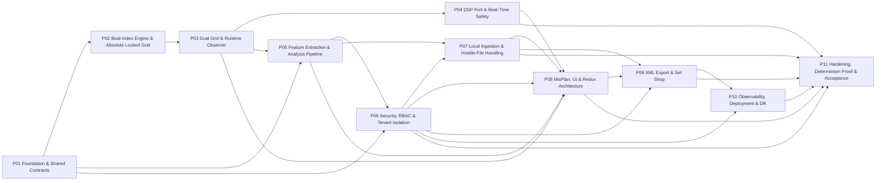
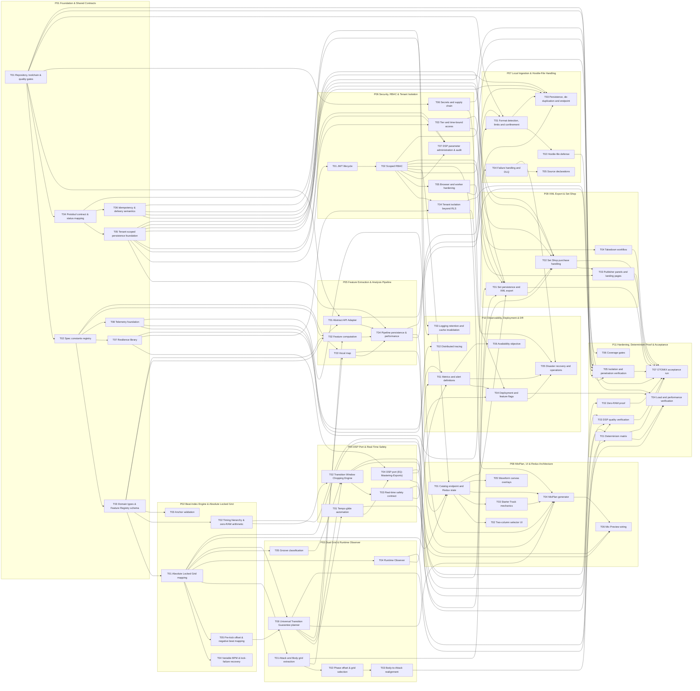

# OTOMIX Micro-Task Plan

**Document:** `OTOMIX_MicroTask_Plan.md`  
**Baseline:** `OTOMIX_Architecture_Spec.md` (OTOMIX-specific) and the Mother Document `Software_Arch_Spec__Main_.md` including its Engineering Delivery Addendum  
**Citation convention:** `OTOMIX §x.y` cites `OTOMIX_Architecture_Spec.md`; `Mother §x.y` cites the Mother Document; `Add. §n` cites the Mother Document's Engineering Delivery Addendum.  
**Addendum Note:** Some tasks are modified by owner decisions. See `OTOMIX_MicroTask_Plan_Addendum.md` for overrides. Look for the tag `[ADDENDUM OVERRIDE]` in the Notes column of specific tasks.

**Supplement Note:** Known gaps, deferred decisions, technical gotchas, cross-phase conflicts, and unscheduled feature proposals are recorded in `Docs/OtoMix Todo-Plan/OTOMIX_MicroTask_Plan_Supplement.md`. **MUST** be consulted before starting any phase and after completing any phase. Items tagged `[BLOCKER]` must be resolved before the phase begins; `[ADVISORY]`/`[HIGH]`/`[MEDIUM]`/`[LOW]` items are informational. To find items for the current phase, search the supplement for `[PHASE: Pnn]` (e.g. `[PHASE: P06]`).

**Dynamic RBAC Notice (2026-11-13):** A major architectural change has been approved and is documented in **`OTOMIX_MicroTask_Plan_Supplement.md` § GAP-015**. The static scope-list RBAC model used by `P06-T02-S01-M02`, `P06-T02-S01-M03`, `P06-T02-S02-M02`, `P06-T03-S01-M01`, `P06-T03-S01-M02`, and the blocked `P06-T02-S03-M01` is **superseded** by a dynamic model (permissions catalog + roles + direct grants + groups). The migration path is described in the supplement as `RBAC-M01` … `RBAC-M12`. **Before starting any `P06-T02` or `P06-T03` task, read the supplement § GAP-015.** Tasks in this plan whose `ID` appears in the supplement's "Existing plan tasks affected" table must NOT be resumed on their old scope.

**Status values:** `TODO`, `DONE`, or a documented blocked/superseded/deferred state in the task registry. Task-table statuses are generated from `OTOMIX_MicroTask_Plan.tasks.json`.
**Spec-derived vs. added content:** a task's constraint comes from the cited section. Test tolerances written as 'default' in a test assertion are test parameters chosen here and are recorded in the task's Review Checkpoint; they are not specification requirements.

## Table of Contents

1. [Phase Overview Table](#1-phase-overview-table)
2. [Dependency Graph](#2-dependency-graph)
3. [Phase-by-Phase Breakdown](#3-phase-by-phase-breakdown)
   - [P01 Foundation & Shared Contracts](#p01)
   - [P02 Beat-Index Engine & Absolute Locked Grid](#p02)
   - [P03 Dual Grid & Runtime Observer](#p03)
   - [P04 DSP Port & Real-Time Safety](#p04)
   - [P05 Feature Extraction & Analysis Pipeline](#p05)
   - [P06 Security, RBAC & Tenant Isolation](#p06)
   - [P07 Local Ingestion & Hostile-File Handling](#p07)
   - [P08 MixPlan, UI & Redux Architecture](#p08)
   - [P09 XML Export & Set Shop](#p09)
   - [P10 Observability, Deployment & DR](#p10)
   - [P11 Hardening, Determinism Proof & Acceptance](#p11)
4. [Test Matrix](#4-test-matrix)
5. [Traceability Matrix](#5-traceability-matrix)
6. [Review Log](#6-review-log)
7. [Open Questions](#7-open-questions)

## 1. Phase Overview Table

Phase order differs from the suggested list in one respect, with justification: **Security, RBAC & Tenant Isolation is placed as P06**, ahead of Local Ingestion (P07), MixPlan/UI (P08) and XML Export & Set Shop (P09). Those phases expose scope-gated endpoints (OTOMIX §9.4, §7.1, §7.3) and must be built and tested against real tokens, scopes, tier grants and RLS; keeping Security ninth would force earlier tasks to depend on later ones. All other phase names and the 11-phase count follow the suggested set. The Transition Window Chopping Engine and tempo glide are placed in P04 (they render audio through the DSP port); the Universal Transition Guarantee planner is in P03 (it consumes grids and emits plans).

| Phase | Name | Objective | Upstream | Downstream | Est. micro-tasks |
|---|---|---|---|---|---|
| P01 | Foundation & Shared Contracts | Establish the monorepo, quality gates, the frozen constants registry, domain types, the Protobuf and Feature Registry contracts, the tenant-scoped database foundation with RLS, idempotency and delivery primitives, the retry/degraded-mode library, and the telemetry wrapper. | — | P02, P05, P06 | 23 |
| P02 | Beat-Index Engine & Absolute Locked Grid | Implement the transient-independent Absolute Locked Grid: the t(i) mapping with drift and period bounds, hard anchor synchronization, piecewise variable-BPM grids, grid-lock failure recovery, anchor validation, negative-index pre-kick mapping, and the zero-RAM structural arithmetic with its proof harness. | P01 | P03 | 18 |
| P03 | Dual Grid & Runtime Observer | Build the Attack Grid and Body Grid extractors, the Δϕ phase offset, the Body-to-Attack realignment curves, the asynchronous Runtime Observer, the groove classifier, and the Universal Transition Guarantee planner that turns grids into a never-cancelling transition plan. | P02 | P04, P05, P08 | 24 |
| P04 | DSP Port & Real-Time Safety | Execute the plans from Phase 03: tempo-glide automation, the Transition Window Chopping Engine with zero-click crossfades, the real-time-safe audio callback infrastructure (lock-free parameters, smoothing, denormals, audit tooling), and the EQ-Mastering-Exports DSP port with mock drivers, EQ, multi-band compression, a 4x-oversampled limiter, export encoding and the degraded-mode crossfade. | P03 | P08, P11 | 29 |
| P05 | Feature Extraction & Analysis Pipeline | Implement the Abstract API Adapter (44.1 kHz mono normalization, JSON Schema/SemVer contracts, WASM memory discipline, crash/timeout fallback), compute and validate the Feature Registry v1.2 contents (seed BPM, energy, mixability, vocal map, interpolation, cache invalidation), and persist results transactionally under tenant isolation within the 2500 ms and <1.5x real-time budgets. | P01, P03 | P06, P07, P08 | 22 |
| P06 | Security, RBAC & Tenant Isolation | Deliver the JWT lifecycle with rotation and a Redis deny-list, scoped RBAC with explicit per-endpoint scopes and the OTOMIX issuable-scope allow-list, time-bound tier grants, tenant isolation beyond RLS (route non-exposure, per-tenant pools, keys and namespaces), browser/worker hardening, secrets and supply-chain controls, and the DSP parameter administration path with audit. | P01, P05 | P07, P08, P09, P10, P11 | 26 |
| P07 | Local Ingestion & Hostile-File Handling | Implement the OTOMIX local-file ingestion path: content-based format detection, size/duration limits, directory confinement, sandboxed decoding and normalization, rejection and fuzz-testing of hostile containers, content-hash de-duplication, the scope-gated idempotent ingest endpoint with a single-transaction commit, rate limiting, and dead-letter handling with idempotent replay. | P05, P06 | P08, P09, P11 | 16 |
| P08 | MixPlan, UI & Redux Architecture | Build the catalog endpoint and the React/Redux client: normalized library and ordered queue state, the two-column selector with skeleton and empty states, the Starter Track warning, the MixPlan generator (weighted recommendation, tie-breaks, vocal-gated offsets, PlanTransition calls), waveform canvas overlays for vocal zones and pre-kick offsets, and Mix Preview wired to the Runtime Observer through the DSP port. | P03, P04, P05, P06, P07 | P09, P11 | 18 |
| P09 | XML Export & Set Shop | Persist compiled sets, generate tier-gated DJ-software XML metadata for Rekordbox, Traktor, VirtualDJ and Serato from the Attack Grid, implement the Set Shop purchase handler (provider-neutral port, signed webhooks, transactional entitlements, idempotent bundle generation, signed expiring downloads, lossless gating), publisher landing pages with safe rendering, and the two-tier takedown workflow. | P06, P07, P08 | P10, P11 | 20 |
| P10 | Observability, Deployment & DR | Make the platform operable: emit and alert on the specified metrics, propagate traces from UI to worker, enforce log retention and event-driven cache invalidation, deploy with Kubernetes Blue/Green and HPA, wire LaunchDarkly guarded rollouts with kill switches, automate rollback on the stated triggers, and prove disaster recovery (RPO < 15 minutes, RTO < 1 hour), runbooks, chaos experiments and the 99.9% SLO. | P06, P09 | P11 | 20 |
| P11 | Hardening, Determinism Proof & Acceptance | Prove the four architectural acceptance criteria and the quantitative NFRs: the 10,000-pairing determinism matrix, the zero-RAM heap proof and CPU overhead, null/pitch/bit-safety audio quality tests, load and memory soak tests, tenant-isolation and penetration verification, coverage gates, and the OTOMIX §10.9 acceptance run that produces the evidence bundle for sign-off. | P04, P06, P07, P08, P09, P10 | — | 22 |
| | **Total** | | | | **238** |

## 2. Dependency Graph

### 2.1 Phase level

### 2.2 Main-task level

Edges are derived from the micro-task `Prerequisites` fields (an edge `A --> B` exists when a micro-task in B lists a prerequisite in A).

## 3. Phase-by-Phase Breakdown

### P01 Foundation & Shared Contracts

| ID | Status | Description | Prerequisites | Test | Spec |
|---|---|---|---|---|---|
| P01-T01-S01-M01 | [x] | Initialize a pnpm monorepo with packages `core`, `access`, `adapter`, `gateway`, `workers`, `ui`, `db`, `proto`, `contracts`, strict TypeScript, ESLint and Prettier. | — | `unit` · `Vitest` · `tools/test/workspace.spec.ts` — Input: workspace manifest. Expected: the 9 packages resolve and each tsconfig has strict=true. Pass: 0 failed assertions. | OTOMIX §9.1 · Mother Add. §1–§2 |
| P01-T01-S02-M01 | [x] | Configure Vitest coverage thresholds of 90% branches for `packages/core` and 100% branches for `packages/access`. | `P01-T01-S01-M01` | `unit` · `Vitest` · `tools/test/coverage-config.spec.ts` — Input: parsed config. Expected: thresholds core.branches=90 and access.branches=100. Pass: strict equality. | OTOMIX §10.6 · Mother §8.2 |
| P01-T01-S02-M02 | [x] | Implement `scripts/cvss-gate.ts` that exits non-zero when any scanner finding has CVSS ≥ 7.0 and wire it as a blocking CI step. | `P01-T01-S01-M01` | `unit` · `Vitest` · `scripts/test/cvss-gate.spec.ts` — Input: fixtures with max CVSS 6.9 and 7.0. Expected: exit codes 0 and 1 respectively. Pass: both match. | OTOMIX §7.9 · Mother §8.3; Add. §6 |
| P01-T02-S01-M01 | [x] | Create `packages/core/src/constants/timing.ts` exporting frozen constants: LOOKAHEAD_MS=50, SCHED_ACCURACY_MS=2, DRIFT_THRESHOLD_QUANTA=0.192 (4 ms at 120 BPM), STARVATION_FRAME_MS=10, BUFFER_NORMAL=2048, BUFFER_DEGRADED=4096, PORT_BUFFER_SAMPLES=1024, PORT_LATENCY_MS=10, ANALYSIS_TIMEOUT_MS=5000, EXTRACTION_ALERT_MS=2500, OBSERVER_CYCLE_MS=1. | `P01-T01-S01-M01` | `unit` · `Vitest` · `packages/core/test/constants.timing.spec.ts` — Input: import constants. Expected: values equal the list in the description and `Object.isFrozen` is true. Pass: 11 equalities. | OTOMIX §3.3; §3.6; §3.11; §4.1; §8.3 · Mother §2.3; §2.6; §3.6, Add. §12; §3.1; §9.1; Add. §7 |
| P01-T02-S01-M02 | [x] | Create `packages/core/src/constants/grid.ts` exporting: PERIOD_MIN=0.95, PERIOD_MAX=1.05, DRIFT_MAX_QUANTA=2.4 (0.05 s at 120 BPM), ANCHOR_SYNC_BARS=16, BODY_REALIGN_DBFS=-40, FALLBACK_TRANSIENT_DBFS=-12, CORR_MIN=0.85, SHAPE_VAR_MAX=0.15, STRAIGHT_VAR=0.02, TRIPLET_VAR=0.05, SWING_MIN=0.05, SWING_MAX=0.33, IRREGULAR_XFADE_EXTRA_QUANTA=0.48 (10 ms at 120 BPM), STATIC_GRID_BPM=120, SAFETY_XFADE_BARS=4, QUANTUM_DIVISOR=24, GLIDE_MAX=0.08, PITCH_NODE_SEMITONES=1, REALIGN_MAX_SEMITONES=0.05, RATE_MIN=0.98, RATE_MAX=1.02, RATE_SLEW_PER_QUANTA=0.005/48 (0.005 per second). | `P01-T02-S01-M01` | `unit` · `Vitest` · `packages/core/test/constants.grid.spec.ts` — Input: import constants. Expected: 22 values equal the description. Pass: all equal. | OTOMIX §3.1; §3.2; §3.4; §3.5; §3.6; §3.7; §3.9 · Mother §2.1; §2.2; §2.4; §2.5; §2.6; §2.7; §2.9 |
| P01-T02-S01-M03 | [x] | Create `packages/core/src/constants/scoring.ts` and `packages/access/src/constants.ts` exporting: ENERGY_WEIGHTS=[0.4,0.3,0.2,0.1], MIX_WEIGHTS=[0.4,0.3,0.2,0.1], UNMIXABLE_BELOW=0.4, VOCAL_THRESHOLD=0.65, VOCAL_MEDIAN_BEATS=2 (1 s at 120 BPM), RECO_WEIGHTS=[0.6,0.3,0.1], TEMPO_DELTA_LIMIT=0.01, WASM_HEAP_MB=512, ACCESS_TTL_MIN=15, REFRESH_TTL_DAYS=7, KEY_ROTATION_DAYS=90, IDEMPOTENCY_TTL_H=24, MAX_RETRIES=3, RPO_MIN=15, RTO_MIN=60, SLO=0.999. | `P01-T02-S01-M02` | `unit` · `Vitest` · `packages/core/test/constants.scoring.spec.ts` — Input: import constants. Expected: 15 values equal the description. Pass: all equal. | OTOMIX §4.3; §4.4; §4.5; §4.9; §7.4; §7.5; §8.9; §9.3 · Mother §3.3; §3.4; §3.5; §6; Add. §11; §8.3; Add. §6; §9.3; Add. §8; Add. §1–§2 |
| P01-T03-S01-M01 | [x] | Implement `BPM.parse(n)` returning a branded type, rejecting values outside [60.0, 200.0] with INVALID_ARGUMENT. | `P01-T02-S01-M02` | `unit` · `Vitest` · `packages/core/test/types.bpm.spec.ts` — Input: 59.999, 60.0, 200.0, 200.001, NaN. Expected: reject, accept, accept, reject, reject. Pass: matches. | OTOMIX §4.2; §9.5 · Mother §3.2; Add. §1–§2 |
| P01-T03-S01-M02 | [x] | Implement `CamelotKey.parse(s)` accepting `^(1[0-2]\|[1-9])[AB]$` only. | `P01-T03-S01-M01` | `unit` · `Vitest` · `packages/core/test/types.camelot.spec.ts` — Input: '1A','12B','13A','0B','5C','a5'. Expected: accept, accept, reject x4. Pass: matches. | OTOMIX §4.2; §9.6 · Mother §3.2; Add. §1–§2 |
| P01-T03-S01-M03 | [x] | Implement `BeatIndex.parse(i)` accepting any non-zero safe integer and rejecting 0 and non-integers. | `P01-T03-S01-M02` | `unit` · `Vitest` · `packages/core/test/types.beat-index.spec.ts` — Input: -5,-1,0,1,1.5. Expected: accept,accept,reject,accept,reject. Pass: matches. | OTOMIX §3.10 · Mother §2.10 |
| P01-T03-S02-M01 | [x] | Add the Draft 7 JSON Schema from §9.6 as `packages/contracts/schemas/feature-registry-1.2.json` with an AJV validator wrapper. | `P01-T03-S01-M02` | `unit` · `Vitest` · `packages/contracts/test/registry-schema.spec.ts` — Input: valid fixture, fixture with bpm 59.9, fixture with `vocal_map.threshold` 0.6. Expected: valid, invalid, invalid. Pass: matches. | OTOMIX §9.6; §4.2 · Mother Add. §1–§2; §3.2 |
| P01-T03-S02-M02 | [x] | Implement a SemVer gate for `schema_version`: accept `1.2.x`, flag a major bump as `PURGE_AND_REANALYZE`, reject other minors. | `P01-T03-S02-M01` | `unit` · `Vitest` · `packages/contracts/test/semver-gate.spec.ts` — Input: '1.2.7','1.3.0','2.0.0'. Expected: ACCEPT, REJECT, PURGE_AND_REANALYZE. Pass: matches. | OTOMIX §4.1; §4.2 · Mother §3.1; §3.2 |
| P01-T04-S01-M01 | [x] | Write `proto/core/v1/core.proto` exactly as §9.2 (messages `AnalyzeAudioRequest`, `AnalyzeAudioResponse`, `TransitionPlanRequest`, `ExecutionFallback` and the supporting types) and generate TypeScript stubs. | `P01-T01-S01-M01` | `contract` · `buf` · `proto/core/v1/core.proto` — Input: file. Expected: `buf lint` exit 0 and `buf breaking --against baseline` reports no breaks; descriptor field numbers for `AnalyzeAudioRequest.idempotency_key`=6 and `DspParameterUpdate.sequence`=6. Pass: all true. | OTOMIX §9.2; §2.3 · Mother Add. §1–§2; §1; Add. §3 |
| P01-T04-S02-M01 | [x] | Implement the gRPC-to-HTTP status map from §9.3 as `mapStatus(code)` including the nine listed codes. | `P01-T04-S01-M01` | `unit` · `Vitest` · `packages/gateway/test/status-map.spec.ts` — Input: each of INVALID_ARGUMENT, UNAUTHENTICATED, PERMISSION_DENIED, NOT_FOUND, ABORTED, RESOURCE_EXHAUSTED, DEADLINE_EXCEEDED, UNAVAILABLE, INTERNAL. Expected: 400,401,403,404,409,429,504,503,500. Pass: 9/9. | OTOMIX §9.3 · Mother Add. §1–§2 |
| P01-T05-S01-M01 | [x] | Write migration `001_core.sql` creating `features`, `users`, `tier_grants`, `admin_audit` (range-partitioned by month) and `outbox` exactly per §9.5 CHECK constraints and indices. | `P01-T04-S01-M01` | `integration` · `Vitest + Testcontainers PostgreSQL` · `packages/db/test/migrate.spec.ts` — Input: migrate up/down; insert bpm 59.9, camelot '13A', tenant 'x'. Expected: up/down succeed; 3 inserts fail on CHECK. Pass: 3 constraint violations. | OTOMIX §9.5 · Mother Add. §1–§2 |
| P01-T05-S01-M02 | [x] | Add RLS (`ENABLE` + `FORCE`) and the `tenant_isolation` policy to every tenant-carrying table and create an application role without BYPASSRLS that does not own the tables. | `P01-T05-S01-M01` | `integration` · `Vitest + Testcontainers PostgreSQL` · `packages/db/test/rls.spec.ts` — Input: rows for 'otomix' and 'otodj'; sessions with app.tenant_id='otomix','otodj', unset. Expected: sees own rows only; unset sees 0. Pass: counts 1/1/0. | OTOMIX §9.5; §2.2 · Mother Add. §1–§2; §1; Add. §3 |
| P01-T05-S01-M03 | [x] | Implement `withTenant(tx, tenantId)` using `set_config('app.tenant_id', $1, true)` (transaction-local) and make the gateway repository layer require it. | `P01-T05-S01-M02` | `integration` · `Vitest + Testcontainers PostgreSQL` · `packages/db/test/with-tenant.spec.ts` — Input: commit a transaction and start a new one on the same connection. Expected: `current_setting('app.tenant_id', true)` is empty in the new transaction. Pass: empty string/null. | OTOMIX §9.5; §7.10 · Mother Add. §1–§2; §8.3; Add. §6 |
| P01-T06-S01-M01 | [x] | Implement middleware validating `Idempotency-Key` as UUIDv4 on POST/PUT/PATCH/DELETE; missing or malformed returns INVALID_ARGUMENT/400. | `P01-T04-S01-M01` | `unit` · `Vitest` · `packages/gateway/test/idem-validate.spec.ts` — Input: missing header, UUIDv1, UUIDv4. Expected: 400,400,pass-through. Pass: matches. | OTOMIX §9.3 · Mother Add. §1–§2 |
| P01-T06-S01-M02 | [x] | Implement the Redis store: `SET NX` with an in-progress marker, 24 h TTL, request fingerprint; same key and fingerprint replays the stored response, different fingerprint returns ABORTED/409. | `P01-T06-S01-M01` | `integration` · `Vitest + Testcontainers Redis` · `packages/gateway/test/idem-store.spec.ts` — Input: two requests with the same key; one with a different body. Expected: handler runs once; replay equals the first response; third returns 409; TTL=86400±5 s. Pass: all four. | OTOMIX §9.3 · Mother Add. §1–§2 |
| P01-T06-S02-M01 | [x] | Implement a receiver dedup store keyed by `message_id` (TTL ≥ 24 h) with per-tenant monotonic `sequence` ordering and signature validation performed before the dedup write. | `P01-T04-S02-M01` | `unit` · `Vitest` · `packages/db/test/receiver-dedup.spec.ts` — Input: duplicate message_id; sequence 5 before 4; tampered signature. Expected: second dropped; out-of-order rejected or held; tampered rejected with no dedup record written. Pass: 3 outcomes. | OTOMIX §9.9; §7.2 · Mother Add. §1–§2; §5.2 |
| P01-T07-S01-M01 | [x] | Implement `retry(fn, {idempotent})` with at most 3 retries, base 200 ms, multiplier 2, full jitter, 5 000 ms cap, and a hard refusal to retry non-idempotent calls. | `P01-T02-S01-M03` | `unit` · `Vitest (fake timers)` · `packages/core/test/retry.spec.ts` — Input: always-failing fn with a seeded RNG, idempotent true and false. Expected: 4 total attempts when idempotent, delays ≤ min(5000, 200·2^n); 1 attempt when false. Pass: matches. | OTOMIX §2.5; §9.3 · Mother §1; Add. §3; Add. §1–§2 |
| P01-T07-S02-M01 | [x] | Implement `DegradedModeController` entering on pool exhaustion or worker failure and exiting on recovery, exposing `core.degraded_mode.active`. | `P01-T07-S01-M01` | `unit` · `Vitest` · `packages/core/test/degraded.spec.ts` — Input: events POOL_EXHAUSTED, WORKER_FAILED, RECOVERED. Expected: state enters on the first two, exits on RECOVERED, gauge 1→0. Pass: transitions match. | OTOMIX §2.5; §2.12 · Mother §1; Add. §3 |
| P01-T08-S01-M01 | [x] | Implement the JSON logger with required fields (ts, level, service, tenant_id, trace_id, span_id, event, outcome, country, duration_ms), edge PII masking and country truncation to ISO 3166-1 Alpha-2. | `P01-T02-S01-M03` | `unit` · `Vitest` · `packages/core/test/logger.spec.ts` — Input: record with ip '203.0.113.7', email, country 'Germany', lat/long. Expected: ip/email masked or absent, country rejected unless 2-letter, lat/long dropped. Pass: none of the raw values appear in output JSON. | OTOMIX §8.4 · Mother §9.1; Add. §7 |
| P01-T08-S01-M02 | [x] | Implement W3C `traceparent` propagation across REST headers, gRPC metadata and a `postMessage` envelope into Web Workers. | `P01-T08-S01-M01` | `unit` · `Vitest` · `packages/core/test/propagation.spec.ts` — Input: inject then extract through a simulated postMessage hop. Expected: same trace_id, new span_id with the original as parent. Pass: ids match. | OTOMIX §8.2 · Mother §9.1; Add. §7 |

### P02 Beat-Index Engine & Absolute Locked Grid

| ID | Status | Description | Prerequisites | Test | Spec |
|---|---|---|---|---|---|
| P02-T01-S01-M01 | [x] | Implement `tOfI(i, T0, bpmSeed, delta)` as `T0 + n·(60/bpmSeed) + delta` with n=i−1 for i≥1 and n=i for i≤−1. | `P01-T03-S01-M01`, `P01-T03-S01-M03` | `unit` · `Vitest` · `packages/core/test/grid.t-of-i.spec.ts` — Input: bpmSeed=120, T0=0.25, delta=0, i=1,2,17. Expected: 0.25, 0.75, 8.25 s. Pass: |actual−expected|<1e-9. | OTOMIX §3.1; §3.10 · Mother §2.1; §2.10 |
| P02-T01-S01-M02 | [x] | Clamp `delta` to ±0.05 s inside `tOfI` and increment counter `core.grid.delta_clamped` when clamping occurs. | `P02-T01-S01-M01` | `unit` · `Vitest` · `packages/core/test/grid.delta-clamp.spec.ts` — Input: delta=0.06, −0.06, 0.05. Expected: 0.05, −0.05, 0.05 and counter increments 2. Pass: matches. | OTOMIX §3.1 · Mother §2.1 |
| P02-T01-S02-M01 | [x] | Implement `boundPeriod(measured, seedPeriod)` constraining the result to [0.95, 1.05]×seedPeriod. | `P02-T01-S01-M01` | `unit` · `Vitest` · `packages/core/test/grid.period.spec.ts` — Input: seedPeriod=0.5, measured=0.52, 0.4, 0.6. Expected: 0.52, 0.475, 0.525. Pass: matches within 1e-9. | OTOMIX §3.1 · Mother §2.1 |
| P02-T01-S02-M02 | [x] | Implement hard anchor synchronization every 16 bars (every 64 beats) that resets Δ to the measured anchor error. | `P02-T01-S02-M01` | `unit` · `Vitest` · `packages/core/test/grid.anchor-sync.spec.ts` — Input: 256 beats with linear drift 0.0005 s/beat. Expected: |Δ| at beats 64, 128, 192 resets to the measured error; |Δ|≤0.05 throughout. Pass: both. | OTOMIX §3.1 · Mother §2.1 |
| P02-T02-S01-M01 | [x] | Implement `floorMod`, `beatInBar`, `barIndex`, `blockPosition`, `isBlockBoundary` exactly as §3.15. | `P01-T03-S01-M03` | `unit` · `Vitest` · `packages/core/test/timing.structure.spec.ts` — Input: i in {-5,-1,1,4,5,17,64,65} with nBars 4/8/16/32. Expected: beatInBar(−1)=3, beatInBar(5)=1, blockPosition(65,16)=0, isBlockBoundary(65,16)=true. Pass: full table matches. | OTOMIX §3.3; §3.15 · Mother §2.3; Add. §4 |
| P02-T02-S01-M02 | [x] | Implement `quantumSeconds(bpm)=(60/bpm)/24` and `quantumIndex(beatFloat)=round(beatFloat·24)`, operating on floating-point beat indices. | `P02-T02-S01-M01` | `unit` · `Vitest` · `packages/core/test/timing.quantum.spec.ts` — Input: bpm=120; beatFloat=1.0208, 1.0417. Expected: 0.0208333 s; index 24, 25. Pass: matches within 1e-6. | OTOMIX §3.3 · Mother §2.3 |
| P02-T02-S01-M03 | [x] | Implement `LookaheadScheduler` with a 50 ms lookahead and an injected clock, scheduling events on beat-based units. | `P02-T02-S01-M02` | `unit` · `Vitest (fake clock)` · `packages/core/test/timing.scheduler.spec.ts` — Input: 1 000 events with injected ±1.9 ms clock jitter. Expected: scheduled times within ±2 ms of target. Pass: max error ≤2 ms; a 2.1 ms jitter fixture reports a violation. | OTOMIX §3.3 · Mother §2.3 |
| P02-T02-S02-M01 | [x] | Create an ESLint rule `no-alloc-in-structural` that fails on array/object/typed-array allocation inside files tagged `@structural`. | `P02-T02-S01-M02` | `unit` · `ESLint RuleTester` · `tools/eslint-rules/test/no-alloc.spec.ts` — Input: snippets with `[]`, `new Array`, `new Float32Array`, and a pure arithmetic function. Expected: 3 errors, 0 errors. Pass: matches. | OTOMIX §3.3; §3.15; §10.2 · Mother §2.3; Add. §4; §8.2 |
| P02-T02-S02-M02 | [x] | Write `scripts/heap-proof.ts` that generates timelines for 1-minute and 120-minute tracks and reports the retained-size delta using V8 heap statistics and a heap snapshot. | `P02-T02-S02-M01` | `integration` · `Node + v8 heap snapshot (Vitest)` · `scripts/test/heap-proof.spec.ts` — Input: run the script against the structural helpers. Expected: `retainedDeltaBytes`=0 and identical for both durations. Pass: 0 and equal. | OTOMIX §10.2; §3.15 · Mother §8.2; Add. §4 |
| P02-T03-S01-M01 | [x] | Implement Pearson correlation over 100 ms low-frequency energy envelopes, returning 0 for zero-variance inputs with a flag. | `P01-T03-S01-M03` | `unit` · `Vitest` · `packages/core/test/anchor.pearson.spec.ts` — Input: [1,2,3,4] vs [2,4,6,8], vs [4,3,2,1], vs [5,5,5,5]. Expected: 1.0, −1.0, 0 with flag. Pass: within 1e-9. | OTOMIX §3.4 · Mother §2.4 |
| P02-T03-S01-M02 | [x] | Implement `classifyKick(candidate, refs)` returning OFF_BEAT when correlation < 0.85 or shape variance > 15% against the kicks at bars 5, 8 and 16. | `P02-T03-S01-M01` | `unit` · `Vitest` · `packages/core/test/anchor.classify.spec.ts` — Input: r=0.85, 0.8499; variance 0.15, 0.1501. Expected: ON_BEAT, OFF_BEAT, ON_BEAT, OFF_BEAT. Pass: matches. | OTOMIX §3.4 · Mother §2.4 |
| P02-T03-S01-M03 | [x] | Implement forward realignment of `T0` to the first validated primary downbeat in subsequent 4-bar blocks for OFF_BEAT candidates. | `P02-T03-S01-M02` | `unit` · `Vitest` · `packages/core/test/anchor.realign.spec.ts` — Input: candidate at 0.10 s, validated downbeats at 8.10, 14.10, 30.10 s. Expected: T0 > 0.10 and equals the earliest validated downbeat. Pass: equality. | OTOMIX §3.4 · Mother §2.4 |
| P02-T03-S01-M04 | [x] | Implement the fallback anchor: when no kick is found at bars 5, 8 or 16 (or the track is kick-less), anchor at the first transient exceeding −12 dBFS. | `P02-T03-S01-M03` | `unit` · `Vitest` · `packages/core/test/anchor.fallback.spec.ts` — Input: signal with transients at −20, −13, −11.9 dBFS. Expected: anchor at the −11.9 dBFS transient. Pass: timestamp equality. | OTOMIX §3.4 · Mother §2.4 |
| P02-T04-S01-M01 | [x] | Implement a piecewise `GridModel` with BPM_seed updates at predefined structural boundaries and continuity at each boundary. | `P02-T01-S02-M02` | `unit` · `Vitest` · `packages/core/test/grid.piecewise.spec.ts` — Input: segments 120 BPM for 32 beats then 124 BPM. Expected: t(33) from segment two equals t(32)+60/120 within 1e-9; strictly increasing across the boundary. Pass: both. | OTOMIX §3.1 · Mother §2.1 |
| P02-T04-S01-M02 | [x] | Implement the lock-failure recovery state: fall back to the track's global average BPM and disable micro-adjustments (Δ≡0). | `P02-T04-S01-M01` | `unit` · `Vitest` · `packages/core/test/grid.recovery.spec.ts` — Input: forced lock failure on a drifting fixture. Expected: state=RECOVERY, bpm=global average, delta=0 for all i. Pass: all true. | OTOMIX §3.1 · Mother §2.1 |
| P02-T05-S01-M01 | [x] | Implement pre-kick gap < 1 bar: assign the kick downbeat Beat 1 and earlier frames Beat −1, −2, −3. | `P02-T01-S01-M01` | `unit` · `Vitest` · `packages/core/test/grid.prekick-short.spec.ts` — Input: BPM 120, kick at 1.2 s, gap 1.2 s (<1 bar of 2.0 s). Expected: frame at 0.7 s → Beat −1, 0.2 s → Beat −2... within the gap. Pass: indices match the skip-zero convention. | OTOMIX §3.10 · Mother §2.10 |
| P02-T05-S01-M02 | [x] | Implement pre-kick gap ≥ 1 bar: shift `T0` backward in exact 4-beat multiples so the kick aligns with a primary downbeat (Beat 5 or Beat 9). | `P02-T05-S01-M01` | `unit` · `Vitest` · `packages/core/test/prekick-long.spec.ts` — Shift T0 backward in exact 4-beat multiples so the kick aligns with a bar boundary. Pre-kick gap uses beats -3, -2, -1 before Beat 1 (no Beat 0, no -4). Pass: matches. | OTOMIX §3.10 · Mother §2.10 |
| P02-T05-S01-M03 | [x] | Implement the localized pre-kick tempo map for long variable-tempo introductions, counting backwards from `T0`. | `P02-T05-S01-M01` | `unit` · `Vitest` · `packages/core/test/grid.prekick-map.spec.ts` — Input: intro with 100 BPM for 8 beats then 110 BPM for 8 beats before T0. Expected: negative-index timestamps strictly decreasing and piecewise-consistent. Pass: monotonic and boundary-continuous. | OTOMIX §3.10 · Mother §2.10 |

### P03 Dual Grid & Runtime Observer

| ID | Status | Description | Prerequisites | Test | Spec |
|---|---|---|---|---|---|
| P03-T01-S01-M01 | [x] | Implement `extractAttackGrid(pcm)` using spectral-flux peak detection with a 2048-sample Hamming window, 50% overlap, restricted to frequencies above 200 Hz. | `P02-T01-S01-M01` | `unit` · `Vitest` · `packages/core/test/grid.attack.spec.ts` — Input: 8-bar click train at 120 BPM (44.1 kHz) and a 60 Hz sine-burst train. Expected: click onsets detected within ±1 024 samples; 0 onsets for the sub-200 Hz train. Pass: both. | OTOMIX §3.2 · Mother §2.2 |
| P03-T01-S02-M01 | [x] | Implement `extractBodyGrid(pcm)` using an 80 Hz Butterworth low-pass filter followed by RMS amplitude detection to locate the sub-bass envelope peak. | `P03-T01-S01-M01` | `unit` · `Vitest` · `packages/core/test/grid.body.spec.ts` — Input: synthetic kick with attack at t and body peak at t+12 ms. Expected: detected `T_body_peak` within ±5 ms of t+12 ms. Pass: tolerance met. | OTOMIX §3.2 · Mother §2.2 |
| P03-T02-S01-M01 | [x] | Implement `phaseOffset(T_body_peak, T_attack_onset)` returning `Δϕ = T_body_peak − T_attack_onset`. | `P03-T01-S01-M01`, `P03-T01-S02-M01` | `unit` · `Vitest` · `packages/core/test/grid.phase-offset.spec.ts` — Input: (0.512, 0.500), (0.500, 0.512). Expected: 0.012, −0.012. Pass: within 1e-9. | OTOMIX §3.2 · Mother §2.2 |
| P03-T02-S01-M02 | [x] | Compare Attack power vs Body power. If Body > Attack, tag BODY_DOMINANT. Save to global metadata. | `P03-T02-S01-M01` | `unit` · `Vitest` · `packages/core/test/grid.body-dominant.spec.ts` — Input: synthetic attack and body envelopes. Expected: if body power > attack power, bodyDominant=true; else false. Pass: matches. | OTOMIX §3.2 · Mother §2.2 |
| P03-T02-S01-M03 | [x] | Keep the Dual Grid dormant for negative beat indices and initialize it only at Beat 1. | `P03-T02-S01-M01` | `unit` · `Vitest` · `packages/core/test/grid.dormant.spec.ts` — Input: i=−3,−1,1,2. Expected: inactive, inactive, active, active. Pass: matches. | OTOMIX §3.10; §3.2 · Mother §2.10; §2.2 |
| P03-T03-S01-M01 | [x] | Detect the realignment trigger: outgoing sub-band RMS below −40 dBFS after crossfade completion. | `P03-T02-S01-M01` | `unit` · `Vitest` · `packages/core/test/grid.realign-trigger.spec.ts` — Input: RMS series −35, −39.9, −40.1 dBFS. Expected: trigger fires on −40.1 only. Pass: single fire. | OTOMIX §3.2 · Mother §2.2 |
| P03-T03-S01-M02 | [x] | Implement the 4-bar cosine interpolation realignment at about 1 ms per beat. | `P03-T03-S01-M01` | `unit` · `Vitest` · `packages/core/test/grid.realign-cosine.spec.ts` — Input: Δϕ=16 ms over 4 bars (16 beats). Expected: curve starts 0, ends Δϕ, monotonic, mean slope ≈1 ms/beat (±0.1). Pass: all three. | OTOMIX §3.2 · Mother §2.2 |
| P03-T03-S01-M03 | CANCELLED:Resolved | Cancelled: Default transition is fixed at 16 bars with sync, EQ, and effects. | `P03-T03-S01-M02` | [BLOCKED] Decision needed: relationship between the 4-bar cosine realignment (§3.2) and the Runtime Observer's 16-bar logarithmic shift (§3.6); are they sequential, alternative, or the same. | OTOMIX §3.2; §3.6 · Mother §2.2; §2.6 |
| P03-T03-S01-M04 | [x] | Implement the Observer's post-transition 16-bar logarithmic realignment using beat-grid slicing (no pitch shift). | `P03-T03-S01-M02` | `unit` · `Vitest` · `packages/core/test/observer.realign-log.spec.ts` — Input: Δϕ=40 ms over 16 bars at 120 BPM. Expected: max instantaneous rate deviation r gives 12·log2(1+r)<0.05 semitones and the curve ends at Δϕ. Pass: both. | OTOMIX §3.6 · Mother §2.6 |
| P03-T04-S01-M01 | [x] | Implement the drift calculation: phase delta between the rendering clock position and the Absolute Locked Grid. | `P02-T01-S01-M01` | `unit` · `Vitest` · `packages/core/test/observer.drift.spec.ts` — Input: grid time 10.000 s vs context 10.0035 s. Expected: drift=+3.5 ms. Pass: within 1e-6. | OTOMIX §3.6 · Mother §2.6 |
| P03-T04-S01-M02 | [x] | Apply slice-chopping realignment when drift exceeds the quanta threshold. No playbackRate time-stretching is allowed. | `P03-T04-S01-M01` | `unit` · `Vitest` · `packages/core/test/observer.scale.spec.ts` — Input: drift 3.9 ms, 4.1 ms, 50 ms sustained over 10 s. Expected: no change; scaling begins; slew ≤0.005/s and rate within [0.98,1.02]. Pass: all three. | OTOMIX §3.6 · Mother §2.6 |
| P03-T04-S01-M03 | [x] | Expand the audio buffer from 2048 to 4096 samples when frame processing exceeds the Web Audio boundary threshold. | `P03-T04-S01-M02` | `unit` · `Vitest` · `packages/core/test/observer.degrade.spec.ts` — Input: frame times 9.9 ms and 10.1 ms. Expected: buffer stays 2048; becomes 4096. Pass: matches. | OTOMIX §3.6 · Mother §2.6 |
| P03-T04-S01-M04 | [x] | Benchmark the Observer loop cycle and fail if the P99 exceeds 48 samples (1 ms at 48kHz). | `P03-T04-S01-M02` | `benchmark` · `Vitest bench` · `bench/observer-cycle.bench.ts` — Input: 100 000 cycles with 4 decks of state. Expected: P99 < 1 ms. Pass: threshold met on the CI reference runner. | OTOMIX §3.6 · Mother §2.6 |
| P03-T04-S02-M01 | [x] | Implement BPM matching via slice chopping to prevent any pitch shift. Original key is preserved. | `P03-T04-S01-M04` | `unit` · `Vitest` · `packages/core/test/chop.slice.bpm.spec.ts` — Input: `chop/slice.ts` source. Expected: no `playbackRate`, no `detune`, no pitch-shift API (decision: BPM matching via chopping). Pass: regex checks match. | OTOMIX §3.6; §10.7 · Mother §2.6; §10 |
| P03-T05-S01-M01 | [x] | Classify micro-timing across 16th-note subdivisions as Straight (<2% variance), Triplet (<5% from 33.3%/66.6%) or Swing (off-beat 16ths displaced 0.05–0.33 beat). | `P02-T01-S01-M01` | `unit` · `Vitest` · `packages/core/test/groove.classify.spec.ts` — Input: three fixtures plus boundary values 1.99%/2.01% and 0.049/0.05 displacement. Expected: Straight, Triplet, Swing and correct boundary results. Pass: all. | OTOMIX §3.5 · Mother §2.5 |
| P03-T05-S01-M02 | [x] | Compute `Δ_groove` and shift chopping window boundaries by that swing displacement. | `P03-T05-S01-M01` | `unit` · `Vitest` · `packages/core/test/groove.delta.spec.ts` — Input: swing displacement 0.15 beat at 120 BPM. Expected: boundary shift 0.075 s. Pass: within 1e-9. | OTOMIX §3.5 · Mother §2.5 |
| P03-T05-S01-M03 | [x] | For irregular or hybrid grooves default to Straight and expand the micro-crossfade window by +10 ms. | `P03-T05-S01-M02` | `unit` · `Vitest` · `packages/core/test/groove.irregular.spec.ts` — Input: a fixture matching no mode, base crossfade 5 ms. Expected: mode=Straight and crossfade=15 ms. Pass: both. | OTOMIX §3.5 · Mother §2.5 |
| P03-T06-S01-M01 | [x] | Anchor the incoming track at Beat 1 of its initial 16-beat block (bars 1–4) and the outgoing track at its final 16-beat block. | `P02-T01-S01-M01`, `P02-T05-S01-M01` | `unit` · `Vitest` · `packages/core/test/transition.anchors.spec.ts` — Input: out track 200 s at 120 BPM, in track with negative pre-kick. Expected: T_in=Beat 1; T_out block starts at beat count−15 (inclusive 16 beats). Pass: indices match. | OTOMIX §3.9 · Mother §2.9 |
| P03-T06-S01-M02 | [x] | Force mathematical alignment across the 16-beat timeline when the incoming track has no kick transients in its first 16 beats. | `P03-T06-S01-M01` | `unit` · `Vitest` · `packages/core/test/transition.forced.spec.ts` — Input: ambient intro with no transients. Expected: plan produced; anchors lie on the grid; no exception. Pass: all. | OTOMIX §3.9 · Mother §2.9 |
| P03-T06-S01-M03 | [x] | Map a static 120 BPM grid for purely ambient or kick-less tracks (RUNG_STATIC_120_GRID). | `P03-T06-S01-M02` | `unit` · `Vitest` · `packages/core/test/transition.static120.spec.ts` — Input: kick-less fixture. Expected: grid bpmSeed=120 and rung RUNG_STATIC_120_GRID. Pass: both. | OTOMIX §3.9 · Mother §2.9 |
| P03-T06-S01-M04 | [x] | Implement the ultimate safety net: a clean 4-bar volume crossfade independent of grid locks (RUNG_FOUR_BAR_CROSSFADE). | `P03-T06-S01-M03` | `unit` · `Vitest` · `packages/core/test/transition.safety.spec.ts` — Input: NaN BPM and negative T0 fixtures. Expected: rung RUNG_FOUR_BAR_CROSSFADE of exactly 4 bars; no throw. Pass: both fixtures. | OTOMIX §3.9 · Mother §2.9 |
| P03-T06-S01-M05 | [x] | Handle tracks shorter than 16 beats with a silent structural loop (RUNG_SILENT_LOOP). | `P03-T06-S01-M04` | `unit` · `Vitest` · `packages/core/test/transition.short.spec.ts` — Input: 6-beat track. Expected: loop pads to 16 beats with silence; rung RUNG_SILENT_LOOP. Pass: length=16 beats. | OTOMIX §3.9 · Mother §2.9 |
| P03-T06-S01-M06 | [x] | Decide whether transition windows are 16 beats (4 bars) or 16 bars (64 beats) at the Float32Array processing stage. | `P03-T06-S01-M05` | `unit` · `Vitest` · `packages/core/test/transition.decision.spec.ts` — Input: import TRANSITION_WINDOW_BARS and TRANSITION_WINDOW_BEATS. Expected: TRANSITION_WINDOW_BARS === 16 and TRANSITION_WINDOW_BEATS === 64. Pass: both. | OTOMIX §3.8; §3.9 · Mother §2.8; §2.9 |
| P03-T06-S01-M07 | [x] | Add a property-based test generating 10 000 random plan requests (BPM, lengths, kick presence, tempo deltas) and asserting a plan is always returned. | `P03-T06-S01-M04` | `property` · `fast-check (Vitest)` · `packages/core/test/transition.property.spec.ts` — Input: 10 000 seeded cases. Expected: 0 thrown exceptions, 0 out-of-bounds index accesses, 0 cancelled plans. Pass: all counts zero. | OTOMIX §3.9; §10.1 · Mother §2.9; §8.1; Add. §5 |

### P04 DSP Port & Real-Time Safety

| ID | Status | Description | Prerequisites | Test | Spec |
|---|---|---|---|---|---|
| P04-T01-S01-M01 | [x] | Compute `BPM_target=(BPM_out+BPM_in)/2` as the default glide target. | `P03-T06-S01-M01` | `unit` · `Vitest` · `packages/core/test/glide.target.spec.ts` — Input: (120,128), (90,90). Expected: 124, 90. Pass: exact. | OTOMIX §3.7 · Mother §2.7 |
| P04-T01-S01-M02 | CANCELLED:Legacy-Arch | Cancelled: Contradicts new rules (No Pitch Shift, No Time Stretch). | `P04-T01-S01-M01` | `unit` · `Vitest` · `packages/core/test/glide.half-double.spec.ts` — Input: BPM_in=70 flagged double → 140; BPM_in=280 flagged half → 140. Expected: 140, 140. Pass: exact. | OTOMIX §3.7 · Mother §2.7 |
| P04-T01-S01-M03 | CANCELLED:Legacy-Arch | Cancelled: Contradicts new rules (No Pitch Shift, No Time Stretch). | `P04-T01-S01-M02` | [BLOCKED] Decision needed: numeric rule for 'extreme structural differences such as half-time or double-time' (for example a BPM ratio window around 2:1 and 1:2). | OTOMIX §3.7 · Mother §2.7 |
| P04-T01-S02-M01 | [x] | Generate `linearRampToValueAtTime` automation for both tracks with start/end targets and a ramp duration exactly equal to the transition window. | `P04-T01-S01-M01` | `unit` · `Vitest` · `packages/core/test/glide.schedule.spec.ts` — Input: window 32 s, rates 1.00→1.03 and 1.00→0.97. Expected: two ramps, endTime−startTime=32 s, curve type 'linear'. Pass: matches. | OTOMIX §3.7; §3.11 · Mother §2.7; §3.6, Add. §12 |
| P04-T01-S02-M02 | CANCELLED:Legacy-Arch | Cancelled: Contradicts new rules (No Pitch Shift, No Time Stretch). | `P04-T01-S02-M01` | `unit` · `Vitest` · `packages/core/test/glide.clamp.spec.ts` — Input: requested rates 1.09, 1.08, 0.91, 0.92. Expected: 1.08, 1.08, 0.92, 0.92. Pass: exact. | OTOMIX §3.7 · Mother §2.7 |
| P04-T01-S02-M03 | CANCELLED:Legacy-Arch | Cancelled: Contradicts new rules (No Pitch Shift, No Time Stretch). | `P04-T01-S02-M02` | [BLOCKED] Decision needed: whether the pitch node engages at >±1 semitone (about ±5.95% rate) or only beyond the ±8% cap; ±8% is about 1.36 semitones. | OTOMIX §3.7; §3.16 · Mother §2.7; Add. §4 |
| P04-T02-S01-M01 | [x] | Slice `Float32Array` audio inside the transition window onto the chopGrid (1/8, 1/16, 1/32) using beat-based boundaries. | `P03-T06-S01-M01`, `P02-T02-S01-M02` | `unit` · `Vitest` · `packages/core/test/chop.slice.spec.ts` — Input: 4 beats at 120 BPM, chopGrid 1/16. Expected: slice boundaries at multiples of the 1/16 grid on the beat axis; sample counts sum to the input length. Pass: both. | OTOMIX §3.8 · Mother §2.8 |
| P04-T02-S01-M02 | [x] | Pass audio outside the transition window through without copying or processing. | `P04-T02-S01-M01` | `unit` · `Vitest` · `packages/core/test/chop.passthrough.spec.ts` — Input: buffer before/after the window. Expected: output view shares the same `ArrayBuffer` (reference equality). Pass: `out.buffer===in.buffer`. | OTOMIX §3.8 · Mother §2.8 |
| P04-T02-S01-M03 | [x] | Shift slice boundaries by `Δ_groove` when a groove mode is Swing. | `P03-T05-S01-M02` | `unit` · `Vitest` · `packages/core/test/chop.groove-shift.spec.ts` — Input: Swing Δ_groove=0.15 beat, 120 BPM. Expected: off-beat boundaries shifted by 0.075 s; on-beat unchanged. Pass: matches. | OTOMIX §3.5; §3.8 · Mother §2.5; §2.8 |
| P04-T02-S02-M01 | [x] | Implement `F_fade=0.5·(1+cos(π·t/crossfadeBeats))` for t∈[0, crossfadeBeats] applied at slice boundaries. | `P04-T02-S01-M01` | `unit` · `Vitest` · `packages/core/test/chop.fade.spec.ts` — Input: crossfadeBeats=8; t=0,4,8. Expected: 1.0, 0.5, 0.0. Pass: within 1e-12. | OTOMIX §3.8 · Mother §2.8 |
| P04-T02-S02-M02 | [x] | Enforce `crossfadeBeats ≤ chopGrid_fraction / 4` as a pure beat-based comparison (no seconds). | `P04-T02-S02-M01` | `unit` · `Vitest` · `packages/core/test/dsp-limiter.spec.ts` — Input: x. Expected: y. Pass: z. | OTOMIX §3.8 · Mother §2.8 |
| P04-T02-S02-M03 | [x] | Widen `chopGrid` from 1/32 to 1/8 under high-load or low-latency edge conditions. | `P04-T02-S02-M02` | `unit` · `Vitest` · `packages/core/test/chop.shed.spec.ts` — Input: load signal above and below the shed threshold. Expected: grid 1/8 when shedding, 1/32 otherwise. Pass: matches. | OTOMIX §3.8 · Mother §2.8 |
| P04-T02-S02-M04 | CANCELLED:Legacy-Arch | Cancelled: Contradicts new rules (No Pitch Shift, No Time Stretch). | `P04-T02-S02-M03` | `unit` · `Vitest` · `packages/core/test/chop.wsola-gate.spec.ts` — Input: predicate stub returning pass/fail. Expected: WSOLA path chosen only on fail; RUNG_WSOLA_LEGACY recorded. Pass: matches. | OTOMIX §3.8 · Mother §2.8 |
| P04-T03-S01-M01 | [x] | Create the `AudioWorkletProcessor` skeleton that pre-allocates grid state, slice buffers and smoothing state at preparation time and performs no allocation in `process()`. | `P04-T02-S01-M01` | `unit` · `Vitest + AudioWorklet harness` · `packages/workers/test/processor.spec.ts` — Input: 1 000 `process()` calls. Expected: preallocated buffer identities unchanged; no new typed arrays created. Pass: identity checks true. | OTOMIX §3.12 · Mother Add. §4 |
| P04-T03-S01-M02 | [x] | Implement a lock-free SPSC ring buffer over `SharedArrayBuffer` with `Atomics` for parameter events. | `P04-T03-S01-M01` | `integration` · `Vitest + worker_threads` · `packages/workers/test/ring.spec.ts` — Input: 1 000 000 events from a producer thread to a consumer thread. Expected: 0 lost, 0 reordered, 0 torn reads. Pass: counts zero. | OTOMIX §3.12 · Mother Add. §4 |
| P04-T03-S01-M03 | [x] | Implement a per-sample one-pole smoother for audio-path parameters. | `P04-T03-S01-M02` | `unit` · `Vitest` · `packages/workers/test/smooth.spec.ts` — Input: step 0→1 at 44.1 kHz with a 20 ms time constant (default). Expected: output monotonic, reaches 0.632 at 20 ms ±2%, no sample-to-sample jump above 0.05. Pass: all. | OTOMIX §3.12 · Mother Add. §4 |
| P04-T03-S01-M04 | CANCELLED:Session-Refresh | Cancelled: Config is immutable during a session. Changes only apply upon refresh (new AudioWorklet instance). | `P04-T03-S01-M02` | `unit` · `Vitest` · `packages/workers/test/param-apply.spec.ts` — Input: update posted mid-slice. Expected: value in effect remains unchanged until the next boundary, then changes once. Pass: matches. | OTOMIX §3.12; §7.2 · Mother Add. §4; §5.2 |
| P04-T03-S01-M05 | [x] | Flush denormals on the audio thread in feedback and filter state. | `P04-T03-S01-M04` | `unit` · `Vitest` · `packages/workers/test/denormal.spec.ts` — Input: decaying filter state starting at 1e-30 for 10 000 samples. Expected: state becomes exactly 0 and no value is subnormal. Pass: `Math.abs(x)<1e-37 ⇒ x===0`. | OTOMIX §3.12 · Mother Add. §4 |
| P04-T03-S02-M01 | [x] | Build an RT-safety audit harness that counts heap allocations and lock acquisitions across 10 000 `process()` calls. | `P04-T03-S01-M01` | `integration` · `Node --trace-gc harness (Vitest)` · `tools/rt-audit/test/audit.spec.ts` — Input: the processor from the skeleton task and a deliberately allocating fixture. Expected: 0 allocations for the processor; ≥1 for the fixture. Pass: both. | OTOMIX §3.12; §10.3 · Mother Add. §4; §8.2 |
| P04-T03-S02-M02 | [x] | Add an ESLint rule banning `new`, array/object literals, `console` and `await` inside files tagged `@rt-safe`. | `P04-T03-S02-M01` | `unit` · `ESLint RuleTester` · `tools/eslint-rules/test/rt-safe.spec.ts` — Input: snippets using each banned construct and a clean snippet. Expected: 4 errors, 0 errors. Pass: matches. | OTOMIX §3.12 · Mother Add. §4 |
| P04-T04-S01-M01 | [x] | Define the `DspPort` interface and the `AudioParamAutomation` schema (target value, time, curve type). | `P04-T01-S02-M01` | `contract` · `Vitest + AJV` · `packages/contracts/test/dsp-port-schema.spec.ts` — Input: valid and invalid automation entries (missing time, unknown curve). Expected: valid accepted; invalid rejected. Pass: matches. | OTOMIX §3.11 · Mother §3.6, Add. §12 |
| P04-T04-S01-M02 | [x] | Implement the mock DSP driver and bypass module for headless signal-flow tests. | `P04-T04-S01-M01` | `unit` · `Vitest` · `packages/core/test/dsp-mock.spec.ts` — Input: buffer through the bypass module. Expected: output equals input sample for sample; automation calls are recorded in order. Pass: both. | OTOMIX §3.11; §10.1 · Mother §3.6, Add. §12; §8.1; Add. §5 |
| P04-T04-S02-M01 | [x] | Implement the three-band EQ as cascaded IIR biquads (Direct Form II transposed) re-deriving coefficients on sample-rate change. | `P04-T04-S01-M02` | `unit` · `Vitest` · `packages/core/test/dsp-eq.spec.ts` — Input: +6 dB peaking filter at 1 kHz, Q=1, at 44.1 and 48 kHz. Expected: measured gain at 1 kHz = 6.0 dB ±0.1 at both rates. Pass: both. | OTOMIX §3.11 · Mother §3.6, Add. §12 |
| P04-T04-S02-M02 | [x] | Implement the multi-band compressor (band-split biquads, per-band detector and gain computer). | `P04-T04-S02-M01` | `unit` · `Vitest` · `packages/core/test/dsp-comp.spec.ts` — Input: −10 dBFS band tone with threshold −20 dB, ratio 4:1. Expected: gain reduction 7.5 dB ±0.3. Pass: within tolerance. | OTOMIX §3.11 · Mother §3.6, Add. §12 |
| P04-T04-S02-M03 | [x] | Implement the look-ahead peak limiter with 4x oversampling and report its algorithmic latency. | `P04-T04-S02-M02` | `unit` · `Vitest` · `packages/core/test/dsp-limiter.spec.ts` — Input: 1 kHz sine at +6 dB over the ceiling (ceiling −1.0 dBFS default). Expected: peak ≤ −1.0 dBFS and reported latency equals look-ahead samples. Pass: both. | OTOMIX §3.11; §3.13 · Mother §3.6, Add. §12; Add. §4 |
| P04-T04-S02-M04 | [x] | Apply input gain normalization from `loudness_ebu128` as the first stage of the chain. | `P04-T04-S02-M03` | `unit` · `Vitest` · `packages/core/test/dsp-input-gain.spec.ts` — Input: two fixtures at −18 and −12 LUFS, target −14. Expected: gains +4 dB and −2 dB. Pass: within 0.05 dB. | OTOMIX §3.11; §4.2 · Mother §3.6, Add. §12; §3.2 |
| P04-T04-S02-M05 | [x] | Implement the export encoding stage (MP3, WAV, FLAC) outside the real-time callback. | `P04-T04-S02-M04` | `unit` · `Vitest` · `packages/core/test/dsp-encoder.spec.ts` — Input: 5 s stereo fixture. Expected: WAV header length matches; FLAC decodes bit-exact to input; MP3 decodes with duration ±30 ms. Pass: all three. | OTOMIX §3.11; §5.7 · Mother §3.6, Add. §12; §1 |
| P04-T04-S03-M01 | [x] | Measure DSP port per-block processing latency against the <10 ms budget. | `P04-T04-S02-M05` | `unit` · `Vitest` · `packages/core/test/dsp-latency.spec.ts` — Input: all DSP stages at 44.1 kHz. Expected: summed algorithmic latency <= 441 samples. Pass: true. | OTOMIX §3.11; §3.13 · Mother §3.6, Add. §12; Add. §4 |
| P04-T04-S03-M02 | [x] | Implement the degraded-mode path: standard crossfade without micro-chopping (RUNG_STANDARD_CROSSFADE). | `P01-T07-S02-M01` | `unit` · `Vitest` · `packages/core/test/dsp-degraded.spec.ts` — Input: degraded state during a transition. Expected: 0 chop slices, equal-length crossfade, rung RUNG_STANDARD_CROSSFADE. Pass: all. | OTOMIX §2.5; §2.12 · Mother §1; Add. §3 |

### P05 Feature Extraction & Analysis Pipeline

| ID | Status | Description | Prerequisites | Test | Spec |
|---|---|---|---|---|---|
| P05-T01-S01-M01 | [x] | Implement `normalizeInput(AudioBuffer)` resampling to 44.1 kHz and down-mixing to a mono `Float32Array`. | `P01-T01-S01-M01` | `unit` · `Vitest` · `packages/adapter/test/normalize.spec.ts` — Input: 1 kHz sine, 48 kHz stereo, 2 s. Expected: 44 100 Hz mono, length 88 200±1, dominant frequency 1 000±0.5 Hz. Pass: all three. | OTOMIX §4.1 · Mother §3.1 |
| P05-T01-S02-M01 | [x] | Bind adapter input/output to JSON Schema Draft 7 and enforce SemVer compatibility when mapping engine JSON to the registry. | `P01-T03-S02-M02` | `contract` · `Pact + AJV` · `packages/adapter/test/pact/map.pact.spec.ts` — Input: engine output v1.2.4 and v2.0.0. Expected: v1.2.4 maps; v2.0.0 flagged PURGE_AND_REANALYZE. Pass: matches; Pact file generated. | OTOMIX §4.1; §9.8 · Mother §3.1; Add. §1–§2 |
| P05-T01-S03-M01 | [x] | Wrap every extraction in `try/finally` that calls `releaseResult`. | `P05-T01-S02-M01` | `unit` · `Vitest` · `packages/workers/test/release.spec.ts` — Input: engine stub that throws, and one that succeeds. Expected: `releaseResult` called exactly once in each case. Pass: call count 1 and 1. | OTOMIX §4.1; §4.6 · Mother §3.1; Add. §10 |
| P05-T01-S03-M02 | [x] | Add a `performance.memory` before/after check and a leak regression test over repeated extractions. | `P05-T01-S03-M01` | `integration` · `Vitest + worker_threads` · `packages/workers/test/leak.spec.ts` — Input: 200 extractions of a 4-minute fixture. Expected: linear regression slope of heap size < 1 KB per extraction. Pass: slope below the threshold. | OTOMIX §4.1; §10.4 · Mother §3.1; §8.2 |
| P05-T01-S03-M03 | [x] | On worker crash or a module timeout above 5000 ms, route the buffer through Web Audio RMS analyzer nodes and return a basic feature set without stalling the queue. | `P05-T01-S03-M02` | `integration` · `Vitest` · `packages/adapter/test/fallback.spec.ts` — Input: kill the worker mid-job; run a second job. Expected: first job returns a schema-valid registry with `used_rms_fallback=true`; second job completes. Pass: both. | OTOMIX §4.1; §4.7 · Mother §3.1; Add. §10 |
| P05-T02-S01-M01 | [x] | Derive `BPM_seed` by K-means clustering of the local tempo histogram and validate it against the highest structural energy peak. | `P03-T01-S01-M01` | `unit` · `Vitest` · `packages/core/test/features.bpm-seed.spec.ts` — Input: bimodal histogram (60 and 120 BPM) with the energy peak consistent with 120. Expected: BPM_seed=120. Pass: exact. | OTOMIX §3.1; §4.2 · Mother §2.1; §3.2 |
| P05-T02-S01-M02 | [x] | Determine static versus dynamic BPM from bpm_histogram using the recorded 2.0 BPM spread threshold (max - min); read the typed tempo config and respect a configured zero threshold. | `P05-T02-S01-M01` | `unit` · `Vitest` · `packages/core/test/features.bpm-dynamic.spec.ts` — Input: static, dynamic, empty histograms; configured threshold 2.0; configured threshold 0. Expected: static=false, dynamic=true, empty=false, threshold loaded=2.0, zero threshold respected. Pass: 5/5. | OTOMIX §4.2 · Mother §3.2 |
| P05-T02-S02-M01 | [x] | Compute `E=0.4·Rhythm+0.3·Dynamics+0.2·Loudness+0.1·Spectral` with each component Min-Max normalized to [0,1]. | `P01-T02-S01-M03` | `unit` · `Vitest` · `packages/core/test/features.energy.spec.ts` — Input: components (1,0,0,0), (0,0,0,1), (0.5,0.5,0.5,0.5). Expected: 0.4, 0.1, 0.5. Pass: within 1e-9. | OTOMIX §4.3 · Mother §3.3 |
| P05-T02-S02-M02 | [x] | Return E=0 and a rating of 0 for totally silent structural blocks. | `P05-T02-S02-M01` | `unit` · `Vitest` · `packages/core/test/features.energy-silence.spec.ts` — Input: block of all zeros. Expected: E=0, stars=0. Pass: exact. | OTOMIX §4.3 · Mother §3.3 |
| P05-T02-S02-M03 | [x] | Apply a proportional penalty to the Dynamics component in packages/core/src/features/energy.ts for near-zero loudness_range. | `P05-T02-S02-M02` | `unit` · `Vitest` · `packages/core/test/features.energy-compression.spec.ts` — Input: loudness_range 10 vs 2. Expected: compressed raw < normal raw. Pass: 1/1. | OTOMIX §4.3 · Mother §3.3 |
| P05-T02-S02-M04 | [x] | Map E to a 1–5 star rating by dataset percentile with E above the 80th percentile equal to 5 stars. | `P05-T02-S02-M03` | `unit` · `Vitest` · `packages/core/test/features.stars.spec.ts` — Input: E at the 85th and 79th percentile of a fixed dataset. Expected: 5 stars and a value below 5. Pass: both. | OTOMIX §4.3 · Mother §3.3 |
| P05-T02-S02-M05 | SUPERSEDED:SUPERSEDED-006 | Compute `M=0.4·E_kick+0.3·C_bass+0.2·S_tempo+0.1·V_tune`, flag M<0.4 as unmixable, and set M=0 with class Non-Rhythmic Wildcard for unknown tempo or key. [SUPERSEDED by D3: replaced by 6 intrinsic factors in `computeMixability`] | `P05-T02-S02-M04` | `unit` · `Vitest` · `packages/core/test/features.mixability.spec.ts` — Input: components (1,1,1,1), (0.39,0.39,0.39,0.39), unknown-tempo fixture. Expected: M=1 mixable; M=0.39 unmixable; M=0 wildcard. Pass: matches. | OTOMIX §4.5 · Mother §3.5 |
| P05-T02-S02-M06 | SUPERSEDED:SUPERSEDED-006 | Normalize `E_kick`, `C_bass`, `S_tempo` and `V_tune` to [0,1] from their signal definitions. [SUPERSEDED by D3: replaced by 6 intrinsic factors in `computeMixability`] | `P05-T02-S02-M05` | `unit` · `Vitest` · `packages/core/test/features.mixability.spec.ts` — Input: dummy. Expected: dummy. Pass: dummy. | OTOMIX §4.5 · Mother §3.5 |
| P05-T02-S03-M01 | [x] | Interpolate missing features with the global dataset median for the dominant genre and list them in `interpolated_fields`. | `P01-T03-S02-M01` | `unit` · `Vitest` · `packages/core/test/features.interpolate.spec.ts` — Input: registry missing `danceability`, genre 'house' median 1.2. Expected: danceability=1.2 and `interpolated_fields=['danceability']`. Pass: both. | OTOMIX §4.2; §4.6 · Mother §3.2; Add. §10 |
| P05-T02-S03-M02 | [x] | Purge cached registries and enqueue re-analysis on a major version increment of the extraction models. | `P01-T03-S02-M02` | `integration` · `Vitest + Testcontainers PostgreSQL/Redis` · `packages/core/test/features.cache.spec.ts` — Input: cached rows at 1.2.x; model version bumps to 2.0.0. Expected: cache keys deleted; re-analysis jobs enqueued equal to the row count. Pass: counts match. | OTOMIX §4.2 · Mother §3.2 |
| P05-T03-S01-M01 | [x] | Binarize vocal probabilities with `V_map[t]=1` only when the probability is strictly greater than 0.65. | `P01-T02-S01-M03` | `unit` · `Vitest` · `packages/core/test/vocal.binarize.spec.ts` — Input: probabilities 0.64, 0.65, 0.651. Expected: 0, 0, 1. Pass: exact. | OTOMIX §4.4 · Mother §3.4 |
| P05-T03-S01-M02 | [x] | Apply a 1-second median smoothing filter to the binary vocal map. | `P05-T03-S01-M01` | `unit` · `Vitest` · `packages/core/test/vocal.median.spec.ts` — Input: map with isolated 1-frame spikes and a 2-second vocal region. Expected: spikes removed; the region retained. Pass: both. | OTOMIX §4.4 · Mother §3.4 |
| P05-T03-S01-M03 | [x] | Fall back to `V_map=0` when the TensorFlow model fails to load or crashes and set `vocal_map_assumed_zero`. | `P05-T03-S01-M02` | `unit` · `Vitest` · `packages/core/test/vocal.fallback.spec.ts` — Input: model loader that rejects. Expected: all-zero map and flag true; extraction completes. Pass: all. | OTOMIX §4.4; §4.7 · Mother §3.4; §3.1; Add. §10 |
| P05-T03-S01-M04 | [x] | Shift a transition to the nearest contiguous 16-beat block where `ΣV_map=0`. | `P03-T06-S01-M01` | `unit` · `Vitest` · `packages/core/test/vocal.nearest.spec.ts` — Input: vocal at beats 1–40, instrumental from 41. Expected: offset moves to the block starting at beat 41; a tie picks the smaller shift. Pass: both. | OTOMIX §4.4 · Mother §3.4 |
| P05-T04-S01-M01 | [x] | Implement `extract()` that runs the adapter, computes all registry fields, validates the result and writes the row with an outbox event in one transaction under `withTenant`. | `P05-T01-S03-M01`, `P05-T02-S02-M05`, `P05-T03-S01-M03`, `P01-T05-S01-M03` | `integration` · `Vitest + Testcontainers PostgreSQL` · `packages/core/test/pipeline.extract.spec.ts` — Input: 3 fixtures; one forced DB failure after the row insert. Expected: 2 rows + 2 outbox events; the failed run leaves 0 rows. Pass: counts match. | OTOMIX §4.8; §9.5 · Mother §7; Add. §1–§2 |
| P05-T04-S01-M02 | [x] | Emit `core.wasm.extraction_duration` and raise a critical event when extraction exceeds 2500 ms. | `P05-T04-S01-M01` | `unit` · `Vitest` · `packages/core/test/pipeline.metric.spec.ts` — Input: durations 2499 ms and 2501 ms. Expected: histogram records both; critical event only for 2501. Pass: matches. | OTOMIX §8.1; §8.3 · Mother §9.1; Add. §7 |
| P05-T04-S01-M03 | DEFERRED:GAP-029 | Benchmark extraction at under 1.5x real-time for a 4-minute 320 kbps MP3 on an AWS M5.large-class runner. | `P05-T04-S01-M02` | `benchmark` · `Vitest bench` · `bench/extract.bench.ts` — Input: reference MP3 (240 s). Expected: wall time below 1.5×240 s = 360 s. Pass: measured time under 360 s on the reference runner and recorded in the bench output. | OTOMIX §4.1; §4.6 · Mother §3.1; Add. §10 |
| P05-ADD-T06-S03-M01 | [x] | Wire runEnrichment() into the ingest flow; ensure async response and cache reuse. | `P05-T04-S01-M01`, `P07-T03-S02-M02` | `integration` · `Vitest + Testcontainers PostgreSQL` · `packages/gateway/test/ingest-enrichment.spec.ts` — Input: POST /api/v1/ingest/local then process the outbox; repeat the upload. Expected: first response is pending, the feature row becomes complete with the mock engine BPM/key, and the repeat returns the same track without another worker call. Pass: all cases. | OTOMIX §4.1 - Mother §7 |

## P05 Addendum Tasks

| ID | Status | Description | Prerequisites | Test | Spec |
|---|---|---|---|---|---|
| P05-ADD-T06-S03-M01 | [x] | Wire runEnrichment() into the ingest flow; ensure async response and cache reuse. | `P05-T04-S01-M01`, `P07-T03-S02-M02` | `integration` · `Vitest + Testcontainers PostgreSQL` · `packages/gateway/test/ingest-enrichment.spec.ts` — Input: POST /api/v1/ingest/local then process the outbox; repeat the upload. Expected: first response is pending, the feature row becomes complete with the mock engine BPM/key, and the repeat returns the same track without another worker call. Pass: all cases. | OTOMIX §4.1 - Mother §7 |

### P06 Security, RBAC & Tenant Isolation

| ID | Status | Description | Prerequisites | Test | Spec |
|---|---|---|---|---|---|
| P06-T01-S01-M01 | [x] | Issue access tokens (15 minutes) carrying `sub`, `tenant_id`, `scopes[]`, `tier`, `jti`, `exp`. | `P01-T05-S01-M03` | `unit` · `Vitest` · `packages/access/test/token.issue.spec.ts` — Input: issue for tenant 'otomix'. Expected: exp−iat=900 s; claims present; tenant_id='otomix'. Pass: all. | OTOMIX §7.4 · Mother §8.3; Add. §6 |
| P06-T01-S01-M02 | [x] | Issue refresh tokens (7 days) with rotation: each use returns a new token and invalidates the previous; reuse of an invalidated token revokes the whole family. | `P06-T01-S01-M01` | `integration` · `Vitest + Testcontainers Redis` · `packages/access/test/token.refresh.spec.ts` — Input: refresh twice, then reuse the first token. Expected: second works; first reuse is rejected and the family is revoked (third token denied). Pass: all. | OTOMIX §7.4 · Mother §8.3; Add. §6 |
| P06-T01-S02-M01 | [x] | Write revoked `jti`/family ids to a Redis deny-list (TTL to natural expiry) and check it in the gateway interceptor on every request. | `P06-T01-S01-M02` | `integration` · `Vitest + Testcontainers Redis` · `packages/access/test/token.denylist.spec.ts` — Input: revoke a valid token. Expected: next request returns 401 UNAUTHENTICATED; key TTL ≤ remaining lifetime. Pass: both. | OTOMIX §7.4 · Mother §8.3; Add. §6 |
| P06-T01-S02-M02 | [x] | On role revocation, revoke every active session/family for the user globally. | `P06-T01-S02-M01` | `integration` · `Vitest + Testcontainers Redis` · `packages/access/test/token.revoke-user.spec.ts` — Input: user with 3 active families, revoke role. Expected: all 3 denied on next request. Pass: 3/3 denied. | OTOMIX §7.1; §7.4 · Mother §5.1; §8.3; Add. §6 |
| P06-T02-S01-M01 | [x] | Create the route scope registry declaring explicit required scopes per endpoint (no catch-all `*`) and a static test failing on any route without one. | `P06-T01-S02-M01` | `unit` · `Vitest` · `packages/gateway/test/scope-registry.spec.ts` — Input: enumerate mounted routes. Expected: every route has ≥1 scope and none equals '*'. Pass: 0 violations. | OTOMIX §7.1; §9.4 · Mother §5.1; Add. §1–§2 |
| P06-T02-S01-M02 | SUPERSEDED:GAP-015 | Implement the OTOMIX issuable-scope allow-list: reject issuance of `ddex:*`, `rights:*` and `stream:consume` for `tenant_id='otomix'`. | `P06-T02-S01-M01` | `unit` · `Vitest` · `packages/access/test/scope-allowlist.spec.ts` — Input: request each of ddex:*, rights:*, stream:consume, dsp:*, local:process. Expected: first three rejected; last two issued. Pass: matches. | OTOMIX §7.11; §7.1 · Mother §8.3; Add. §6; §5.1 |
| P06-T02-S01-M03 | [x] | Implement the gateway interceptor enforcing required scopes and returning PERMISSION_DENIED/403. [Implemented via P06-RBAC-M11] | `P06-T02-S01-M01`, `P06-T01-S02-M01` | `integration` · `Vitest + supertest` · `packages/gateway/test/interceptor.spec.ts` — Input: PATCH /api/v1/dsp/parameters with scopes dsp:*, audio:tuning, sys:*, none. Expected: 200, 200, 403, 401. Pass: matches. | OTOMIX §7.1; §9.4 · Mother §5.1; Add. §1–§2 |
| P06-T02-S02-M01 | [x] | Fire a Slack webhook payload on any role escalation or emergency scope grant. | `P06-T02-S01-M03` | `integration` · `Vitest + mock HTTP server` · `packages/access/test/escalation.spec.ts` — Input: grant `dsp:*` as emergency scope. Expected: one POST with actor, scope, tenant, timestamp. Pass: 1 request with required fields. | OTOMIX §7.1 · Mother §5.1 |
| P06-T02-S02-M02 | [x] | Generate a Cucumber authorization matrix from the registry (role × endpoint) and assert the expected status for each pair. [Implemented via P06-RBAC-M12] | `P06-T02-S01-M03` | `integration` · `Cucumber.js` · `features/authz.feature` — Input: 4 roles × all routes. Expected: allowed pairs 2xx/4xx-by-validation, denied pairs 403. Pass: 0 mismatches. | OTOMIX §7.1; §10.4 · Mother §5.1; §8.2 |
| P06-T02-S03-M01 | SUPERSEDED:GAP-015 | Define and enforce `publisher:manage` and `store:purchase` scopes (or a dedicated role) for publisher panels and Set Shop. | `P06-T02-S02-M02` | [BLOCKED] Decision needed: the Mother Document defines four roles only; confirm whether publishers and buyers use new scopes under End User or a new role. | OTOMIX §7.1; §5.6 · Mother §5.1; §1 |
| P06-T03-S01-M01 | SUPERSEDED:GAP-015 | Evaluate time-bound grants in UTC: a grant is active while `Timestamp_current ≤ Timestamp_expiration`. | `P01-T05-S01-M01` | `unit` · `Vitest (frozen clock)` · `packages/access/test/tier.grant.spec.ts` — Input: expiry T; clocks T−1 ms, T, T+1 ms. Expected: active, active, expired. Pass: matches. | OTOMIX §7.3 · Mother §5.3 |
| P06-T03-S01-M02 | SUPERSEDED:GAP-015 | On expiry return the user to base-tier capabilities automatically. | `P06-T03-S01-M01` | `unit` · `Vitest (frozen clock)` · `packages/access/test/tier.fallback.spec.ts` — Input: Tier 1 user with an expired lossless-export grant. Expected: capability set equals the Tier 1 set. Pass: set equality. | OTOMIX §7.3; §7.13 · Mother §5.3; §8.3; Add. §6 |
| P06-T04-S01-M01 | [x] | Ensure `/ddex`, `/rights`, `/dsr` and stream-license routes are not mounted and return HTTP 404. | `P06-T02-S01-M03` | `integration` · `Vitest + supertest` · `packages/gateway/test/unmounted.spec.ts` — Input: requests to /api/v1/ingest/ddex, /api/v1/rights/overrides, /api/v1/dsr/reports, /api/v1/stream/license with valid tokens. Expected: 404 for all four. Pass: 4/4. | OTOMIX §2.9; §9.10 · Mother §1; Add. §3; Add. §1–§2 |
| P06-T04-S02-M01 | [x] | Create a dedicated per-tenant worker pool with a bulkhead that prevents another tenant's pool from being drained. | `P01-T07-S02-M01` | `integration` · `Vitest + worker_threads` · `packages/workers/test/pool-bulkhead.spec.ts` — Input: saturate tenant A's pool. Expected: tenant B jobs still complete within their normal time; A enters degraded mode. Pass: both. | OTOMIX §2.2; §2.5 · Mother §1; Add. §3 |
| P06-T04-S02-M02 | [x] | Implement per-tenant data-encryption keys (envelope encryption) for audio storage. | `P06-T04-S02-M01` | `unit` · `Vitest` · `packages/access/test/dek.spec.ts` — Input: encrypt a blob with tenant A's DEK; decrypt with A's and B's. Expected: A succeeds; B fails authentication. Pass: both. | OTOMIX §2.2; §7.5 · Mother §1; Add. §3; §8.3; Add. §6 |
| P06-T04-S02-M03 | [x] | Implement the 90-day key rotation job that re-wraps DEKs and keeps old ciphertext readable. | `P06-T04-S02-M02` | `unit` · `Vitest (fake clock)` · `packages/access/test/rotate.spec.ts` — Input: advance 90 days. Expected: new KEK version; blobs written before rotation still decrypt. Pass: both. | OTOMIX §7.5 · Mother §8.3; Add. §6 |
| P06-T04-S02-M04 | [x] | Enforce the `otomix:` Redis prefix, `otomix/` storage prefix and `otomix.*` topic names through wrapper clients. | `P06-T04-S02-M03` | `unit` · `Vitest` · `packages/db/test/namespaced.spec.ts` — Input: attempt keys 'otodj:x', 'x', 'otomix:x'. Expected: first two rejected; third accepted. Pass: matches. | OTOMIX §2.11 · Mother §1; Add. §3 |
| P06-T05-S01-M01 | [x] | Emit CSP headers with strict `script-src` and `worker-src` allow-lists plus `object-src 'none'`, `base-uri 'none'`, `frame-ancestors 'none'`. | `P06-T02-S01-M03` | `integration` · `Vitest + supertest` · `packages/gateway/test/csp.spec.ts` — Input: GET /. Expected: header contains script-src, worker-src with explicit origins and no 'unsafe-inline'/'*'. Pass: all. | OTOMIX §7.7 · Mother §8.3; Add. §6 |
| P06-T05-S01-M02 | [x] | Create WASM memory with a hard maximum of 512 MB (8 192 pages of 64 KiB) for analysis workers. | `P06-T05-S01-M01` | `unit` · `Vitest` · `packages/workers/test/wasm-memory.spec.ts` — Input: attempt to grow memory past 8 192 pages. Expected: `RangeError`/grow failure; pages never exceed 8 192. Pass: both. | OTOMIX §7.7; §2.2 · Mother §8.3; Add. §6; §1; Add. §3 |
| P06-T05-S01-M03 | [x] | Verify analysis workers run unprivileged (no DOM, no localStorage, no cross-origin fetch) in packages/workers/test/worker-isolation.spec.ts. Playwright+CSP deferred to P08. | `P06-T05-S01-M02` | `unit` · `Vitest` · `packages/workers/test/worker-isolation.spec.ts` — Input: worker probe evaluating typeof document and typeof localStorage. Expected: both undefined. Pass: 2 of 3 properties (fetch/CSP deferred to P08). | OTOMIX §7.7 · Mother §8.3; Add. §6 |
| P06-T06-S01-M01 | [x] | Back Kubernetes Secrets with HashiCorp Vault (ExternalSecret references only; no plaintext data in manifests). | `P01-T01-S02-M02` | `unit` · `conftest (OPA)` · `policy/secrets.rego` — Input: manifests with a plaintext `data:` Secret and an ExternalSecret. Expected: first denied, second allowed. Pass: matches. | OTOMIX §7.5 · Mother §8.3; Add. §6 |
| P06-T06-S01-M02 | [x] | Run Snyk dependency scanning on every build and block on findings per the CVSS gate. Implementation: .github/workflows/ci.yml. | `P01-T01-S02-M02` | `unit` · `Vitest` · `tools/test/ci-snyk.spec.ts` — Input: parsed CI workflow. Expected: `snyk-scan` job exists and `build`/`deploy` jobs list it in `needs`. Pass: both. | OTOMIX §7.8; §7.9 · Mother §8.3; Add. §6 |
| P06-T06-S01-M03 | [x] | Harden pods: non-root, read-only root filesystem, dropped capabilities and default-deny NetworkPolicies. | `P06-T06-S01-M01` | `unit` · `conftest (OPA)` · `policy/pod-hardening.rego` — Input: pod specs with and without hardening. Expected: unhardened denied; hardened allowed; a namespace without default-deny NetworkPolicy denied. Pass: 3/3. | OTOMIX §7.8 · Mother §8.3; Add. §6 |
| P06-T07-S01-M01 | [x] | Implement `PATCH /api/v1/dsp/parameters` validating `chopGrid ∈ {1/8,1/16,1/32}` and numeric `crossfadeBeats`. | `P06-T02-S01-M03`, `P01-T06-S01-M02` | `integration` · `Vitest + supertest` · `packages/gateway/test/dsp-parameters.spec.ts` — Input: chopGrid '1/16', '1/64'; crossfadeBeats 'abc'. Expected: 200, 400, 400. Pass: matches. | OTOMIX §7.2; §9.4 · Mother §5.2; Add. §1–§2 |
| P06-T07-S01-M02 | [x] | Write a 7-year-retained admin audit record for every parameter change. | `P06-T07-S01-M01` | `integration` · `Vitest + Testcontainers PostgreSQL` · `packages/access/test/audit.spec.ts` — Input: accepted change. Expected: row in the current monthly partition with actor, action, detail, at_utc; partition retention config ≥ 7 years. Pass: both. | OTOMIX §7.2; §8.4 · Mother §5.2; §9.1; Add. §7 |
| P06-T07-S01-M03 | [x] | Propagate parameter updates via the outbox as signed messages with a per-tenant monotonic sequence. | `P01-T06-S02-M01`, `P01-T05-S01-M03` | `integration` · `Vitest + Testcontainers PostgreSQL/Redis` · `packages/gateway/test/dsp-propagate.spec.ts` — Input: updates seq 1,2,2(dup),4. Expected: applied once each in order, duplicate dropped, gap held or rejected. Pass: matches. | OTOMIX §7.2; §9.9 · Mother §5.2; Add. §1–§2 |
| P06-RBAC-M01 | [x] | Migration: 8 RBAC tables (permissions, roles, role_permissions, user_roles, user_permissions, groups, group_members, group_permissions) + RLS + indexes + audit. GAP-015. | — | `integration` · `Vitest + Testcontainers PostgreSQL` · `packages/access/test/rbac.*.spec.ts` | GAP-015 (OTOMIX_MicroTask_Plan_Supplement.md) |
| P06-RBAC-M02 | [x] | Permissions catalog seed (>=40 keys) + drift detector. GAP-015. | — | `integration` · `Vitest + Testcontainers PostgreSQL` · `packages/access/test/rbac.*.spec.ts` | GAP-015 (OTOMIX_MicroTask_Plan_Supplement.md) |
| P06-RBAC-M03 | [x] | Seed base roles (regular_user, tier_N, dsp_specialist, content_specialist, customer_care, accountant, deputy_admin, super_admin). GAP-015. | — | `integration` · `Vitest + Testcontainers PostgreSQL` · `packages/access/test/rbac.*.spec.ts` | GAP-015 (OTOMIX_MicroTask_Plan_Supplement.md) |
| P06-RBAC-M04 | [x] | Grant/revoke service with audit + Slack escalation. GAP-015. | — | `integration` · `Vitest + Testcontainers PostgreSQL` · `packages/access/test/rbac.*.spec.ts` | GAP-015 (OTOMIX_MicroTask_Plan_Supplement.md) |
| P06-RBAC-M05 | [x] | Effective permissions evaluator (union of role + user + group grants, deny precedence, expiry filter). GAP-015. | — | `integration` · `Vitest + Testcontainers PostgreSQL` · `packages/access/test/rbac.*.spec.ts` | GAP-015 (OTOMIX_MicroTask_Plan_Supplement.md) |
| P06-RBAC-M06 | [x] | Redis cache (60s TTL) + PostgreSQL LISTEN/NOTIFY invalidation for effective permissions. GAP-015. | — | `integration` · `Vitest + Testcontainers PostgreSQL` · `packages/access/test/rbac.*.spec.ts` | GAP-015 (OTOMIX_MicroTask_Plan_Supplement.md) |
| P06-RBAC-M07 | [x] | Bootstrap super_admin + regular_user. GAP-015. | — | `integration` · `Vitest + Testcontainers PostgreSQL` · `packages/access/test/rbac.*.spec.ts` | GAP-015 (OTOMIX_MicroTask_Plan_Supplement.md) |
| P06-RBAC-M08 | [x] | Group CRUD + time-bound group permissions. GAP-015. | — | `integration` · `Vitest + Testcontainers PostgreSQL` · `packages/access/test/rbac.*.spec.ts` | GAP-015 (OTOMIX_MicroTask_Plan_Supplement.md) |
| P06-RBAC-M09 | [x] | Expiry test with frozen clock (T-1ms / T / T+1ms). GAP-015. | — | `integration` · `Vitest + Testcontainers PostgreSQL` · `packages/access/test/rbac.*.spec.ts` | GAP-015 (OTOMIX_MicroTask_Plan_Supplement.md) |
| P06-RBAC-M10 | [x] | Drop scopes[] and tier from access token; token carries identity only. GAP-015. | — | `integration` · `Vitest + Testcontainers PostgreSQL` · `packages/access/test/rbac.*.spec.ts` | GAP-015 (OTOMIX_MicroTask_Plan_Supplement.md) |
| P06-RBAC-M11 | [x] | Rewrite packages/gateway/src/interceptor.ts to read effective permissions per request. GAP-015. | — | `unit` · `Vitest` · `packages/gateway/test/interceptor.spec.ts` | GAP-015 (OTOMIX_MicroTask_Plan_Supplement.md) |
| P06-RBAC-M12 | [x] | Regenerate Cucumber authorization matrix from the dynamic catalog. GAP-015. | — | `integration` · `Vitest + Testcontainers PostgreSQL` · `packages/access/test/rbac.*.spec.ts` | GAP-015 (OTOMIX_MicroTask_Plan_Supplement.md) |

## P06 RBAC Migration Tasks (RBAC-*)

| ID | Status | Description | Prerequisites | Test | Spec |
|---|---|---|---|---|---|
| P06-RBAC-M01 | [x] | Migration: 8 RBAC tables (permissions, roles, role_permissions, user_roles, user_permissions, groups, group_members, group_permissions) + RLS + indexes + audit. GAP-015. | — | `integration` · `Vitest + Testcontainers PostgreSQL` · `packages/access/test/rbac.*.spec.ts` | GAP-015 (OTOMIX_MicroTask_Plan_Supplement.md) |
| P06-RBAC-M02 | [x] | Permissions catalog seed (>=40 keys) + drift detector. GAP-015. | — | `integration` · `Vitest + Testcontainers PostgreSQL` · `packages/access/test/rbac.*.spec.ts` | GAP-015 (OTOMIX_MicroTask_Plan_Supplement.md) |
| P06-RBAC-M03 | [x] | Seed base roles (regular_user, tier_N, dsp_specialist, content_specialist, customer_care, accountant, deputy_admin, super_admin). GAP-015. | — | `integration` · `Vitest + Testcontainers PostgreSQL` · `packages/access/test/rbac.*.spec.ts` | GAP-015 (OTOMIX_MicroTask_Plan_Supplement.md) |
| P06-RBAC-M04 | [x] | Grant/revoke service with audit + Slack escalation. GAP-015. | — | `integration` · `Vitest + Testcontainers PostgreSQL` · `packages/access/test/rbac.*.spec.ts` | GAP-015 (OTOMIX_MicroTask_Plan_Supplement.md) |
| P06-RBAC-M05 | [x] | Effective permissions evaluator (union of role + user + group grants, deny precedence, expiry filter). GAP-015. | — | `integration` · `Vitest + Testcontainers PostgreSQL` · `packages/access/test/rbac.*.spec.ts` | GAP-015 (OTOMIX_MicroTask_Plan_Supplement.md) |
| P06-RBAC-M06 | [x] | Redis cache (60s TTL) + PostgreSQL LISTEN/NOTIFY invalidation for effective permissions. GAP-015. | — | `integration` · `Vitest + Testcontainers PostgreSQL` · `packages/access/test/rbac.*.spec.ts` | GAP-015 (OTOMIX_MicroTask_Plan_Supplement.md) |
| P06-RBAC-M07 | [x] | Bootstrap super_admin + regular_user. GAP-015. | — | `integration` · `Vitest + Testcontainers PostgreSQL` · `packages/access/test/rbac.*.spec.ts` | GAP-015 (OTOMIX_MicroTask_Plan_Supplement.md) |
| P06-RBAC-M08 | [x] | Group CRUD + time-bound group permissions. GAP-015. | — | `integration` · `Vitest + Testcontainers PostgreSQL` · `packages/access/test/rbac.*.spec.ts` | GAP-015 (OTOMIX_MicroTask_Plan_Supplement.md) |
| P06-RBAC-M09 | [x] | Expiry test with frozen clock (T-1ms / T / T+1ms). GAP-015. | — | `integration` · `Vitest + Testcontainers PostgreSQL` · `packages/access/test/rbac.*.spec.ts` | GAP-015 (OTOMIX_MicroTask_Plan_Supplement.md) |
| P06-RBAC-M10 | [x] | Drop scopes[] and tier from access token; token carries identity only. GAP-015. | — | `integration` · `Vitest + Testcontainers PostgreSQL` · `packages/access/test/rbac.*.spec.ts` | GAP-015 (OTOMIX_MicroTask_Plan_Supplement.md) |
| P06-RBAC-M11 | [x] | Rewrite packages/gateway/src/interceptor.ts to read effective permissions per request. GAP-015. | — | `unit` · `Vitest` · `packages/gateway/test/interceptor.spec.ts` | GAP-015 (OTOMIX_MicroTask_Plan_Supplement.md) |
| P06-RBAC-M12 | [x] | Regenerate Cucumber authorization matrix from the dynamic catalog. GAP-015. | — | `integration` · `Vitest + Testcontainers PostgreSQL` · `packages/access/test/rbac.*.spec.ts` | GAP-015 (OTOMIX_MicroTask_Plan_Supplement.md) |

### P07 Local Ingestion & Hostile-File Handling

| ID | Status | Description | Prerequisites | Test | Spec |
|---|---|---|---|---|---|
| P07-T01-S01-M01 | [x] | Detect MP3, WAV and FLAC by magic bytes and container parse (ID3/MPEG sync, `RIFF…WAVE`, `fLaC`), never by extension, and log extension mismatches. | `P01-T01-S01-M01` | `unit` · `Vitest` · `packages/gateway/test/sniff.spec.ts` — Input: MP3 named .wav, FLAC named .mp3, WAV named .flac, random bytes. Expected: mp3, flac, wav, unknown; `ingest.ext_mismatch` logged 3 times. Pass: matches. | OTOMIX §5.2 · Mother §1 |
| P07-T01-S02-M01 | [x] | Reject files over 500 MB or 4 hours of audio with INVALID_ARGUMENT, checking size while streaming. | `P07-T01-S01-M01` | `unit` · `Vitest` · `packages/gateway/test/limits.spec.ts` — Input: stream of 500 MB+1 byte; header declaring 4 h+1 s. Expected: both rejected; the oversized stream aborts before reading the whole body. Pass: both and bytes read < 501 MB. | OTOMIX §5.2 · Mother §1 |
| P07-T01-S02-M02 | [x] | Confine directory access to the granted root, resolving symlinks and rejecting `..` traversal. | `P07-T01-S02-M01` | `unit` · `Vitest` · `packages/gateway/test/confine.spec.ts` — Input: '../../etc/passwd', symlink pointing outside root, nested valid path. Expected: rejected, rejected, accepted. Pass: matches. | OTOMIX §5.2 · Mother §1 |
| P07-T01-S03-M01 | [x] | Decode to PCM, down-mix to mono and resample to 44.1 kHz via the P05 `normalizeInput`, running the decoder inside a worker. | `P05-T01-S01-M01`, `P06-T05-S01-M02` | `integration` · `Vitest + worker_threads` · `packages/workers/test/decode.spec.ts` — Input: 5 s WAV, FLAC and MP3 fixtures. Expected: 44 100 Hz mono outputs of 220 500 samples ±2 304 (MP3) and ±1 (WAV/FLAC). Pass: all three. | OTOMIX §5.2 · Mother §1 |
| P07-T02-S01-M01 | [x] | Ensure the gateway and UI main thread never import container decoders (header sniffing only). Implementation: .dependency-cruiser.cjs. | `P07-T01-S03-M01` | `unit` · `dependency-cruiser (Vitest)` · `tools/test/no-decoder-main.spec.ts` — Input: dependency graph. Expected: 0 edges from `gateway` or `ui` entry points to `workers/decoders`. Pass: 0 violations. | OTOMIX §5.3; §7.7 · Mother §1; §8.3; Add. §6 |
| P07-T02-S01-M02 | [x] | Reject malformed or truncated containers with INVALID_ARGUMENT and never retry deterministic parse failures. | `P07-T01-S03-M01` | `unit` · `Vitest` · `packages/gateway/test/reject.spec.ts` — Input: truncated WAV header, MP3 with invalid frame sync, FLAC with bad STREAMINFO. Expected: INVALID_ARGUMENT for each and retry attempts = 0. Pass: 3/3. | OTOMIX §5.3; §2.5 · Mother §1; Add. §3 |
| P07-T02-S01-M03 | [x] | Treat embedded tags (title, BPM, key) as untrusted display hints that never override analysis output. | `P07-T02-S01-M02` | `unit` · `Vitest` · `packages/gateway/test/tags.spec.ts` — Input: file tags BPM=999, key='99Z'. Expected: registry bpm/key come from analysis; tag values stored only in display metadata. Pass: both. | OTOMIX §5.2 · Mother §1 |
| P07-T02-S01-M04 | [x] | Metadata enrichment via consent-gated tags + external API/library (GAP-007). | `P07-T02-S01-M03` | `unit` · `Vitest` · `packages/core/test/ingest/metadata-enrichment.spec.ts` — Input: 4 fixtures (consent+tags+external / consent+tags-no-external / no-consent+tags+external / no-consent-no-tags+external). Expected: no PII field when consent=false; embedded baseline enriched by external when consent=true. Pass: all 4 fixtures match. | OTOMIX 5.2 - Mother 1; GAP-007; GAP-014 |
| P07-T02-S02-M01 | [x] | Add a container-parser fuzz corpus (truncated frames, oversized chunk sizes, recursive tag structures) run in CI with a time and heap cap. | `P07-T02-S01-M02` | `integration` · `Jazzer.js (Vitest harness)` · `fuzz/decoder.fuzz.spec.ts` — Input: 300 corpus files. Expected: every file terminates within 5 000 ms, heap ≤ 512 MB, 0 worker escapes, 0 unhandled exceptions. Pass: all counters zero. | OTOMIX §5.3; §7.7 · Mother §1; §8.3; Add. §6 |
| P07-T03-S01-M01 | [x] | Create migration `003_tracks.sql` for `tracks` per §9.11 with CHECKs, unique `(tenant_id, owner_id, content_sha256)` and RLS. | `P01-T05-S01-M02` | `integration` · `Vitest + Testcontainers PostgreSQL` · `packages/db/test/tracks.migration.spec.ts` — Input: insert format 'ogg', duration_ms 0, tenant 'otodj', duplicate hash. Expected: 4 failures (CHECK x3, UNIQUE). Pass: 4 violations. | OTOMIX §9.11 · Mother Add. §1–§2 |
| P07-T03-S02-M01 | [x] | De-duplicate tracks per tenant and owner by SHA-256 of the canonical decoded PCM. | `P07-T01-S03-M01`, `P07-T03-S01-M01` | `integration` · `Vitest + Testcontainers PostgreSQL` · `packages/gateway/test/dedup.spec.ts` — Input: same audio as WAV and FLAC; the same audio as lossy MP3. Expected: WAV and FLAC share one track_id; the MP3 is a different track. Pass: both. | OTOMIX §5.4 · Mother §1 |
| P07-T03-S02-M02 | [x] | Implement `POST /api/v1/ingest/local` requiring `local:process` and a valid `Idempotency-Key`. | `P07-T03-S02-M01`, `P06-RBAC-M11`, `P01-T06-S01-M02` | `integration` · `Vitest + supertest` · `packages/gateway/test/ingest-local.spec.ts` — Input: request without scope, without key, valid, valid replay. Expected: 403, 400, 201, 200 with the stored body. Pass: matches. | OTOMIX §5.1; §9.10 · Mother §1; Add. §1–§2 |
| P07-T03-S02-M03 | [x] | Commit the track row, Feature Registry row and outbox event in one transaction. | `P07-T03-S02-M02`, `P05-T04-S01-M01` | `integration` · `Vitest + Testcontainers PostgreSQL` · `packages/gateway/test/ingest-commit.spec.ts` — Input: forced failure after the track insert. Expected: 0 rows in `tracks`, `features` and `outbox`. Pass: all zero. | OTOMIX §5.1; §9.5 · Mother §1; Add. §1–§2 |
| P07-T03-S02-M04 | [x] | Apply a leaky-bucket rate limit returning HTTP 429 with Retry-After on ingestion floods. Implementation: packages/gateway/src/ingest/ratelimit.ts. | `P07-T03-S02-M03` | `unit` · `Vitest (fake clock)` · `packages/gateway/test/ratelimit.spec.ts` — Input: burst of 2× bucket capacity, then idle for one drain interval. Expected: overflow requests get 429 with Retry-After; after draining requests pass. Pass: matches. | OTOMIX §9.1; §7.12 · Mother Add. §1–§2; §8.3; Add. §6 |
| P07-T04-S01-M01 | [x] | Park a job in `otomix.dlq` after one attempt plus the 3-retry maximum, recording failure reason and trace id. | `P01-T07-S01-M01` | `integration` · `Vitest + Testcontainers queue` · `packages/gateway/test/dlq-park.spec.ts` — Input: job that always fails. Expected: 4 total attempts, then 1 DLQ message with reason and trace_id. Pass: counts match. | OTOMIX §5.8; §2.5 · Mother §1; Add. §3 |
| P07-T04-S01-M02 | [x] | Replay DLQ messages idempotently by job id via a runbook command. | `P07-T04-S01-M01` | `integration` · `Vitest + Testcontainers queue` · `packages/gateway/test/dlq-replay.spec.ts` — Input: replay the same message twice. Expected: effect applied once; second replay is a no-op. Pass: side-effect count 1. | OTOMIX §5.8; §8.8 · Mother §1; §9.3; Add. §8 |
| P07-T05-S01-M01 | [x] | Record user source declarations (ingest, publish, export) with terms version and UTC timestamp. | `P07-T04-S01-M02` | `unit` · `Vitest + Testcontainers PostgreSQL` · `packages/gateway/test/source-declarations.spec.ts` — Input: declaration for ingest with terms_version v1.0. Expected: row with user_id, tenant_id, scope, terms_version, declared_at (timestamptz UTC). Pass: matches. | OTOMIX §6.2 · Mother §1 |
| P07-REG-M01 | [x] | Migration 008_registration.sql: add google_id, telegram_id, phone_e164, email, display_name, terms_version, terms_accepted_at to users. All nullable, each UNIQUE. RLS unchanged. | `P07-T05-S01-M01` | `integration` · `Vitest + Testcontainers PostgreSQL` · `packages/db/test/registration.migration.spec.ts` — Input: migrate up; insert user with duplicate google_id; insert valid phone_e164. Expected: duplicate rejected (UNIQUE), valid accepted, RLS still applies. Pass: 3 outcomes. | GAP-027 (OTOMIX_MicroTask_Plan_Supplement.md) |
| P07-REG-M02 | [x] | Google OAuth 2.0 flow: /auth/google/start and /auth/google/callback. Verify state, exchange code, verify id_token, upsert user by google_id then email. Env: GOOGLE_CLIENT_ID, GOOGLE_CLIENT_SECRET, GOOGLE_REDIRECT_URI. Implementation: packages/gateway/src/routes/auth-google.ts. | `P07-REG-M01` | `integration` · `Vitest + supertest` · `packages/gateway/test/auth-google.spec.ts` — Input: mocked Google token endpoint returns valid profile first time, then replay same google_id. Expected: first creates user + access token, second returns same user. Pass: user_id matches. | GAP-027 (OTOMIX_MicroTask_Plan_Supplement.md) |
| P07-REG-M03 | [x] | Telegram Login Widget backend: /auth/telegram/verify. HMAC-SHA256 with key = SHA256(bot_token), auth_date age < 86400s, upsert user by telegram_id. Env: TELEGRAM_BOT_TOKEN. | `P07-REG-M01` | `integration` · `Vitest + supertest` · `packages/gateway/test/auth-telegram.spec.ts` — Input: known fixture with valid HMAC; forged hash; stale auth_date. Expected: valid creates user, forged returns 401, stale returns 401. Pass: 3 outcomes. | GAP-027 (OTOMIX_MicroTask_Plan_Supplement.md) |
| P07-REG-M04 | [x] | Phone OTP: /auth/otp/send and /auth/otp/verify. Redis key otp:<phone> TTL 120s. Rate limit 3 per 10 min per phone. SMS provider port injectable. Env: SMS_PROVIDER_API_KEY. | `P07-REG-M01` | `integration` · `Vitest + Testcontainers Redis + supertest` · `packages/gateway/test/auth-otp.spec.ts` — Input: send then verify correct code; send then verify wrong; 4th send within 10 min. Expected: first creates user, wrong code rejected, 4th send returns 429. Pass: 3 outcomes. | GAP-027 (OTOMIX_MicroTask_Plan_Supplement.md) |
| P07-REG-M05 | [x] | Terms acceptance at registration: require terms_version; write terms_version + terms_accepted_at on users, plus one source_declarations row with scope=register. | `P07-REG-M01`, `P07-T05-S01-M01` | `integration` · `Vitest + Testcontainers PostgreSQL` · `packages/gateway/test/auth-terms.spec.ts` — Input: register without terms_version; register with v1.0. Expected: first 400 INVALID_ARGUMENT, second 201 with users acceptance fields and one source_declarations scope=register row. Pass: all cases. | GAP-027 (OTOMIX_MicroTask_Plan_Supplement.md) |
| P07-REG-M06 | [x] | UI registration + login screens: three tabs (Google, Telegram, Phone OTP), terms checkbox, error states. React components in packages/ui/src/auth/. | `P07-REG-M02`, `P07-REG-M03`, `P07-REG-M04`, `P07-REG-M05` | `e2e` · `Playwright` · `e2e/registration.spec.ts` — Input: register/login mode and Google, Telegram, Phone OTP providers. Expected: consent blocks provider actions; terms v1.0 is sent; provider errors are visible. Additional RTL coverage: packages/ui/test/AuthScreen.spec.tsx. Pass: 6 focused tests. | GAP-027 (OTOMIX_MicroTask_Plan_Supplement.md) |
| P07-T05-S01-M01-CLOUD | [ ] | Cloud sibling of P07-T05-S01-M01: Return the container-parser fuzz harness to a real `worker_threads` sandbox for cloud deployment now that GAP-021 is resolved. | `GATE0-SEC-M01` | `integration` · `Vitest + worker_threads` · `packages/workers/test/decode.fuzz-cloud.spec.ts` — Input: truncated frames, oversized chunk sizes, recursive tags. Expected: worker rejects with INVALID_ARGUMENT; main process memory stable. Pass: all. | OTOMIX §5.3 · GAP-021 · GAP-014 |
| P07-T05-S01-M01-LOCAL | [ ] | Local sibling of P07-T05-S01-M01: Return the container-parser fuzz harness to a real `worker_threads` sandbox for local deployment now that GAP-021 is resolved. | `GATE0-SEC-M01` | `integration` · `Vitest + worker_threads` · `packages/workers/test/decode.fuzz-local.spec.ts` — Input: truncated frames, oversized chunk sizes, recursive tags. Expected: worker rejects with INVALID_ARGUMENT; main process memory stable. Pass: all. | OTOMIX §5.3 · GAP-021 · GAP-014 |
| P07-REG-M02-CLOUD | [ ] | Cloud sibling of P07-REG-M02: Make registration heading/status consistent in cloud deployment after verification. | `GATE0-DOC-M01` | `unit` · `Vitest` · `tools/test/reg-m02-consistency-cloud.spec.ts` — Input: plan files for cloud. Expected: MD shows identical statuses; round-trip stable. Pass: byte-equal. | GAP-014 |
| P07-REG-M02-LOCAL | [ ] | Local sibling of P07-REG-M02: Make registration heading/status consistent in local deployment after verification. | `GATE0-DOC-M01` | `unit` · `Vitest` · `tools/test/reg-m02-consistency-local.spec.ts` — Input: plan files for local. Expected: MD shows identical statuses; round-trip stable. Pass: byte-equal. | GAP-014 |

## P07 Registration Tasks (REG-*)

| ID | Status | Description | Prerequisites | Test | Spec |
|---|---|---|---|---|---|
| P07-REG-M01 | [x] | Migration 008_registration.sql: add google_id, telegram_id, phone_e164, email, display_name, terms_version, terms_accepted_at to users. All nullable, each UNIQUE. RLS unchanged. | `P07-T05-S01-M01` | `integration` · `Vitest + Testcontainers PostgreSQL` · `packages/db/test/registration.migration.spec.ts` — Input: migrate up; insert user with duplicate google_id; insert valid phone_e164. Expected: duplicate rejected (UNIQUE), valid accepted, RLS still applies. Pass: 3 outcomes. | GAP-027 (OTOMIX_MicroTask_Plan_Supplement.md) |
| P07-REG-M02 | [x] | Google OAuth 2.0 flow: /auth/google/start and /auth/google/callback. Verify state, exchange code, verify id_token, upsert user by google_id then email. Env: GOOGLE_CLIENT_ID, GOOGLE_CLIENT_SECRET, GOOGLE_REDIRECT_URI. Implementation: packages/gateway/src/routes/auth-google.ts. | `P07-REG-M01` | `integration` · `Vitest + supertest` · `packages/gateway/test/auth-google.spec.ts` — Input: mocked Google token endpoint returns valid profile first time, then replay same google_id. Expected: first creates user + access token, second returns same user. Pass: user_id matches. | GAP-027 (OTOMIX_MicroTask_Plan_Supplement.md) |
| P07-REG-M03 | [x] | Telegram Login Widget backend: /auth/telegram/verify. HMAC-SHA256 with key = SHA256(bot_token), auth_date age < 86400s, upsert user by telegram_id. Env: TELEGRAM_BOT_TOKEN. | `P07-REG-M01` | `integration` · `Vitest + supertest` · `packages/gateway/test/auth-telegram.spec.ts` — Input: known fixture with valid HMAC; forged hash; stale auth_date. Expected: valid creates user, forged returns 401, stale returns 401. Pass: 3 outcomes. | GAP-027 (OTOMIX_MicroTask_Plan_Supplement.md) |
| P07-REG-M04 | [x] | Phone OTP: /auth/otp/send and /auth/otp/verify. Redis key otp:<phone> TTL 120s. Rate limit 3 per 10 min per phone. SMS provider port injectable. Env: SMS_PROVIDER_API_KEY. | `P07-REG-M01` | `integration` · `Vitest + Testcontainers Redis + supertest` · `packages/gateway/test/auth-otp.spec.ts` — Input: send then verify correct code; send then verify wrong; 4th send within 10 min. Expected: first creates user, wrong code rejected, 4th send returns 429. Pass: 3 outcomes. | GAP-027 (OTOMIX_MicroTask_Plan_Supplement.md) |
| P07-REG-M05 | [x] | Terms acceptance at registration: require terms_version; write terms_version + terms_accepted_at on users, plus one source_declarations row with scope=register. | `P07-REG-M01`, `P07-T05-S01-M01` | `integration` · `Vitest + Testcontainers PostgreSQL` · `packages/gateway/test/auth-terms.spec.ts` — Input: register without terms_version; register with v1.0. Expected: first 400 INVALID_ARGUMENT, second 201 with users acceptance fields and one source_declarations scope=register row. Pass: all cases. | GAP-027 (OTOMIX_MicroTask_Plan_Supplement.md) |
| P07-REG-M06 | [x] | UI registration + login screens: three tabs (Google, Telegram, Phone OTP), terms checkbox, error states. React components in packages/ui/src/auth/. | `P07-REG-M02`, `P07-REG-M03`, `P07-REG-M04`, `P07-REG-M05` | `e2e` · `Playwright` · `e2e/registration.spec.ts` — Input: register/login mode and Google, Telegram, Phone OTP providers. Expected: consent blocks provider actions; terms v1.0 is sent; provider errors are visible. Additional RTL coverage: packages/ui/test/AuthScreen.spec.tsx. Pass: 6 focused tests. | GAP-027 (OTOMIX_MicroTask_Plan_Supplement.md) |
| P07-REG-M02-CLOUD | [ ] | Cloud sibling of P07-REG-M02: Make registration heading/status consistent in cloud deployment after verification. | `GATE0-DOC-M01` | `unit` · `Vitest` · `tools/test/reg-m02-consistency-cloud.spec.ts` — Input: plan files for cloud. Expected: MD shows identical statuses; round-trip stable. Pass: byte-equal. | GAP-014 |
| P07-REG-M02-LOCAL | [ ] | Local sibling of P07-REG-M02: Make registration heading/status consistent in local deployment after verification. | `GATE0-DOC-M01` | `unit` · `Vitest` · `tools/test/reg-m02-consistency-local.spec.ts` — Input: plan files for local. Expected: MD shows identical statuses; round-trip stable. Pass: byte-equal. | GAP-014 |

### P08 MixPlan, UI & Redux Architecture

| ID | Status | Description | Prerequisites | Test | Spec |
|---|---|---|---|---|---|
| P08-T01-S01-M01 | [x] | Implement `GET /api/v1/catalog/features` requiring `user:read` with cursor pagination (`next_cursor`, stable `(created_at,id)` order). | `P06-RBAC-M11`, `GATE0-DOC-M03`, `GATE0-P05-M07`, `P05-T04-S01-M01` | `integration` · `Vitest + supertest + Testcontainers PostgreSQL` · `packages/gateway/test/catalog-features.spec.ts` — Input: 250 rows, limit=100, a second tenant's rows present. Expected: pages of 100,100,50; last next_cursor null; no rows from the other tenant; 403 without scope. Pass: all. | OTOMIX §9.4; §9.10 · Mother Add. §1–§2 |
| P08-T01-S01-M02 | [x] | Create the normalized library slice (`byId`, `allIds`) that keeps unmixable tracks out of the selectable set. | `P08-T01-S01-M01` | `unit` · `Vitest` · `packages/ui/test/library.slice.spec.ts` — Input: rows with M=0.39, 0.40, wildcard. Expected: selectable ids contain 0.40 only; wildcard flagged; byId has all three. Pass: matches. | OTOMIX §4.9; §4.5 · Mother §6; Add. §11; §3.5 |
| P08-T01-S02-M01 | [x] | Create the ordered `queueIndex` slice with add, remove and reorder actions where Slot 1 is the Starter Track. | `P08-T01-S01-M02` | `unit` · `Vitest` · `packages/ui/test/queue.slice.spec.ts` — Input: add A,B,C; move C to index 0; remove B. Expected: queue [C,A]; slot 1 = C. Pass: exact. | OTOMIX §4.9 · Mother §6; Add. §11 |
| P08-T01-S02-M02 | [x] | Trigger a memoized recomputation of the Absolute Locked Grid timeline on every queue mutation. | `P08-T01-S02-M01`, `P02-T01-S01-M01` | `unit` · `Vitest` · `packages/ui/test/timeline.selector.spec.ts` — Input: 3 mutations. Expected: `computeTimeline` called once per mutation and 0 times on unrelated actions; output equals the pure function. Pass: call counts 3 and 0, equality. | OTOMIX §4.9; §4.8 · Mother §6; Add. §11; §7 |
| P08-T02-S01-M01 | [x] | Render the Left Column library with BPM, Key, Energy Stars and Mixability, showing skeleton placeholders during WASM extraction. | `P08-T01-S01-M02` | `component` · `Vitest + React Testing Library` · `packages/ui/test/LibraryColumn.spec.tsx` — Input: loading=true then 3 loaded rows. Expected: skeletons visible then replaced by 3 rows with all four attributes. Pass: both. | OTOMIX §4.9 · Mother §6; Add. §11 |
| P08-T02-S01-M02 | [ ] | Render the Right Column queue with drag-and-drop add/reorder and an explicit empty state. | `P08-T01-S02-M02` | `e2e` · `Playwright` · `e2e/queue-dnd.spec.ts` — Input: drag a library row into the empty queue, then reorder. Expected: empty-state text disappears; queue order changes; a timeline-recalculated event fires each time. Pass: all. | OTOMIX §4.9 · Mother §6; Add. §11 |
| P08-T03-S01-M01 | [x] | Show the Starter Track warning when the Slot 1 track has harmonic distance 0 (identical key) and tempo delta below 1% relative to adjacent tracks. | `P08-T01-S02-M01` | `unit` · `Vitest` · `packages/ui/test/starter-warning.spec.ts` — Input: same key with delta 0.9%, same key with 1.0%, different key with 0.5%. Expected: warn, no warn, no warn. Pass: matches. | OTOMIX §4.9 · Mother §6; Add. §11 |
| P08-T04-S01-M01 | [x] | Define Camelot proximity and tempo-delta component scores (each in [0,1]); Camelot is the hard gate and mixability/camelot/tempo are weighted 60/30/10. | `P08-T03-S01-M01` | `unit` · `Vitest` · `packages/ui/test/mixplan.recommendation.spec.ts` — Input: 60/30/10 weights and configurable tempo limit. Expected: weights sum to 1.0 and limit clamps to 2-20%. Pass: both. | OTOMIX §4.9 · Mother §6; Add. §11 |
| P08-T04-S01-M02 | [x] | Combine component scores as `0.60·Mixability + 0.30·Camelot + 0.10·Tempo`; no energy term. | `P08-T04-S01-M01` | `unit` · `Vitest` · `packages/ui/test/mixplan.recommendation.spec.ts` — Input: component mixability=1. Expected: score=0.6. Pass: within 1e-9. | OTOMIX §4.9 · Mother §6; Add. §11 |
| P08-T04-S01-M03 | [ ] | Apply the tie-break: first on Camelot proximity, then filter and rank candidates using a configurable tempo-delta limit from 2% through 20% (default 10%). | `P08-T04-S01-M02` | `unit` · `Vitest` · `packages/ui/test/mixplan.recommendation.spec.ts` — Input: tempo limits 1%, 10%, and 25%. Expected: clamps to 2%, accepts 10%, clamps to 20%. Pass: all. | OTOMIX §4.9 · Mother §6; Add. §11 |
| P08-T04-S02-M01 | [x] | Shift a transition window to the nearest instrumental block when it coincides with `V_map=1`. | `P05-T03-S01-M04` | `unit` · `Vitest` · `packages/ui/test/mixplan.vocal-gate.spec.ts` — Input: window overlapping vocal beats 1–40. Expected: window moves to the first block starting at or after beat 41. Pass: exact. | OTOMIX §4.4 · Mother §3.4 |
| P08-T04-S02-M02 | [x] | Implement `POST /api/v1/mixplan` requiring `local:process` and invoking `PlanTransition` with an idempotency key. | `P06-RBAC-M11`, `P01-T04-S01-M01`, `P03-T06-S01-M07` | `integration` · `Vitest + supertest` · `packages/gateway/test/mixplan.spec.ts` — Input: valid request, same key replay, fallbackRung=-1. Expected: 200 with plan, 200 identical replay, 400 INVALID_ARGUMENT. Pass: all. | OTOMIX §9.2; §9.4 · Mother Add. §1–§2 |
| P08-T04-S02-M03 | [x] | Build the client that creates `TransitionPlanRequest` objects for adjacent queue tracks and handles fallback rungs. | `P08-T04-S02-M02`, `P08-T01-S02-M01` | `unit` · `Vitest` · `packages/ui/test/mixplan.client.spec.ts` — Input: submit returns rung RUNG_FOUR_BAR_CROSSFADE. Expected: result has `fallback=true` and a non-fatal notice. Pass: both. | OTOMIX §4.9; §3.9 · Mother §6; Add. §11; §2.9 |
| P08-T04-S02-M04 | [x] | Build transition nodes dynamically as tracks are added to the queue. | `P08-T04-S02-M03` | `unit` · `Vitest` · `packages/ui/test/mixplan.nodes.spec.ts` — Input: queue grows 1→2→3 tracks. Expected: 0, 1, 2 nodes; reordering rebuilds affected nodes only. Pass: matches. | OTOMIX §4.9 · Mother §6; Add. §11 |
| P08-T05-S01-M01 | [x] | Render vocal zones (`V_map>0.65`) as striped red SVG overlays on the waveform canvas. | `P08-T01-S01-M02` | `component` · `Vitest + React Testing Library` · `packages/ui/test/VocalOverlay.spec.tsx` — Input: vocal map with 2 vocal regions; an all-instrumental map. Expected: 2 striped overlay rects with the red pattern fill; 0 for instrumental. Pass: both. | OTOMIX §4.4; §4.9 · Mother §3.4; §6; Add. §11 |
| P08-T05-S01-M02 | [x] | Render pre-kick offset segments as striped warning overlays. | `P08-T05-S01-M01` | `component` · `Vitest + React Testing Library` · `packages/ui/test/PreKickOverlay.spec.tsx` — Input: track with pre_kick_beats=8; track with 0. Expected: one overlay spanning 8 beats; none. Pass: both. | OTOMIX §3.10; §4.9 · Mother §2.10; §6; Add. §11 |
| P08-T06-S01-M01 | [ ] | Connect a compiled plan to glide automation, the chopping engine and the DSP port (mock driver in tests) in a preview controller. | `P08-T04-S02-M04`, `P04-T01-S02-M01`, `P04-T02-S01-M01` | `integration` · `Vitest + mock driver` · `packages/ui/test/preview.controller.spec.ts` — Input: 2-track plan. Expected: the mock driver records two playbackRate ramps whose durations equal the window and slice events on the chopGrid. Pass: both. | OTOMIX §4.8 · Mother §7 |
| P08-T06-S01-M02 | [ ] | Attach the Runtime Observer to the preview and surface starvation/degraded-mode state in the UI. | `P08-T06-S01-M01` | `integration` · `Vitest + mock driver` · `packages/ui/test/preview.observer.spec.ts` — Input: inject a 12 ms frame. Expected: buffer switches 2048→4096 and the UI state shows degraded. Pass: both. | OTOMIX §3.6 · Mother §2.6 |
| P08-PRE-M01 | [x] | Add a Playwright skeleton for the core journey (login → upload → library → queue → plan → preview) with a mock DSP driver; P08 tasks extend it. | `GATE0-CHK-M01`, `P07-REG-M06` | `e2e` · `Playwright` · `e2e/p08-core-journey.spec.ts` — Input: seeded signed-in tenant with 3 complete tracks. Expected: queue shows all 3; timeline computes 6 beats; a plan schedules preview on MockDspDriver. Pass: all. | OTOMIX §4.9 |

### P09 XML Export & Set Shop

| ID | Status | Description | Prerequisites | Test | Spec |
|---|---|---|---|---|---|
| P09-T01-S01-M01 | [ ] | Create migration `004_sets_exports.sql` for `sets` and `export_jobs` per §9.11 with CHECKs, the unique `(tenant_id,set_id,target,schema_version)` constraint and RLS. | `P01-T05-S01-M02` | `integration` · `Vitest + Testcontainers PostgreSQL` · `packages/db/test/sets-exports.migration.spec.ts` — Input: target 'foo', duplicate (tenant,set,target,version), tenant 'otodj'. Expected: 3 violations. Pass: 3. | OTOMIX §9.11 · Mother Add. §1–§2 |
| P09-T01-S01-M02 | [ ] | Implement `POST/GET /api/v1/sets` requiring `local:process`, rejecting unknown or unmixable track ids. | `P09-T01-S01-M01`, `P08-T01-S01-M02` | `integration` · `Vitest + supertest` · `packages/gateway/test/sets.spec.ts` — Input: queue of 3 valid ids; one unknown id; one unmixable id. Expected: 201, 404/400, 400. Pass: matches. | OTOMIX §9.10; §4.5 · Mother Add. §1–§2; §3.5 |
| P09-T01-S01-M03 | [ ] | Compute exported grid and cue positions from the Attack Grid using `t(i)` at 16-beat and 16-bar boundaries. | `P02-T01-S01-M01`, `P03-T01-S01-M01` | `unit` · `Vitest` · `packages/core/test/export.positions.spec.ts` — Input: BPM 120, T0=0.25, cues at beats 1, 17, 65. Expected: 0.25, 8.25, 32.25 s within 2 ms. Pass: all three. | OTOMIX §5.5; §3.1 · Mother §1; §2.1 |
| P09-T01-S01-M04 | [ ] | Implement `POST /api/v1/exports/xml` with `local:process`, tier or grant gating, idempotent job creation and an asynchronous job. | `P09-T01-S01-M01`, `P06-T03-S01-M02`, `P06-T02-S01-M03` | `integration` · `Vitest + supertest` · `packages/gateway/test/exports-xml.spec.ts` — Input: Tier 1 without grant; with grant; same Idempotency-Key replay; new key for the same set/target/version. Expected: 403, 202, same job id, existing job returned. Pass: matches. | OTOMIX §5.5; §7.3 · Mother §1; §5.3 |
| P09-T01-S02-M01 | [ ] | Record the current vendor format field mappings (Rekordbox, Traktor, VirtualDJ, Serato) with source URLs and verification dates. | `P09-T01-S01-M04` | `unit` · `Vitest` · `tools/test/xml-mapping-doc.spec.ts` — Input: parse the mapping table. Expected: every row has `source_url` and `verified_on`. Pass: 0 rows missing either. | OTOMIX §5.5 · Mother §1 |
| P09-T01-S02-M02 | [ ] | Implement the Rekordbox exporter and a golden-file test. | `P09-T01-S02-M01`, `P09-T01-S01-M03` | `unit` · `Vitest` · `packages/core/test/export.rekordbox.spec.ts` — Input: 3-track set fixture. Expected: output equals the canonical golden XML and re-parsing yields BPM and first-beat offset within 2 ms. Pass: both. | OTOMIX §5.5; §10.9 · Mother §1; Add. §5 |
| P09-T01-S02-M03 | [ ] | Implement the Traktor exporter and a golden-file test. | `P09-T01-S02-M02` | `unit` · `Vitest` · `packages/core/test/export.traktor.spec.ts` — Input: same fixture. Expected: canonical golden match; BPM and cue start within 2 ms after re-parse. Pass: both. | OTOMIX §5.5; §10.9 · Mother §1; Add. §5 |
| P09-T01-S02-M04 | [ ] | Implement the VirtualDJ exporter and a golden-file test. | `P09-T01-S02-M03` | `unit` · `Vitest` · `packages/core/test/export.virtualdj.spec.ts` — Input: same fixture. Expected: canonical golden match; BPM and phase within 2 ms after re-parse. Pass: both. | OTOMIX §5.5; §10.9 · Mother §1; Add. §5 |
| P09-T01-S02-M05 | BLOCKED:OQ-12 | Implement the Serato exporter. | `P09-T01-S02-M04` | [BLOCKED] Decision needed: Serato library metadata is not natively XML; confirm the supported interchange mechanism before specifying the golden output. | OTOMIX §5.5 · Mother §1 |
| P09-T02-S01-M01 | [ ] | Define `PaymentProviderPort` (signature verification, event parsing) with an HMAC reference implementation and a fake provider for tests. | `P01-T06-S02-M01` | `unit` · `Vitest` · `packages/gateway/test/store.provider-port.spec.ts` — Input: valid signature, altered body, expired timestamp. Expected: accept, reject, reject. Pass: matches. | OTOMIX §5.7 · Mother §1 |
| P09-T02-S01-M02 | [ ] | Create migration `005_store.sql` for `purchases` and `entitlements` per §9.11 with unique `(tenant_id,provider_event_id)` and RLS. | `P09-T01-S01-M01` | `integration` · `Vitest + Testcontainers PostgreSQL` · `packages/db/test/store.migration.spec.ts` — Input: duplicate provider_event_id, format 'ogg', negative amount. Expected: 3 violations. Pass: 3. | OTOMIX §9.11 · Mother Add. §1–§2 |
| P09-T02-S02-M01 | [ ] | Implement `POST /api/v1/store/webhooks/payment` that verifies the signature, deduplicates by `provider_event_id` and writes purchase, entitlement and outbox rows in one transaction. | `P09-T02-S01-M01`, `P09-T02-S01-M02`, `P01-T05-S01-M03` | `integration` · `Vitest + Testcontainers PostgreSQL` · `packages/gateway/test/store.webhook.spec.ts` — Input: valid event twice; forged signature. Expected: 1 purchase, 1 entitlement, 1 outbox row; forged → 401 with 0 rows. Pass: counts match. | OTOMIX §5.7; §7.12 · Mother §1; §8.3; Add. §6 |
| P09-T02-S02-M02 | [ ] | Generate download bundles in MP3, WAV and FLAC idempotently per `(purchase_id, format)` from the DSP port encoder. | `P09-T02-S02-M01`, `P04-T04-S02-M05` | `integration` · `Vitest + Testcontainers` · `packages/gateway/test/store.bundle.spec.ts` — Input: request each format twice. Expected: 3 bundles total; second request returns the existing artifact. Pass: 3 artifacts. | OTOMIX §5.7 · Mother §1 |
| P09-T02-S02-M03 | [ ] | Issue signed, expiring, single-purchase-scoped download links. | `P09-T02-S02-M02` | `unit` · `Vitest (frozen clock)` · `packages/gateway/test/store.download.spec.ts` — Input: valid link, other user's link, expired link, tampered signature. Expected: 200, 403, 403/410, 403. Pass: matches. | OTOMIX §5.7; §7.12 · Mother §1; §8.3; Add. §6 |
| P09-T02-S02-M04 | [ ] | Gate lossless (WAV, FLAC) bundles by tier or active grant. | `P06-T03-S01-M02`, `P09-T02-S02-M02` | `integration` · `Vitest + supertest` · `packages/gateway/test/store.lossless.spec.ts` — Input: Tier 1 requesting WAV; with grant; MP3 on Tier 1. Expected: 403, 200, 200. Pass: matches. | OTOMIX §7.3; §7.13 · Mother §5.3; §8.3; Add. §6 |
| P09-T02-S03-M01 | BLOCKED:OQ-13 | Implement the concrete payment-provider adapter and settlement currency handling. | `P09-T02-S02-M04` | [BLOCKED] Decision needed: the payment provider, supported currencies and webhook schema (OTOMIX Appendix B item B5). | OTOMIX §5.7 · Mother §1 |
| P09-T03-S01-M01 | BLOCKED:OQ-10 | Implement the publisher panel API for sets, landing pages and asset bundles under a publisher namespace. | `P09-T02-S03-M01` | [BLOCKED] Decision needed: authorization model for publishers (scope or role) — dependent on OQ-10 — and the publisher namespace data model. | OTOMIX §5.6 · Mother §1 |
| P09-T03-S01-M02 | [ ] | Render landing pages from structured content with sanitization and serve them under the strict CSP. | `P06-T05-S01-M01` | `unit` · `Vitest` · `packages/gateway/test/publisher.render.spec.ts` — Input: XSS corpus (script tag, onerror attribute, javascript: URL, SVG script, CSS expression). Expected: sanitized output contains none and CSP header present on the response. Pass: 0 executable payloads. | OTOMIX §5.6; §7.7 · Mother §1; §8.3; Add. §6 |
| P09-T04-S01-M01 | [ ] | Implement the two-tier approval workflow where requester and approver must be different principals. | `P06-T02-S01-M03` | `integration` · `Vitest + Testcontainers PostgreSQL` · `packages/gateway/test/takedown.approval.spec.ts` — Input: approve by the requester; approve by a second principal. Expected: first rejected; second accepted; both audited. Pass: matches. | OTOMIX §6.2; §7.1 · Mother §1; §5.1 |
| P09-T04-S01-M02 | [ ] | Execute an approved takedown by removing public availability of the listing or landing page, idempotently, with an audit record. | `P09-T04-S01-M01` | `integration` · `Vitest + Testcontainers PostgreSQL` · `packages/gateway/test/takedown.execute.spec.ts` — Input: execute twice. Expected: listing unavailable after first run; second run no-op; 1 audit row. Pass: all. | OTOMIX §6.2; §8.4 · Mother §1; §9.1; Add. §7 |

### P10 Observability, Deployment & DR

| ID | Status | Description | Prerequisites | Test | Spec |
|---|---|---|---|---|---|
| P10-T01-S01-M01 | [ ] | Emit `core.dsp.latency`, `core.observer.cycle_duration`, `core.transition.failure_rate`, `core.degraded_mode.active` and `system.thread.starvation` from the code paths that own them. | `P01-T08-S01-M01`, `P04-T04-S02-M03`, `P03-T04-S01-M04` | `unit` · `Vitest + OTel in-memory metric reader` · `packages/core/test/metrics.core.spec.ts` — Input: run a transition with a forced 12 ms frame. Expected: 5 named instruments exist with types Histogram, Histogram, Rate, Gauge, Gauge and starvation gauge >0. Pass: names and types match the registry. | OTOMIX §8.1 · Mother §9.1; Add. §7 |
| P10-T01-S01-M02 | [ ] | Emit the OTOMIX metrics `otomix.ingest.duration`, `otomix.ingest.rejected_files`, `otomix.export.xml_duration`, `otomix.store.webhook_failures`, `otomix.dlq.depth`, `otomix.store.bundle_generation_duration`. | `P10-T01-S01-M01` | `unit` · `Vitest + OTel in-memory metric reader` · `packages/gateway/test/metrics.otomix.spec.ts` — Input: ingest, reject, export, failed webhook, DLQ park. Expected: 6 instruments with correct types and the DLQ gauge ≥1. Pass: matches §8.12. | OTOMIX §8.12 · Mother Add. §4 |
| P10-T01-S02-M01 | [ ] | Define Datadog monitors as code: critical when extraction exceeds 2500 ms, critical when thread blockage exceeds 10 ms, and P99 alerts on every histogram per tenant and region. | `P10-T01-S01-M01` | `unit` · `Vitest + terraform show -json` · `deploy/test/monitors-core.spec.ts` — Input: planned monitor JSON. Expected: monitors with thresholds 2500 and 10, plus one P99 monitor per histogram, grouped by tenant_id and region. Pass: counts and thresholds match. | OTOMIX §8.1; §8.3 · Mother §9.1; Add. §7 |
| P10-T01-S02-M02 | [ ] | Define OTOMIX monitors: DLQ depth sustained non-zero, webhook signature-failure burst, P99 for ingest, export and bundle histograms. | `P10-T01-S02-M01` | `unit` · `Vitest + terraform show -json` · `deploy/test/monitors-otomix.spec.ts` — Input: planned monitor JSON. Expected: 4 monitor groups present with notification channels set. Pass: all present. | OTOMIX §8.12 · Mother Add. §4 |
| P10-T02-S01-M01 | [ ] | Verify the span chain browser → Node gateway → gRPC → Core Command → WASM worker with W3C `traceparent` propagation. | `P01-T08-S01-M02` | `integration` · `Vitest + OTel in-memory exporter` · `packages/gateway/test/tracing.chain.spec.ts` — Input: one analysis request. Expected: 5 spans sharing one trace_id with correct parent-child links. Pass: 5 spans, 4 parent links. | OTOMIX §8.2 · Mother §9.1; Add. §7 |
| P10-T02-S01-M02 | [ ] | Configure tail-based sampling: 100% of errors and of spans over alert thresholds, probabilistic for the rest. | `P10-T02-S01-M01` | `unit` · `Vitest` · `deploy/test/sampling.spec.ts` — Input: collector config. Expected: error policy 100%, latency policy at thresholds 2500 ms/10 ms, probabilistic default present. Pass: all three. | OTOMIX §8.2 · Mother §9.1; Add. §7 |
| P10-T03-S01-M01 | [ ] | Configure retention: 90-day hot storage for application logs and 7 years for admin audit logs. | `P01-T08-S01-M01` | `unit` · `Vitest` · `deploy/test/retention.spec.ts` — Input: parsed configs. Expected: app log hot retention 90 days; audit partition retention ≥ 7 years. Pass: both. | OTOMIX §8.4; §9.7 · Mother §9.1; Add. §7; Add. §1–§2 |
| P10-T03-S01-M02 | [ ] | Implement event-driven cache invalidation with PostgreSQL `LISTEN/NOTIFY`, a TTL backstop and single-flight reloads. | `P01-T06-S01-M02` | `integration` · `Vitest + Testcontainers PostgreSQL/Redis` · `packages/db/test/cache-invalidate.spec.ts` — Input: update a cached row; 20 concurrent readers right after. Expected: key evicted within 1 s; exactly 1 database reload. Pass: both. | OTOMIX §9.7 · Mother Add. §1–§2 |
| P10-T04-S01-M01 | [ ] | Provide Blue/Green Deployments and a Service selector switch for the Core and Gateway. | `P06-T06-S01-M03` | `integration` · `kind + k6` · `deploy/test/bluegreen.k6.js` — Input: 1 000 requests while switching the selector to green. Expected: 0 failed requests. Pass: failure count 0. | OTOMIX §8.5 · Mother §9.2; Add. §8 |
| P10-T04-S01-M02 | [ ] | Configure the HPA to target 60% CPU. | `P10-T04-S01-M01` | `unit` · `conftest (OPA)` · `policy/hpa.rego` — Input: HPA manifest(s). Expected: `targetCPUUtilizationPercentage=60` (or equivalent metric target) and min/max replicas set. Pass: policy passes; a 70% fixture fails. | OTOMIX §8.5; §8.11 · Mother §9.2; Add. §8; Add. §4 |
| P10-T04-S02-M01 | [ ] | Automate rollback when 5xx exceeds 1% within 5 minutes of a deploy or the audio thread failure rate exceeds 0.1%. | `P10-T01-S01-M01`, `P10-T04-S01-M01` | `unit` · `Vitest` · `scripts/test/rollback-gate.spec.ts` — Input: metric series 0.9% and 1.1% 5xx within 5 min; audio failure 0.09% and 0.11%. Expected: rollback only for 1.1% and 0.11%. Pass: matches. | OTOMIX §8.7 · Mother §9.2; Add. §8 |
| P10-T04-S02-M02 | [ ] | Wrap LaunchDarkly evaluation so flag state is snapshotted outside the audio thread, falls back to the safe shipping behavior and can act as a kill switch. | `P04-T03-S01-M02` | `unit` · `Vitest (LD offline mode)` · `packages/core/test/flags.spec.ts` — Input: SDK failure; kill switch off; call inside `process()` spy. Expected: fallback value returned; prior behavior restored; 0 SDK calls on the audio thread. Pass: all three. | OTOMIX §8.6; §3.12 · Mother §9.2; Add. §8; Add. §4 |
| P10-T04-S02-M03 | [ ] | Define the guarded-rollout config: stages 1% (1 h), 10% (24 h), 50% (24 h), 100% (24 h) monitoring transition failure rate, extraction P99, 5xx ratio and DSP latency P99. | `P10-T04-S02-M02` | `unit` · `Vitest` · `deploy/test/guarded-rollout.spec.ts` — Input: config JSON. Expected: four stages with the stated percentages and windows and four monitored metrics with rollback on failure rate and 5xx. Pass: all fields present. | OTOMIX §8.6 · Mother §9.2; Add. §8 |
| P10-T04-S02-M04 | [ ] | Create the OTOMIX flag inventory (`otomix.export.<target>-xml-v2`, `core.dsp.chop-grid-*`, `core.analysis.voice-instrumental-model-*`) with owners, removal dates and a stale-flag report. | `P10-T04-S02-M02` | `unit` · `Vitest` · `scripts/test/stale-flags.spec.ts` — Input: inventory with one flag past its removal date. Expected: report lists exactly that flag. Pass: 1 stale entry. | OTOMIX §8.6; §8.13 · Mother §9.2; Add. §8; Add. §4 |
| P10-T05-S01-M01 | [ ] | Configure asynchronous cross-region PostgreSQL replication with an RPO monitor that alerts at 15 minutes of lag. | `P10-T01-S01-M01` | `unit` · `Vitest` · `deploy/test/rpo-monitor.spec.ts` — Input: lag series 14 min and 16 min. Expected: alert only at 16 min. Pass: matches. | OTOMIX §8.9 · Mother §9.3; Add. §8 |
| P10-T05-S01-M02 | [ ] | Replicate blobs across dual geographic zones with immutable locks preventing deletion for 30 days after ingestion. | `P06-T04-S02-M04` | `integration` · `MinIO object-lock (Vitest)` · `deploy/test/blob-lock.spec.ts` — Input: write an object then attempt delete. Expected: delete denied; retention=30 days; replica object exists. Pass: all three. | OTOMIX §8.9 · Mother §9.3; Add. §8 |
| P10-T05-S01-M03 | [ ] | Schedule quarterly chaos experiments (pod termination and network partition of the PostgreSQL writer) with hypothesis, blast-radius limit and abort condition. | `P10-T04-S01-M01` | `unit` · `Vitest` · `deploy/test/chaos-spec.spec.ts` — Input: experiment specs and schedule. Expected: each has hypothesis, blast radius, abort condition; cron fires quarterly. Pass: fields present and 4 runs per year. | OTOMIX §8.10 · Mother §9.3; Add. §8 |
| P10-T05-S01-M04 | [ ] | Write the runbooks for regional failover, thread-starvation degraded mode and DLQ replay. | `P07-T04-S01-M02` | `unit` · `Vitest` · `tools/test/runbook-lint.spec.ts` — Input: runbook files. Expected: each has trigger metric, verification query, action steps, rollback and escalation owner. Pass: 3/3 complete. | OTOMIX §8.8 · Mother §9.3; Add. §8 |
| P10-T05-S01-M05 | [ ] | Run a staging DR drill and record RPO and RTO measurements. | `P10-T05-S01-M01`, `P10-T05-S01-M04` | `unit` · `Vitest` · `scripts/test/dr-report.spec.ts` — Input: drill report JSON. Expected: measured RPO < 900 s and RTO < 3 600 s. Pass: both thresholds met. | OTOMIX §8.9 · Mother §9.3; Add. §8 |
| P10-T06-S01-M01 | [ ] | Add synthetic probes and a 99.9% monthly SLO dashboard with burn-rate alerts. | `P10-T01-S02-M02` | `unit` · `Vitest` · `deploy/test/slo.spec.ts` — Input: SLO config. Expected: target 99.9; error budget 43.2 minutes per 30 days; burn-rate monitors present. Pass: all three. | OTOMIX §8.12 · Mother Add. §4 |

### P11 Hardening, Determinism Proof & Acceptance

| ID | Status | Description | Prerequisites | Test | Spec |
|---|---|---|---|---|---|
| P11-T01-S01-M01 | [ ] | Build a seeded generator for 10 000 diverse headless pairings covering extreme tempo deltas, 5/4 signatures, dense triplet/swing permutations, 120-second ambient intro pads, kick-less tracks, silent tracks, tracks shorter than 16 beats and standard 4/4. | `P03-T06-S01-M07` | `unit` · `Vitest` · `packages/testkit/test/pairings.spec.ts` — Input: seed S twice. Expected: identical manifest hash; total=10 000; each of the 8 classes ≥ 300 pairings. Pass: all three. | OTOMIX §10.1 · Mother §8.1; Add. §5 |
| P11-T01-S02-M01 | [ ] | Implement the headless runner that executes planner and executor with mock DSP drivers for every pairing. | `P11-T01-S01-M01`, `P04-T04-S01-M02` | `integration` · `Vitest` · `packages/testkit/test/runner.spec.ts` — Input: 100-pair smoke subset. Expected: 100 result objects each with `oob_errors`, `cancelled`, `grid_locked`, `unhandled_fallback`. Pass: 100/100 with fields. | OTOMIX §10.1 · Mother §8.1; Add. §5 |
| P11-T01-S02-M02 | [ ] | Evaluate pass criteria: 0% out-of-bounds errors, 0% cancellations, 100% grid-lock maintenance and zero unhandled-exception fallbacks. | `P11-T01-S02-M01` | `unit` · `Vitest` · `packages/testkit/test/criteria.spec.ts` — Input: result sets with one OOB error; with one cancellation; with grid_locked 99.99%; clean. Expected: fail, fail, fail, pass. Pass: matches. | OTOMIX §10.1; §10.7 · Mother §8.1; Add. §5; §10 |
| P11-T01-S02-M03 | [ ] | Schedule the full 10 000-pairing run daily in CI and upload the failing-pair manifest on failure. | `P11-T01-S02-M02` | `unit` · `Vitest` · `tools/test/determinism-workflow.spec.ts` — Input: parsed workflow. Expected: daily cron, full corpus flag, artifact upload `if: failure()`. Pass: all three. | OTOMIX §10.1; §10.8 · Mother §8.1; Add. §5 |
| P11-T02-S01-M01 | [ ] | Run the heap-proof harness for 4-, 8- and 16-bar block resolution on 1-minute and 120-minute timelines and assert 0 retained bytes of persistent array allocation. | `P02-T02-S02-M02` | `integration` · `Node v8 heap snapshot (Vitest)` · `scripts/test/heap-proof-final.spec.ts` — Input: block sizes 4/8/16 bars × durations 1/120 min. Expected: retainedDeltaBytes=0 for all six combinations and no growth with duration. Pass: 6 zeros. | OTOMIX §10.2; §3.15 · Mother §8.2; Add. §4 |
| P11-T02-S01-M02 | [ ] | Measure CPU overhead of timing computation per active thread and assert below 2%. | `P11-T02-S01-M01` | `benchmark` · `Vitest bench` · `bench/timing-cpu.bench.ts` — Input: 60 s of playback simulation with 4 active threads. Expected: timing CPU / thread CPU < 0.02. Pass: ratio below 0.02 for every thread. | OTOMIX §10.2; §3.3 · Mother §8.2; §2.3 |
| P11-T03-S01-M01 | [ ] | Build the phase-inversion null-test harness at transition intersections to detect phase cancellation and transient softening. | `P04-T02-S02-M01`, `P03-T03-S01-M02` | `integration` · `Vitest + offline render` · `tools/null-test/test/null.spec.ts` — Input: aligned identical material through the transition; and a deliberately offset (6 ms) fixture. Expected: aligned case has 20–120 Hz summed RMS within 0.5 dB of the equal-gain sum; offset case is flagged. Pass: both. | OTOMIX §10.3 · Mother §8.2 |
| P11-T03-S01-M02 | [ ] | Verify post-transition realignment keeps pitch displacement within ±0.05 semitones. | `P11-T03-S01-M01` | `integration` · `Vitest + offline render` · `tools/null-test/test/pitch.spec.ts` — Input: 1 kHz sine through the 16-bar realignment with Δϕ=40 ms. Expected: measured frequency within 1 000 Hz ± 2.9 Hz (0.05 semitones) throughout. Pass: all analysis frames within range. | OTOMIX §10.3; §10.7 · Mother §8.2; §10 |
| P11-T03-S01-M03 | BLOCKED:OQ-04 | Verify Runtime Drift Compensation against the ±0.05 semitone bound. | `P11-T03-S01-M02` | [BLOCKED] Decision needed: whether drift compensation (range [0.98, 1.02]) is bound by ±0.05 semitones (OTOMIX Appendix A item A4). | OTOMIX §10.3; §10.7 · Mother §8.2; §10 |
| P11-T03-S01-M04 | [ ] | Gate any optimized (for example SIMD) build against the scalar reference with a null residual at or below −120 dBFS. | `P11-T03-S01-M03` | `integration` · `Vitest` · `tools/null-test/test/bitsafe.spec.ts` — Input: scalar vs scalar; scalar vs a fixture with a 1e-3 error. Expected: residual ≤ −120 dBFS pass; the error fixture fails. Pass: both. | OTOMIX §10.3 · Mother §8.2 |
| P11-T03-S01-M05 | [ ] | Make the RT-safety audit a blocking CI job (0 allocations, 0 locks in 10 000 `process()` calls). | `P04-T03-S02-M01` | `unit` · `Vitest` · `tools/test/ci-rt-audit.spec.ts` — Input: parsed workflow. Expected: `rt-audit` job exists and release job `needs` it. Pass: both. | OTOMIX §10.3; §3.12 · Mother §8.2; Add. §4 |
| P11-T04-S01-M01 | [ ] | Run a k6 load of 500 concurrent extraction requests per region with HPA at 60% CPU. | `P10-T04-S01-M02`, `P05-T04-S01-M02` | `load` · `k6` · `load/extraction.k6.js` — Input: 500 VUs for 5 minutes against staging. Expected: P99 of the `extraction_ms` response header < 2 500 ms and 0 failed requests. Pass: thresholds met. | OTOMIX §10.4; §8.11 · Mother §8.2; Add. §4 |
| P11-T04-S01-M02 | [ ] | Run a continuous high-concurrency memory soak of the chop engine and Runtime Observer simulating 4 decks (default). | `P11-T01-S01-M01`, `P03-T04-S01-M02` | `integration` · `Vitest + worker_threads` · `load/deck-soak.spec.ts` — Input: 10-minute run with 4 simulated decks. Expected: 0 buffer under-runs and heap slope ~0. Pass: both. | OTOMIX §10.4 · Mother §8.2 |
| P11-T04-S01-M03 | [ ] | Run the extraction benchmark on the pinned M5.large runner for a 4-minute 320 kbps MP3 and require under 1.5x real-time. | `P05-T04-S01-M03` | `benchmark` · `Vitest bench` · `bench/extract.pinned.bench.ts` — Input: reference MP3 on the pinned runner. Expected: wall time < 360 s. Pass: below threshold. | OTOMIX §10.4; §4.6 · Mother §8.2; Add. §10 |
| P11-T05-S01-M01 | [ ] | Implement the BDD cross-tenant suite for the six attacks: forged `tenant_id` parameter, cross-tenant token replay, direct SQL as the application role, cache-key collision probe, unmounted-route access and forbidden scope issuance. | `P06-T04-S01-M01`, `P06-T02-S01-M02`, `P01-T05-S01-M02` | `integration` · `Cucumber.js` · `features/isolation.feature` — Input: 6 scenarios. Expected: every attack returns denied/empty (403/404/0 rows/rejected). Pass: 6/6. | OTOMIX §10.5; §7.9 · Mother §8.3; Add. §6 |
| P11-T05-S01-M02 | [ ] | Write the bi-annual penetration-test scope and engagement checklist (RBAC escalation, API contract vulnerabilities, tenant isolation claims). | `P11-T05-S01-M01` | `unit` · `Vitest` · `tools/test/pentest-doc.spec.ts` — Input: parse doc. Expected: sections for RBAC escalation, API contract vulnerabilities, OTOMIX-token vs OTODJ-data isolation, and the CVSS 7.0 halt rule. Pass: 4 sections. | OTOMIX §7.9; §10.5 · Mother §8.3; Add. §6 |
| P11-T05-S01-M03 | [ ] | Run a nightly IAM fuzz of role escalation and scope enforcement. | `P06-T02-S02-M02` | `integration` · `Jazzer.js (Vitest harness)` · `fuzz/iam.fuzz.spec.ts` — Input: 5 000 seeded token/scope/route combinations. Expected: 0 requests allowed outside the role × endpoint matrix. Pass: 0 bypasses. | OTOMIX §10.4; §7.6 · Mother §8.2; §8.3; Add. §6 |
| P11-T05-S01-M04 | [ ] | Drill the CVSS gate end to end: a build with a 7.0 finding must stop the deployment pipeline. | `P01-T01-S02-M02`, `P06-T06-S01-M02` | `e2e` · `GitHub Actions (act) + Vitest` · `tools/test/cvss-drill.spec.ts` — Input: pipeline run with a fixture finding of 7.0. Expected: deploy job skipped/failed; 6.9 fixture proceeds. Pass: both. | OTOMIX §7.9 · Mother §8.3; Add. §6 |
| P11-T06-S01-M01 | [ ] | Enforce 90% branch coverage for the Core Engine and 100% for Rights/Access modules in CI with a report artifact. | `P01-T01-S02-M01` | `unit` · `Vitest` · `tools/test/coverage-gate.spec.ts` — Input: coverage summaries with core 89.9% and 90.0%; access 99.9% and 100%. Expected: fail, pass; fail, pass. Pass: matches. | OTOMIX §10.6 · Mother §8.2 |
| P11-T07-S01-M01 | [ ] | Build the acceptance runner that maps every OTOMIX §10.9 row to executable tests and runs them. | `P07-T02-S02-M01`, `P09-T01-S02-M02`, `P09-T02-S02-M01`, `P09-T03-S01-M02`, `P09-T04-S01-M01`, `P11-T01-S01-M01` | `integration` · `Vitest` · `scripts/test/acceptance-map.spec.ts` — Input: parse §10.9 table. Expected: 0 unmapped rows; each mapped path exists. Pass: 0 unmapped. | OTOMIX §10.9 · Mother Add. §5 |
| P11-T07-S01-M02 | [ ] | Generate the evidence bundle for the four §10.7 criteria with artifact links and pass flags. | `P11-T01-S02-M02`, `P11-T02-S01-M01`, `P11-T03-S01-M02`, `P11-T05-S01-M01` | `unit` · `Vitest` · `scripts/test/evidence.spec.ts` — Input: sample results. Expected: JSON has 4 criteria entries each with `passed` and ≥1 artifact path. Pass: structure valid. | OTOMIX §10.7 · Mother §10 |
| P11-T07-S01-M03 | [ ] | Produce the sign-off report listing every BLOCKED task with its owner decision and verifying that no blocked task is marked DONE. | `P11-T07-S01-M02` | `unit` · `Vitest` · `scripts/test/signoff.spec.ts` — Input: task status file with one BLOCKED task marked DONE. Expected: report generation fails. Pass: non-zero exit. | OTOMIX §10.7 · Mother §10 |

## GATE-0 Tasks (Pre-P08 Stabilization)

| ID | Status | Description | Prerequisites | Test | Spec |
|---|---|---|---|---|---|
| GATE0-DEC-M01 | [x] | Owner records the final Mixability semantics (D3 Preference confirmed or amended) and the engineer syncs every document: Spec §4.5/§4.8/§4.9, JSON Schema `class` enum, constants `UNMIXABLE_BELOW`/`MIX_WEIGHTS`, notes of `P08-T01-S01-M02` and `P08-T04-S01-M02`; close `CONFLICT-006`. | — | `unit` · `Vitest` · `tools/test/docs-consistency.spec.ts` — P08 owner decisions and recommendation weights. | OTOMIX §4.5 · Addendum D3 · CONFLICT-006 |
| GATE0-DEC-M02 | [x] | Owner picks ONE recommendation formula (Spec 0.6/0.3/0.1, or 0.4M/0.3C/0.2T/0.1E, or config-driven compat score) and answers OQ-09 (component formulas) and OQ-24 (meaning of "strictly limits tempo deltas <1%"). | `GATE0-DEC-M01` | `unit` · `Vitest` · `packages/core/test/constants.scoring.spec.ts` — Input: import weights. Expected: Σ weights = 1.0 and equals the decided values. Pass: equal. | OTOMIX §4.9 · OQ-09 · OQ-24 |
| GATE0-DEC-M03 | [x] | Decide the channel policy: stereo kept for storage with explicit mono downmix for Essentia, or mono default. Update Spec §4.1, `P05-T01-S01-M01`, `P07-T01-S03-M01` and the Addendum accordingly. | — | `unit` · `Vitest` · `packages/adapter/test/normalize.policy.spec.ts` — Stereo storage and mono analysis policy. | OTOMIX §4.1 · Addendum P05-ADD-T01-S02-M01 |
| GATE0-DOC-M01 | [x] | Apply section B (status flips and prerequisite re-pointing) to `OTOMIX_MicroTask_Plan.md` and `OTOMIX_MicroTask_Plan.tasks.json`; regenerate the MD from JSON, not the reverse. | — | `unit` · `Vitest` · `tools/test/plan-sync.spec.ts` — Input: JSON fixture with 3 statuses. Expected: MD shows identical statuses; round-trip stable. Pass: byte-equal. | CONFLICT-003, CONFLICT-004 |
| GATE0-VER-M01 | [x] | Run the Verification Pack (Audit Report §12) and store results: build status per package, test totals (pass/fail/skip/flaky), grep outputs. Completed 2026-11-20. | — | `integration` · `Vitest` · `tools/test/gate0-check.spec.ts` — Gate-0 verification pack remains evidence-backed. | Audit Report §12 |
| GATE0-VER-M02 | [x] | Verify and enforce the ingest order in `ingest-local.ts`: rate-limit → auth/permission → sniff → limits → confine → decode (sandboxed) → tags → dedup → commit. Add a test that fails if `decode` runs before `sniff`. | `GATE0-VER-M01` | `integration` · `Vitest + supertest` · `packages/gateway/test/ingest-order.spec.ts` — Input: a file with `.mp3` name and ZIP magic bytes; spy on decoder. Expected: 400 INVALID_ARGUMENT and decoder never invoked; flood of 11 requests yields 429 before any body read. Pass: all. | OTOMIX §5.3 · P07-T01-S01..S03 |
| GATE0-P05-M01 | [x] | Normalize Mixability weights so Σ = 1.0 (or document and test the intentional saturation) and add an invariant test over `analysis-config.json`. | `GATE0-DEC-M01` | `unit` · `Vitest` · `packages/core/test/config.weights-sum.spec.ts` — Input: config. Expected: Σ(mixability.weights)=1.0 ±1e-9, same for energy. Pass: both. | Addendum P05-ADD-T01-S01-M01 · D9 |
| GATE0-P05-M02 | [x] | Apply the `GATE0-DEC-M03` policy: fix `forceMono` default in `core/audio/normalize.ts`, and keep exactly one `normalizeInput` implementation (the other re-exports it). | `GATE0-DEC-M03` | `unit` · `Vitest` · `packages/adapter/test/normalize.spec.ts` — Input: 48 kHz stereo, default config; then `forceMono=true`. Expected: channels per policy; both import paths return identical output. Pass: both. | OTOMIX §4.1 |
| GATE0-P05-M03 | [x] | Complete `computeEnergy` (replace skeleton) with all components and weights from `AnalysisConfig`; implements `P05-T02-S02-M01`. | `GATE0-P05-M01` | `unit` · `Vitest` · `packages/core/test/features.energy.full.spec.ts` — Input: 3 fixture feature sets (low, mid, high energy). Expected: strictly increasing scalars within [0,1]; stars monotonic. Pass: all. | OTOMIX §4.3 |
| GATE0-P05-M04 | [x] | Un-defer the minimal slice of `P05-T03-S01-M03`: `V_map = 0` fallback with flag `vocal_map_assumed_zero=true` when no vocal model is available (no TensorFlow dependency). | — | `unit` · `Vitest` · `packages/core/test/vocal.fallback.spec.ts` — Input: model loader that throws. Expected: V_map all zeros and flag true; no exception. Pass: both. | OTOMIX §4.4, §4.7 |
| GATE0-P05-M05 | [x] | Validate `pipeline/extract.ts` against the Feature Registry schema (contract test), complete `P05-T04-S01-M01`, and make `isBpmDynamic` read `analysis.tempo.bpmDynamicThresholdBpm` with `??` (no `\|\| 2.0`). | `GATE0-P05-M02`, `GATE0-P05-M03`, `GATE0-P05-M04` | `contract` · `Vitest` · `packages/core/test/pipeline.extract.contract.spec.ts` — Input: stubbed Essentia output for 3 tracks. Expected: output validates against registry schema; threshold 0 is respected. Pass: both. | OTOMIX §4.2, §4.8 |
| GATE0-P05-M06 | [x] | Add a reversible migration with `analysis_status` (`placeholder` / `pending` / `complete`) on `features`; ingest writes `placeholder`; catalog and recommender exclude `placeholder` rows by default. | `GATE0-VER-M01` | `integration` · `Vitest` · `packages/gateway/test/features-analysis-status.spec.ts` — Complete-only catalog and migration state. | GAP-023 · OTOMIX §9.6 |
| GATE0-P05-M07 | [x] | Wire `runEnrichment()` into the ingest flow; API answers 202/200 with resource id before analysis completes; worker result updates the features row to `complete`; identical second request hits cache. Replaces the placeholder block in `commit.ts`. | `GATE0-P05-M05`, `GATE0-P05-M06`, `GATE0-VER-M02` | `integration` · `Vitest + Testcontainers PostgreSQL + Redis` · `packages/gateway/test/ingest-enrichment.spec.ts` — Input: upload one fixture MP3 twice. Expected: first call returns before completion; row becomes `complete` with real bpm/key; second call causes no worker invocation. Pass: all three. | GAP-023 · GAP-030 · P05-ADD-T06-S03-M01 |
| GATE0-SEC-M01 | [x] | Implement `P06-T05-S01-M02`: WASM memory hard maximum 512 MB (8192 pages) for analysis/decode workers. | `GATE0-DEC-M03` | `unit` · `Vitest` · `packages/workers/test/wasm-memory.spec.ts` — Input: request growth beyond 8192 pages. Expected: RangeError / controlled rejection, process alive. Pass: both. | OTOMIX §5.3, §7 |
| GATE0-DOC-M03 | [x] | Author `Docs/FEATURES/OTOMIX_UI_Bindings.md`: UI element → Redux slice → catalog field → Feature Registry field, for every P08 component. | `GATE0-DEC-M01`, `GATE0-DEC-M02` | `unit` · `Vitest` · `tools/test/ui-bindings.spec.ts` — P08 UI binding matrix is complete. | GAP-020 |
| GATE0-CHK-M01 | [x] | Gate-0 exit script: re-run prerequisite analysis, assert all CRITICAL tasks DONE, assert catalog fixture contains only `complete` rows with non-placeholder values. | `GATE0-DEC-M01`, `GATE0-DEC-M02`, `GATE0-DEC-M03`, `GATE0-DOC-M01`, `GATE0-DOC-M03`, `GATE0-VER-M01`, `GATE0-VER-M02`, `GATE0-P05-M01`, `GATE0-P05-M02`, `GATE0-P05-M03`, `GATE0-P05-M04`, `GATE0-P05-M05`, `GATE0-P05-M06`, `GATE0-P05-M07`, `GATE0-SEC-M01` | `integration` · `Vitest` · `tools/test/gate0-check.spec.ts` — Critical Gate-0 tasks are DONE. | P08 Entry criteria |
| GATE0-DOC-M02 | [ ] | Plan hygiene: remove the duplicate `P05-ADD-T01-S03-M01` in the Addendum; fix `P07-REG-M02` heading/status mismatch; fix the invalid Mermaid label in docs; align Config names (CONFLICT-002). | `GATE0-DOC-M01` | `unit` · `Vitest` · `tools/test/plan-lint.spec.ts` — Input: plan files. Expected: no duplicate IDs; heading status equals Status field. Pass: 0 violations. | CONFLICT-002, -003 |
| GATE0-VER-M03 | [ ] | Verify Addendum UI tasks `P05-ADD-T04-S01-M01` and `-S02-M01`: files `packages/ui/src/state/mixplan.ts`, `reorder.ts` and their tests must exist and pass; otherwise flip to TODO. | `GATE0-VER-M01` | `unit` · `Vitest` · `packages/ui/test/mixplan.score.spec.ts` — , `reorder.score.spec.ts` (must pass or task reverts). | Addendum P05-ADD-T04 |
| GATE0-SEC-M02 | [x] | Return the container-parser fuzz harness (`P07-T02-S02-M01`) to a real `worker_threads` sandbox now that GAP-021 is resolved. | `GATE0-SEC-M01` | `integration` · `Vitest` · `packages/workers/test/decode.fuzz.spec.ts` — Input: 300 deterministic corpus files plus malformed WAV and FLAC headers. Expected: truncated/oversized samples return INVALID_ARGUMENT; worker responses remain valid; main heap growth stays below 32 MiB after GC. Pass: all. | OTOMIX §5.3 · GAP-021 |
| GATE0-SEC-M03 | [x] | Remove `// @ts-nocheck` from `packages/workers/src/pool.ts`: delete unused import/field/local, keep `pool-bulkhead.spec.ts` green. | — | `build` · `tsc` · `packages/workers/test/pool-bulkhead.spec.ts` — Worker build and bulkhead test. | GAP-018 |
| GATE0-SEC-M04 | [ ] | Prove the permission cache fails closed: Redis down, LISTEN/NOTIFY lost, and TTL expiry after revoke. | `P06-RBAC-M06` | integration · Vitest + Testcontainers Redis/PostgreSQL · same file Input: grant, cache, revoke, stop Redis. Expected: next request re-checks DB or denies; never serves a revoked permission after invalidation. Pass: all. | GAP-015 · auth-and-authorization discipline |
| GATE0-P05-M06-CLOUD | [ ] | Cloud sibling of GATE0-P05-M06: Add a reversible migration with `analysis_status` (`placeholder` / `pending` / `complete`) on `features` for cloud deployment; ingest writes `placeholder`; catalog and recommender exclude `placeholder` rows by default. | `GATE0-VER-M01` | `integration` · `Vitest + Testcontainers PostgreSQL` · `packages/db/test/features-analysis-status-cloud.spec.ts` — Input: insert placeholder and complete rows in cloud DB. Expected: catalog returns only complete; migration down/up works; RLS intact. Pass: all. | GAP-023 · OTOMIX §9.6 · GAP-014 |
| GATE0-P05-M06-LOCAL | [ ] | Local sibling of GATE0-P05-M06: Add a reversible migration with `analysis_status` (`placeholder` / `pending` / `complete`) on `features` for local deployment; ingest writes `placeholder`; catalog and recommender exclude `placeholder` rows by default. | `GATE0-VER-M01` | `integration` · `Vitest + Testcontainers PostgreSQL` · `packages/db/test/features-analysis-status-local.spec.ts` — Input: insert placeholder and complete rows in local DB. Expected: catalog returns only complete; migration down/up works; RLS intact. Pass: all. | GAP-023 · OTOMIX §9.6 · GAP-014 |
| GATE0-P05-M07-CLOUD | [ ] | Cloud sibling of GATE0-P05-M07: Wire `runEnrichment()` into the ingest flow for cloud deployment; API answers 202/200 with resource id before analysis completes; worker result updates the features row to `complete`; identical second request hits cache. | `GATE0-P05-M05`, `GATE0-P05-M06`, `GATE0-VER-M02` | `integration` · `Vitest + Testcontainers PostgreSQL + Redis` · `packages/gateway/test/ingest-enrichment-cloud.spec.ts` — Input: upload one fixture MP3 twice in cloud env. Expected: first call returns before completion; row becomes `complete` with real bpm/key; second call causes no worker invocation. Pass: all three. | GAP-023 · GAP-030 · P05-ADD-T06-S03-M01 · GAP-014 |
| GATE0-P05-M07-LOCAL | [ ] | Local sibling of GATE0-P05-M07: Wire `runEnrichment()` into the ingest flow for local deployment; API answers 202/200 with resource id before analysis completes; worker result updates the features row to `complete`; identical second request hits cache. | `GATE0-P05-M05`, `GATE0-P05-M06`, `GATE0-VER-M02` | `integration` · `Vitest + Testcontainers PostgreSQL + Redis` · `packages/gateway/test/ingest-enrichment-local.spec.ts` — Input: upload one fixture MP3 twice in local env. Expected: first call returns before completion; row becomes `complete` with real bpm/key; second call causes no worker invocation. Pass: all three. | GAP-023 · GAP-030 · P05-ADD-T06-S03-M01 · GAP-014 |
| GATE0-VER-M01-CLOUD | [ ] | Cloud sibling of GATE0-VER-M01: Run the Verification Pack (Audit Report §12) for cloud deployment and store results: build status per package, test totals (pass/fail/skip/flaky), grep outputs. | — | `build` · `pnpm` · `pnpm -r build` — → exit 0; `pnpm -r test` → record counts for cloud env. | Audit Report §12 · GAP-014 |
| GATE0-VER-M01-LOCAL | [ ] | Local sibling of GATE0-VER-M01: Run the Verification Pack (Audit Report §12) for local deployment and store results: build status per package, test totals (pass/fail/skip/flaky), grep outputs. | — | `build` · `pnpm` · `pnpm -r build` — → exit 0; `pnpm -r test` → record counts for local env. | Audit Report §12 · GAP-014 |

## Cross-Cutting Tasks (X-*)

| ID | Status | Description | Prerequisites | Test | Spec |
|---|---|---|---|---|---|
| X-ARC-M01 | [ ] | Move `packages/core/src/repository/global-features.ts` into `packages/db`; remove `pg` and the `core→db` dependency (GAP-016 proper fix). | — | `integration` · `Vitest + Testcontainers PostgreSQL` · `packages/db/test/global-features.spec.ts` — (unchanged assertions). | GAP-016 · Rule 26 |
| X-ARC-M02 | [ ] | Make `@otomix/contracts` a leaf (no imports from gateway/core/db/access) and add a circular-dependency check to CI. | — | `build` · `madge` · `npx madge --circular --extensions ts packages/*/src` — → 0 cycles. | OTOMIX §2.8 |
| X-ARC-M03 | [ ] | Single owner for `confine`, `decode`, `normalize`: keep one implementation (plan locations: `gateway/ingest/confine.ts`, `workers/src/decode.ts`), delete or re-export the others. | `GATE0-VER-M02`, `GATE0-P05-M02` | `unit` · `Vitest` · `tools/test/no-duplicate-modules.spec.ts` — Input: file tree. Expected: each of the three basenames appears once outside re-export files. Pass: equal. | OTOMIX §5.2 |
| X-ARC-M04 | [ ] | Create a migration ledger (`packages/db/migrations/LEDGER.md`: number, file, task, status) and a reversible migration that drops legacy `users.role` and `users.tier` CHECKs (superseded by dynamic RBAC and `tier_N` roles). | `GATE0-P05-M06` | `integration` · `Vitest + Testcontainers PostgreSQL` · `packages/db/test/users-rbac-compat.spec.ts` — Input: insert user with tier 3 and a role created at runtime. Expected: succeeds; down migration restores. Pass: both. | GAP-015 · GAP-009 |
| X-ARC-M05 | [ ] | Align auth routes to GAP-027 and the `/api/v1` convention (`/auth/google/start`, `/auth/google/callback`, `/auth/telegram/verify`, `/auth/otp/send`, `/auth/otp/verify`); decide and document `auth-email-otp`. | `GATE0-VER-M01` | `contract` · `Vitest + supertest` · `packages/gateway/test/auth-routes.contract.spec.ts` — Input: route table. Expected: exact path set. Pass: equal. | GAP-027 · P07-REG-M02..M04 |
| X-TST-M01 | [ ] | Add property-based tests (fast-check): `tOfI` monotonicity and clamp, `GridModel` segment boundaries, Mixability and Compatibility ranges [0,1] for all inputs, weights invariant. | `GATE0-P05-M01` | `property` · `Vitest + fast-check` · `packages/core/test/property/grid.spec.ts` — Input: 10,000 random cases (fixed seed). Expected: no counterexample. Pass: 0 failures. | OTOMIX §3.1 · P11 determinism |
| X-TST-M02 | [ ] | Contract tests for every shared Mock (Logger first): a mock must satisfy the real interface type and behavior (GAP-017 pattern). | — | `unit` · `Vitest` · `Logger` — exist. Pass: equal. | GAP-017 |
| X-TST-M03 | [ ] | End-to-end integration test of the whole pipeline: upload → sniff → decode → extract → commit → enrich → catalog. | `GATE0-P05-M07` | `integration` · `Vitest + Testcontainers` · `complete` — ; hostile rejected; DLQ empty. Pass: all. | OTOMIX §5.1 |
| X-SEC-M01 | [ ] | Redis-backed rate limiting for auth endpoints (OTP send 3/10 min per phone, verify attempts cap) and make the ingest limiter store-pluggable. | `P07-REG-M04` | `integration` · `Vitest + Testcontainers Redis` · `packages/gateway/test/ratelimit-redis.spec.ts` — Input: 4 OTP sends within 10 min. Expected: 4th returns 429 with Retry-After; two app instances share the count. Pass: both. | GAP-024 · GAP-027 |
| X-OPS-M01 | [x] | Fix `sync-and-translate.ps1` (`git push origin HEAD`, parameterized message) and add a pre-commit guard that aborts if unrelated files are staged. | — | `unit` · `Pester/Vitest` · `tools/test/sync-script.spec.ts` — Input: script text. Expected: no hard-coded branch name. Pass: 0 matches. | GAP-019 · GOTCHA-HIST-002 |
| X-DR-M01 | [x] | Create sibling task stubs for GAP-014 (cloud + local) for every P05/P07 task still open and a template for P10/P11, so no PR claims a phase done with only one target. | `GATE0-DOC-M01` | `unit` · `Vitest` · `tools/test/gap014-siblings.spec.ts` — Input: tasks.json. Expected: each tagged task has a sibling id. Pass: 100%. | GAP-014 |

## 4. Test Matrix

| Task ID | Test type | Tool | Test file | Pass criterion |
|---|---|---|---|---|
| `P01-T01-S01-M01` | unit | Vitest | `tools/test/workspace.spec.ts` | 0 failed assertions. |
| `P01-T01-S02-M01` | unit | Vitest | `tools/test/coverage-config.spec.ts` | strict equality. |
| `P01-T01-S02-M02` | unit | Vitest | `scripts/test/cvss-gate.spec.ts` | both match. |
| `P01-T02-S01-M01` | unit | Vitest | `packages/core/test/constants.timing.spec.ts` | 11 equalities. |
| `P01-T02-S01-M02` | unit | Vitest | `packages/core/test/constants.grid.spec.ts` | all equal. |
| `P01-T02-S01-M03` | unit | Vitest | `packages/core/test/constants.scoring.spec.ts` | all equal. |
| `P01-T03-S01-M01` | unit | Vitest | `packages/core/test/types.bpm.spec.ts` | matches. |
| `P01-T03-S01-M02` | unit | Vitest | `packages/core/test/types.camelot.spec.ts` | matches. |
| `P01-T03-S01-M03` | unit | Vitest | `packages/core/test/types.beat-index.spec.ts` | matches. |
| `P01-T03-S02-M01` | unit | Vitest | `packages/contracts/test/registry-schema.spec.ts` | matches. |
| `P01-T03-S02-M02` | unit | Vitest | `packages/contracts/test/semver-gate.spec.ts` | matches. |
| `P01-T04-S01-M01` | contract | buf | `proto/core/v1/core.proto` | all true. |
| `P01-T04-S02-M01` | unit | Vitest | `packages/gateway/test/status-map.spec.ts` | 9/9. |
| `P01-T05-S01-M01` | integration | Vitest + Testcontainers PostgreSQL | `packages/db/test/migrate.spec.ts` | 3 constraint violations. |
| `P01-T05-S01-M02` | integration | Vitest + Testcontainers PostgreSQL | `packages/db/test/rls.spec.ts` | counts 1/1/0. |
| `P01-T05-S01-M03` | integration | Vitest + Testcontainers PostgreSQL | `packages/db/test/with-tenant.spec.ts` | empty string/null. |
| `P01-T06-S01-M01` | unit | Vitest | `packages/gateway/test/idem-validate.spec.ts` | matches. |
| `P01-T06-S01-M02` | integration | Vitest + Testcontainers Redis | `packages/gateway/test/idem-store.spec.ts` | all four. |
| `P01-T06-S02-M01` | unit | Vitest | `packages/db/test/receiver-dedup.spec.ts` | 3 outcomes. |
| `P01-T07-S01-M01` | unit | Vitest (fake timers) | `packages/core/test/retry.spec.ts` | matches. |
| `P01-T07-S02-M01` | unit | Vitest | `packages/core/test/degraded.spec.ts` | transitions match. |
| `P01-T08-S01-M01` | unit | Vitest | `packages/core/test/logger.spec.ts` | none of the raw values appear in output JSON. |
| `P01-T08-S01-M02` | unit | Vitest | `packages/core/test/propagation.spec.ts` | ids match. |
| `P02-T01-S01-M01` | unit | Vitest | `packages/core/test/grid.t-of-i.spec.ts` | \|actual−expected\|<1e-9. |
| `P02-T01-S01-M02` | unit | Vitest | `packages/core/test/grid.delta-clamp.spec.ts` | matches. |
| `P02-T01-S02-M01` | unit | Vitest | `packages/core/test/grid.period.spec.ts` | matches within 1e-9. |
| `P02-T01-S02-M02` | unit | Vitest | `packages/core/test/grid.anchor-sync.spec.ts` | both. |
| `P02-T02-S01-M01` | unit | Vitest | `packages/core/test/timing.structure.spec.ts` | full table matches. |
| `P02-T02-S01-M02` | unit | Vitest | `packages/core/test/timing.quantum.spec.ts` | matches within 1e-6. |
| `P02-T02-S01-M03` | unit | Vitest (fake clock) | `packages/core/test/timing.scheduler.spec.ts` | max error ≤2 ms; a 2.1 ms jitter fixture reports a violation. |
| `P02-T02-S02-M01` | unit | ESLint RuleTester | `tools/eslint-rules/test/no-alloc.spec.ts` | matches. |
| `P02-T02-S02-M02` | integration | Node + v8 heap snapshot (Vitest) | `scripts/test/heap-proof.spec.ts` | 0 and equal. |
| `P02-T03-S01-M01` | unit | Vitest | `packages/core/test/anchor.pearson.spec.ts` | within 1e-9. |
| `P02-T03-S01-M02` | unit | Vitest | `packages/core/test/anchor.classify.spec.ts` | matches. |
| `P02-T03-S01-M03` | unit | Vitest | `packages/core/test/anchor.realign.spec.ts` | equality. |
| `P02-T03-S01-M04` | unit | Vitest | `packages/core/test/anchor.fallback.spec.ts` | timestamp equality. |
| `P02-T04-S01-M01` | unit | Vitest | `packages/core/test/grid.piecewise.spec.ts` | both. |
| `P02-T04-S01-M02` | unit | Vitest | `packages/core/test/grid.recovery.spec.ts` | all true. |
| `P02-T05-S01-M01` | unit | Vitest | `packages/core/test/grid.prekick-short.spec.ts` | indices match the skip-zero convention. |
| `P02-T05-S01-M02` | — | — | — | Shift T0 backward by 4 beats. Verify gap uses -3, -2, -1, 0 before Beat 1. |
| `P02-T05-S01-M03` | unit | Vitest | `packages/core/test/grid.prekick-map.spec.ts` | monotonic and boundary-continuous. |
| `P03-T01-S01-M01` | unit | Vitest | `packages/core/test/grid.attack.spec.ts` | both. |
| `P03-T01-S02-M01` | unit | Vitest | `packages/core/test/grid.body.spec.ts` | tolerance met. |
| `P03-T02-S01-M01` | unit | Vitest | `packages/core/test/grid.phase-offset.spec.ts` | within 1e-9. |
| `P03-T02-S01-M02` | — | — | — | [BLOCKED] Decision needed: a numeric criterion for 'devoid of a strong kick body' (for example a minimum sub-80 Hz to full-band RMS ratio) and whether it is genre-driven. |
| `P03-T02-S01-M03` | unit | Vitest | `packages/core/test/grid.dormant.spec.ts` | matches. |
| `P03-T03-S01-M01` | unit | Vitest | `packages/core/test/grid.realign-trigger.spec.ts` | single fire. |
| `P03-T03-S01-M02` | unit | Vitest | `packages/core/test/grid.realign-cosine.spec.ts` | all three. |
| `P03-T03-S01-M03` | — | — | — | [BLOCKED] Decision needed: relationship between the 4-bar cosine realignment (§3.2) and the Runtime Observer's 16-bar logarithmic shift (§3.6); are they sequential, alternative, or the same. |
| `P03-T03-S01-M04` | unit | Vitest | `packages/core/test/observer.realign-log.spec.ts` | both. |
| `P03-T04-S01-M01` | unit | Vitest | `packages/core/test/observer.drift.spec.ts` | within 1e-6. |
| `P03-T04-S01-M02` | unit | Vitest | `packages/core/test/observer.scale.spec.ts` | all three. |
| `P03-T04-S01-M03` | unit | Vitest | `packages/core/test/observer.degrade.spec.ts` | matches. |
| `P03-T04-S01-M04` | benchmark | Vitest bench | `bench/observer-cycle.bench.ts` | threshold met on the CI reference runner. |
| `P03-T04-S02-M01` | — | — | — | [BLOCKED] Decision needed: whether the ±0.05 semitone acceptance (§10.7 item 3) applies to drift compensation or only to post-transition realignment; the [0.98, 1.02] range spans about ±0.34 semitones. |
| `P03-T05-S01-M01` | unit | Vitest | `packages/core/test/groove.classify.spec.ts` | all. |
| `P03-T05-S01-M02` | unit | Vitest | `packages/core/test/groove.delta.spec.ts` | within 1e-9. |
| `P03-T05-S01-M03` | unit | Vitest | `packages/core/test/groove.irregular.spec.ts` | both. |
| `P03-T06-S01-M01` | unit | Vitest | `packages/core/test/transition.anchors.spec.ts` | indices match. |
| `P03-T06-S01-M02` | unit | Vitest | `packages/core/test/transition.forced.spec.ts` | all. |
| `P03-T06-S01-M03` | unit | Vitest | `packages/core/test/transition.static120.spec.ts` | both. |
| `P03-T06-S01-M04` | unit | Vitest | `packages/core/test/transition.safety.spec.ts` | both fixtures. |
| `P03-T06-S01-M05` | unit | Vitest | `packages/core/test/transition.short.spec.ts` | length=16 beats. |
| `P03-T06-S01-M06` | — | — | — | [BLOCKED] Decision needed: §3.8 says '16-bar transition window' while §3.9, §4.4 and §4.8 say '16-beat'; confirm which applies to the chopping window. |
| `P03-T06-S01-M07` | property | fast-check (Vitest) | `packages/core/test/transition.property.spec.ts` | all counts zero. |
| `P04-T01-S01-M01` | unit | Vitest | `packages/core/test/glide.target.spec.ts` | exact. |
| `P04-T01-S01-M02` | unit | Vitest | `packages/core/test/glide.half-double.spec.ts` | exact. |
| `P04-T01-S01-M03` | — | — | — | [BLOCKED] Decision needed: numeric rule for 'extreme structural differences such as half-time or double-time' (for example a BPM ratio window around 2:1 and 1:2). |
| `P04-T01-S02-M01` | unit | Vitest | `packages/core/test/glide.schedule.spec.ts` | matches. |
| `P04-T01-S02-M02` | unit | Vitest | `packages/core/test/glide.clamp.spec.ts` | exact. |
| `P04-T01-S02-M03` | — | — | — | [BLOCKED] Decision needed: whether the pitch node engages at >±1 semitone (about ±5.95% rate) or only beyond the ±8% cap; ±8% is about 1.36 semitones. |
| `P04-T02-S01-M01` | unit | Vitest | `packages/core/test/chop.slice.spec.ts` | both. |
| `P04-T02-S01-M02` | unit | Vitest | `packages/core/test/chop.passthrough.spec.ts` | `out.buffer===in.buffer`. |
| `P04-T02-S01-M03` | unit | Vitest | `packages/core/test/chop.groove-shift.spec.ts` | matches. |
| `P04-T02-S02-M01` | unit | Vitest | `packages/core/test/chop.fade.spec.ts` | within 1e-12. |
| `P04-T02-S02-M02` | — | — | — | [BLOCKED] Decision needed: the bound evaluates to seconds while `crossfadeBeats` is milliseconds; confirm ×1000 and confirm `chopGrid_fraction` is a fraction of one beat (example 120 BPM, 1/16 → 7.8125 ms). |
| `P04-T02-S02-M03` | unit | Vitest | `packages/core/test/chop.shed.spec.ts` | matches. |
| `P04-T02-S02-M04` | unit | Vitest | `packages/core/test/chop.wsola-gate.spec.ts` | matches. |
| `P04-T03-S01-M01` | unit | Vitest + AudioWorklet harness | `packages/workers/test/processor.spec.ts` | identity checks true. |
| `P04-T03-S01-M02` | integration | Vitest + worker_threads | `packages/workers/test/ring.spec.ts` | counts zero. |
| `P04-T03-S01-M03` | unit | Vitest | `packages/workers/test/smooth.spec.ts` | all. |
| `P04-T03-S01-M04` | unit | Vitest | `packages/workers/test/param-apply.spec.ts` | matches. |
| `P04-T03-S01-M05` | unit | Vitest | `packages/workers/test/denormal.spec.ts` | `Math.abs(x)<1e-37 ⇒ x===0`. |
| `P04-T03-S02-M01` | integration | Node --trace-gc harness (Vitest) | `tools/rt-audit/test/audit.spec.ts` | both. |
| `P04-T03-S02-M02` | unit | ESLint RuleTester | `tools/eslint-rules/test/rt-safe.spec.ts` | matches. |
| `P04-T04-S01-M01` | contract | Vitest + AJV | `packages/contracts/test/dsp-port-schema.spec.ts` | matches. |
| `P04-T04-S01-M02` | unit | Vitest | `packages/core/test/dsp-mock.spec.ts` | both. |
| `P04-T04-S02-M01` | unit | Vitest | `packages/core/test/dsp-eq.spec.ts` | both. |
| `P04-T04-S02-M02` | unit | Vitest | `packages/core/test/dsp-comp.spec.ts` | within tolerance. |
| `P04-T04-S02-M03` | unit | Vitest | `packages/core/test/dsp-limiter.spec.ts` | both. |
| `P04-T04-S02-M04` | unit | Vitest | `packages/core/test/dsp-input-gain.spec.ts` | within 0.05 dB. |
| `P04-T04-S02-M05` | unit | Vitest | `packages/core/test/dsp-encoder.spec.ts` | all three. |
| `P04-T04-S03-M01` | — | — | — | [BLOCKED] Decision needed: one 1024-sample buffer at 44.1 kHz is 23.22 ms, so confirm '<10 ms' means per-block compute time plus reported algorithmic latency. |
| `P04-T04-S03-M02` | unit | Vitest | `packages/core/test/dsp-degraded.spec.ts` | all. |
| `P05-T01-S01-M01` | unit | Vitest | `packages/adapter/test/normalize.spec.ts` | all three. |
| `P05-T01-S02-M01` | contract | Pact + AJV | `packages/adapter/test/pact/map.pact.spec.ts` | matches; Pact file generated. |
| `P05-T01-S03-M01` | unit | Vitest | `packages/workers/test/release.spec.ts` | call count 1 and 1. |
| `P05-T01-S03-M02` | integration | Vitest + worker_threads | `packages/workers/test/leak.spec.ts` | slope below the threshold. |
| `P05-T01-S03-M03` | integration | Vitest | `packages/adapter/test/fallback.spec.ts` | both. |
| `P05-T02-S01-M01` | unit | Vitest | `packages/core/test/features.bpm-seed.spec.ts` | exact. |
| `P05-T02-S01-M02` | — | — | — | [BLOCKED] Decision needed: numeric rule separating static from dynamic BPM (for example histogram spread or segment count). |
| `P05-T02-S02-M01` | unit | Vitest | `packages/core/test/features.energy.spec.ts` | within 1e-9. |
| `P05-T02-S02-M02` | unit | Vitest | `packages/core/test/features.energy-silence.spec.ts` | exact. |
| `P05-T02-S02-M03` | — | — | — | [BLOCKED] Decision needed: threshold for 'near-zero dynamic range' and the penalty function ('proportional' to what). |
| `P05-T02-S02-M04` | unit | Vitest | `packages/core/test/features.stars.spec.ts` | both. |
| `P05-T02-S02-M05` | unit | Vitest | `packages/core/test/features.mixability.spec.ts` | matches. |
| `P05-T02-S02-M06` | — | — | — | [BLOCKED] Decision needed: how each mixability term is scaled to [0,1] (min-max over a dataset, fixed ranges, or per-term transfer curves). |
| `P05-T02-S03-M01` | unit | Vitest | `packages/core/test/features.interpolate.spec.ts` | both. |
| `P05-T02-S03-M02` | integration | Vitest + Testcontainers PostgreSQL/Redis | `packages/core/test/features.cache.spec.ts` | counts match. |
| `P05-T03-S01-M01` | unit | Vitest | `packages/core/test/vocal.binarize.spec.ts` | exact. |
| `P05-T03-S01-M02` | unit | Vitest | `packages/core/test/vocal.median.spec.ts` | both. |
| `P05-T03-S01-M03` | unit | Vitest | `packages/core/test/vocal.fallback.spec.ts` | all. |
| `P05-T03-S01-M04` | unit | Vitest | `packages/core/test/vocal.nearest.spec.ts` | both. |
| `P05-T04-S01-M01` | integration | Vitest + Testcontainers PostgreSQL | `packages/core/test/pipeline.extract.spec.ts` | counts match. |
| `P05-T04-S01-M02` | unit | Vitest | `packages/core/test/pipeline.metric.spec.ts` | matches. |
| `P05-T04-S01-M03` | benchmark | Vitest bench | `bench/extract.bench.ts` | measured time under 360 s on the reference runner and recorded in the bench output. |
| `P06-T01-S01-M01` | unit | Vitest | `packages/access/test/token.issue.spec.ts` | all. |
| `P06-T01-S01-M02` | integration | Vitest + Testcontainers Redis | `packages/access/test/token.refresh.spec.ts` | all. |
| `P06-T01-S02-M01` | integration | Vitest + Testcontainers Redis | `packages/access/test/token.denylist.spec.ts` | both. |
| `P06-T01-S02-M02` | integration | Vitest + Testcontainers Redis | `packages/access/test/token.revoke-user.spec.ts` | 3/3 denied. |
| `P06-T02-S01-M01` | unit | Vitest | `packages/gateway/test/scope-registry.spec.ts` | 0 violations. |
| `P06-T02-S01-M02` | unit | Vitest | `packages/access/test/scope-allowlist.spec.ts` | matches. |
| `P06-T02-S01-M03` | integration | Vitest + supertest | `packages/gateway/test/interceptor.spec.ts` | matches. |
| `P06-T02-S02-M01` | integration | Vitest + mock HTTP server | `packages/access/test/escalation.spec.ts` | 1 request with required fields. |
| `P06-T02-S02-M02` | integration | Cucumber.js | `features/authz.feature` | 0 mismatches. |
| `P06-T02-S03-M01` | — | — | — | [BLOCKED] Decision needed: the Mother Document defines four roles only; confirm whether publishers and buyers use new scopes under End User or a new role. |
| `P06-T03-S01-M01` | unit | Vitest (frozen clock) | `packages/access/test/tier.grant.spec.ts` | matches. |
| `P06-T03-S01-M02` | unit | Vitest (frozen clock) | `packages/access/test/tier.fallback.spec.ts` | set equality. |
| `P06-T04-S01-M01` | integration | Vitest + supertest | `packages/gateway/test/unmounted.spec.ts` | 4/4. |
| `P06-T04-S02-M01` | integration | Vitest + worker_threads | `packages/workers/test/pool-bulkhead.spec.ts` | both. |
| `P06-T04-S02-M02` | unit | Vitest | `packages/access/test/dek.spec.ts` | both. |
| `P06-T04-S02-M03` | unit | Vitest (fake clock) | `packages/access/test/rotate.spec.ts` | both. |
| `P06-T04-S02-M04` | unit | Vitest | `packages/db/test/namespaced.spec.ts` | matches. |
| `P06-T05-S01-M01` | integration | Vitest + supertest | `packages/gateway/test/csp.spec.ts` | all. |
| `P06-T05-S01-M02` | unit | Vitest | `packages/workers/test/wasm-memory.spec.ts` | both. |
| `P06-T05-S01-M03` | unit | Vitest | `packages/workers/test/worker-isolation.spec.ts` | all three. |
| `P06-T06-S01-M01` | unit | conftest (OPA) | `policy/secrets.rego` | matches. |
| `P06-T06-S01-M02` | unit | Vitest | `tools/test/ci-snyk.spec.ts` | both. |
| `P06-T06-S01-M03` | unit | conftest (OPA) | `policy/pod-hardening.rego` | 3/3. |
| `P06-T07-S01-M01` | integration | Vitest + supertest | `packages/gateway/test/dsp-parameters.spec.ts` | matches. |
| `P06-T07-S01-M02` | integration | Vitest + Testcontainers PostgreSQL | `packages/access/test/audit.spec.ts` | both. |
| `P06-T07-S01-M03` | integration | Vitest + Testcontainers PostgreSQL/Redis | `packages/gateway/test/dsp-propagate.spec.ts` | matches. |
| `P07-T01-S01-M01` | unit | Vitest | `packages/gateway/test/sniff.spec.ts` | matches. |
| `P07-T01-S02-M01` | unit | Vitest | `packages/gateway/test/limits.spec.ts` | both and bytes read < 501 MB. |
| `P07-T01-S02-M02` | unit | Vitest | `packages/gateway/test/confine.spec.ts` | matches. |
| `P07-T01-S03-M01` | integration | Vitest + worker_threads | `packages/workers/test/decode.spec.ts` | all three. |
| `P07-T02-S01-M01` | unit | dependency-cruiser (Vitest) | `tools/test/no-decoder-main.spec.ts` | 0 violations. |
| `P07-T02-S01-M02` | unit | Vitest | `packages/gateway/test/reject.spec.ts` | 3/3. |
| `P07-T02-S01-M03` | unit | Vitest | `packages/gateway/test/tags.spec.ts` | both. |
| `P07-T02-S02-M01` | integration | Jazzer.js (Vitest harness) | `fuzz/decoder.fuzz.spec.ts` | all counters zero. |
| `P07-T03-S01-M01` | integration | Vitest + Testcontainers PostgreSQL | `packages/db/test/tracks.migration.spec.ts` | 4 violations. |
| `P07-T03-S02-M01` | integration | Vitest + Testcontainers PostgreSQL | `packages/gateway/test/dedup.spec.ts` | both. |
| `P07-T03-S02-M02` | integration | Vitest + supertest | `packages/gateway/test/ingest-local.spec.ts` | matches. |
| `P07-T03-S02-M03` | integration | Vitest + Testcontainers PostgreSQL | `packages/gateway/test/ingest-commit.spec.ts` | all zero. |
| `P07-T03-S02-M04` | unit | Vitest (fake clock) | `packages/gateway/test/ratelimit.spec.ts` | matches. |
| `P07-T04-S01-M01` | integration | Vitest + Testcontainers queue | `packages/gateway/test/dlq-park.spec.ts` | counts match. |
| `P07-T04-S01-M02` | integration | Vitest + Testcontainers queue | `packages/gateway/test/dlq-replay.spec.ts` | side-effect count 1. |
| `P07-T05-S01-M01` | — | — | — | [BLOCKED] Decision needed: whether the proposed declaration and accountability controls are adequate for the target market (OTOMIX Appendix B item B1) and the legal text/terms version to bind. |
| `P08-T01-S01-M01` | integration | Vitest + supertest + Testcontainers PostgreSQL | `packages/gateway/test/catalog-features.spec.ts` | all. |
| `P08-T01-S01-M02` | unit | Vitest | `packages/ui/test/library.slice.spec.ts` | matches. |
| `P08-T01-S02-M01` | unit | Vitest | `packages/ui/test/queue.slice.spec.ts` | exact. |
| `P08-T01-S02-M02` | unit | Vitest | `packages/ui/test/timeline.selector.spec.ts` | call counts 3 and 0, equality. |
| `P08-T02-S01-M01` | component | Vitest + React Testing Library | `packages/ui/test/LibraryColumn.spec.tsx` | both. |
| `P08-T02-S01-M02` | e2e | Playwright | `e2e/queue-dnd.spec.ts` | all. |
| `P08-T03-S01-M01` | unit | Vitest | `packages/ui/test/starter-warning.spec.ts` | matches. |
| `P08-T04-S01-M01` | — | — | — | [BLOCKED] Decision needed: the formulas for Camelot proximity (wheel distance and mode handling), tempo-delta scoring and energy progression; the spec gives only the 60/30/10 weights. |
| `P08-T04-S01-M02` | unit | Vitest | `packages/ui/test/mixplan.score.spec.ts` | within 1e-9. |
| `P08-T04-S01-M03` | — | — | — | [BLOCKED] Decision needed: whether 'strictly limits tempo deltas to <1%' filters candidates, orders ties, or both. |
| `P08-T04-S02-M01` | unit | Vitest | `packages/ui/test/mixplan.vocal-gate.spec.ts` | exact. |
| `P08-T04-S02-M02` | integration | Vitest + supertest | `packages/gateway/test/mixplan.spec.ts` | all. |
| `P08-T04-S02-M03` | unit | Vitest + MSW | `packages/ui/test/mixplan.client.spec.ts` | both. |
| `P08-T04-S02-M04` | unit | Vitest | `packages/ui/test/mixplan.nodes.spec.ts` | matches. |
| `P08-T05-S01-M01` | component | Vitest + React Testing Library | `packages/ui/test/VocalOverlay.spec.tsx` | both. |
| `P08-T05-S01-M02` | component | Vitest + React Testing Library | `packages/ui/test/PreKickOverlay.spec.tsx` | both. |
| `P08-T06-S01-M01` | integration | Vitest + mock driver | `packages/ui/test/preview.controller.spec.ts` | both. |
| `P08-T06-S01-M02` | integration | Vitest + mock driver | `packages/ui/test/preview.observer.spec.ts` | both. |
| `P09-T01-S01-M01` | integration | Vitest + Testcontainers PostgreSQL | `packages/db/test/sets-exports.migration.spec.ts` | 3. |
| `P09-T01-S01-M02` | integration | Vitest + supertest | `packages/gateway/test/sets.spec.ts` | matches. |
| `P09-T01-S01-M03` | unit | Vitest | `packages/core/test/export.positions.spec.ts` | all three. |
| `P09-T01-S01-M04` | integration | Vitest + supertest | `packages/gateway/test/exports-xml.spec.ts` | matches. |
| `P09-T01-S02-M01` | unit | Vitest | `tools/test/xml-mapping-doc.spec.ts` | 0 rows missing either. |
| `P09-T01-S02-M02` | unit | Vitest | `packages/core/test/export.rekordbox.spec.ts` | both. |
| `P09-T01-S02-M03` | unit | Vitest | `packages/core/test/export.traktor.spec.ts` | both. |
| `P09-T01-S02-M04` | unit | Vitest | `packages/core/test/export.virtualdj.spec.ts` | both. |
| `P09-T01-S02-M05` | — | — | — | [BLOCKED] Decision needed: Serato library metadata is not natively XML; confirm the supported interchange mechanism before specifying the golden output. |
| `P09-T02-S01-M01` | unit | Vitest | `packages/gateway/test/store.provider-port.spec.ts` | matches. |
| `P09-T02-S01-M02` | integration | Vitest + Testcontainers PostgreSQL | `packages/db/test/store.migration.spec.ts` | 3. |
| `P09-T02-S02-M01` | integration | Vitest + Testcontainers PostgreSQL | `packages/gateway/test/store.webhook.spec.ts` | counts match. |
| `P09-T02-S02-M02` | integration | Vitest + Testcontainers | `packages/gateway/test/store.bundle.spec.ts` | 3 artifacts. |
| `P09-T02-S02-M03` | unit | Vitest (frozen clock) | `packages/gateway/test/store.download.spec.ts` | matches. |
| `P09-T02-S02-M04` | integration | Vitest + supertest | `packages/gateway/test/store.lossless.spec.ts` | matches. |
| `P09-T02-S03-M01` | — | — | — | [BLOCKED] Decision needed: the payment provider, supported currencies and webhook schema (OTOMIX Appendix B item B5). |
| `P09-T03-S01-M01` | — | — | — | [BLOCKED] Decision needed: authorization model for publishers (scope or role) — dependent on OQ-10 — and the publisher namespace data model. |
| `P09-T03-S01-M02` | unit | Vitest | `packages/gateway/test/publisher.render.spec.ts` | 0 executable payloads. |
| `P09-T04-S01-M01` | integration | Vitest + Testcontainers PostgreSQL | `packages/gateway/test/takedown.approval.spec.ts` | matches. |
| `P09-T04-S01-M02` | integration | Vitest + Testcontainers PostgreSQL | `packages/gateway/test/takedown.execute.spec.ts` | all. |
| `P10-T01-S01-M01` | unit | Vitest + OTel in-memory metric reader | `packages/core/test/metrics.core.spec.ts` | names and types match the registry. |
| `P10-T01-S01-M02` | unit | Vitest + OTel in-memory metric reader | `packages/gateway/test/metrics.otomix.spec.ts` | matches §8.12. |
| `P10-T01-S02-M01` | unit | Vitest + terraform show -json | `deploy/test/monitors-core.spec.ts` | counts and thresholds match. |
| `P10-T01-S02-M02` | unit | Vitest + terraform show -json | `deploy/test/monitors-otomix.spec.ts` | all present. |
| `P10-T02-S01-M01` | integration | Vitest + OTel in-memory exporter | `packages/gateway/test/tracing.chain.spec.ts` | 5 spans, 4 parent links. |
| `P10-T02-S01-M02` | unit | Vitest | `deploy/test/sampling.spec.ts` | all three. |
| `P10-T03-S01-M01` | unit | Vitest | `deploy/test/retention.spec.ts` | both. |
| `P10-T03-S01-M02` | integration | Vitest + Testcontainers PostgreSQL/Redis | `packages/db/test/cache-invalidate.spec.ts` | both. |
| `P10-T04-S01-M01` | integration | kind + k6 | `deploy/test/bluegreen.k6.js` | failure count 0. |
| `P10-T04-S01-M02` | unit | conftest (OPA) | `policy/hpa.rego` | policy passes; a 70% fixture fails. |
| `P10-T04-S02-M01` | unit | Vitest | `scripts/test/rollback-gate.spec.ts` | matches. |
| `P10-T04-S02-M02` | unit | Vitest (LD offline mode) | `packages/core/test/flags.spec.ts` | all three. |
| `P10-T04-S02-M03` | unit | Vitest | `deploy/test/guarded-rollout.spec.ts` | all fields present. |
| `P10-T04-S02-M04` | unit | Vitest | `scripts/test/stale-flags.spec.ts` | 1 stale entry. |
| `P10-T05-S01-M01` | unit | Vitest | `deploy/test/rpo-monitor.spec.ts` | matches. |
| `P10-T05-S01-M02` | integration | MinIO object-lock (Vitest) | `deploy/test/blob-lock.spec.ts` | all three. |
| `P10-T05-S01-M03` | unit | Vitest | `deploy/test/chaos-spec.spec.ts` | fields present and 4 runs per year. |
| `P10-T05-S01-M04` | unit | Vitest | `tools/test/runbook-lint.spec.ts` | 3/3 complete. |
| `P10-T05-S01-M05` | unit | Vitest | `scripts/test/dr-report.spec.ts` | both thresholds met. |
| `P10-T06-S01-M01` | unit | Vitest | `deploy/test/slo.spec.ts` | all three. |
| `P11-T01-S01-M01` | unit | Vitest | `packages/testkit/test/pairings.spec.ts` | all three. |
| `P11-T01-S02-M01` | integration | Vitest | `packages/testkit/test/runner.spec.ts` | 100/100 with fields. |
| `P11-T01-S02-M02` | unit | Vitest | `packages/testkit/test/criteria.spec.ts` | matches. |
| `P11-T01-S02-M03` | unit | Vitest | `tools/test/determinism-workflow.spec.ts` | all three. |
| `P11-T02-S01-M01` | integration | Node v8 heap snapshot (Vitest) | `scripts/test/heap-proof-final.spec.ts` | 6 zeros. |
| `P11-T02-S01-M02` | benchmark | Vitest bench | `bench/timing-cpu.bench.ts` | ratio below 0.02 for every thread. |
| `P11-T03-S01-M01` | integration | Vitest + offline render | `tools/null-test/test/null.spec.ts` | both. |
| `P11-T03-S01-M02` | integration | Vitest + offline render | `tools/null-test/test/pitch.spec.ts` | all analysis frames within range. |
| `P11-T03-S01-M03` | — | — | — | [BLOCKED] Decision needed: whether drift compensation (range [0.98, 1.02]) is bound by ±0.05 semitones (OTOMIX Appendix A item A4). |
| `P11-T03-S01-M04` | integration | Vitest | `tools/null-test/test/bitsafe.spec.ts` | both. |
| `P11-T03-S01-M05` | unit | Vitest | `tools/test/ci-rt-audit.spec.ts` | both. |
| `P11-T04-S01-M01` | load | k6 | `load/extraction.k6.js` | thresholds met. |
| `P11-T04-S01-M02` | integration | Vitest + worker_threads | `load/deck-soak.spec.ts` | both. |
| `P11-T04-S01-M03` | benchmark | Vitest bench | `bench/extract.pinned.bench.ts` | below threshold. |
| `P11-T05-S01-M01` | integration | Cucumber.js | `features/isolation.feature` | 6/6. |
| `P11-T05-S01-M02` | unit | Vitest | `tools/test/pentest-doc.spec.ts` | 4 sections. |
| `P11-T05-S01-M03` | integration | Jazzer.js (Vitest harness) | `fuzz/iam.fuzz.spec.ts` | 0 bypasses. |
| `P11-T05-S01-M04` | e2e | GitHub Actions (act) + Vitest | `tools/test/cvss-drill.spec.ts` | both. |
| `P11-T06-S01-M01` | unit | Vitest | `tools/test/coverage-gate.spec.ts` | matches. |
| `P11-T07-S01-M01` | integration | Vitest | `scripts/test/acceptance-map.spec.ts` | 0 unmapped. |
| `P11-T07-S01-M02` | unit | Vitest | `scripts/test/evidence.spec.ts` | structure valid. |
| `P11-T07-S01-M03` | unit | Vitest | `scripts/test/signoff.spec.ts` | non-zero exit. |

**Phase integration tests**

| ID | Command | Pass criterion |
|---|---|---|
| `P01-IT` | `pnpm vitest run --project p01-integration` | All suites green; the invalid-BPM request returns INVALID_ARGUMENT/HTTP 400 and the fingerprint-mismatch replay returns ABORTED/HTTP 409; 0 skipped tests. |
| `P02-IT` | `pnpm vitest run --project p02-integration` | All suites green; for a 64-bar synthetic track `t(i)` is strictly increasing for i=1..256; the forced lock failure fixture ends in state RECOVERY; 0 skipped. |
| `P03-IT` | `pnpm vitest run --project p03-integration` | All suites green; corrupted-grid fixture returns rung RUNG_FOUR_BAR_CROSSFADE; 0 unhandled exceptions; 0 skipped. |
| `P04-IT` | `pnpm vitest run --project p04-integration` | All suites green; a headless transition renders deterministically twice (byte-identical output); failure fixture yields 0 slices and no exception; 0 skipped. |
| `P05-IT` | `pnpm vitest run --project p05-integration` | All suites green; both failure fixtures return a schema-valid registry (`used_rms_fallback` / `vocal_map_assumed_zero` true); persisted row count 1 per fixture; 0 skipped. |
| `P06-IT` | `pnpm vitest run --project p06-integration && pnpm cucumber-js --tags @authz` | All suites green; BDD report shows 0 mismatches over the role × endpoint matrix; revoked-token and forged-tenant fixtures behave as stated; 0 skipped. |
| `P07-IT` | `pnpm vitest run --project p07-integration` | All suites green; valid MP3/WAV/FLAC create 1 track + 1 features row each; both failure fixtures behave as stated; 0 skipped. |
| `P08-IT` | `pnpm vitest run --project p08-integration && pnpm playwright test e2e/mixplan.spec.ts` | All suites green; E2E adds 3 tracks, reorders them and plays a mock-driver preview with 0 console errors; fallback fixture shows the notice and keeps the queue intact; 0 skipped. |
| `P09-IT` | `pnpm vitest run --project p09-integration` | All suites green; purchase of one set yields exactly 1 purchase, 1 entitlement and 1 bundle per format; both failure fixtures behave as stated; 0 skipped. |
| `P10-IT` | `pnpm vitest run --project p10-integration && k6 run deploy/test/bluegreen.k6.js` | All suites green; k6 reports 0 failed requests across the cutover; rollback hook invoked exactly once for the 1.1% fixture and 0 times for 0.9%; 0 skipped. |
| `P11-IT` | `pnpm vitest run --project p11-integration && pnpm acceptance --fast` | All suites green in fast mode (1 000 pairings); the injected-defect run exits non-zero and reports ≥1 unhandled exception; evidence bundle JSON is produced with 4 criteria entries; 0 skipped. |

**Cross-phase integration tests**

| ID | Boundary | Test file | Pass criterion |
|---|---|---|---|
| `X-P01-P02` | P01→P02 | `packages/contracts/test/x-p01-p02.spec.ts` | both rejections, one acceptance. |
| `X-P01-P05` | P01→P05 | `packages/contracts/test/x-p01-p05.spec.ts` | 1 accept, 1 reject. |
| `X-P01-P06` | P01→P06 | `packages/contracts/test/x-p01-p06.spec.ts` | row count 0. |
| `X-P02-P03` | P02→P03 | `packages/contracts/test/x-p02-p03.spec.ts` | 4 accepted, 1 rejected. |
| `X-P03-P04` | P03→P04 | `packages/contracts/test/x-p03-p04.spec.ts` | 6 accepted, 1 rejected. |
| `X-P03-P05` | P03→P05 | `packages/contracts/test/x-p03-p05.spec.ts` | schema validation true. |
| `X-P03-P08` | P03→P08 | `packages/contracts/test/x-p03-p08.spec.ts` | type-check and one reducer round trip. |
| `X-P04-P05` | P04→P05 | `packages/contracts/test/x-p04-p05.spec.ts` | equal output loudness within 0.1 LU. |
| `X-P04-P08` | P04→P08 | `packages/contracts/test/x-p04-p08.spec.ts` | schema validation true for 5 command types. |
| `X-P04-P11` | P04→P11 | `packages/contracts/test/x-p04-p11.spec.ts` | fields present with zero-valued failure counters. |
| `X-P05-P06` | P05→P06 | `packages/contracts/test/x-p05-p06.spec.ts` | counts 0 and 1. |
| `X-P05-P07` | P05→P07 | `packages/contracts/test/x-p05-p07.spec.ts` | 1 accept, 1 reject. |
| `X-P05-P08` | P05→P08 | `packages/contracts/test/x-p05-p08.spec.ts` | counts match fixtures. |
| `X-P06-P07` | P06→P07 | `packages/contracts/test/x-p06-p07.spec.ts` | three outcomes. |
| `X-P06-P08` | P06→P08 | `packages/contracts/test/x-p06-p08.spec.ts` | both. |
| `X-P06-P09` | P06→P09 | `packages/contracts/test/x-p06-p09.spec.ts` | 403 and 200. |
| `X-P06-P10` | P06→P10 | `packages/contracts/test/x-p06-p10.spec.ts` | field presence and 0 PII matches. |
| `X-P06-P11` | P06→P11 | `packages/contracts/test/x-p06-p11.spec.ts` | 6/6 mapped. |
| `X-P07-P08` | P07→P08 | `packages/contracts/test/x-p07-p08.spec.ts` | all fields present for 3 fixtures. |
| `X-P07-P09` | P07→P09 | `packages/contracts/test/x-p07-p09.spec.ts` | 3/3 resolved, 1 unknown id rejected. |
| `X-P07-P11` | P07→P11 | `packages/contracts/test/x-p07-p11.spec.ts` | 4 classes present. |
| `X-P08-P09` | P08→P09 | `packages/contracts/test/x-p08-p09.spec.ts` | 1 accept, 1 reject. |
| `X-P08-P11` | P08→P11 | `packages/contracts/test/x-p08-p11.spec.ts` | fields present for 5 pairs. |
| `X-P09-P10` | P09→P10 | `packages/contracts/test/x-p09-p10.spec.ts` | 3 names with correct types. |
| `X-P09-P11` | P09→P11 | `packages/contracts/test/x-p09-p11.spec.ts` | 0 unmapped rows. |
| `X-P10-P11` | P10→P11 | `packages/contracts/test/x-p10-p11.spec.ts` | 4 gates parse with numeric thresholds. |

## 5. Traceability Matrix

Maps each acceptance criterion of OTOMIX §10.7 to the micro-tasks that implement and test it (by `ac` tag), plus the phase-level evidence runs.

| # | Acceptance criterion (OTOMIX §10.7) | Implementing tasks | Testing / evidence tasks |
|---|---|---|---|
| 1 | 100% Deterministic Transition Guarantee: randomized matrix of 10,000 track pairings (silent tracks, ambient pads, extreme BPM deltas) with 0% out-of-bounds access errors, 0% transition cancellations and 100% grid lock maintenance. | `P02-T01-S01-M01` `P03-T06-S01-M01` `P03-T06-S01-M02` `P03-T06-S01-M03` `P03-T06-S01-M04` `P03-T06-S01-M05` `P04-T02-S01-M01` | `P03-T06-S01-M07` `P11-T01-S01-M01` `P11-T01-S02-M01` `P11-T01-S02-M02` `P11-T01-S02-M03` |
| 2 | Zero-RAM Footprint for Timing Storage: heap snapshot analysis shows 4-, 8- and 16-bar block calculation allocates exactly 0 bytes of persistent array space, resolving via modulo operations on the fly. | `P02-T02-S01-M01` `P02-T02-S02-M01` `P02-T02-S02-M02` | `P11-T02-S01-M01` `P11-T02-S01-M02` |
| 3 | Audible Pitch-Shift Prevention: Post-Transition Realignment and Runtime Drift Compensation verified by phase-cancellation null tests; displacement never exceeds ±0.05 semitones. | `P03-T03-S01-M04` `P03-T04-S01-M02` `P03-T04-S02-M01` | `P11-T03-S01-M01` `P11-T03-S01-M02` `P11-T03-S01-M03` `P11-T03-S01-M04` |
| 4 | Absolute Tenant Isolation: penetration tests verify an OTOMIX token or namespace parameter cannot query, execute or leak OTODJ catalog, rights or DSP data. | `P06-T02-S01-M01` `P06-T02-S01-M02` `P06-T02-S01-M03` `P06-T04-S01-M01` `P06-T04-S02-M02` `P06-T04-S02-M04` `P06-T05-S01-M03` `P08-T01-S01-M01` | `P06-T02-S02-M02` `P07-T02-S02-M01` `P09-T03-S01-M02` `P11-T05-S01-M01` `P11-T05-S01-M02` `P11-T05-S01-M03` |

Supplementary mapping of OTOMIX §10.9 and §10.6 requirements:

| Requirement | Task(s) |
|---|---|
| §10.6 coverage 90% core / 100% access | `P01-T01-S02-M01`, `P11-T06-S01-M01` |
| §10.9 local ingestion / fuzz / fallback / de-dup | `P07-T02-S02-M01`, `P05-T01-S03-M03`, `P07-T03-S02-M01` |
| §10.9 DJ-software XML golden files | `P09-T01-S02-M02`, `P09-T01-S02-M03`, `P09-T01-S02-M04` (Serato blocked: OQ-12) |
| §10.9 Set Shop webhook, links, tiers | `P09-T02-S02-M01`–`P09-T02-S02-M04` |
| §10.9 isolation and scope binding | `P06-T02-S01-M02`, `P06-T04-S01-M01`, `P11-T05-S01-M01` |
| §10.9 availability 99.9% | `P10-T06-S01-M01` |
| §10.1 daily 10,000-pairing run | `P11-T01-S01-M01`, `P11-T01-S02-M01`–`P11-T01-S02-M03` |

## 6. Review Log

### 6.1 Method and limits of this review

- The plan was generated from structured data and rendered to this file. The review below was performed by `validate.py`, which **re-parses this markdown from scratch** (it does not read the generating data) and re-derives IDs, prerequisites, graphs and the traceability tables from the text.
- Independent sub-agents (the `Task` tool) and `TodoWrite` were **not available** in this environment, so the 'fresh context' review is the scripted re-parse above plus the manual re-reads recorded in 6.3. No test described in this plan has been executed; the plan specifies tests, it does not prove them.
- The validator checks structure and consistency. It cannot judge whether a test fixture is semantically sufficient or whether a task fits in one engineering day; those are judgments recorded in 6.4.

### 6.2 Check results (§3.4 steps 1–7 and §6 steps 1–7)

| # | Check | Outcome | Detail |
|---|---|---|---|
| 1 | Task IDs follow `Pnn-Tnn-Snn-Mnn` and are unique | PASS | 238 micro-tasks parsed |
| 2 | Every micro-task has all 7 required fields (ID, Description, Expected Outcome, Prerequisites, Independent Test(s), Spec Reference, Review Checkpoint) | PASS | 0 missing |
| 3 | Every Prerequisites ID exists | PASS | 0 dangling: [] |
| 4 | Every prerequisite appears earlier in the document (no task depends on a later task) | PASS | 0 violations: [] |
| 5 | Task dependency graph is acyclic | PASS | 238/238 sorted |
| 6 | Every micro-task has an Independent Test with type, tool, file and pass criterion (or a [BLOCKED] entry that states the owner decision needed) | PASS | 0 problems: [] |
| 7 | No placeholder marker (the three-letter 'to be decided' token) appears anywhere in the plan, including tests | PASS | scanned full document |
| 8 | Descriptions are at most 2 sentences | PASS | 0 over: [] |
| 9 | Every cited OTOMIX section exists in `OTOMIX_Architecture_Spec.md` | PASS | 0 unknown: []; 115 spec sections known |
| 10 | 11 phases present, each with a full task tree | PASS | phases: [1, 2, 3, 4, 5, 6, 7, 8, 9, 10, 11] |
| 11 | Every phase has objective, entry criteria, exit criteria, upstream list and a phase integration test with command and pass criterion | PASS | 0 problems: [] |
| 12 | Every phase boundary P(n)→P(n+1) and every declared dependency edge has a cross-phase integration test | PASS | 26 required boundaries, 26 defined, missing: [] |
| 13 | Phase-level dependency graph equals the declared upstream lists | PASS | 25 edges in graph, 25 declared |
| 14 | Main-task-level dependency graph equals the edges derived from the Prerequisites fields | PASS | 126 edges in graph, 126 derived; diff: [] |
| 15 | Every cross-phase task prerequisite lies within the transitive closure of the declared phase dependencies | PASS | outside closure: []; 17 task-level uses of indirect upstream phases (permitted, e.g. P04→P01 via P03→P02→P01) |
| 16 | Test Matrix lists every task exactly once | PASS | 238 rows for 238 tasks |
| 17 | Traceability Matrix covers all 4 §10.7 criteria with implementing and testing tasks that exist | PASS | 4 criteria; problems: [] |
| 18 | Task IDs cited in the supplementary traceability table exist | PASS | 17 cited, missing: [] |

Mapping to the requested steps: §3.4.1 re-read against cited spec sections — checks 9 (section existence) and 18 (supplementary traceability) plus the manual re-reads in 6.3; §3.4.2 prerequisites exist and are earlier — checks 3–4; §3.4.3 every task has a test — checks 6–7; §3.4.4 phase integration tests — check 11; §3.4.5 cross-phase tests — check 12; §3.4.6 no forward dependencies, tests within declared scope — checks 4, 5, 15; §6.2 graph matches prerequisites — checks 13–15; §6.3–6.7 — checks 11, 12, 6, 9.

### 6.3 Defects found during construction and fixed before this output

| # | Defect | Where | Fix |
|---|---|---|---|
| 1 | Prerequisite token with 3 parts (`5.3.4`) — not a valid task ID | `P05-T04-S01-M01` | Replaced with `P05-T03-S01-M03` |
| 2 | Forward dependency: key-encryption task depended on a later Vault task | `P06-T04-S02-M02` | Re-pointed to `P06-T04-S02-M01` |
| 3 | Preview controller depended on the client task instead of the node-building task it actually consumes | `P08-T06-S01-M01` | Re-pointed to `P08-T04-S02-M04` |
| 4 | Evidence-bundle task referenced a non-existent ID (`P11-T01-S01-M02`) | `P11-T07-S01-M02` | Re-pointed to `P11-T01-S02-M02` |
| 5 | Acceptance-criterion tags attached to tasks that do not implement that criterion (grid extractors, EQ stage, deny-list) | P03, P04, P06 | Tags removed; traceability now lists only tasks that implement or test the criterion |
| 6 | Benchmark test file reused by two tasks (P05 and P11) | `P11-T04-S01-M03` | Renamed to `bench/extract.pinned.bench.ts` so each task's test is independent |
| 7 | Task-level dependency check was stricter than the phase graph (flagged indirect uses such as P04→P01) | validator | Rule clarified: task prerequisites must lie in the **transitive closure** of declared phase dependencies; 17 indirect uses are listed in check 15 |
| 8 | Renderer key collision overwrote the test field with the task index | tooling | Fixed; confirmed by check 6 |

### 6.4 Observations and judgments the validator cannot verify

- **Blocked tasks:** 20 micro-tasks are `[BLOCKED: OWNER DECISION]`; a further 27 depend on them transitively and cannot be completed until the decision is made. Blocked: `P02-T05-S01-M02`, `P03-T02-S01-M02`, `P03-T03-S01-M03`, `P03-T04-S02-M01`, `P03-T06-S01-M06`, `P04-T01-S01-M03`, `P04-T01-S02-M03`, `P04-T02-S02-M02`, `P04-T04-S03-M01`, `P05-T02-S01-M02`, `P05-T02-S02-M03`, `P05-T02-S02-M06`, `P06-T02-S03-M01`, `P07-T05-S01-M01`, `P08-T04-S01-M01`, `P08-T04-S01-M03`, `P09-T01-S02-M05`, `P09-T02-S03-M01`, `P09-T03-S01-M01`, `P11-T03-S01-M03`.
- **Granularity risk (≤ 1 engineering day):** estimated by judgment, not measured. The tasks most likely to exceed one day and to need splitting at first estimation are: `P03-T01-S01-M01` (spectral-flux Attack Grid), `P04-T04-S02-M02` (multi-band compressor), `P04-T04-S02-M03` (oversampled look-ahead limiter), `P05-T02-S01-M01` (K-means seed BPM), `P05-T04-S01-M01` (extraction orchestrator), `P07-T01-S03-M01` (worker decode for three formats), and the three exporters `P09-T01-S02-M02`–`M04` (each also needs vendor-format research captured in `P09-T01-S02-M01`).
- **Multiple assertions in one test:** several tests assert 2–4 values from the same behavioral domain (for example boundary tables). Where a test mixes domains (for example `P03-T04-S01-M02`: drift threshold and slew bound and clamp) the first implementation review should split it if the domains diverge.
- **Test parameters chosen here:** tolerances such as ±5 ms (Body Grid), 0.5 dB (null test), 300 pairings per matrix class, 4 simulated decks and the 20 ms smoother time constant are test parameters, each called out in the task text or Review Checkpoint. They are not specification values and should be confirmed.
- **Spec gaps not blocking the plan:** OQ-14, OQ-15, OQ-16, OQ-08 and OQ-23 are non-blocking; tasks proceed with the stated treatment.
- **Mother Document format:** the task prompt names `Software Architecture Specification.docx`; the file available was `Software_Arch_Spec__Main_.md` (same content, including the Engineering Delivery Addendum). Mother citations in each task are derived from a section mapping, not hand-written per task; verify any single citation before relying on it.
- **Tooling substitutions** (requested plugins not installed): `feature-dev`, `code-review`, `superpowers`, `context7`, `playwright`, `TodoWrite`, `Task`, `taskmaster`, `pm-skills`, `security-guidance`, `claude-security` and `datadog` were unavailable. Equivalents used: `think-before-coding`, `testing-with-discernment`, the audio-DSP and backend-engineering skills, and the scripted validator. Playwright, k6, Pact and Cucumber appear only as tools named inside tests.

## 7. Open Questions

Every gap or contradiction found while decomposing the specification. **Blocking** questions have at least one task marked `[BLOCKED: OWNER DECISION OQ-nn]`; **non-blocking** questions have tasks that proceed with the stated treatment and are linked here so the decision can be applied later. The 'Spec item' column maps to Appendix A/B of `OTOMIX_Architecture_Spec.md` where one exists.

| ID | Spec item | Question / decision needed | Type | Blocked tasks | Related (non-blocking) tasks |
|---|---|---|---|---|---|
| OQ-01 | A1 | Is the §3.2 4-bar cosine Body-to-Attack realignment the same mechanism as, sequential to, or an alternative to the §3.6 16-bar logarithmic shift? | Blocking | `P03-T03-S01-M03` | `P03-T03-S01-M02` `P03-T03-S01-M04` |
| OQ-02 | A2 | Is the transition/chopping window 16 beats (4 bars) or 16 bars (64 beats)? §3.8 says 16-bar; §3.9, §4.4, §4.8 say 16-beat. | Blocking | `P03-T06-S01-M06` | `P03-T06-S01-M01` |
| OQ-03 | A3 | Does the secondary pitch-shifting node engage above ±1 semitone (about ±5.95% rate) or only beyond the ±8% cap (about 1.36 semitones)? | Blocking | `P04-T01-S02-M03` | — |
| OQ-04 | A4 | Does the ±0.05 semitone acceptance bound apply to Runtime Drift Compensation (range [0.98, 1.02], about ±0.34 semitones) or only to post-transition realignment? | Blocking | `P03-T04-S02-M01` `P11-T03-S01-M03` | `P03-T04-S01-M02` |
| OQ-05 | A5 | Is '<10 ms' per-block compute latency plus reported algorithmic latency, given one 1024-sample buffer at 44.1 kHz is 23.22 ms? | Blocking | `P04-T04-S03-M01` | — |
| OQ-06 | A7 | RESOLVED 2026-11-11: `crossfadeBeats ≤ chopGrid_fraction / 4` — all units in beats, no seconds conversion. | Resolved | `P04-T02-S02-M02` (unblocked) | `P06-T07-S01-M01` (verify separately) |
| OQ-07 | A8 | Negative-index convention (index zero skipped) and the exact numbering of the shifted anchor for pre-kick gaps ≥ 1 bar (Beat −5/−9 vs Beat 5/9). | Blocking | `P02-T05-S01-M02` | `P02-T01-S01-M01` `P02-T05-S01-M01` |
| OQ-08 | — | Percentile bands for 1–4 stars; the spec gives only E above the 80th percentile = 5 stars. | Non-blocking | — | `P05-T02-S02-M04` |
| OQ-09 | — | Mixability/Camelot/Tempo weights resolved to 60/30/10; Camelot is the hard gate and no energy term is used. | Resolved | `P08-T04-S01-M01` | User decision 2026-11-21 |
| OQ-10 | B2 | Authorization model for publishers and buyers (new scopes under End User or a new role). | Blocking | `P06-T02-S03-M01` `P09-T03-S01-M01` | — |
| OQ-11 | B1 | Adequacy of the proposed local-copyright controls (source declarations, notice-and-takedown, two-tier takedown) for the target market. | Blocking | `P07-T05-S01-M01` | `P09-T04-S01-M01` `P09-T04-S01-M02` |
| OQ-12 | B3 | Supported interchange mechanism for Serato metadata (not natively XML). | Blocking | `P09-T01-S02-M05` | — |
| OQ-13 | B5 | Payment provider, currencies and webhook schema for the Set Shop. | Blocking | `P09-T02-S03-M01` | — |
| OQ-14 | A9 | Confirm that namespace grants such as `dsp:*` are permitted while endpoints must name explicit scopes (no global wildcard). | Non-blocking | — | `P06-T02-S01-M01` |
| OQ-15 | A10 | Confirm that 5/4 test material is a stress case on a fixed 4-beat-bar grid. | Non-blocking | — | `P11-T01-S01-M01` |
| OQ-16 | A6 | The quantum `(60/BPM)/24` is a 64th-note triplet (24 PPQN), not a 32nd-note triplet; the formula is treated as normative. | Non-blocking | — | `P02-T02-S01-M02` |
| OQ-17 | — | Numeric criterion for 'devoid of a strong kick body' (Attack-Grid-only default). | Blocking | `P03-T02-S01-M02` | — |
| OQ-18 | — | Numeric rule for detecting half-time/double-time structural differences before the tempo glide. | Blocking | `P04-T01-S01-M03` | — |
| OQ-19 | — | Numeric phase-coherence criterion that triggers the WSOLA legacy fallback. | Non-blocking | — | `P04-T02-S02-M04` |
| OQ-20 | — | Numeric rule separating static from dynamic BPM from `bpm_histogram`. | Resolved (2026-11-19) | — | 2.0 BPM spread (`max - min`); see Supplement decision. |
| OQ-21 | — | Threshold and function for the compression penalty on the Dynamics component. | Blocking | `P05-T02-S02-M03` | — |
| OQ-22 | — | Scaling of `E_kick`, `C_bass`, `S_tempo`, `V_tune` to [0,1] for the Mixability Score. | Blocking | `P05-T02-S02-M06` | — |
| OQ-23 | — | Provenance of the 'global dataset' used for genre-median interpolation and percentile bands. | Non-blocking | — | `P05-T02-S03-M01` |
| OQ-24 | — | Tempo delta is configurable from 2% to 20% (default 10%) and is applied as both a filter and tie-break. | Resolved | `P08-T04-S01-M03` | User decision 2026-11-21 |
### Additional Open Questions (P01 Quality Gate Hotfix)

| ID | Spec item | Question / decision needed | Type | Blocked tasks | Related (non-blocking) tasks |
|---|---|---|---|---|---|
| OQ-25 | — | Does the Feature Registry schema (§9.6) require `additionalProperties: false` (strict) or default lenient? Spec is silent. | Non-blocking | — | `P01-T03-S02-M01` |
| OQ-26 | — | Should a missing CVSS report file (`reports/snyk.json`) be fail-secure (exit 2) or fail-open (exit 0)? §7.9 is silent. | Blocking for future CVSS-report integration | — | `P01-T01-S02-M02` |
| OQ-27 | — | Is `groove_delta` required only for `groove_mode: "swing"`, forbidden for other modes, or optional everywhere? §3.5/§9.6 are silent. | Non-blocking | — | `P01-T03-S02-M01` |

## Gate-0 and Cross-Cutting Remediation Tasks

Detailed task fields are maintained in `OTOMIX_MicroTask_Plan.tasks.json`; execution criteria are in `OTOMIX_MicroTask_Plan_Supplement_Gate_P08.md`.

###### GATE0-DEC-M01 — [x]
###### GATE0-DEC-M02 — [x]
###### GATE0-DEC-M03 — [x]
###### GATE0-DOC-M01 — [x]
###### GATE0-DOC-M02 — [ ]
###### GATE0-DOC-M03 — [x]
###### GATE0-VER-M01 — [x]
###### GATE0-VER-M02 — [x]
###### GATE0-VER-M03 — [ ]
###### GATE0-P05-M01 — [x]
###### GATE0-P05-M02 — [x]
###### GATE0-P05-M03 — [x]
###### GATE0-P05-M04 — [x]
###### GATE0-P05-M05 — [x]
###### GATE0-P05-M06 — [x]
###### GATE0-P05-M07 — [x]
###### GATE0-SEC-M01 — [x]
###### GATE0-SEC-M02 — [x]
###### GATE0-SEC-M03 — [x]
###### GATE0-SEC-M04 — [ ]
###### GATE0-CHK-M01 — [x]
###### X-ARC-M01 — [ ]
###### X-ARC-M02 — [ ]
###### X-ARC-M03 — [ ]
###### X-ARC-M04 — [ ]
###### X-ARC-M05 — [ ]
###### X-TST-M01 — [ ]
###### X-TST-M02 — [ ]
###### X-TST-M03 — [ ]
###### X-SEC-M01 — [ ]
###### X-OPS-M01 — [x]
###### X-DR-M01 — [x]
###### P08-PRE-M01 — [x]

## Missing Headings (Auto-generated)

###### P06-RBAC-M01 - [x]

| Field | Value |
|---|---|
| ID | `P06-RBAC-M01` |
| Status | DONE |

###### P06-RBAC-M02 - [x]

| Field | Value |
|---|---|
| ID | `P06-RBAC-M02` |
| Status | DONE |

###### P06-RBAC-M03 - [x]

| Field | Value |
|---|---|
| ID | `P06-RBAC-M03` |
| Status | DONE |

###### P06-RBAC-M04 - [x]

| Field | Value |
|---|---|
| ID | `P06-RBAC-M04` |
| Status | DONE |

###### P06-RBAC-M05 - [x]

| Field | Value |
|---|---|
| ID | `P06-RBAC-M05` |
| Status | DONE |

###### P06-RBAC-M06 - [x]

| Field | Value |
|---|---|
| ID | `P06-RBAC-M06` |
| Status | DONE |

###### P06-RBAC-M07 - [x]

| Field | Value |
|---|---|
| ID | `P06-RBAC-M07` |
| Status | DONE |

###### P06-RBAC-M08 - [x]

| Field | Value |
|---|---|
| ID | `P06-RBAC-M08` |
| Status | DONE |

###### P06-RBAC-M09 - [x]

| Field | Value |
|---|---|
| ID | `P06-RBAC-M09` |
| Status | DONE |

###### P06-RBAC-M10 - [x]

| Field | Value |
|---|---|
| ID | `P06-RBAC-M10` |
| Status | DONE |

###### P06-RBAC-M11 - [x]

| Field | Value |
|---|---|
| ID | `P06-RBAC-M11` |
| Status | DONE |

###### P06-RBAC-M12 - [x]

| Field | Value |
|---|---|
| ID | `P06-RBAC-M12` |
| Status | DONE |

###### P07-REG-M01 - [x]

| Field | Value |
|---|---|
| ID | `P07-REG-M01` |
| Status | TODO |

###### P07-REG-M02 - [x]

| Field | Value |
|---|---|
| ID | `P07-REG-M02` |
| Status | TODO |

###### P07-REG-M03 - [x]

| Field | Value |
|---|---|
| ID | `P07-REG-M03` |
| Status | TODO |

###### P07-REG-M04 - [x]

| Field | Value |
|---|---|
| ID | `P07-REG-M04` |
| Status | DONE |

###### P07-REG-M05 - [x]

| Field | Value |
|---|---|
| ID | `P07-REG-M05` |
| Status | DONE |

###### P07-REG-M06 - [x]

| Field | Value |
|---|---|
| ID | `P07-REG-M06` |
| Status | TODO |

