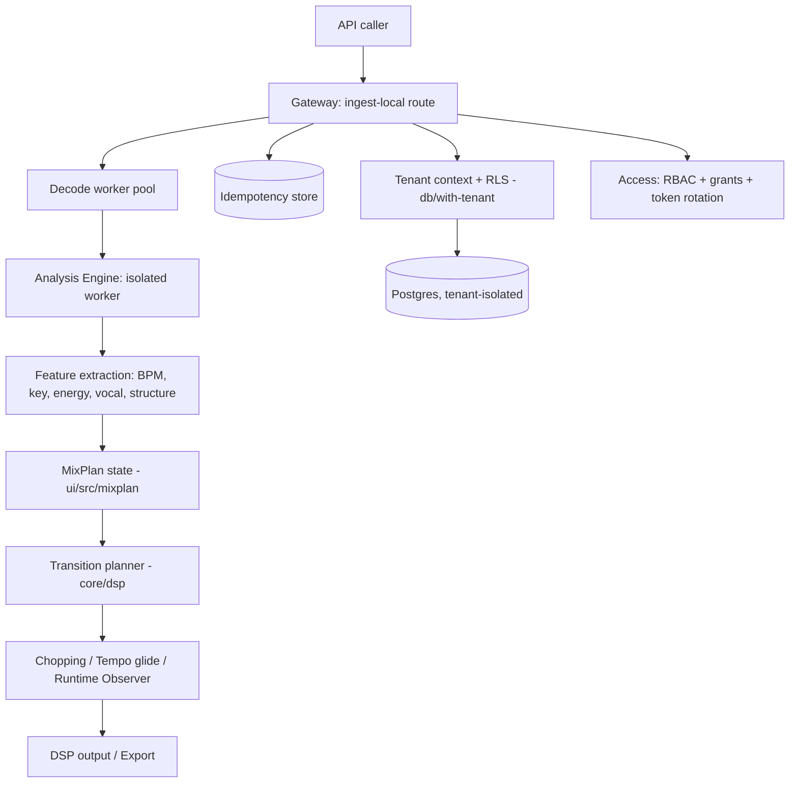

# OTOMIX — Technical Onboarding Summary
_Generated from disk state on 2026-11-23 21:08_

## 1. What this system is
OTOMIX is an automatic DJ mixing engine: it ingests audio tracks, analyzes them (BPM/grid/key/energy/vocal/structure), builds a mix plan between tracks, and renders real-time DSP transitions (tempo glide, chopping, EQ). It is a pnpm monorepo with 10 packages, branch 'P08', 417 commits, last commit: 2026-11-18 04:02:56 +0330 fix(book): test-stale no longer reverts green tiles (severity warn -> info).

## 2. Module map (from actual packages/* on disk)
| Package | Path | Source files | Purpose (from package.json) |
|---|---|---|---|
| access | packages\access | 17 | access package for OTOMIX platform |
| adapter | packages\adapter | 12 | adapter package for OTOMIX platform |
| contracts | packages\contracts | 5 | contracts package for OTOMIX platform |
| core | packages\core | 106 | core package for OTOMIX platform |
| db | packages\db | 9 | db package for OTOMIX platform |
| gateway | packages\gateway | 38 | gateway package for OTOMIX platform |
| proto | packages\proto | 2 | proto package for OTOMIX platform |
| testkit | packages\testkit | 0 |  |
| ui | packages\ui | 5 | ui package for OTOMIX platform |
| workers | packages\workers | 12 | workers package for OTOMIX platform |

```mermaid
graph LR
  adapter --> @otomix/contracts
  adapter --> @otomix/core
  contracts --> @otomix/access
  contracts --> @otomix/core
  contracts --> @otomix/db
  contracts --> @otomix/gateway
  core --> @otomix/db
  gateway --> @otomix/access
  gateway --> @otomix/core
  gateway --> @otomix/db
  workers --> @otomix/core
  workers --> @otomix/contracts
```

## 3. High-level architecture flow


## 4. Progress by phase (authoritative counts from tasks.json, not estimated)
| Phase | BLOCKED | CANCELLED | DEFERRED | DONE | SUPERSEDED | TODO | Total |
|---|---|---|---|---|---|---|---|
| P01 | 0 | 0 | 0 | 23 | 0 | 0 | 23 |
| P02 | 0 | 0 | 0 | 18 | 0 | 0 | 18 |
| P03 | 0 | 1 | 0 | 23 | 0 | 0 | 24 |
| P04 | 0 | 6 | 0 | 23 | 0 | 0 | 29 |
| P05 | 0 | 0 | 1 | 21 | 0 | 1 | 23 |
| P06 | 0 | 0 | 0 | 32 | 6 | 0 | 38 |
| P07 | 1 | 0 | 0 | 18 | 0 | 4 | 23 |
| P08 | 2 | 0 | 0 | 0 | 0 | 16 | 18 |
| P09 | 3 | 0 | 0 | 0 | 0 | 17 | 20 |
| P10 | 0 | 0 | 0 | 0 | 0 | 20 | 20 |
| P11 | 1 | 0 | 0 | 0 | 0 | 21 | 22 |

**Overall totals:**
- BLOCKED : 7
- CANCELLED : 7
- DEFERRED : 1
- DONE : 158
- SUPERSEDED : 6
- TODO : 79

## 5. Known gaps / blockers (from Supplement)

**Source:** `Docs\OtoMix Todo-Plan\OTOMIX_MicroTask_Plan_Supplement.md` — 35 items found.

### Open BLOCKERs (4)
- **[GAP-001]** (Phase: P05, P08) — Feature Registry 1.2 → 1.3 bump via BDC module
- **[GAP-004]** (Phase: P06) — Publisher/buyer authorization model blocked by OQ-10
- **[CONFLICT-006]** (Phase: P06) — Rule 25 tension: gate vs preference
- **[GAP-015]** (Phase: P06, P08, P09, P10, P11) — RBAC must be dynamic: permissions catalog + roles + direct grants + groups

### Other open items (HIGH / MEDIUM / ADVISORY) (21)
- [GAP-002] (ADVISORY, Phase: P05) — New Essentia features from BDC / Smart Setlist not in current P05 scope
- [GAP-003] (ADVISORY, Phase: P05) — Era/Year flow requires metadata not extractable by Essentia
- [CONFLICT-005] (HIGH, Phase: P06) — Vault client does not exist yet — P06-T01-S01-M01 relies on DI
- [CONFLICT-007] (HIGH, Phase: P08) — BDC schema uses `t_start`/`t_end` in seconds — Rule 26 tension
- [GAP-008] (HIGH, Phase: P08) — BDC REST endpoint introduces new scope + idempotency
- [GAP-009] (HIGH, Phase: P08) — BDC database schema change requires new migration
- [GAP-010] (ADVISORY, Phase: P08) — Smart Setlist proposes 10 features not scheduled in any phase
- [GAP-011] (ADVISORY, Phase: P09) — BDC failure matrix may affect Set persistence semantics
- [GAP-012] (MEDIUM, Phase: P10) — BDC adds four new metrics not in P10 registry
- [GAP-013] (MEDIUM, Phase: P11) — Determinism matrix does not include BDC-constrained pairings
- [CONFLICT-002] (HIGH, Phase: ALL) — Config name inconsistency: `AnalysisConfig` vs `AdminTuningConfig` vs `UserFacingConfig`
- [CONFLICT-003] (HIGH, Phase: ALL) — Plan header says "no task is DONE" but body has `DONE`/`[x]`
- [CONFLICT-004] (HIGH, Phase: ALL) — Plan status mismatch after OQ resolutions
- [CONFLICT-009] (MEDIUM, Phase: ALL) — Console encoding corruption in Match reports
- [GAP-014] (HIGH, Phase: ALL) — Dual deployment required: cloud AND local, implemented separately
- [GAP-016] (MEDIUM, Phase: P05, P06, P07) — Core imports `pg` but does not declare it (pre-existing)
- [GAP-017] (HIGH, Phase: P07) — `Logger` exposes only `.log(record)` — not `.warn/.info/.error`
- [GAP-018] (HIGH, Phase: P07) — `workers/src/pool.ts` has pre-existing unused-locals errors blocked by `@ts-nocheck`
- [GAP-019] (MEDIUM, Phase: ALL) — `sync-and-translate.ps1` hardcodes `git push origin P04`
- [GAP-020] (HIGH, Phase: P08) — No central UI binding matrix (UI element -> Redux slice -> catalog field -> Feature Registry)
- [GAP-029] (MEDIUM, Phase: P05) — Reference runner benchmark deferred for P05-T04-S01-M03

### Resolved (10)
- [GAP-007] (Phase: P07) — [RESOLVED] Consent-gated metadata enrichment (PII)
- [GAP-021] (Phase: P07, P10, P11) — [RESOLVED] `packages/core/dist` is ESM with extensionless relative imports
- [GAP-022] (Phase: P07, P10, P11) — [RESOLVED] Testcontainers parallelism + tight timeouts cause Step 6 flakes
- [GAP-023] (Phase: P07, P05) — [RESOLVED] M03 uses placeholder Feature Registry values
- [GAP-024] (Phase: P07) — [RESOLVED] Rate-limit defaults recorded from M04
- [GAP-025] (Phase: P07, P10, P11) — [RESOLVED] DLQ queue technology unspecified; Redis Streams chosen
- [GAP-026] (Phase: P07, P10) — [RESOLVED] DLQ handler registry not implemented; replay uses caller-provided handler
- [GAP-027] (Phase: P07, P08) — [RESOLVED] Registration methods (Gmail / Telegram / Phone OTP) not scheduled; owner mandates all three [BLOCKER]
- [GAP-028] (Phase: P07) — [RESOLVED] Plan says 'action', DDL uses 'scope'
- [GAP-030] (Phase: P05) — [RESOLVED] Enrichment Pipeline lives in core, not workers


## 6. Cross-check against plan-audit tool (if present)
Audit report found at: C:\Oto Dj - Oto Mix\Oto Mix\Docs\OtoMix Todo-Plan\OTOMIX_Audit_Report.md
Checks: 300 · Passed: 287 · Failed: 13
See file for the 13 known consistency failures (DONE tasks with superseded/cancelled prerequisites, duplicate IDs, tracker/branch mismatches).

## 7. What remains (plain language)
- P08 (MixPlan UI) — in progress, several sub-tasks still TODO/BLOCKED (see table above).
- P09 (XML Export, Set Shop, Publisher pages) — not started.
- P10 (Observability/Deploy) — not started.
- P11 (Hardening, determinism proof, load/pen testing) — not started.
- RBAC model (GAP-015) is mid-migration from static scopes to dynamic permissions — several DONE tasks depend on the now-superseded model and need re-validation.

## 8. Caveats for the new team
- DONE in tasks.json means 'a locator test file exists', not that behavior is verified — confirm with actual test runs.
- Some DONE tasks have CANCELLED/SUPERSEDED prerequisites (see plan-audit failures) — treat these as needing review, not trusted-complete.
- packages/core/dist has been manually patched per the P05 tracker; full 	sc --build reportedly fails — verify before building on this.


